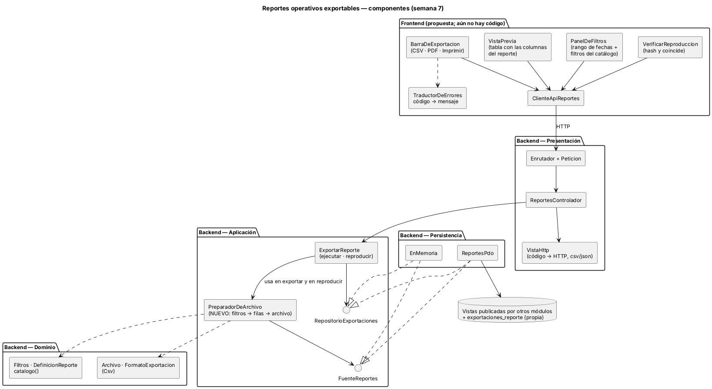
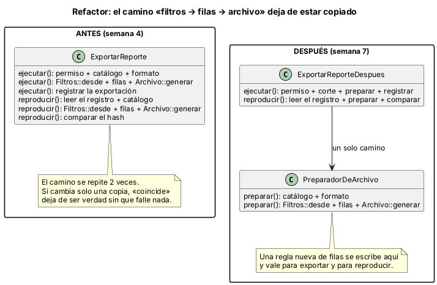
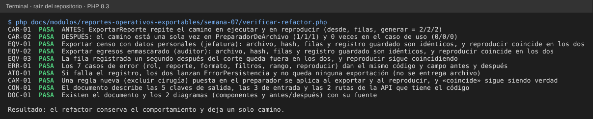

# Semana 7 — Componentes y refactor de «filtrado y exportación reproducible de un reporte operativo»

**Estudiante:** Joshua Eduardo García Reyes (`jgarciar73-svg`) · **Módulo:** Reportes operativos exportables y filtros administrativos (módulo 27, reasignado dentro del grupo G1)

Se parte del Micro-HIS de las semanas 3 y 4 (cuatro capas, puertos `RepositorioExportaciones` y `FuenteReportes`, adaptadores PDO y en memoria). Esta semana se dibujan los componentes de backend y de frontend, se fijan sus contratos y se refactoriza el punto más acoplado. El refactor es conceptual: vive en `ejemplo-refactor/` y no cambia el código del Micro-HIS.

## 1. Componentes

| Componente | Capa | Responsabilidad | Existe |
|---|---|---|---|
| `PanelDeFiltros` | Frontend | Pedir rango de fechas (obligatorio, máximo 92 días) y los filtros que permite el catálogo | Propuesta |
| `VistaPrevia` | Frontend | Mostrar la tabla con las columnas del reporte, con los datos personales enmascarados si el rol no los ve | Propuesta |
| `BarraDeExportacion` | Frontend | Botones CSV, PDF e Imprimir; imprimir usa la misma vista previa con estilos de impresión | Propuesta |
| `VerificarReproduccion` | Frontend | Pedir a la API que reproduzca una exportación y mostrar si el hash coincide | Propuesta |
| `ClienteApiReportes`, `TraductorDeErrores` | Frontend | Única puerta HTTP; código de error → mensaje y acción | Propuesta |
| `Enrutador`, `Peticion`, `ReportesControlador`, `VistaHttp` | Presentación | HTTP ↔ caso de uso; `VistaHttp` es el único mapa código → estado | Código (S4) |
| `ExportarReporte` (`ejecutar`, `reproducir`) | Aplicación | Permiso, corte, registro de la exportación y comparación del hash | Código (S4) |
| `PreparadorDeArchivo` | Aplicación | Camino único: catálogo → formato → filtros → filas → archivo | Nuevo (esta semana) |
| `Filtros`, `DefinicionReporte`, `catalogo()`, `Archivo`, `FormatoExportacion` (`Csv`) | Dominio | Reglas de filtros, columnas, enmascarado, orden estable y hash | Código (S4) |
| `ReportesPdo`, `EnMemoria` | Persistencia | Leer las vistas de otros módulos y guardar `exportaciones_reporte` | Código (S4) |

Solo existe el formato CSV. PDF es un `FormatoExportacion` nuevo (la extensión que se diseñó en la semana 2); imprimir no necesita backend. El frontend es una propuesta porque el Micro-HIS aún no tiene pantallas; flujos y mensajes concretos son de las semanas 8 a 10.

## 2. Contratos de entrada y salida

**API** (ya implementada en la semana 4):

| Ruta | Entrada | Salida |
|---|---|---|
| `GET /api/v1/reportes/{codigo}/exportar` | `codigo` en la ruta; `filtros` (`desde`, `hasta` y los del catálogo) y `formato` en la consulta | Archivo; cabeceras `X-Exportacion-Id` y `X-Reporte-Sha256` |
| `POST /api/v1/exportaciones/{id}/reproducir` | `id` de una exportación del mismo hospital | JSON con la comparación |

**Caso de uso** (lo que devuelve el código):

| Operación | Entrada | Salida |
|---|---|---|
| `ExportarReporte::ejecutar` | `codigo`, `filtros`, `formato` y el usuario | `id`, `hash`, `filas`, `contenido` |
| `ExportarReporte::reproducir` | `id` y el usuario | `id`, `coincide`, `hash` |

**Preparador** (nuevo): `PreparadorDeArchivo::preparar(codigo, filtros, formato, hospital, verDatosPersonales, corte)` devuelve el archivo y los filtros ya normalizados. No escribe nada. Errores: `reporte_no_encontrado`, `formato_no_soportado` y `filtro_invalido` (con el campo).

## 3. El punto de mayor acoplamiento

La reproducibilidad (CU-05) depende de que el archivo se arme **igual** al exportar y al reproducir. Hoy `ExportarReporte::ejecutar` y `ExportarReporte::reproducir` escriben por separado el mismo camino: normalizar filtros, pedir las filas a la fuente y generar el archivo con enmascarado, orden y hash (`CAR-01` lo cuenta: 2 veces cada pieza).

Consecuencias:

- Si una regla cambia en una copia y no en la otra (por ejemplo, una columna nueva, otro orden o una exclusión de filas), la exportación nueva sale bien pero al reproducirla `coincide` da `false`, sin que falle ninguna prueba hasta que alguien reproduzca una exportación.
- Además, un mismo método mezcla permiso, reloj, armado del archivo y registro, lo que dificulta probar cada parte.

## 4. Antes y después

| Aspecto | Antes (semana 4) | Después |
|---|---|---|
| Camino filtros → filas → archivo | 2 copias en `ExportarReporte` | 1 sola, en `PreparadorDeArchivo` |
| Regla nueva de filas | Editar 2 lugares | Un punto (`posproceso`) |
| Qué decide el caso de uso | Todo | Permiso, corte, registro y comparación |
| Archivo, hash y registro | Referencia | Idénticos (`EQV-01`, `EQV-02`, `EQV-03`) |
| Errores | Referencia | Mismos 7 casos con mismo código y campo (`ERR-01`) |
| Registrar antes de entregar | Sí | Igual (`ATO-01`) |

Código del después: `ejemplo-refactor/despues/ExportarReporte.php`.

## 5. Justificación

- **Una sola responsabilidad:** el preparador arma archivos; el caso de uso decide si se puede y qué se registra.
- **Abierto a cambios:** un formato nuevo (PDF) o una regla de filas nueva no tocan `ejecutar` ni `reproducir`.
- **Dependencias hacia adentro:** el preparador usa el puerto `FuenteReportes` y el dominio; no conoce PDO.
- **Qué no se hizo:** no se cambió la API, ni los puertos, ni el comportamiento observable; solo se movió el camino. Conectar el Micro-HIS al nuevo diseño queda para cuando el equipo lo apruebe.

## 6. Evidencia

`php docs/modulos/reportes-operativos-exportables/semana-07/verificar-refactor.php` (solo PHP; carga el Micro-HIS real y el ejemplo del después, con el repositorio en memoria y los datos de demostración). Ejecuta las mismas operaciones con el código de la semana 4 y con el nuevo, y compara resultados, registros y errores.

Se dañó el ejemplo a propósito y las 4 alteraciones se detectaron:

| Daño | Falla |
|---|---|
| `reproducir` usa otro corte que el guardado | `EQV-03` |
| `reproducir` ignora el enmascarado guardado | `EQV-02` |
| El preparador ignora la regla de filas nueva | `CAM-01` |
| El caso de uso vuelve a normalizar filtros por su cuenta | `CAR-02` |

## 7. Límites

- El refactor no está conectado al Micro-HIS; es un ejemplo ejecutable que prueba que el resultado es el mismo.
- El frontend es una propuesta de componentes; no hay pantallas ni formato PDF todavía.
- Las pruebas usan el repositorio en memoria con los datos de demostración; no se corrieron contra las vistas reales de otros módulos.
