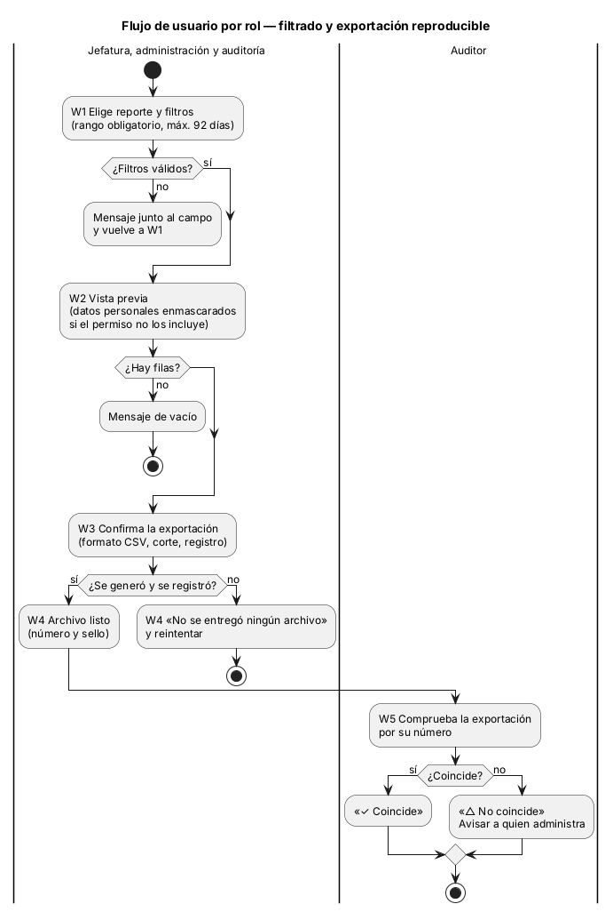
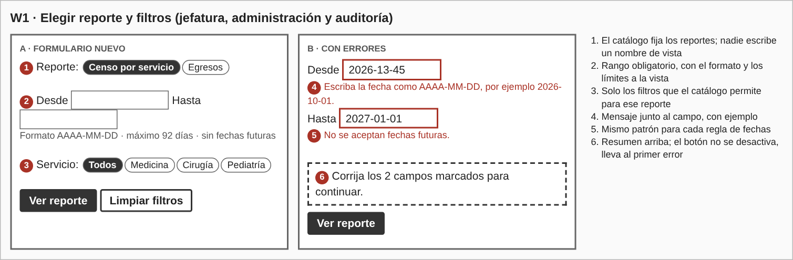
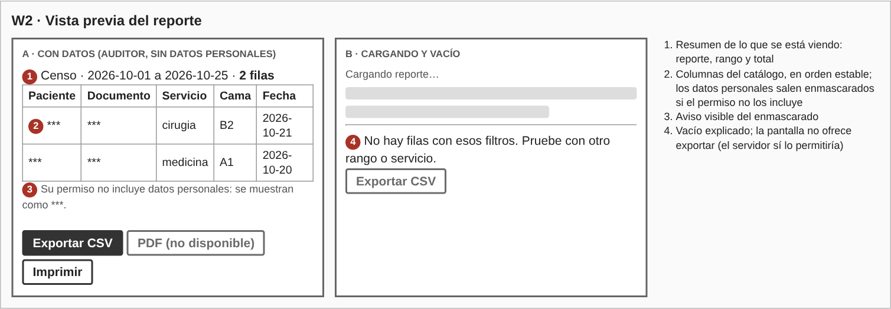
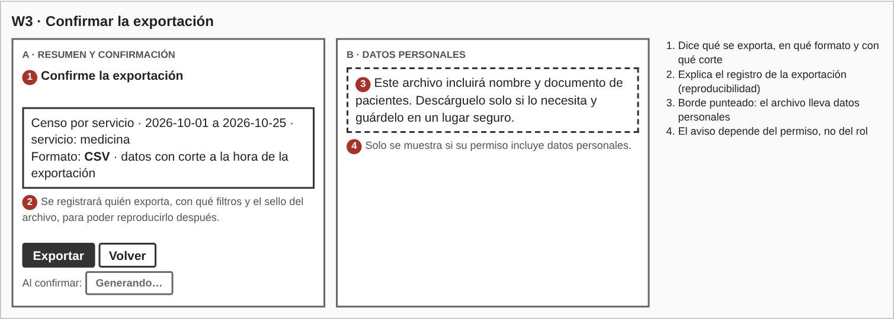
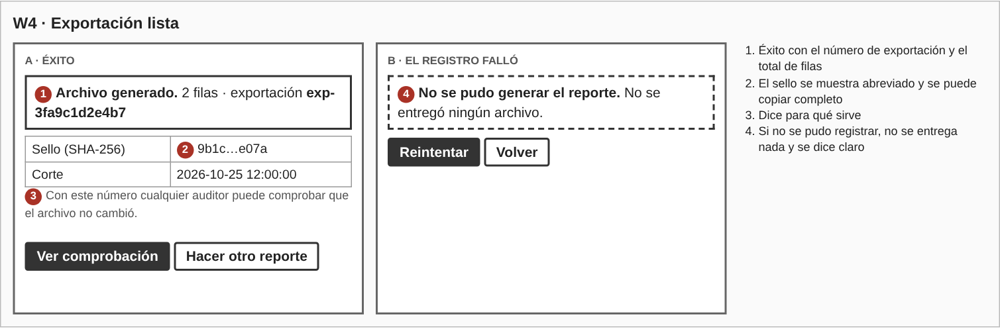
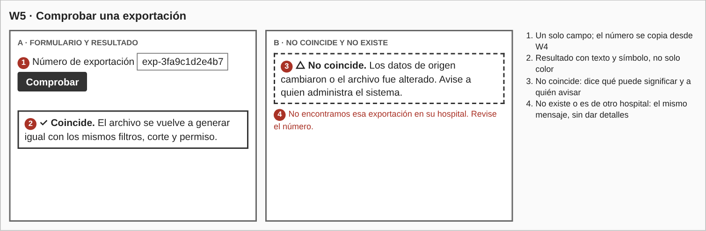
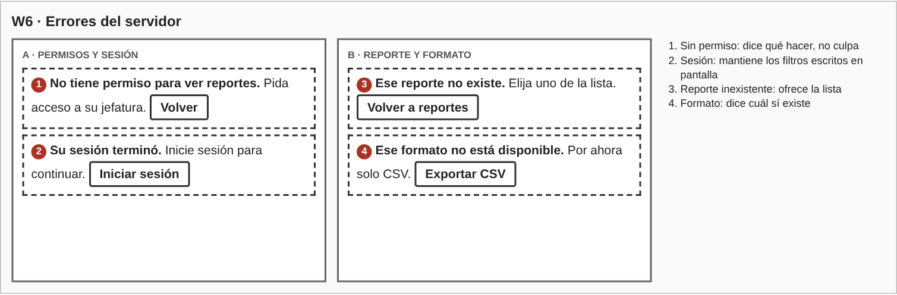
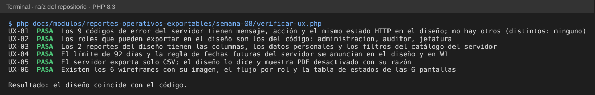

# Semana 8 — Diseño de experiencia de usuario de «filtrado y exportación reproducible de un reporte operativo»

**Estudiante:** Joshua Eduardo García Reyes (`jgarciar73-svg`) · **Módulo:** Reportes operativos exportables y filtros administrativos (módulo 27, reasignado dentro del grupo G1)

El flujo se diseña sobre lo que ya hace el Micro-HIS (semanas 3 y 4: catálogo de reportes, reglas de filtros, enmascarado y registro de exportaciones) y sobre los requisitos de la semana 2. Quien manda el contenido de cada mensaje es el servidor; la pantalla solo lo traduce a una frase que dice qué pasó y qué hacer.

## 1. Roles

| Acción | Jefatura | Administración | Auditoría | Base |
|---|---|---|---|---|
| Ver y exportar un reporte | Sí | Sí | Sí | CU-01, CU-03, `ExportarReporte::ejecutar` |
| Comprobar una exportación (reproducir) | Sí | Sí | Sí | CU-05, `ExportarReporte::reproducir` |

Cualquier otro rol recibe `acceso_denegado`. Todos ven solo datos de su hospital. Ver nombre y documento de los pacientes **no depende del rol sino del permiso del usuario** (`verDatosPersonales`): quien no lo tiene ve `***` en esas columnas, también en el archivo.

Observación: en el código, `reproducir` no revisa el rol, solo que la exportación sea del mismo hospital. El diseño la ofrece a los tres roles (el auditor es quien más la usa); si se quisiera limitarla al auditor habría que agregar la regla en el servidor.

## 2. Flujo de usuario por rol

- **Jefatura, administración y auditoría:** elige reporte y filtros → ve la vista previa → confirma la exportación → recibe el archivo con su número y sello.
- **Auditoría (y los demás roles):** escribe el número de una exportación y comprueba si se vuelve a generar igual.

**Decisiones del flujo.** Hay un paso de **confirmación** porque exportar deja un registro (quién, qué filtros, qué corte, qué sello) que no se borra, y porque el archivo puede llevar datos personales. El archivo se entrega solo después de registrarlo: si el registro falla, no se entrega nada. Tras confirmar, los botones se desactivan para no exportar dos veces. La vista previa (W2) y el botón «Imprimir» son propuestas: el servidor hoy solo ofrece la exportación CSV y su comprobación.

## 3. Wireframes

Los seis wireframes están en `wireframes/wireframes.html` (se abre en cualquier navegador); `wireframes/generar-png.js` genera las imágenes.

### 3.1 Reportes, columnas y filtros

| Reporte | Código | Columnas (marcadas: dato personal) | Filtro y valores |
|---|---|---|---|
| Censo por servicio | `censo` | paciente*, documento*, servicio, cama, fecha | `servicio`: medicina, cirugia, pediatria |
| Egresos | `egresos` | paciente*, documento*, tipo_alta, fecha | `tipo_alta`: medica, voluntaria, referencia, defuncion |

Reglas de los filtros (las valida el servidor; la pantalla las anuncia y las repite):

- El rango `desde` y `hasta` es obligatorio, con formato AAAA-MM-DD, `desde` menor o igual a `hasta`.
- Máximo 92 días de rango y no se aceptan fechas futuras.
- Solo se aceptan los filtros y valores de la tabla; todo se pasa a minúsculas y sin espacios.
- Los reportes y sus columnas los fija el catálogo; el usuario nunca escribe el nombre de una vista.

**Formatos.** Hoy solo existe **CSV**. PDF aparece desactivado con la razón; imprimir usa la vista previa con estilos de impresión.

### 3.2 Estados por pantalla

| Pantalla | Vacío | Carga | Éxito | Error |
|---|---|---|---|---|
| W1 Reporte y filtros | Campos en blanco con ayuda | — | Pasa a W2 | Mensaje junto al campo y resumen arriba |
| W2 Vista previa | «No hay filas con esos filtros» | «Cargando reporte…» | Tabla con total de filas | W6 |
| W3 Confirmación | — | «Generando…» | Pasa a W4 | W4b |
| W4 Exportación lista | — | — | Número, sello, filas y corte | «No se entregó ningún archivo» |
| W5 Comprobar | Campo en blanco | «Comprobando…» | «✓ Coincide» o «△ No coincide» | «No encontramos esa exportación» |
| W6 Errores | — | — | — | Un mensaje y una acción por código (§4) |

## 4. Mensajes de error (código → qué ve el usuario → qué puede hacer)

| Código | HTTP | Mensaje | Acción |
|---|---|---|---|
| `formato_no_soportado` | 400 | Ese formato no está disponible. Por ahora solo CSV. | Exportar CSV |
| `sin_sesion` | 401 | Su sesión terminó. Inicie sesión para continuar. | Iniciar sesión |
| `acceso_denegado` | 403 | No tiene permiso para ver reportes. Pida acceso a su jefatura. | Volver |
| `reporte_no_encontrado` | 404 | Ese reporte no existe. Elija uno de la lista. | Volver a reportes |
| `exportacion_no_encontrada` | 404 | No encontramos esa exportación en su hospital. Revise el número. | Corregir el número |
| `ruta_no_encontrada` | 404 | Algo salió mal. Intente de nuevo; si sigue, avise a soporte. | Volver |
| `metodo_no_permitido` | 405 | Algo salió mal. Intente de nuevo; si sigue, avise a soporte. | Volver |
| `filtro_invalido` | 422 | Mensaje según el campo: fecha mal escrita, rango de más de 92 días, fecha futura o filtro no permitido. | Corregir el campo marcado |
| `error_persistencia` | 500 | No se pudo generar el reporte. No se entregó ningún archivo. | Reintentar |

`filtro_invalido` trae el campo (`desde`, `hasta` o el nombre del filtro) para marcar el que falla. `exportacion_no_encontrada` se muestra igual si la exportación no existe o es de otro hospital, para no dar pistas.

## 5. Ayuda contextual y protección de datos

- **Ayuda:** formato y límites de fechas visibles junto a los campos; la confirmación explica qué se registra; el resultado explica para qué sirve el número y el sello.
- **Datos personales:** por defecto salen enmascarados; si el permiso los incluye, la confirmación advierte que el archivo los lleva (W3b).
- **Datos en el navegador:** los filtros viven solo en pantalla; no se guardan en `localStorage` ni en cookies. Los datos del reporte no van en la URL ni en el título de la pestaña.
- **Permisos:** el servidor vuelve a comprobar rol, hospital y permiso de datos personales en cada petición.

## 6. Trazabilidad

| Requisito | Dónde se atiende |
|---|---|
| CU-01, CU-02 (consultar con filtros y validarlos) | W1, W2, §3.1 |
| CU-03, CU-04 (exportar y registrar) | W3, W4 |
| CU-05 (reproducir) | W5 |
| CU-06 (enmascarar datos personales) | W2, W3b |
| Rango máximo de 92 días | W1, §3.1 |
| Mensajes con código estable | §4 |

## 7. Evidencia

`php docs/modulos/reportes-operativos-exportables/semana-08/verificar-ux.php` (solo PHP; lee el código del Micro-HIS y este documento). Comprueba que los códigos de error y sus estados HTTP, los roles, los reportes con sus columnas y filtros, el límite de 92 días y los formatos de este diseño coinciden con el código, y que los wireframes existen.

Se dañó el diseño a propósito y las 5 alteraciones se detectaron:

| Daño | Falla |
|---|---|
| Se borra el mensaje de `exportacion_no_encontrada` | `UX-01` |
| Auditoría deja de poder exportar en el diseño | `UX-02` |
| Se quita una columna del reporte de egresos | `UX-03` |
| El rango máximo pasa de 92 a 90 días | `UX-04` |
| Se borra una de las imágenes de los wireframes | `UX-06` |

## 8. Límites

- Son wireframes de baja fidelidad para escritorio; la evaluación de usabilidad y accesibilidad es de la semana 9 y la adaptación a móvil, de la semana 10.
- Los textos no se probaron con usuarios reales.
- La vista previa (W2), imprimir y el formato PDF son propuestas: el Micro-HIS actual solo exporta CSV y no tiene una consulta de vista previa.
