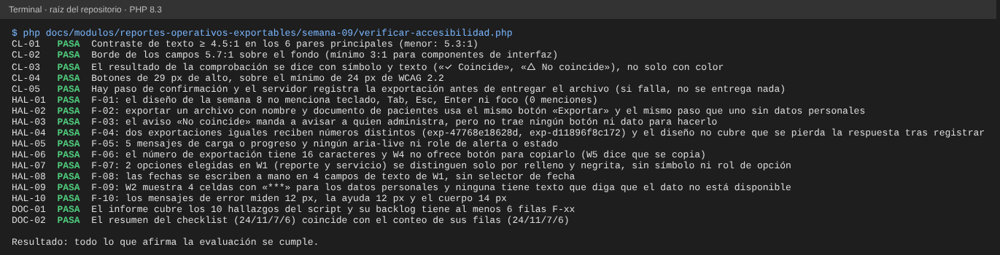

# Semana 9 — Evaluación de usabilidad y accesibilidad de «filtrado y exportación reproducible de un reporte operativo»

**Estudiante:** Joshua Eduardo García Reyes (`jgarciar73-svg`) · **Módulo:** Reportes operativos exportables y filtros administrativos (módulo 27, reasignado dentro del grupo G1)

Se evalúa el diseño de la semana 8 (flujo por rol, 6 wireframes `W1` a `W6` y 9 mensajes de error) con las 10 heurísticas de Nielsen y los criterios de WCAG 2.2 nivel AA que se pueden juzgar sobre un wireframe: teclado, foco, contraste, etiquetas, mensajes y prevención de errores. Todavía no hay pantalla programada, así que se evalúa el diseño, no un producto; los hallazgos son lo que hay que corregir **antes** de programarla.

Cómo se priorizó: el impacto se mide por lo que puede pasar con los datos. Sacar del sistema un archivo con nombre y documento de pacientes, no poder actuar cuando una exportación ya no coincide o no poder usar el flujo sin ratón pesa más que un texto pequeño.

| Prioridad | Significado |
|---|---|
| Alta | Puede sacar datos personales sin que la persona lo note, dejar sin salida a quien detecta una alteración o impedir el uso a quien no usa ratón |
| Media | Obliga a repetir trabajo, ensucia el registro de exportaciones o confunde, pero el dato queda bien |
| Baja | Molestia o incumplimiento menor que no cambia el dato |

## 1. Checklist completado

Se marca **Cumple**, **Parcial** o **No cumple** según lo que dicen el documento y los wireframes de la semana 8.

### 1.1 Heurísticas de usabilidad (Nielsen)

| N.º | Heurística | Resultado | Evidencia |
|---|---|---|---|
| H1 | Visibilidad del estado | Cumple | Estados vacío, carga, éxito y error por pantalla (§3.2 de la semana 8) |
| H2 | Lenguaje cercano al usuario | Cumple | Mensajes en español claro; «exportación», «sello», no códigos |
| H3 | Control y libertad | Parcial | Hay «Volver» y «Limpiar filtros», pero si se pierde la respuesta no hay salida clara (F-04) |
| H4 | Consistencia | Cumple | Mismo patrón de mensaje y acción en los 9 códigos; mismos botones en todas las pantallas |
| H5 | Prevención de errores | Parcial | Los límites de fecha se anuncian, pero se escriben a mano; la exportación con datos personales se confirma igual que la otra (F-02, F-08) |
| H6 | Reconocer en vez de recordar | Parcial | El número de exportación hay que copiarlo a mano de W4 a W5 (F-06) |
| H7 | Flexibilidad y eficiencia | No cumple | No se define uso con teclado (F-01) |
| H8 | Diseño minimalista | Cumple | Una acción principal por pantalla |
| H9 | Ayudar a recuperarse de errores | Parcial | «No coincide» no ofrece cómo avisar; no se cubre la respuesta perdida (F-03, F-04) |
| H10 | Ayuda y documentación | Cumple | La confirmación explica qué se registra y la exportación lista, para qué sirve el sello |

### 1.2 Accesibilidad (WCAG 2.2 AA)

| Criterio | Tema | Resultado | Evidencia |
|---|---|---|---|
| 1.3.1 | Información y relaciones | No cumple | Opciones sin rol de opción y celdas «***» sin texto que las explique (F-07, F-09) |
| 1.4.1 | Uso del color | Parcial | El resultado de comprobar va en texto y símbolo; la opción elegida solo por relleno (F-07) |
| 1.4.3 | Contraste del texto (4.5:1) | Cumple | Los 6 pares principales cumplen (menor: 5.3:1) |
| 1.4.11 | Contraste de componentes (3:1) | Cumple | Borde de campos 5.7:1 |
| 2.1.1 | Teclado | No cumple | El diseño no menciona teclado (F-01) |
| 2.4.3 | Orden del foco | No cumple | No se define adónde va el foco (F-01) |
| 2.4.7 | Foco visible | No cumple | No se define el estilo de foco (F-01) |
| 2.5.8 | Tamaño del objetivo (24 px) | Cumple | Botones de 29 px de alto |
| 3.2.2 | Al introducir datos | Cumple | Nada se envía sin confirmar |
| 3.3.1 | Identificación de errores | Cumple | Mensaje junto al campo, resumen arriba y mensaje por código |
| 3.3.2 | Etiquetas o instrucciones | Cumple | Formato y límites de fecha visibles junto a los campos |
| 3.3.3 | Sugerencia ante errores | Parcial | «No coincide» dice a quién avisar pero no da cómo (F-03) |
| 3.3.4 | Prevención de errores (datos) | Parcial | Hay confirmación, pero igual con y sin datos personales (F-02) |
| 4.1.3 | Mensajes de estado | No cumple | Cargas, progreso y errores no se anuncian a un lector de pantalla (F-05) |

Resumen: de 24 puntos, 11 cumplen, 7 cumplen en parte y 6 no cumplen. Los 6 que no cumplen salen de cuatro hallazgos: F-01 (H7, 2.1.1, 2.4.3 y 2.4.7), F-05 (4.1.3) y F-07 y F-09 (1.3.1).

## 2. Hallazgos con evidencia

Cada hallazgo se reproduce con `verificar-accesibilidad.php`; la columna «Prueba» es el ID que imprime.

| Hallazgo | Prueba | Qué se encontró | Dónde |
|---|---|---|---|
| F-01 | HAL-01 | El diseño no menciona teclado, Tab, Esc, Enter ni foco (0 menciones): no se define el orden de recorrido ni dónde queda el foco al abrir la confirmación, al fallar un campo o al ver el resultado | `semana-08-diseno-ux.md`, `wireframes.html` |
| F-02 | HAL-02 | La confirmación de W3 tiene un solo botón «Exportar», igual para un archivo sin datos personales que para uno con nombre y documento de pacientes; el aviso de W3b es solo un recuadro de texto. Un archivo exportado sale del sistema y ya no se controla | W3 |
| F-03 | HAL-03 | Cuando una exportación ya no coincide, W5b dice «Avise a quien administra el sistema», pero no hay botón, enlace ni dato listo para copiar. Es el resultado más grave que ve el auditor y la pantalla no lo deja actuar | W5 |
| F-04 | HAL-04 | El script exporta dos veces con los mismos filtros y obtiene dos números distintos con el mismo sello. Si la respuesta se pierde después de que el servidor registró la exportación, quien reintenta deja una exportación huérfana; ni el diseño ni la lista de mensajes cubren el caso | W4, §4 de la semana 8 |
| F-05 | HAL-05 | «Cargando reporte…», «Generando…» y «Comprobando…» (5 apariciones entre el documento y los wireframes), igual que los errores, no se anuncian al lector de pantalla; no hay `aria-live` ni `role` de alerta o estado | W2, W3, W5, W6 |
| F-06 | HAL-06 | El número tiene 16 caracteres (`exp-` y 12 hexadecimales). W5 anota que «se copia desde W4», pero W4 no dibuja ningún botón «Copiar»; hay que teclearlo a mano | W4, W5 |
| F-07 | HAL-07 | Reporte y servicio son opciones que se distinguen por relleno oscuro y negrita; no tienen símbolo ni se declaran como grupo de opciones | W1 |
| F-08 | HAL-08 | Las fechas (4 campos entre W1a y W1b) se escriben a mano en formato AAAA-MM-DD; no hay selector de fecha. Todo el control de errores recae en el mensaje posterior | W1 |
| F-09 | HAL-09 | Con permiso sin datos personales, 4 celdas de W2 muestran solo «***». Un lector las lee como «asterisco asterisco asterisco» y no dice que el dato no está disponible | W2 |
| F-10 | HAL-10 | Los mensajes de error y la ayuda del formato miden 12 px y el cuerpo 14 px: lo que explica cómo corregir es lo más pequeño | todos |

Lo que sí se midió y cumple: `CL-01` (contraste ≥ 4.5:1 en 6 pares, el menor 5.3:1), `CL-02` (borde de campos 5.7:1), `CL-03` (la comprobación se dice con símbolo y texto), `CL-04` (botones de 29 px) y `CL-05` (hay confirmación y el servidor registra antes de entregar, así que si falla no se entrega nada).

## 3. Backlog priorizado

Ordenado por prioridad y, dentro de ella, por esfuerzo. «Criterio verificable» es lo que debe poder comprobar quien revise la corrección.

| Hallazgo | Prioridad | Corrección propuesta | Criterio verificable | Semana |
|---|---|---|---|---|
| F-03 | Alta | En «No coincide», agregar el botón «Copiar detalles» (número, sello guardado, sello nuevo y hora) y el texto «Envíe estos datos a quien administra el sistema» | Con un resultado «No coincide» hay un botón que deja los 4 datos en el portapapeles; el aviso ya no termina en una frase sin acción | 11 |
| F-02 | Alta | Cuando el archivo lleva datos personales, el botón dice «Exportar con datos personales» y pide marcar «Entiendo que el archivo contiene nombre y documento»; sin ese permiso queda como está | El botón de W3b está desactivado hasta marcar la casilla; el de un archivo sin datos personales no la pide | 11 |
| F-01 | Alta | Definir el orden de Tab igual al visual; Enter confirma, Esc cierra la confirmación; foco visible de 2 px; el foco pasa al resumen de errores en W1, al título de la confirmación en W3 y al resultado en W5; el resumen enlaza a cada campo con error | Recorrer W1 a W6 solo con teclado sin ratón: el foco siempre se ve y nunca queda atrapado | 11 |
| F-04 | Media | Mensaje nuevo «No recibimos respuesta. Puede que la exportación se haya registrado; no se entregó el archivo» y botón «Exportar de nuevo» que avisa que se creará otro número | Simular respuesta perdida: aparece ese mensaje y no el de `error_persistencia`; el nuevo número se muestra con el aviso | 10 |
| F-05 | Media | Cargas y progreso en una región `role="status"`; errores en `role="alert"` | El lector anuncia el mensaje al aparecer, sin mover el foco; todo mensaje de carga o error lleva esa marca | 11 |
| F-06 | Media | Botón «Copiar número» junto al número en W4 y el campo de W5 acepta pegar con o sin espacios | W4 tiene el botón; pegar el número copiado en W5 comprueba sin teclear | 11 |
| F-07 | Media | Las opciones son un grupo de opciones (`role="radiogroup"` con `aria-checked`) y la elegida lleva el símbolo ✓ además del relleno | El lector dice «Censo por servicio, elegida»; el conteo de opciones elegidas sin símbolo es 0 | 11 |
| F-08 | Media | Usar un campo de fecha con el selector del navegador, con `max` en la fecha de hoy y el formato como ayuda; el servidor sigue validando | Se puede elegir la fecha sin teclearla y no se puede elegir una fecha futura; `HAL-08` pasa a FALLA | 11 |
| F-09 | Baja | Las celdas enmascaradas llevan texto oculto «No disponible por permiso» además de los asteriscos | El lector dice «No disponible por permiso»; ninguna celda tiene solo asteriscos | 11 |
| F-10 | Baja | Mensajes de error y ayuda de 14 px como mínimo (16 px en móvil) | El tamaño de `.t` y `.hint` es ≥ el del cuerpo; `HAL-10` pasa a FALLA | 10 |

Cuando se corrija un hallazgo, la prueba `HAL-xx` pasa a FALLA a propósito: ya no se cumple lo que el informe afirma, y hay que actualizar el informe junto con la corrección.

## 4. Evidencia

`php docs/modulos/reportes-operativos-exportables/semana-09/verificar-accesibilidad.php` (solo PHP; lee los wireframes y el documento de la semana 8, ejecuta el servicio del Micro-HIS en memoria y calcula los contrastes según la fórmula de WCAG). Imprime `CL-01..05` (lo que cumple), `HAL-01..10` (los hallazgos), `DOC-01` (que este informe los cubra) y `DOC-02` (que el resumen del checklist coincida con sus filas). Sale con código 0 si todo se cumple y 1 si algo no.

Se alteró el diseño, el código o el informe a propósito y las 5 alteraciones se detectaron:

| Alteración | Falla |
|---|---|
| El texto de ayuda pasa a gris claro `#aaaaaa` | `CL-01` |
| Se agrega «Tab» y «foco visible» al documento de la semana 8 | `HAL-01` |
| Se agrega un botón «Copiar» a W4 | `HAL-06` |
| La ayuda pasa a 14 px | `HAL-10` |
| Se borra la fila F-09 de la tabla de hallazgos del informe | `DOC-01` |

## 5. Límites

- Se evaluó el diseño, no una pantalla real: no se probó con un lector de pantalla ni con personas usuarias. Los criterios que dependen del código (nombre accesible, orden real del foco) se evalúan por lo que el diseño dice o no dice.
- El contraste se calculó sobre los colores de los wireframes; el color final puede cambiar.
- F-04 se probó contra el servicio en memoria (dos exportaciones iguales dan números distintos); la pérdida de la respuesta en la red no se simuló.
- La vista previa (W2), imprimir y el formato PDF son propuestas de la semana 8; el Micro-HIS actual solo exporta CSV y no tiene una consulta de vista previa. Los hallazgos de W2 se refieren a ese diseño propuesto.
- Las mediciones de tamaño salen del CSS de los wireframes de escritorio; la adaptación a móvil es de la semana 10.
- No se evaluó el tamaño de texto al ampliar al 200 %.
