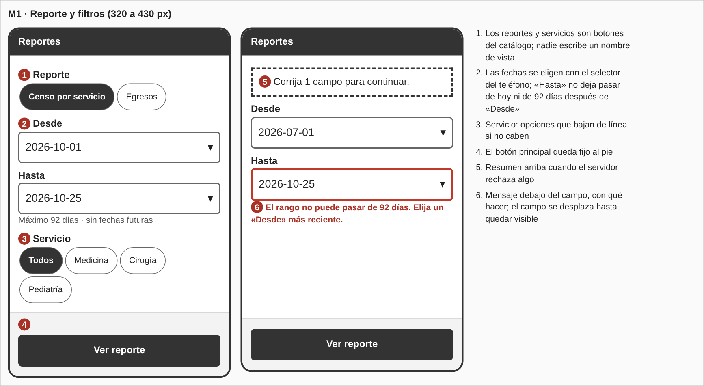
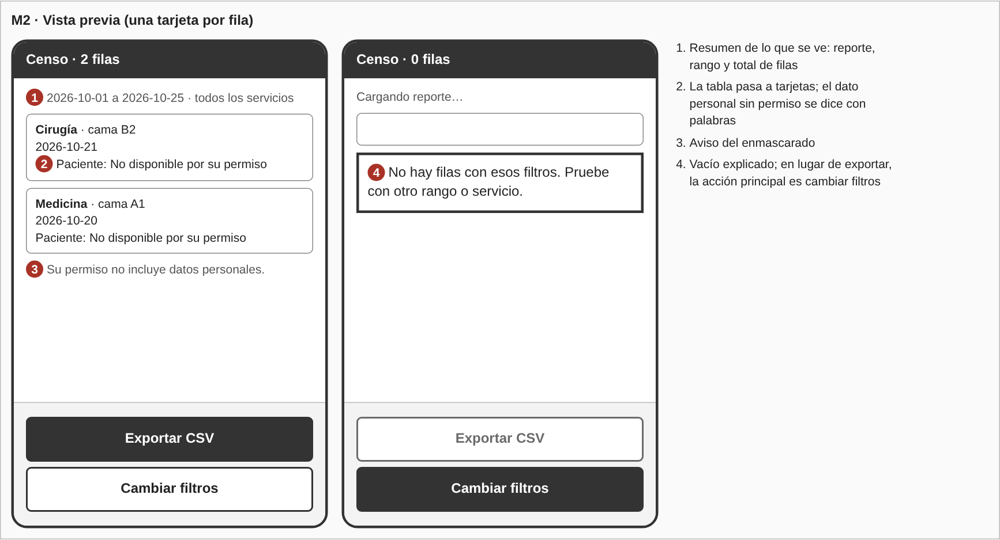
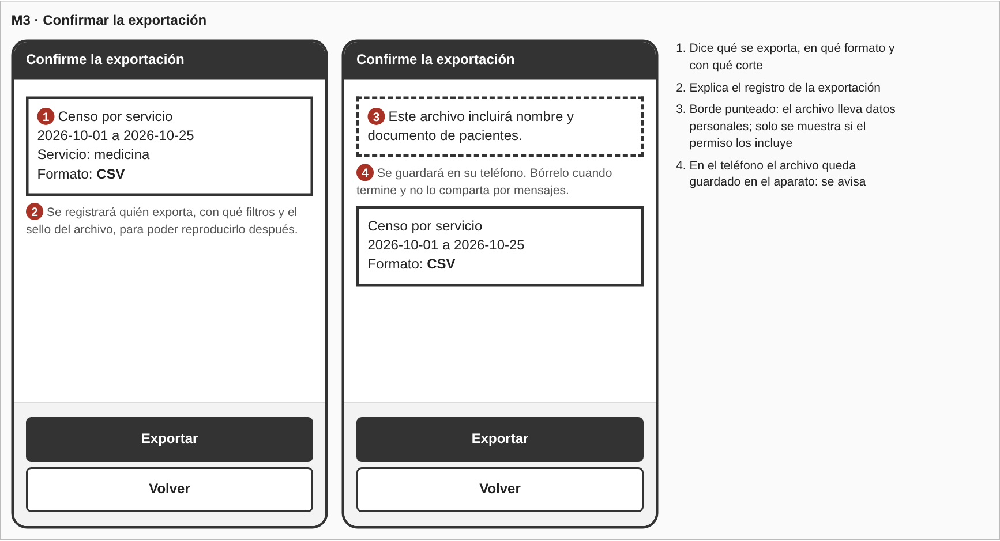
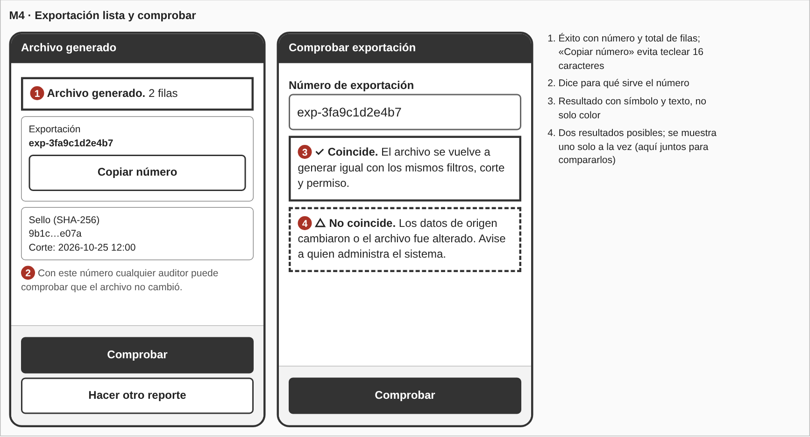
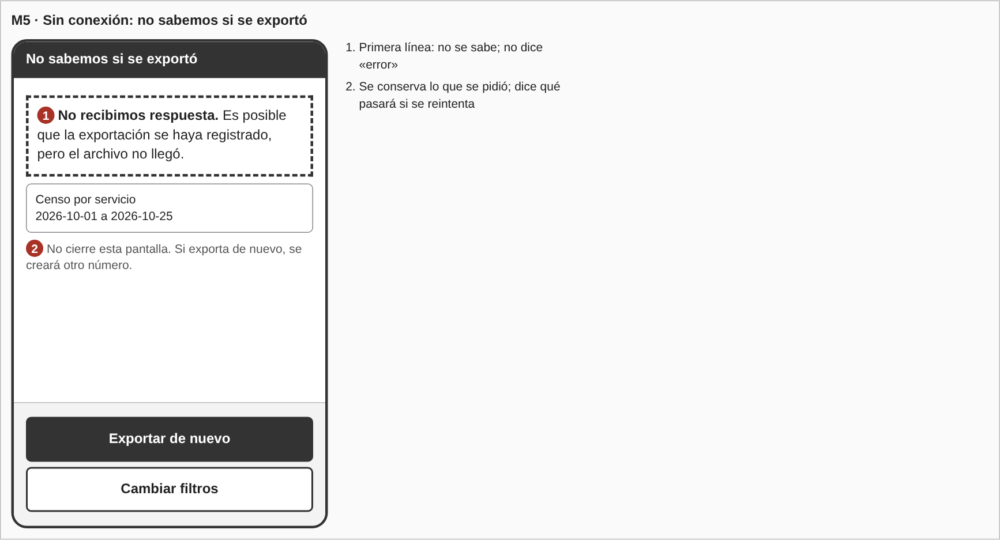
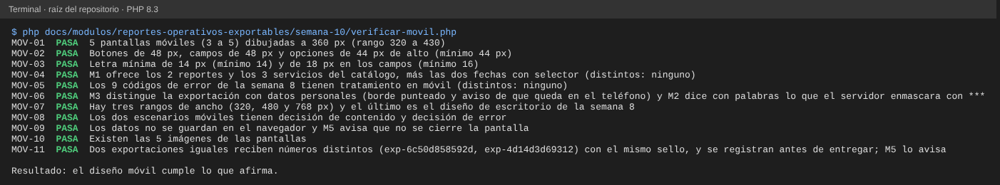

# Semana 10 — Diseño para móvil de «filtrado y exportación reproducible de un reporte operativo»

**Estudiante:** Joshua Eduardo García Reyes (`jgarciar73-svg`) · **Módulo:** Reportes operativos exportables y filtros administrativos (módulo 27, reasignado dentro del grupo G1)

Se adapta a móvil (320 a 430 px de ancho) el flujo diseñado en la semana 8 para escritorio: roles, catálogo de reportes, reglas de filtros, enmascarado y mensajes de error no cambian; cambia cómo se distribuyen. Una jefatura o un auditor que mira un reporte desde el teléfono suele hacerlo entre otras tareas, con poco tiempo y con una conexión que puede cortarse, así que se prioriza elegir, confirmar y comprobar con pocos toques.

## 1. Qué cambia respecto al escritorio

| Tema | Escritorio (semana 8) | Móvil |
|---|---|---|
| Filtros | Campos de texto en fila con el formato AAAA-MM-DD | Un campo por línea con el selector de fecha del teléfono; «Hasta» no deja pasar de hoy ni de 92 días después de «Desde» |
| Opciones (reporte, servicio) | Botones pequeños en línea | Botones de 44 px que bajan de línea |
| Vista previa | Tabla de columnas | Una tarjeta por fila con servicio, cama y fecha |
| Dato personal sin permiso | `***` en la columna | Se escribe con palabras: «No disponible por su permiso» |
| Acción principal | Botón junto al contenido | Botón a ancho completo, fijo al pie |
| Número de exportación | Se copia a mano | Botón «Copiar número» |
| Errores | Mensaje junto al campo y resumen | Igual; el campo con error se desplaza hasta quedar visible |

## 2. Pantallas propuestas (5)

Los wireframes están en `wireframes-movil/moviles.html` (a 360 px; `generar-png.js` genera las imágenes).

| Pantalla | Qué se ve primero | Acción principal | Equivale a (semana 8) |
|---|---|---|---|
| M1 Reporte y filtros | Los reportes del catálogo | Ver reporte | W1 |
| M2 Vista previa | Reporte, rango y total de filas | Exportar CSV (o cambiar filtros si no hay filas) | W2 |
| M3 Confirmar | Qué se exporta, formato y corte | Exportar | W3 |
| M4 Exportación lista y comprobar | «Archivo generado» y el número de exportación; en la otra mitad, el resultado de comprobar | Comprobar | W4, W5 |
| M5 Sin conexión | «No sabemos si se exportó» | Exportar de nuevo | W4b (`error_persistencia`) |

La vista previa (M2), imprimir y el formato PDF son propuestas de la semana 8: el Micro-HIS solo exporta CSV y no tiene una consulta de vista previa. Los errores de servidor (W6) se ven en móvil con el recuadro a ancho completo de M5; no se dibujan aparte para no pasar de 5 pantallas.

## 3. Reglas de breakpoint

| Ancho | Diseño |
|---|---|
| 320 a 479 px | Base. Una columna, tarjetas y botón fijo al pie. El contenido útil mide 288 px (320 menos 16 px de margen a cada lado) |
| 480 a 767 px | La misma pantalla con la columna centrada, de 480 px como máximo; «Desde» y «Hasta» caben en una sola fila |
| 768 px o más | Diseño de escritorio de la semana 8 (tabla de columnas y filtros en fila) |

Reglas generales:

- Se diseña desde 320 px hacia arriba; no hay desplazamiento horizontal. Si un texto no cabe, baja a otra línea.
- Todo objeto que se toca mide al menos 44 px de alto (botones y opciones de 44 a 48 px, campos de 48 px).
- Ningún texto menor de 14 px; en los campos de entrada, 18 px.
- Una sola acción principal por pantalla, fija al pie; la secundaria va debajo.
- Exportar siempre pasa por M3; un solo toque nunca saca un archivo del sistema.
- La orientación horizontal no tiene diseño propio (ver límites).

## 4. Escenario 1: rango demasiado largo desde el teléfono

La jefatura elige Censo, «Desde» 2026-07-01 y «Hasta» 2026-10-25 (117 días). Recorre M1 → (rechazo) → M1.

- **Decisión de contenido:** M1 pone solo lo que hace falta: reporte, rango y servicio. Los límites («máximo 92 días · sin fechas futuras») van debajo de «Hasta», donde se necesitan, y el selector ya impide fechas futuras.
- **Decisión de error:** si llega `filtro_invalido` con `hasta`, M1 se vuelve a mostrar con un resumen arriba («Corrija 1 campo para continuar»), el campo «Hasta» con borde grueso y el mensaje debajo: «El rango no puede pasar de 92 días. Elija un «Desde» más reciente.» Los demás valores se conservan, el campo se desplaza hasta quedar visible y el botón principal sigue activo.

## 5. Escenario 2: conexión limitada al exportar

La persona confirma en M3 y la red se cae. Recorre M3 → M5.

- **Decisión de contenido:** M5 dice en la primera línea «No recibimos respuesta» y no «error»; deja a la vista qué se había pedido (reporte y rango). Esos datos viven solo en la pantalla: no se guardan en el almacenamiento del navegador (semana 8, §5).
- **Decisión de error:** el servidor registra la exportación antes de entregar el archivo. Si la respuesta se pierde después de registrar, la exportación existe pero el archivo no llegó, y exportar de nuevo crea **otra** exportación con otro número y el mismo sello. M5 lo dice antes de que la persona toque: «Si exporta de nuevo, se creará otro número.» El reintento es manual. No existe una lista de exportaciones propias para revisar antes; si se quisiera, sería un servicio nuevo y queda como propuesta.
- Distinto es `error_persistencia` (500): ahí el servidor sí respondió y dijo que no entregó ningún archivo. El texto de M5 cambia a «No se pudo generar el reporte. No se entregó ningún archivo.» y el botón pasa a «Reintentar».

## 6. Mensajes de error en móvil

Los textos son los de la semana 8 (§4); aquí solo cambia dónde se ven.

| Código | HTTP | Cómo se ve en móvil | Pantalla |
|---|---|---|---|
| `formato_no_soportado` | 400 | Aviso «Por ahora solo CSV» con «Exportar CSV» | M3 |
| `sin_sesion` | 401 | Pantalla de inicio de sesión; al volver, M1 con los filtros si no se cerró la página | M1 |
| `acceso_denegado` | 403 | Aviso con «Volver», sin mostrar datos | M1 |
| `reporte_no_encontrado` | 404 | Aviso «Ese reporte no existe» con «Volver a reportes» | M1 |
| `exportacion_no_encontrada` | 404 | Mensaje debajo del campo de comprobar, igual si no existe o es de otro hospital | M4 |
| `ruta_no_encontrada` | 404 | Aviso genérico con «Volver» | M1 |
| `metodo_no_permitido` | 405 | Aviso genérico con «Volver» | M1 |
| `filtro_invalido` | 422 | Campo con borde grueso y mensaje debajo; el resumen arriba | M1 |
| `error_persistencia` | 500 | Aviso «No se entregó ningún archivo» con «Reintentar» | M5 |

## 7. Trazabilidad

| Requisito | Dónde se atiende |
|---|---|
| CU-01, CU-02 (consultar con filtros y validarlos) | M1, M2, escenario 1 |
| CU-03, CU-04 (exportar y registrar) | M3, M5, escenario 2 |
| CU-05 (reproducir) | M4 |
| CU-06 (enmascarar datos personales) | M2, M3 |
| Rango máximo de 92 días | M1, escenario 1 |
| Mensajes con código estable | §6 |

## 8. Evidencia

`php docs/modulos/reportes-operativos-exportables/semana-10/verificar-movil.php` (solo PHP; lee los wireframes móviles, el catálogo y el servicio del Micro-HIS y los documentos de la semana 8 y de esta). Comprueba el número de pantallas y su ancho, el tamaño de botones, opciones y campos, que los servicios de M1 sean los del catálogo, que los 9 códigos de error tengan tratamiento móvil, que M3 distinga la exportación con datos personales, los breakpoints, los dos escenarios, que los datos no se guarden en el navegador, que dos exportaciones iguales reciban números distintos (por eso M5 avisa) y que las imágenes existan.

Se dañó el diseño o el código a propósito y las 6 alteraciones se detectaron:

| Daño | Falla |
|---|---|
| Un botón pasa a `min-height:36px` | `MOV-02` |
| Se quita la opción «Pediatría» de M1 | `MOV-04` |
| Se borra la fila de `formato_no_soportado` | `MOV-05` |
| Se quita el aviso «Se guardará en su teléfono» de M3 | `MOV-06` |
| El texto de ayuda pasa a 12 px | `MOV-03` |
| El servidor genera siempre el mismo número de exportación | `MOV-11` |

## 9. Límites

- Son wireframes de baja fidelidad a 360 px; no se probaron en un dispositivo ni con personas usuarias.
- No hay diseño propio para orientación horizontal ni para tabletas más allá de la regla de 480 a 767 px.
- La vista previa, imprimir, el formato PDF y el selector de fecha con tope son propuestas; el Micro-HIS actual no los tiene (el servidor sigue validando el rango).
- Escribir el dato enmascarado con palabras es una decisión de la pantalla móvil; el archivo exportado sigue llevando `***`.
- Cómo se abre o comparte un CSV en el teléfono depende del sistema operativo; el diseño solo avisa que queda guardado en el aparato.
- Los hallazgos de usabilidad y accesibilidad de la semana 9 no se aplican aquí; este diseño parte del de la semana 8.
