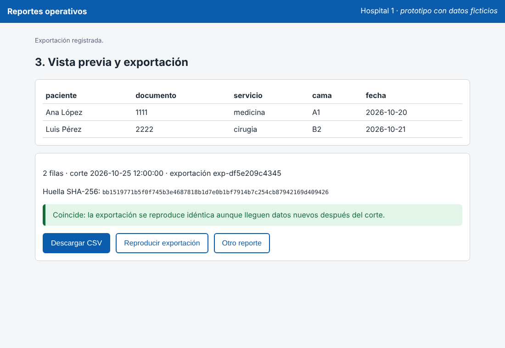
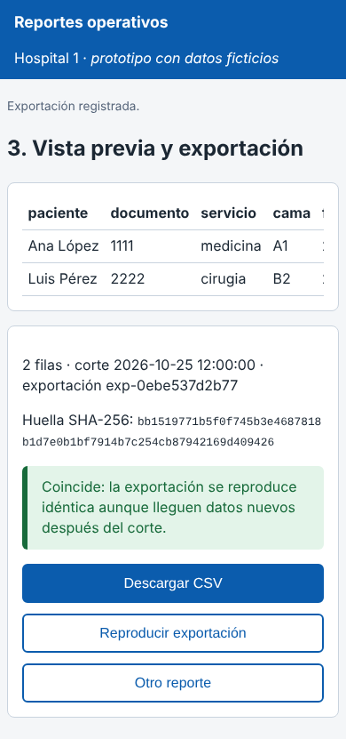
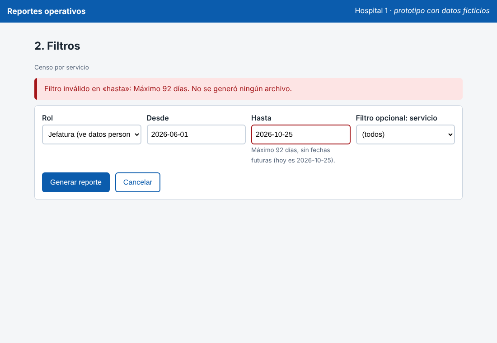
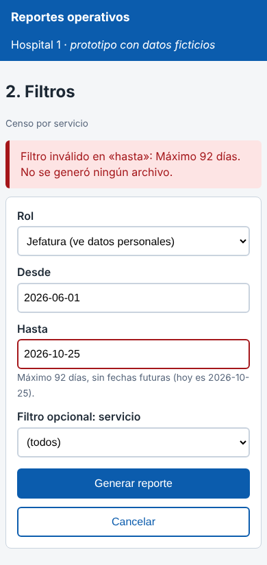

# Semana 11 – Prototipo navegable: filtrado y exportación reproducible de un reporte operativo

Módulo: Reportes operativos exportables · Grupo G1 · Autor: Joshua Eduardo García Reyes.

El prototipo es **un solo archivo** (`prototipo/index.html`, sin servidor ni dependencias). Se abre con doble clic en un navegador y funciona igual en escritorio y en móvil (probado a 1100 px y a 390 px). Los datos son ficticios y son los de `micro-his-reportes/sql/esquema.sql` más una fila registrada **después del corte**. La generación del CSV y su huella SHA-256 usan la misma regla del Micro-HIS (`Archivo::generar`, `Csv`); `verificar-prototipo.php` lo comprueba byte por byte.

## Mapa de navegación

```
 `pantalla:catalogo` ── "Elegir reporte" ──▶ `pantalla:filtros` ── "Generar reporte" ──▶ `pantalla:resultado`
        ▲                                        │  ▲                                        │
        │                          filtro inválido │ corrige                                │
        │                                        ▼  │                                        │
        │                          error crítico (bloque rojo, foco, nada se genera)         │
        └────────────── "Cancelar" ◀────────────┘            "Otro reporte" ◀───────────────┘
```

| Pantalla | Qué hace | Requisito que cubre |
|---|---|---|
| `pantalla:catalogo` | Lista los reportes con sus columnas (censo por servicio, egresos). | RF-01 |
| `pantalla:filtros` | Rango de fechas, filtro opcional del reporte y rol (con o sin datos personales). | RF-02, RF-03, RF-09, RF-10 |
| `pantalla:resultado` | Vista previa, filas, corte, huella SHA-256, descarga CSV y «Reproducir exportación». | RF-04, RF-05, RF-06, RF-07, RF-08 |

## Camino feliz (capturas `escritorio-camino-feliz.png` y `movil-camino-feliz.png`)

1. Se elige «Censo por servicio» como jefatura.
2. Rango 2026-10-01 a 2026-10-25, sin filtro opcional, «Generar reporte».
3. La vista previa trae **2 filas** (la fila de otro hospital y la registrada después del corte no aparecen), la huella y el número de exportación.
4. «Reproducir exportación» vuelve a generar con los filtros y el corte guardados y confirma que **coincide**.




## Error crítico (capturas `escritorio-error-critico.png` y `movil-error-critico.png`)

Se escribe `desde` = 2026-06-01 y `hasta` = 2026-10-25 (146 días; el máximo es 92). El prototipo **no genera ni registra nada**, muestra un bloque rojo que nombra el campo, marca `hasta` con `aria-invalid` y mueve el foco al mensaje (RF-02, RF-10). Al corregir la fecha, el flujo continúa sin repetir los demás filtros.




## Lo que el prototipo deja ver con honestidad

- Con rol **auditor** la vista previa muestra `***` en paciente y documento, igual que el Micro-HIS (RF-09, RNF-02).
- El prototipo rechaza fechas que no existen en el calendario (por ejemplo 2026-02-31 o 2026-13-45). El Micro-HIS **todavía no**: acepta la primera y falla con una excepción en la segunda (se revisa en la semana 13). `verificar-prototipo.php` lo imprime como diferencia conocida.
- Solo hay formato CSV; el JSON y el PDF que cita RF-05 no están registrados en el Micro-HIS, y la vista previa y el catálogo todavía no tienen ruta en la API.
- El prototipo no habla con la API ni con la base; no sustituye las pruebas del Micro-HIS.

## Cómo verificarlo

```
php docs/modulos/reportes-operativos-exportables/semana-11/verificar-prototipo.php
```

Resultado esperado: líneas `PASA` (P-01 a P-09), dos líneas `INFO` de diferencia conocida y «Resultado: el prototipo coincide con el Micro-HIS y con el documento». Si no hay `node` en el equipo, P-03 y P-04 aparecen como OMITIDO.
