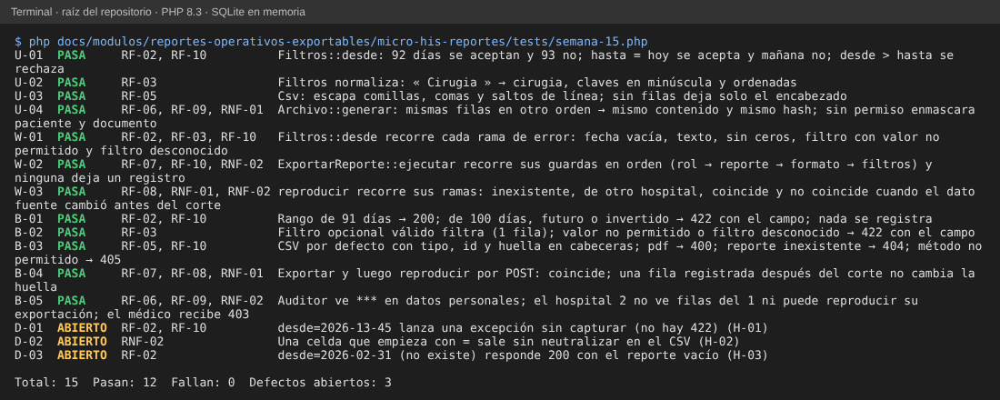

# Semana 15 – Pruebas unitarias, de caja blanca y de caja negra trazadas a RF/RNF

Módulo: Reportes operativos exportables · Grupo G1 · Autor: Joshua Eduardo García Reyes.
Archivo de pruebas: `micro-his-reportes/tests/semana-15.php` (sin dependencias, SQLite en memoria; no modifica `tests/ejecutar.php`).

## 1. Cómo se ejecuta

```
php docs/modulos/reportes-operativos-exportables/micro-his-reportes/tests/semana-15.php
```

Resultado esperado: `Total: 15  Pasan: 12  Fallan: 0  Defectos abiertos: 3` y código de salida 0. Una prueba de defecto (`D-xx`) imprime **ABIERTO** mientras el defecto se reproduce; si alguien lo corrige, pasa a FALLA con el mensaje «conviértalo en prueba normal», para que el defecto no quede escondido ni la prueba obsoleta.



## 2. Matriz de trazabilidad

| Requisito | Prueba(s) | Tipo | Qué comprueba |
|---|---|---|---|
| RF-01 catálogo de reportes | B-03 | negra | Un reporte inexistente responde 404; el catálogo existe como estructura, pero **no tiene ruta** (H-04). |
| RF-02 rango de fechas | U-01, W-01, B-01, D-01, D-03 | unitaria, blanca, negra, defecto | 92 y 93 días, hoy y mañana, desde > hasta, fecha vacía o con formato malo; 422 con el campo. |
| RF-03 filtros opcionales | U-02, W-01, B-02 | unitaria, blanca, negra | Normaliza « Cirugia », rechaza valor no permitido y filtro desconocido. |
| RF-04 vista previa paginada | — | — | **Sin prueba: la ruta no existe** (H-04). |
| RF-05 formatos de exportación | U-03, B-03 | unitaria, negra | Escapado del CSV y cabeceras; PDF y JSON responden 400 (H-05). |
| RF-06 corte y orden estable | U-04, B-05 | unitaria, negra | Mismas filas en otro orden → mismo contenido; solo filas hasta el corte. |
| RF-07 registro antes de entregar | W-02, B-01, B-04 | blanca, negra | Ningún rechazo deja registro; la exportación correcta queda registrada. |
| RF-08 reproducir | W-03, B-04 | blanca, negra | Coincide tras una fila tardía; **no** coincide si se edita una fila vieja. |
| RF-09 enmascarar datos personales | U-04, B-05 | unitaria, negra | `***` en paciente y documento para el auditor. |
| RF-10 códigos de rechazo estables | W-01, W-02, B-01, B-03 | blanca, negra | `filtro_invalido` (con campo), `reporte_no_encontrado`, `formato_no_soportado`. |
| RNF-01 reproducibilidad | U-04, W-03, B-04 | unitaria, blanca, negra | Misma huella aunque lleguen datos después del corte. |
| RNF-02 confidencialidad | W-02, W-03, B-05, D-02 | blanca, negra, defecto | Hospital ajeno sin datos ni reproducción (404); el CSV con fórmulas **no** está neutralizado (D-02). |
| RNF-03 corte de 30 s | — | — | **No implementado ni medido.** |
| RNF-04 y RNF-06 extensibilidad y verificabilidad | — | — | Ya cubiertos por `semana-02/ejemplo-ocp/verificar.php` y la semana 12. |
| RNF-05 reglas en un solo lugar | — | — | Cubierto por ARQ-01 de `tests/ejecutar.php`. |

## 3. Cobertura pedida por la entrega

| Pedido | Cantidad | Pruebas |
|---|---|---|
| Unitarias (≥ 3) | 4 | U-01, U-02, U-03, U-04 |
| Caja blanca (≥ 2) | 3 | W-01 (ramas de `Filtros::desde`), W-02 (guardas de `ExportarReporte`), W-03 (ramas de `reproducir`) |
| Caja negra (≥ 4) | 5 | B-01 a B-05, solo por HTTP |
| Defectos reportados | 3 | D-01, D-02, D-03 |

Las pruebas se comprobaron también **rompiendo el código a propósito** (11 cambios en el límite de 92 días, fecha futura, orden de fechas, orden de filas, enmascarado, escapado del CSV, permiso de rol, comparación de huella, aislamiento por hospital, corte y 405): cada cambio hizo fallar al menos una prueba.

## 4. Defectos encontrados (se corrigen en el código aparte; el acta de la semana 13 los registra con responsable)

| ID | Prueba | Descripción | Requisito | Severidad | Estado |
|---|---|---|---|---|---|
| H-01 | D-01 | `desde=2026-13-45` lanza una excepción sin capturar. | RF-02, RF-10 | Alta | Abierto |
| H-02 | D-02 | Una celda que empieza con `=` sale sin neutralizar en el CSV. | RNF-02 | Alta | Abierto |
| H-03 | D-03 | `desde=2026-02-31` responde 200 con el reporte vacío. | RF-02 | Media | Abierto |

## 5. Lo que estas pruebas no cubren

RF-04 (vista previa), RF-05 en PDF e impresión y RNF-03 (corte de 30 s) no tienen prueba porque la función no existe. Los hallazgos H-06 (aviso de PHP con filtro en arreglo) y H-07 (93 días calendario aceptados) son de severidad Baja y quedan solo en el acta de la semana 13.
