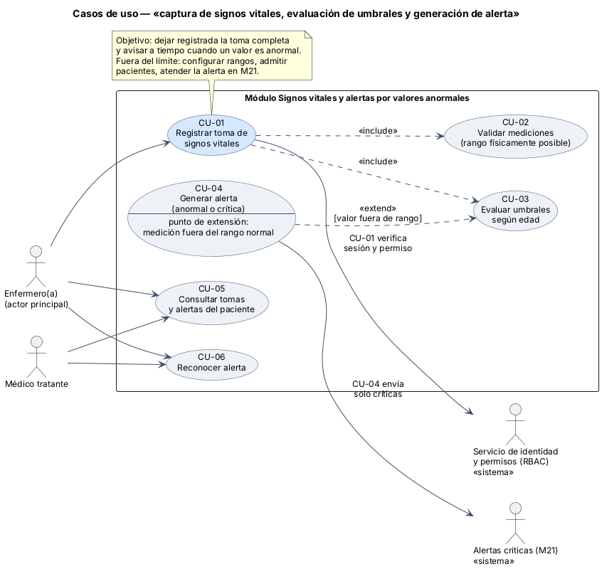
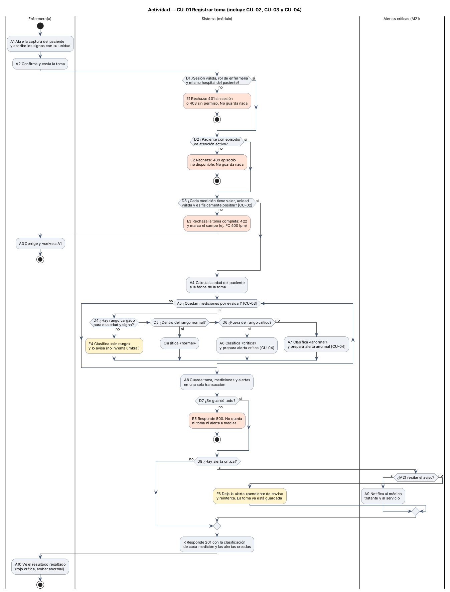
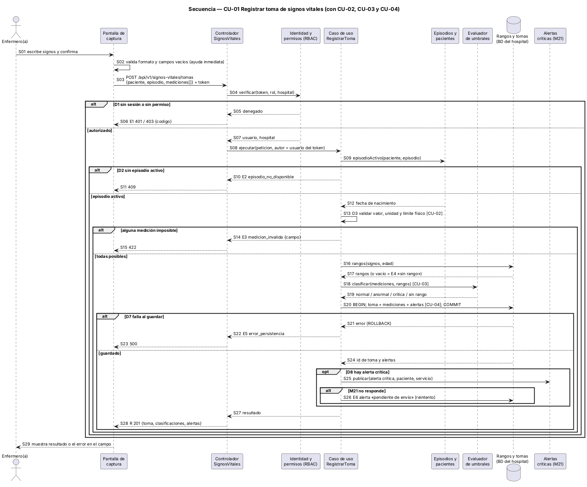

# Semana 1 — UML del proceso de signos vitales y alertas

**Estudiante:** Joshua Eduardo García Reyes (`jgarciar73@miumg.edu.gt`, `jgarciar73-svg`) · **Módulo:** Signos vitales y alertas por valores anormales (asignado por el docente) · **Proceso:** «captura de signos vitales, evaluación de umbrales y generación de alerta»

| Pedido | Dónde |
|---|---|
| Casos de uso: actores y objetivo | §2 y [diagrama](diagramas/semana-01-casos-de-uso.png) |
| Actividad con decisiones, excepciones y resultado | §3 y [diagrama](diagramas/semana-01-actividad.png) |
| Secuencia con participantes, mensajes, validaciones y respuesta | §4 y [diagrama](diagramas/semana-01-secuencia.png) |
| Trazabilidad entre los tres diagramas | §5 |
| Narrativa de alcance | §1 |

## 1. Narrativa de alcance

**Objetivo.** Que enfermería registre en el sistema la toma de signos vitales de un paciente con episodio activo, que el sistema compare cada valor con los rangos de su edad y que, si un valor sale del rango normal, se cree una alerta que el equipo vea a tiempo. Las alertas críticas se envían además al módulo Alertas críticas (M21).

**Actores**

| Actor | Tipo | Qué busca |
|---|---|---|
| Enfermero(a) | Principal (humano) | Registrar la toma completa y saber de inmediato si hay un valor fuera de rango |
| Médico tratante | Secundario (humano) | Consultar tomas y alertas de sus pacientes y reconocer las alertas |
| Servicio de identidad y permisos (RBAC) | Secundario (sistema) | Confirmar sesión, rol y hospital del usuario |
| Alertas críticas (M21) | Secundario (sistema) | Recibir solo las alertas críticas para notificar al servicio |

**Dentro del alcance:** registrar la toma (presión sistólica y diastólica, frecuencia cardiaca, frecuencia respiratoria, temperatura y saturación de oxígeno), validar que cada valor sea físicamente posible, clasificarlo como normal, anormal, crítico o «sin rango», crear la alerta, consultar el historial y reconocer una alerta.

**Fuera del alcance:** configurar los rangos (catálogo global administrado aparte), registrar o admitir pacientes (módulo Pacientes), autenticar usuarios (RBAC), atender y escalar la alerta crítica (M21), leer datos directo de monitores y calcular escalas como NEWS2.

**Supuestos.** Hoy la base del grupo solo trae rangos de adulto (`rangos_signos_vitales`), así que un paciente pediátrico sin rango cargado queda «sin rango» y no se le inventa un umbral. Las mediciones no se editan: un error se corrige con una toma nueva.

**Reglas de negocio**

| ID | Regla |
|---|---|
| RN-01 | Solo enfermería del mismo hospital del paciente registra tomas; el autor sale del token, no del formulario |
| RN-02 | Solo se registra si el paciente tiene un episodio de atención activo |
| RN-03 | Un valor físicamente imposible rechaza la toma completa (no se guardan tomas a medias) |
| RN-04 | La clasificación usa el rango según la edad del paciente a la fecha de la toma |
| RN-05 | Fuera del rango normal → alerta anormal; fuera del rango crítico → alerta crítica |
| RN-06 | Toma, mediciones y alertas se guardan en una sola transacción |
| RN-07 | Si M21 no responde, la alerta crítica queda «pendiente de envío» y se reintenta; la toma no se pierde |

**Rangos de ejemplo para adulto** (solo para explicar el diseño; los valores reales salen del catálogo):

| Signo | Unidad | Normal | Crítico si | Imposible si |
|---|---|---|---|---|
| Presión sistólica | mmHg | 90–139 | < 80 o ≥ 180 | < 40 o > 300 |
| Presión diastólica | mmHg | 60–89 | < 40 o ≥ 120 | < 20 o > 200 |
| Frecuencia cardiaca | lpm | 60–100 | < 40 o > 130 | < 20 o > 300 |
| Frecuencia respiratoria | rpm | 12–20 | < 8 o > 30 | < 1 o > 80 |
| Temperatura | °C | 36.0–37.5 | < 35.0 o ≥ 40.0 | < 25 o > 45 |
| Saturación de oxígeno | % | 95–100 | < 90 | < 50 o > 100 |

## 2. Casos de uso



| CU | Nombre | Actor | Relación |
|---|---|---|---|
| CU-01 | Registrar toma de signos vitales | Enfermero(a) | Base del proceso; usa RBAC |
| CU-02 | Validar mediciones | — | «include» de CU-01 |
| CU-03 | Evaluar umbrales según edad | — | «include» de CU-01 |
| CU-04 | Generar alerta (anormal o crítica) | — | «extend» de CU-03 si un valor sale de rango; envía críticas a M21 |
| CU-05 | Consultar tomas y alertas | Enfermero(a), Médico | Lectura |
| CU-06 | Reconocer alerta | Enfermero(a), Médico | Deja constancia de quién vio la alerta y cuándo |

**CU-01 en breve.** Precondición: sesión iniciada y paciente con episodio activo. Flujo principal: la enfermera escribe los signos, confirma, el sistema valida (CU-02), clasifica (CU-03), crea alertas si hace falta (CU-04), guarda todo y muestra el resultado. Alternativos: E1–E6 de §3. Poscondición: la toma queda guardada con su clasificación y sus alertas, o no queda nada.

## 3. Actividad



| Decisión | Si falla | Resultado |
|---|---|---|
| D1 sesión, rol y hospital | E1 | 401 o 403, nada guardado |
| D2 episodio activo | E2 | 409, nada guardado |
| D3 valor, unidad y límite físico | E3 | 422 con el campo marcado; la enfermera corrige |
| D4 hay rango para la edad | E4 | Se guarda como «sin rango» y se avisa (no es error) |
| D5 / D6 normal o crítico | — | Clasifica normal, anormal (A7) o crítica (A6) |
| D7 guardado completo | E5 | 500, nada guardado |
| D8 hay crítica / M21 responde | E6 | Alerta «pendiente de envío»; la toma ya está guardada |

**Resultado (R):** 201 con la clasificación de cada medición y las alertas creadas; la pantalla resalta en rojo las críticas y en ámbar las anormales (A10).

## 4. Secuencia



Participantes: enfermero(a), pantalla de captura, controlador, RBAC, caso de uso `RegistrarToma`, episodios y pacientes, evaluador de umbrales, base del hospital y M21. Las validaciones están en S02 (formato en pantalla), S04 (permiso), S09 (episodio) y S13 (límite físico). La respuesta es S28 (201) o la de cada error (S06, S11, S15, S23).

## 5. Trazabilidad entre los tres diagramas

| Caso de uso | Actividad | Secuencia | Regla |
|---|---|---|---|
| CU-01 Registrar toma | A1, A2, D1, D2, A8, D7, R, A10 · E1, E2, E5 | S01–S12, S20–S24, S27–S29 · S06, S11, S23 | RN-01, RN-02, RN-06 |
| CU-02 Validar mediciones | D3 · E3, A3 | S02, S13–S15 | RN-03 |
| CU-03 Evaluar umbrales | A4, A5, D4, D5, D6 · E4 | S16–S19 | RN-04 |
| CU-04 Generar alerta | A6, A7, D8, A9 · E6 | S20, S25, S26 | RN-05, RN-07 |
| CU-05 / CU-06 | No forman parte de este flujo; se modelan cuando se diseñe la consulta | — | RN-01 |

Cada nodo de la actividad y cada mensaje de la secuencia lleva el mismo ID (D1, E3, CU-02…), así que se puede seguir un camino de un diagrama a otro.

## 6. Fuentes de los diagramas

Las fuentes editables están en [diagramas/](diagramas/) (`.puml`). Para regenerar las imágenes:

```bash
java -jar plantuml.jar -charset UTF-8 -tpng docs/modulos/signos-vitales-alertas/semana-01/diagramas/*.puml
```

**Defensa en 1 minuto:** «La enfermera registra la toma; el sistema revisa permiso, episodio y que cada valor sea posible, compara con el rango de la edad y crea alerta si hace falta. Todo se guarda junto o no se guarda. Las críticas van a M21 y, si M21 está caído, quedan pendientes sin perder la toma. Los IDs D, E, S y CU unen los tres diagramas.»
