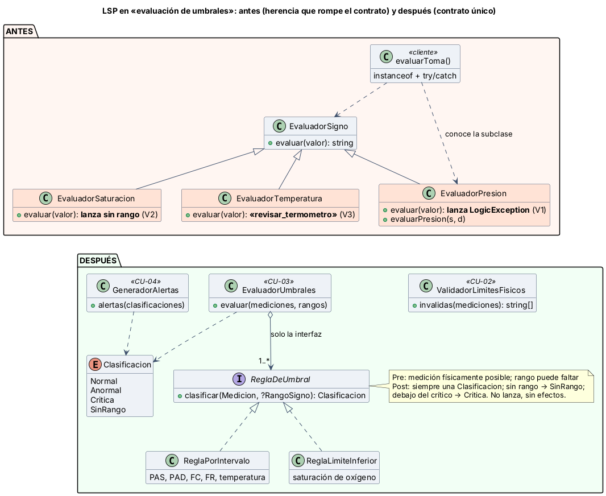

# Semana 2 — RF/RNF, criterios de aceptación y LSP en signos vitales

**Estudiante:** Joshua Eduardo García Reyes (`jgarciar73@miumg.edu.gt`, `jgarciar73-svg`) · **Módulo:** Signos vitales y alertas por valores anormales (módulo 13, reasignado dentro del grupo G1) · **Flujo:** «captura de signos vitales, evaluación de umbrales y generación de alerta» (CU-01 a CU-04 de la [semana 1](../semana-01/semana-01-uml-signos-vitales.md))

**Contenido:** RF/RNF (§1), criterios de aceptación Dado/Cuando/Entonces (§2), diseño antes/después con LSP, responsabilidades y dependencias (§3, [diagrama](diagramas/semana-02-lsp-antes-despues.png), [`ejemplo-lsp/`](ejemplo-lsp/)) y evidencia verificable (§4, [captura](evidencia/verificar-lsp.png)).

## 1. Requerimientos

| ID | Requerimiento funcional | CU |
|---|---|---|
| RF-01 | Registrar una toma con 1 a 6 mediciones (PAS, PAD, FC, FR, temperatura, SpO2), cada una con su unidad | CU-01 |
| RF-02 | Solo enfermería del mismo hospital del paciente registra; el autor sale del token | CU-01 |
| RF-03 | Solo se registra si el paciente tiene un episodio de atención activo | CU-01 |
| RF-04 | Rechazar la toma completa si un valor es físicamente imposible, indicando el signo | CU-02 |
| RF-05 | Clasificar cada medición como normal, anormal, crítica o sin rango, según la edad | CU-03 |
| RF-06 | Crear una alerta por cada medición anormal o crítica | CU-04 |
| RF-07 | Enviar las alertas críticas a M21; si falla, dejarlas «pendiente de envío» y reintentar | CU-04 |
| RF-08 | Consultar tomas y alertas del paciente (enfermería y médico) | CU-05 |
| RF-09 | Reconocer una alerta una sola vez, guardando quién y cuándo | CU-06 |
| RF-10 | Las mediciones no se editan ni se borran; un error se corrige con otra toma | CU-01 |

| ID | Requerimiento no funcional |
|---|---|
| RNF-01 | Integridad: toma, mediciones y alertas en una transacción |
| RNF-02 | Seguridad: nadie ve ni registra tomas de otro hospital; la bitácora no guarda valores clínicos |
| RNF-03 | Rendimiento: registrar y clasificar una toma en menos de 2 s (p95) |
| RNF-04 | Seguridad clínica: ningún valor crítico puede quedar sin clasificar como crítico |
| RNF-05 | Mantenibilidad (LSP): una regla nueva se conecta sin cambiar `EvaluadorUmbrales` |
| RNF-06 | Verificabilidad: toda regla pasa la misma prueba de contrato |
| RNF-07 | Usabilidad: el error marca el campo y la alerta se distingue por texto, no solo por color |

## 2. Criterios de aceptación

| ID | Dado | Cuando | Entonces | Evidencia |
|---|---|---|---|---|
| CA-01 | Enfermera de otro hospital | registra una toma | 403 y nada guardado | Micro-HIS (S3) |
| CA-02 | Episodio cerrado | se registra una toma | 409 y nada guardado | Micro-HIS (S3) |
| CA-04a | FC 400 lpm y temperatura 36.8 | se valida | se rechaza toda la toma y se marca «fc» | `verificar.php` |
| CA-04b | FC 20 y SpO2 100 (en el límite físico) | se valida | se aceptan | `verificar.php` |
| CA-05a | Adulto con FC 75 / FC 110 | se clasifica | normal / anormal | `verificar.php` |
| CA-05b | FC 131, SpO2 89, PAS 180, temperatura 40.0 | se clasifica | las cuatro son críticas | `verificar.php` |
| CA-05c | Paciente sin rango para su edad | se clasifica | «sin rango», sin inventar umbral | `verificar.php` |
| CA-06 | Una anormal, una crítica y una normal | se generan alertas | 2 alertas con su nivel | `verificar.php` |
| CA-07 | M21 no responde | hay una alerta crítica | la toma queda guardada y la alerta «pendiente de envío» | Micro-HIS (S3) |
| CA-09 | Alerta ya reconocida | se reconoce otra vez | se rechaza y se conserva el primer reconocimiento | Micro-HIS (S3) |

## 3. LSP: antes y después



**LSP** dice que un subtipo debe poder usarse donde se espera el tipo base sin que el cliente note la diferencia: no puede pedir más (precondición) ni entregar menos (postcondición).

**Antes** ([`antes.php`](ejemplo-lsp/antes.php)): `EvaluadorSigno` promete devolver una de 4 clasificaciones y no lanzar. Sus subclases rompen esa promesa:

| Violación | Subclase | Qué rompe | Consecuencia |
|---|---|---|---|
| V1 | `EvaluadorPresion` | Lanza `LogicException` en `evaluar()`: rechaza la operación heredada | El cliente necesita `instanceof` |
| V2 | `EvaluadorSaturacion` | Exige rango (precondición más fuerte) | El cliente necesita `try/catch` |
| V3 | `EvaluadorTemperatura` | Devuelve «revisar_termometro» a más de 42 °C (postcondición más débil) | **Una temperatura crítica de 43 °C no genera alerta** |

**Después** ([`despues.php`](ejemplo-lsp/despues.php)):

| Clase | Responsabilidad (una sola) | Depende de |
|---|---|---|
| `ReglaDeUmbral` (interfaz) | Fijar el contrato: pre, post y sin efectos | — |
| `ReglaPorIntervalo` | PAS, PAD, FC, FR y temperatura (límite bajo y alto) | `ReglaDeUmbral` |
| `ReglaLimiteInferior` | SpO2: solo el valor bajo es peligroso | `ReglaDeUmbral` |
| `ValidadorLimitesFisicos` | CU-02: valores imposibles, antes de clasificar | Nada |
| `EvaluadorUmbrales` | CU-03: elegir la regla de cada signo y aplicarla | Solo la interfaz |
| `GeneradorAlertas` | CU-04: convertir clasificaciones en alertas | `Clasificacion` |

**Por qué así:** la presión se registra como dos mediciones (PAS y PAD, como `mediciones_signo` en la base del grupo), así que ya no hace falta una firma distinta (quita V1). La validación física sale de las reglas hacia `ValidadorLimitesFisicos`, y la falta de rango es un resultado (`SinRango`), no un error (quita V2). `Clasificacion` es un enum: una regla no puede devolver un texto inventado (quita V3). El cliente depende de la interfaz, no de las clases concretas.

## 4. Evidencia

```bash
cd docs/modulos/signos-vitales-alertas/semana-02/ejemplo-lsp
php verificar.php     # sale con 0 si todo da lo esperado y con 1 si algo falla
```

La **prueba de contrato** aplica los mismos casos a cada implementación (cada signo, valores en los límites, con y sin rango): C1 no lanza, C2 devuelve un valor del contrato, C3 sin rango → sin_rango, C4 debajo del crítico → crítica. Resultado ([captura](evidencia/verificar-lsp.png)):

| Implementación | C1 | C2 | C3 | C4 | Veredicto |
|---|---:|---:|---:|---:|---|
| Antes: `EvaluadorSigno` (base) | 0 | 0 | 0 | 0 | Cumple |
| Antes: `EvaluadorPresion` | 94 | 0 | 0 | 0 | Rompe LSP (V1) |
| Antes: `EvaluadorSaturacion` | 47 | 0 | 0 | 0 | Rompe LSP (V2) |
| Antes: `EvaluadorTemperatura` | 0 | 52 | 26 | 3 | Rompe LSP (V3) |
| Después: `ReglaPorIntervalo` y `ReglaLimiteInferior` | 0 | 0 | 0 | 0 | Cumplen |
| Después: regla nueva (clase anónima, RNF-05) | 0 | 0 | 0 | 0 | Cumple y se conecta sin tocar el evaluador |

También pasan CLI-01 (43 °C: antes sin alerta, después crítica) y CA-04 a CA-06.

**Defensa en 1 minuto:** «Antes, tres subclases del evaluador no se podían usar en lugar de la base: una lanzaba, otra pedía rango y otra escondía una temperatura crítica. Ahora hay una interfaz con contrato, la validación va aparte y la falta de rango es un resultado. La misma prueba de contrato lo demuestra: antes 3 rompen, después 0.»
