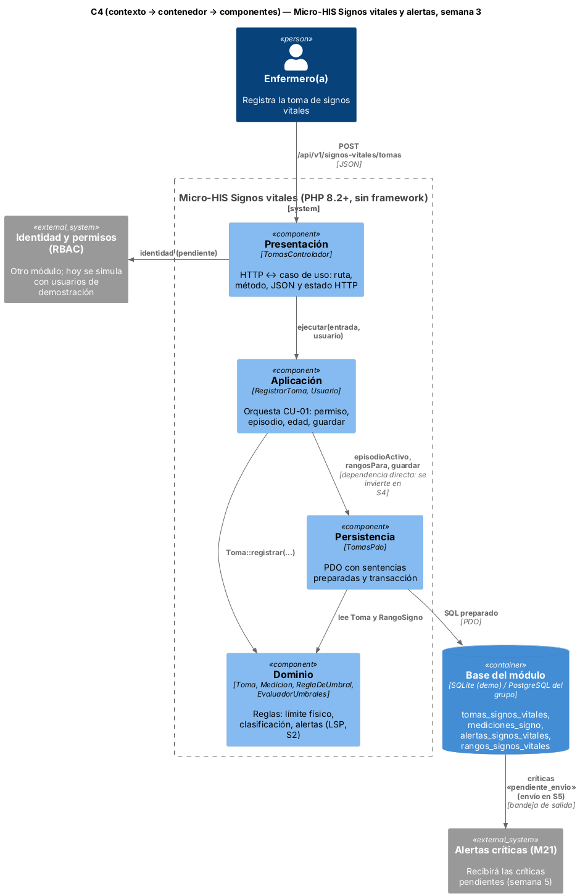

# Semana 3 — Micro-HIS Signos vitales en capas y vista arquitectónica

**Estudiante:** Joshua Eduardo García Reyes (`jgarciar73-svg`) · **Módulo:** Signos vitales y alertas por valores anormales (módulo 13, reasignado dentro del grupo G1) · **Flujo:** «captura de signos vitales, evaluación de umbrales y generación de alerta»

El Micro-HIS está en [`../micro-his-signos-vitales/`](../micro-his-signos-vitales/): PHP 8.2+ sin framework ni Composer, PDO con sentencias preparadas y pruebas propias. Ejecuta CU-01 a CU-04 de la semana 1 con el diseño LSP de la semana 2.

## 1. Vista arquitectónica (C4) y dependencias



| Capa | Archivos | Responsabilidad | Puede depender de |
|---|---|---|---|
| Presentación | `src/Presentacion/TomasControlador.php` | Ruta, método, JSON, usuario de demostración y estado HTTP (201, 400, 401, 403, 404, 405, 409, 422, 500) | Aplicación, `ErrorDominio` |
| Aplicación | `src/Aplicacion/RegistrarToma.php` | Orquesta CU-01: rol, episodio activo, hospital, edad, clasificar y guardar | Dominio, Persistencia (*) |
| Dominio | `src/Dominio/Signos.php`, `Toma.php` | Límite físico, clasificación por rango, alertas, toma completa e inmutable | Nada |
| Persistencia | `src/Persistencia/TomasPdo.php`, `sql/esquema.sql` | SQL preparado; toma, mediciones y alertas en una transacción con rollback | Dominio, `ErrorPersistencia` |

(*) Hoy `RegistrarToma` recibe `TomasPdo` directamente. Es la única flecha que apunta hacia afuera; en la semana 4 se invierte con una interfaz Repository y un adaptador en memoria. `bootstrap.php` carga las capas de adentro hacia afuera, y la prueba ARQ-01 falla si el Dominio menciona otra capa o PDO, o si aparece SQL fuera de Persistencia.

**Decisiones:** las alertas críticas se guardan con `estado_envio = 'pendiente_envio'` (bandeja de salida) para enviarlas a M21 sin perder la toma si M21 falla; los nombres de tabla siguen la base del grupo; la identidad usa usuarios de demostración hasta integrar el módulo RBAC (no son credenciales).

## 2. Pruebas

```bash
cd docs/modulos/signos-vitales-alertas/micro-his-signos-vitales
php tests/ejecutar.php     # Total: 7  Pasan: 7  Fallan: 0  (base de prueba: SQLite en memoria)
```

| ID | Pide la tarea | Qué comprueba |
|---|---|---|
| APP-01 | Camino feliz | FC 135 crítica, SpO2 97 y 36.8 °C normales; 1 toma, 3 mediciones y 1 alerta «pendiente_envio» |
| DOM-01 | Regla de dominio | FC 400 es imposible: `medicion_invalida` en «fc» y 0 tomas |
| DOM-02 | Regla de dominio | Paciente de 5 años sin rango: «sin_rango» y sin alerta |
| PER-01 | Error de persistencia | Falla el INSERT de alertas: `ErrorPersistencia` y rollback (0 tomas, 0 mediciones). Sin `rollBack()` la prueba falla |
| APP-02 | Permisos | Episodio cerrado → 409; médico u otro hospital → `acceso_denegado` |
| HTTP-01 | Presentación | 201, 401, 400, 404, 405 y 422 con su código |
| ARQ-01 | Dependencias | Dominio sin otras capas ni PDO; sin SQL en Aplicación ni Presentación |

**Defensa en 1 minuto:** «Cuatro capas con dependencias hacia adentro: el Dominio no sabe de HTTP ni de SQL. El caso de uso orquesta y Persistencia guarda todo junto o nada. Las pruebas usan SQLite en memoria y cubren camino feliz, regla de dominio y error de persistencia. La única deuda, depender de `TomasPdo`, se paga en la semana 4.»
