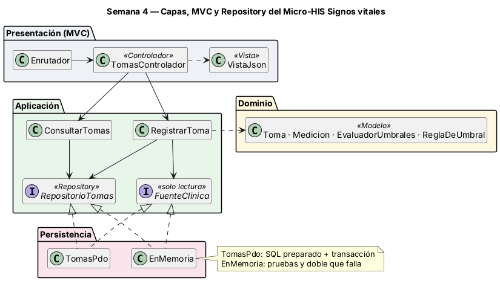
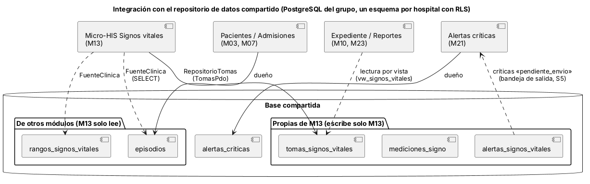

# Semana 4 — MVC, Repository y repositorio de datos compartido

**Estudiante:** Joshua Eduardo García Reyes (`jgarciar73-svg`) · **Módulo:** Signos vitales y alertas por valores anormales (módulo 13, reasignado dentro del grupo G1) · Continúa el [Micro-HIS de la semana 3](../semana-03/semana-03-arquitectura-micro-his.md)

## 1. Capas, responsabilidades y objetos reutilizables



| Capa | Objeto | Responsabilidad | Reutilizable en |
|---|---|---|---|
| Presentación | `public/index.php`, `Enrutador`, `Peticion` | Front controller (elige PDO o memoria) y método + ruta → acción; 404 y 405 | Otras rutas del módulo |
| Presentación | `TomasControlador` | Lee la petición, identifica al usuario, llama al caso de uso y elige la vista. **Sin SQL ni reglas clínicas** | — |
| Presentación | `VistaJson` | Estado HTTP + JSON; único mapa código → estado | Toda respuesta del módulo |
| Aplicación | `RegistrarToma`, `ConsultarTomas` (CU-05, nuevo) | Orquestan; dependen solo de interfaces. El Dominio no cambia | — |
| Aplicación | `RepositorioTomas` (interfaz) | Repository del agregado Toma: `guardar` (todo o nada) y `deEpisodio` | Cualquier caso de uso de tomas |
| Aplicación | `FuenteClinica` (interfaz) | Lectura de datos ajenos: episodio activo y rangos por edad | Registrar, consultar, futuras alertas |
| Aplicación | `exigirEpisodio()` | Regla de acceso común: episodio activo y mismo hospital | Registrar y consultar |
| Persistencia | `TomasPdo` | Implementa ambas interfaces con SQL preparado y transacción | Producción (SQLite o PostgreSQL) |
| Persistencia | `EnMemoria` | Implementa ambas interfaces sin base; `fallarAlGuardar` simula una falla | Pruebas y demostración |

**Dónde va el límite:** las interfaces están en Aplicación, porque son lo que el caso de uso necesita. Persistencia las implementa y la flecha de la semana 3 (`RegistrarToma → TomasPdo`) queda invertida. Se separaron dos interfaces porque los datos tienen dueños distintos: las tomas son de este módulo y los episodios y rangos se leen de otros.

## 2. Repositorio de datos compartido



En el sistema del grupo todos los módulos usan una base PostgreSQL compartida con RLS por hospital. Así se integraría este módulo:

| Regla de integración | Cómo se cumple |
|---|---|
| Cada tabla tiene un solo dueño que escribe | M13 escribe solo `tomas_signos_vitales`, `mediciones_signo` y `alertas_signos_vitales` |
| Los datos ajenos se leen por un puerto | `FuenteClinica` hace SELECT a `episodios` (M03/M07) y `rangos_signos_vitales` (catálogo); cambiar su origen no toca el caso de uso |
| Otros módulos leen por vista, no por tabla | Expediente y reportes leerían `vw_signos_vitales` |
| La integración con M21 no comparte transacción | Las críticas quedan «pendiente_envio» y se envían aparte (semana 5) |
| Aislamiento por hospital | Hoy lo valida `exigirEpisodio()`; con la base del grupo lo refuerza RLS (`app.tenant_id`) |
| Riesgo: otro módulo hace `UPDATE` en tablas de M13 | Permisos por rol de base de datos y lectura solo por vistas |

## 3. Pruebas

```bash
cd docs/modulos/signos-vitales-alertas/micro-his-signos-vitales
php tests/ejecutar.php     # Total: 9  Pasan: 9  Fallan: 0
```

Siguen las 5 de la semana 3 y se agregan cuatro: REP-01 (contrato: PDO y memoria devuelven lo mismo), MVC-01 (enrutador → controlador → vista: 201, 200, 401, 400, 403, 404, 405, 409 y 422), PER-02 (doble en memoria que falla → 500 sin guardar) y ARQ-01 ampliada (la Aplicación no importa Persistencia ni PDO; el controlador no tiene SQL ni reglas). Si se agrega `use ...\Persistencia\TomasPdo` en Aplicación, ARQ-01 falla.
