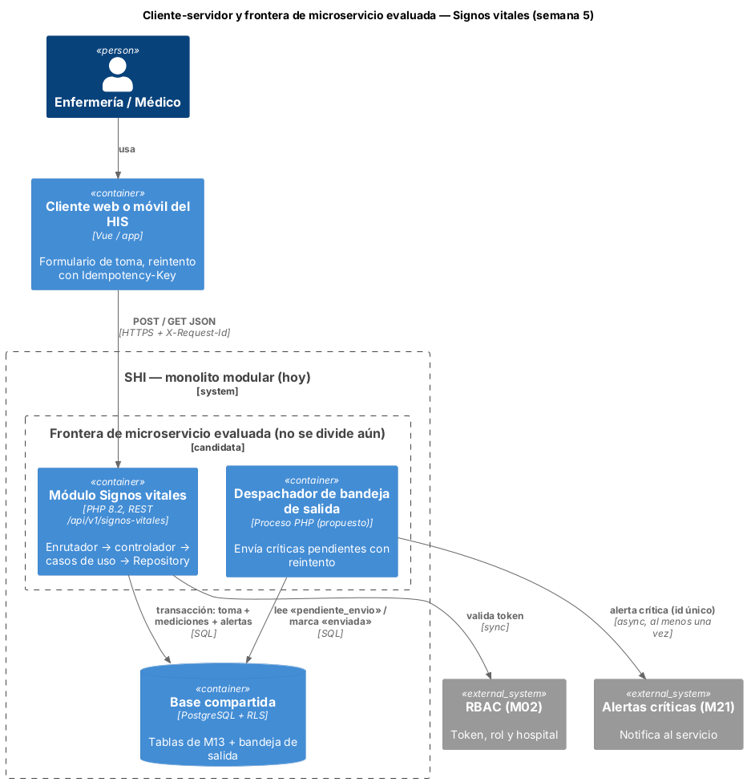
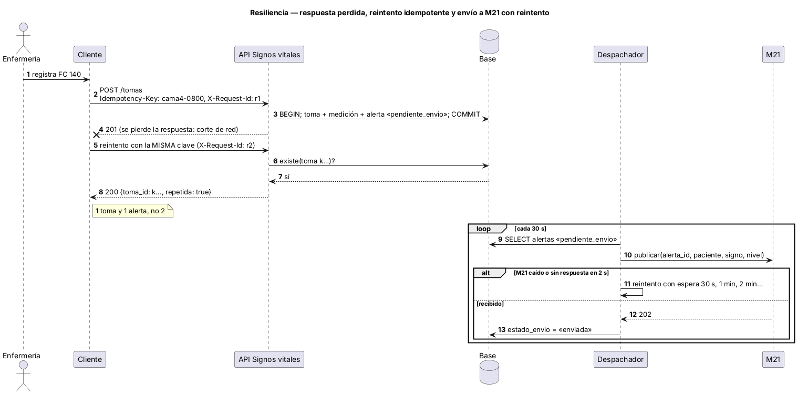

# Semana 5 — Cliente-servidor, contrato API y frontera de microservicio

**Estudiante:** Joshua Eduardo García Reyes (`jgarciar73-svg`) · **Módulo:** Signos vitales y alertas por valores anormales (módulo 13, reasignado dentro del grupo G1) · Evoluciona el [Micro-HIS de las semanas 3 y 4](../semana-04/semana-04-mvc-repository.md)

**Entregables:** contrato [`api/openapi.yaml`](../micro-his-signos-vitales/api/openapi.yaml) (OpenAPI 3.0.3, validado con `openapi-spec-validator`), diagramas, evaluación de la frontera, migración razonada y plan de issue, rama, worktree y PR (§9). Prototipo: `Idempotency-Key` y `X-Request-Id` funcionando y probados.

## 1. Diseño cliente-servidor



| Operación | Respuestas | Notas |
|---|---|---|
| `POST /api/v1/signos-vitales/tomas` | 201 creada · 200 reintento con la misma clave · 400 · 401 · 403 · 409 · 422 · 500 | Cuerpo: `paciente_id`, `episodio_id`, `mediciones` (signo → valor) |
| `GET /api/v1/signos-vitales/tomas?paciente_id=&episodio_id=` | 200 · 401 · 403 · 409 · 500 | Más reciente primero |

Todo error devuelve `{codigo, mensaje, campos}` con uno de 11 códigos estables (enum en el contrato). El cliente decide por `codigo`, no por el texto.

## 2. ¿Separarlo como microservicio? Evaluación medible

| Criterio | Medición o hecho | ¿Justifica dividir? |
|---|---|---|
| Rendimiento | p95 de 200 registros dentro del proceso: **0.13 ms** (RNF-03, meta < 2 s). Una llamada de red agregaría milisegundos sin ganar nada | No |
| Escala independiente | Una toma por paciente cada pocas horas; no hay picos que exijan escalar solo este módulo | No |
| Despliegue independiente | Un solo equipo pequeño publica todo el SHI junto | No |
| Datos | Lee episodios y rangos de otros módulos en cada registro; separado necesitaría copias o llamadas extra | No (aumenta el acoplamiento) |
| Falla aislada | Lo que hay que aislar es M21, y eso ya se logra con la bandeja de salida | No |

**Decisión:** seguir como módulo dentro del monolito modular, pero con la frontera ya marcada (contrato propio, tablas propias, puertos para datos ajenos y comunicación asíncrona con M21). **Se dividiría** si se cumple alguna de estas condiciones: más de 50 tomas por segundo sostenidas, otro equipo a cargo del módulo, o integración directa con monitores que exija disponibilidad distinta.

## 3. Propiedad de datos

| Dato | Dueño | Acceso de M13 |
|---|---|---|
| `tomas_signos_vitales`, `mediciones_signo`, `alertas_signos_vitales` | M13 | Escribe y lee (único que escribe) |
| `episodios`, `pacientes` | Pacientes y admisiones | Solo lectura por `FuenteClinica` |
| `rangos_signos_vitales` | Catálogo global | Solo lectura por `FuenteClinica` |
| `alertas_criticas` | M21 | Nunca escribe: le envía la alerta y M21 la guarda |

## 4. Comunicación

- **Síncrona (REST/JSON)** entre cliente y API: la enfermera necesita ver la clasificación al guardar.
- **Asíncrona** hacia M21 con bandeja de salida: la toma no espera a M21 ni se pierde si M21 falla.
- **Lectura** de episodios y rangos dentro del mismo proceso. Si se separara, sería una llamada con caché corta para los rangos.

## 5. Seguridad

| Riesgo | Control |
|---|---|
| Suplantación | Hoy `X-Usuario-Demo` (solo demostración). En el SHI: token del módulo RBAC; el autor siempre sale del token |
| Ver pacientes de otro hospital | `exigirEpisodio()` compara hospitales; en PostgreSQL además RLS con `app.tenant_id` |
| Datos clínicos expuestos | HTTPS; el log no guarda valores ni ids de paciente; a M21 solo se envía lo necesario |
| Abuso o datos basura | Límites físicos (422), `json_invalido` (400) y clave de idempotencia validada (8 a 64 caracteres) |

## 6. Resiliencia



| Falla | Respuesta del diseño | Estado |
|---|---|---|
| Se pierde la respuesta y el cliente reintenta | `Idempotency-Key`: el segundo POST devuelve 200 con la misma toma, sin otra alerta | **Implementado** (RES-01) |
| Dos reintentos al mismo tiempo | La clave primaria de la toma impide el duplicado; el segundo recibe 500 y al reintentar obtiene 200 | Implementado |
| M21 caído | La alerta queda «pendiente_envio»; el despachador reintenta con espera creciente | Diseñado (estado ya se guarda) |
| Base caída | 500 `error_persistencia` sin datos a medias (rollback) | Implementado (PER-01) |

## 7. Observabilidad

- `X-Request-Id`: se acepta o se genera, se devuelve en la respuesta y une el log del cliente con el del servidor. **Implementado.**
- Una línea JSON por petición (`id`, método, ruta, estado, código, ms) en el log de errores de PHP, sin datos clínicos. **Implementado.**
- Métricas propuestas: tomas por hora, porcentaje de críticas, antigüedad de la alerta pendiente más vieja (alarma si pasa de 5 min) y p95 del registro.

## 8. Consistencia

- **Fuerte dentro del módulo:** toma, mediciones y alertas en una transacción.
- **Eventual con M21:** entrega «al menos una vez». Cada alerta lleva un id único y M21 debe ignorar los repetidos.
- **Lectura propia inmediata:** después del 201, el GET ya muestra la toma.

## 9. Migración razonada y plan de trabajo

| Paso | Qué se hace | Se considera listo cuando |
|---|---|---|
| 1 | Contrato y códigos estables (esta semana) | CON-01 pasa |
| 2 | Idempotencia y correlación (esta semana) | RES-01 pasa y el log muestra el id |
| 3 | Despachador de la bandeja de salida hacia M21 | Una alerta pendiente llega a M21 con M21 caído y luego recuperado |
| 4 | Usuario de base propio de M13 y vista `vw_signos_vitales` para otros | Otro módulo no puede escribir en tablas de M13 |
| 5 | Separar como servicio solo si se cumple un criterio de §2 | Medición que lo justifique |

**Plan de issue, rama, worktree y PR (esta entrega):**

```bash
# Issue: "Semana 5 Signos vitales: contrato API, idempotencia, correlación y evaluación de microservicio"
git fetch origin
git worktree add ../shi-signos-s5 -b semana-5-signos-vitales-alertas-joshua-garcia origin/semana-4-signos-vitales-alertas-joshua-garcia
cd ../shi-signos-s5        # trabajo aislado sin tocar la carpeta principal
php docs/modulos/signos-vitales-alertas/micro-his-signos-vitales/tests/ejecutar.php
git commit -am "Semana 5: contrato API, idempotencia y correlación en Signos vitales"
git push -u origin semana-5-signos-vitales-alertas-joshua-garcia
# PR hacia develop (menos de 400 líneas, «Semana 5» en el título, revisa otro integrante); luego: git worktree remove ../shi-signos-s5
```

## 10. Evidencia

```bash
cd docs/modulos/signos-vitales-alertas/micro-his-signos-vitales
php tests/ejecutar.php     # Total: 12  Pasan: 12  Fallan: 0
```

Se suman RES-01 (reintento idempotente: 201 y luego 200 con la misma toma; otra persona crea la suya; clave inválida → 400), CON-01 (el contrato documenta los 11 códigos y los 8 estados que devuelve la API) y RNF-03 (p95 de 200 registros < 2 s).

**Defensa en 1 minuto:** «Definí el contrato REST con códigos estables. Medí: el registro tarda 0.13 ms dentro del proceso, así que separarlo solo agregaría red y acoplamiento. La frontera queda marcada: datos propios, puertos para datos ajenos y M21 por bandeja de salida. Implementé idempotencia para que un reintento no duplique tomas ni alertas, y un id de correlación para seguir cada petición.»
