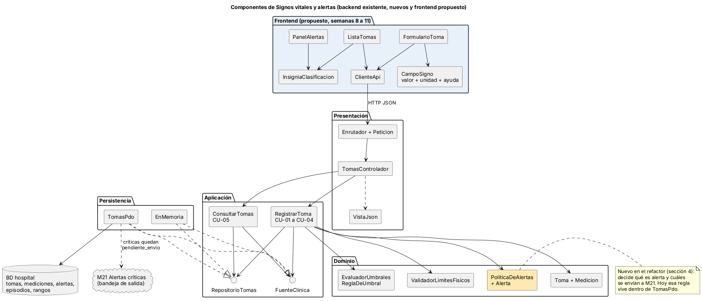
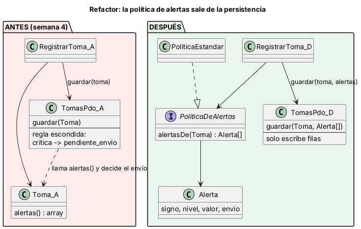
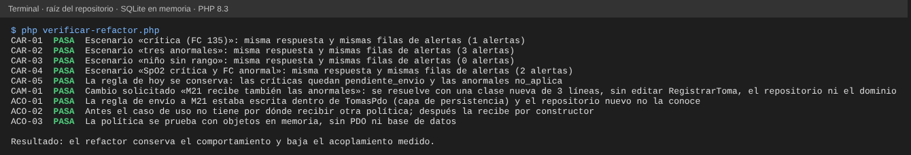

# Semana 7 — Diseño de componentes y refactorización de «captura de signos vitales, evaluación de umbrales y generación de alerta»

**Estudiante:** Joshua Eduardo García Reyes (`jgarciar73-svg`) · **Módulo:** Signos vitales y alertas por valores anormales (módulo 13, reasignado dentro del grupo G1)

El diseño parte del Micro-HIS de las semanas 3 y 4 (`../micro-his-signos-vitales/`). Primero se mide dónde está el mayor acoplamiento, luego se diseñan los componentes y sus contratos, y al final se compara un refactor concreto antes y después con un script que lo ejecuta.

## 1. Puntos de acoplamiento (medidos en el código de la semana 4)

| # | Punto | Evidencia | Costo de un cambio |
|---|---|---|---|
| A1 | **La política de alertas está partida**: `Toma::alertas()` decide qué es alerta y `TomasPdo::guardar()` decide cuáles se envían a M21 (`Critica ? 'pendiente_envio' : 'no_aplica'`). | `TomasPdo.php` contiene la regla; las alertas viajan como arreglos con claves de texto (`signo`, `nivel`, `valor`) que repiten Dominio, Persistencia, respuesta HTTP y pruebas. | Cambiar a quién se envía exige editar la capa de SQL y sus pruebas con PDO. |
| A2 | `TomasPdo` implementa a la vez `RepositorioTomas` (tablas propias) y `FuenteClinica` (episodios, pacientes y rangos de otros módulos). | `final class TomasPdo implements RepositorioTomas, FuenteClinica`. | Un cambio en las tablas de otro módulo obliga a tocar el adaptador que guarda las tomas. |
| A3 | Dos fuentes para los límites: `ValidadorLimitesFisicos::LIMITES` (constante en el código) y `rangos_signos_vitales` (catálogo); la regla «SpO2 solo es peligrosa hacia abajo» está en código y el catálogo igual trae `critico_alto`. | `Signos.php`, `esquema.sql`. | Ajustar un límite puede requerir cambiar el código y el catálogo. |
| A4 | Las unidades son implícitas (mmHg, lpm, rpm, °C, %): `Medicion` no tiene unidad y la respuesta tampoco la informa. | `Medicion::desde()`. | Un cliente en otra unidad (°F) recibe `medicion_invalida` sin saber por qué. |
| A5 | El rol permitido está escrito dentro de cada caso de uso (`'enfermeria'` en `RegistrarToma`, `['enfermeria', 'medico']` en `ConsultarTomas`). | Ambos archivos. | Cambiar quién puede registrar toca el caso de uso. |

**Elegido para el refactor: A1.** Es el que más cambia por razones clínicas (la política con M21 es la que más se va a ajustar), cruza tres capas y es el único donde una regla de negocio vive en la capa de SQL. A2 y A5 quedan como siguientes refactores; A3 y A4 como decisiones de catálogo para la semana 8 (UX).

## 2. Componentes



**Backend** (existe, salvo lo amarillo):

| Componente | Responsabilidad | No debe |
|---|---|---|
| `Enrutador`, `Peticion` | Elegir la acción por método y ruta `/api/v1/signos-vitales/tomas` | Tener reglas clínicas |
| `TomasControlador`, `VistaJson` | Traducir petición ↔ caso de uso y código de error ↔ estado HTTP | Tener SQL |
| `RegistrarToma` (CU-01 a CU-04), `ConsultarTomas` (CU-05) | Orquestar: permiso, episodio, validar, clasificar, alertar, guardar | Conocer PDO |
| `Toma`, `Medicion`, `EvaluadorUmbrales`, `ReglaDeUmbral`, `ValidadorLimitesFisicos` | Reglas de signos vitales | Conocer HTTP o SQL |
| **`PoliticaDeAlertas`, `Alerta` (nuevo)** | Decidir qué mediciones generan alerta y si se envía a M21 | Escribir en la base |
| `RepositorioTomas`, `FuenteClinica` (puertos) | Límite de la Aplicación con los datos | Exponer SQL |
| `TomasPdo`, `EnMemoria` | Adaptadores: escribir y leer filas | Decidir políticas |

**Frontend propuesto** (las pantallas se diseñan en las semanas 8 a 11):

| Componente | Entra | Sale |
|---|---|---|
| `FormularioToma` | `paciente_id`, `episodio_id`, rol | evento `tomaGuardada {toma_id, clasificaciones, alertas}`; evento `errorToma {codigo, campos}` |
| `CampoSigno` | `tipo`, unidad visible, ayuda con el rango, valor | evento `cambio {tipo, valor}`; muestra el error de su campo |
| `ListaTomas` | `tomas[]` | evento `seleccionar {toma_id}` |
| `InsigniaClasificacion` | `normal`, `anormal`, `critica` o `sin_rango` | texto + icono (no solo color) |
| `PanelAlertas` | `alertas[]` | evento `reconocer {toma_id, signo}` |
| `ClienteApi` | `registrar(entrada)`, `listar(paciente, episodio)` | datos o error tipificado (sin sesión, sin permiso, episodio, validación, servidor) |

## 3. Contratos de entrada y salida

**POST `/api/v1/signos-vitales/tomas`** (cabecera de demostración `X-Usuario-Demo`):

| | Contenido |
|---|---|
| Entrada | `{"paciente_id": "...", "episodio_id": "...", "mediciones": {"fc": 135, "spo2": 97, "temp": 36.8}}`; signos `pas`, `pad`, `fc`, `fr`, `temp`, `spo2` |
| Salida 201 | `{"toma_id": "...", "clasificaciones": {"fc": "critica", ...}, "alertas": [{"signo": "fc", "nivel": "critica", "valor": 135.0}]}` |
| Errores | 400 `json_invalido`, 401 `sin_sesion`, 403 `acceso_denegado`, 409 `episodio_no_disponible`, 422 `medicion_invalida` (con `campos`), `toma_vacia`, `signo_repetido`, 500 `error_persistencia` |

**GET** la misma ruta con `?paciente_id=&episodio_id=` → 200 `{"tomas": [...], "total": n}`; mismos errores 401, 403 y 409.

**Puertos de la Aplicación:** `RepositorioTomas::guardar(Toma): void` (todo o nada; falla con `ErrorPersistencia`), `deEpisodio(string): array`; `FuenteClinica::episodioActivo(paciente, episodio): ?array`, `rangosPara(edad): array`.
**Nuevo:** `PoliticaDeAlertas::alertasDe(Toma): Alerta[]`, donde `Alerta` = `signo`, `nivel`, `valor`, `envio` (`no_aplica` o `pendiente_envio`); y `RepositorioTomas::guardar(Toma, Alerta[]): void`.

## 4. Refactor concreto: la política de alertas sale de la persistencia



**Antes** (código real de la semana 4, `TomasPdo::guardar`):
```php
foreach ($t->alertas() as $a) {   // las críticas quedan para enviarse a M21
    $alerta->execute([$t->id, $a['signo'], $a['nivel'], $a['valor'], $a['nivel'] === Clasificacion::Critica->value ? 'pendiente_envio' : 'no_aplica']);
}
```
**Después** (`ejemplo-refactor/despues/`): `RegistrarToma` pide `$alertas = $this->politica->alertasDe($toma)` y `guardar($toma, $alertas)` solo escribe `$a->envio->value`. La regla vive en `PoliticaEstandar`; un cambio de M21 es una clase nueva (`PoliticaEnviaAnormales`, 3 líneas) que se inyecta.

| Medición (script) | Antes | Después |
|---|---|---|
| `ACO-01` Dónde está la regla de envío | dentro de `TomasPdo` (persistencia) | en `PoliticaEstandar` (dominio); el repositorio no la conoce |
| `ACO-02` Por dónde entra otra política | no hay (el caso de uso no la recibe) | por constructor (`PoliticaDeAlertas`) |
| `CAM-01` Cambio «M21 recibe también las anormales» | editar `TomasPdo` | clase nueva, sin editar los demás archivos |
| `ACO-03` Probar la política | solo con una base de datos | con objetos en memoria |
| `CAR-01` a `CAR-05` Comportamiento | respuesta y filas de referencia | idénticas en 4 escenarios |

**Justificación.** `TomasPdo` cambiaba por dos razones (el esquema y la política con M21); ahora solo por la primera (SRP). Una política nueva no obliga a editar clases existentes (abierto/cerrado) y el caso de uso depende de una abstracción (inversión de dependencias). Se mantiene la regla actual, y las pruebas de caracterización `CAR` fijan el comportamiento antes de mover nada.

**Pasos para aplicarlo en el Micro-HIS** (no se aplicaron esta semana, para no tocar el código que otras semanas modifican): 1) agregar `Alerta` y las políticas; 2) cambiar el puerto a `guardar(Toma, array $alertas)` y ajustar `TomasPdo` y `EnMemoria`; 3) inyectar la política en `RegistrarToma`; 4) quitar `Toma::alertas()` y actualizar APP-01 y REP-01. **Riesgo:** cambia la firma del puerto; lo cubren las pruebas existentes de ambos adaptadores.

## 5. Evidencia

Desde la raíz del repositorio: `php docs/modulos/signos-vitales-alertas/semana-07/verificar-refactor.php` (PHP 8.2 y SQLite en memoria; no requiere base de datos instalada).



Se dañó el ejemplo a propósito y las 5 alteraciones se detectaron:

| Daño | Falla |
|---|---|
| La política estándar envía también las anormales | `CAR-02`, `CAR-04`, `ACO-03` |
| El repositorio nuevo escribe siempre `no_aplica` | `CAR-01`, `CAR-04`, `CAM-01` |
| La política nueva deja de enviar anormales | `CAM-01` |
| El repositorio nuevo vuelve a decidir el envío | `ACO-01` |
| El caso de uso ignora la política recibida | `CAM-01` |

## 6. Límites

- El refactor se demuestra en un ejemplo que reutiliza el dominio real, no cambia el código del Micro-HIS.
- Los componentes de frontend son una propuesta de diseño, sin código.
- El «antes» es el código de la semana 4; la semana 5 (API e idempotencia) no está en `develop` y no se consideró.
