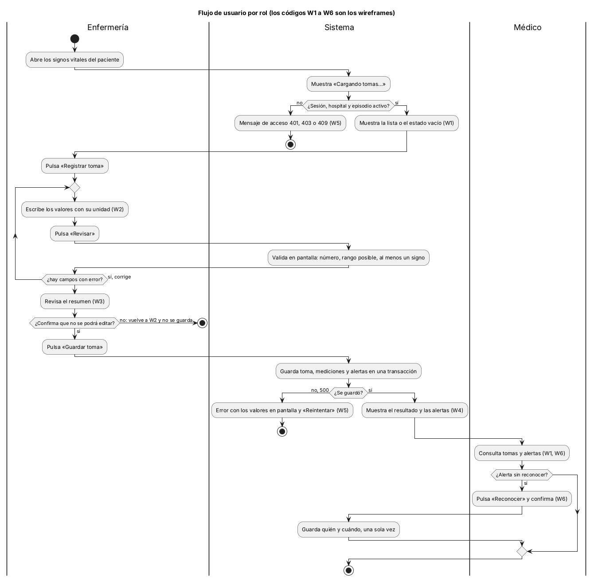
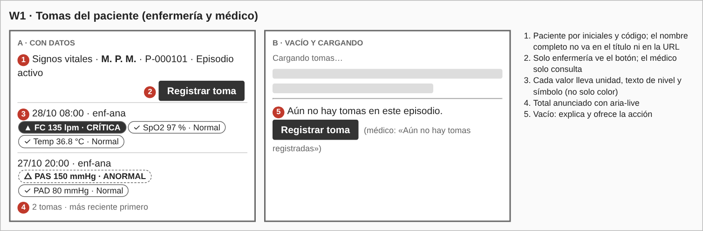
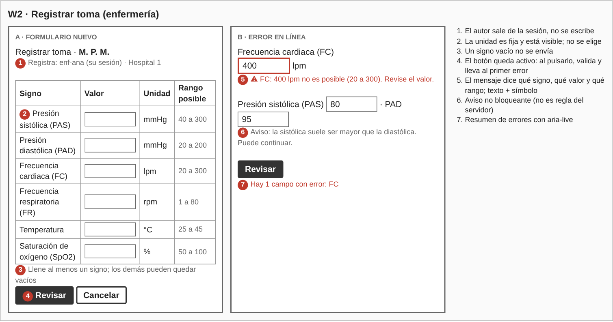
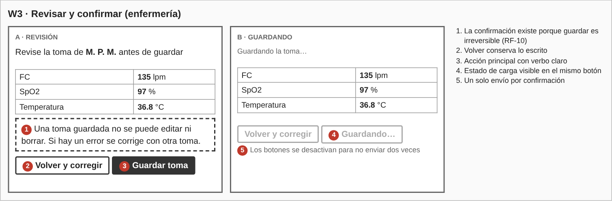
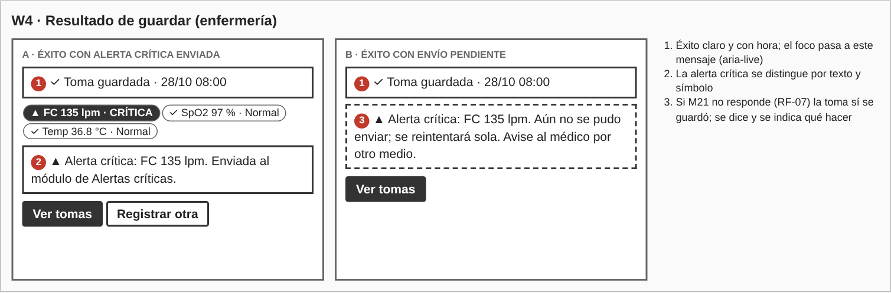
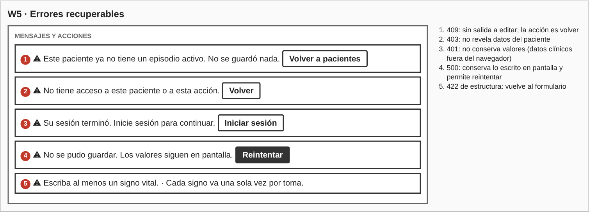
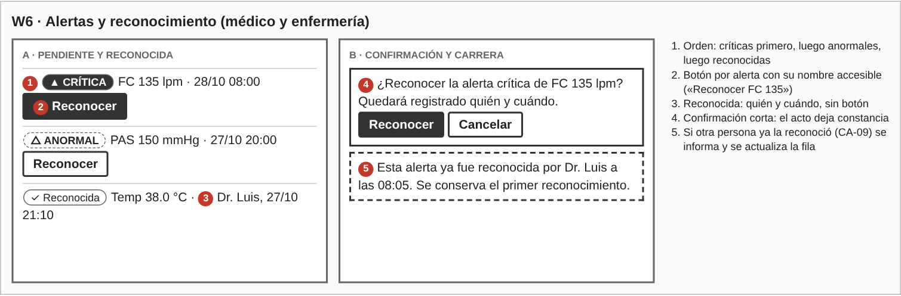
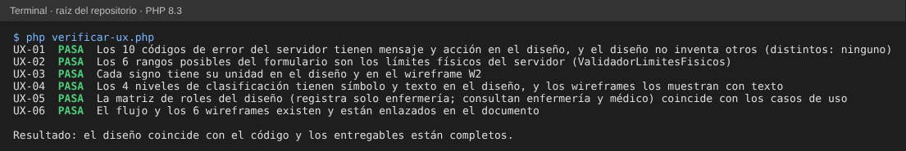

# Semana 8 — Diseño de experiencia de usuario de «captura de signos vitales, evaluación de umbrales y generación de alerta»

**Estudiante:** Joshua Eduardo García Reyes (`jgarciar73-svg`) · **Módulo:** Signos vitales y alertas por valores anormales (módulo 13, reasignado dentro del grupo G1)

El flujo se diseña sobre lo que ya hace el Micro-HIS (semanas 3 y 4: códigos de error, límites físicos, niveles) y sobre los requisitos de la semana 2. Quien manda el contenido de cada mensaje es el servidor; la pantalla solo lo traduce a una frase que dice qué pasó y qué hacer.

## 1. Roles

| Acción | Enfermería | Médico | Base |
|---|---|---|---|
| Registrar toma | Sí | No | RF-02, `RegistrarToma` |
| Consultar tomas y alertas | Sí | Sí | RF-08, `ConsultarTomas` |
| Reconocer alerta (CU-06, aún sin código) | Sí | Sí | RF-09 |

Ambos roles solo ven pacientes de su hospital y con episodio activo. El autor de la toma sale de la sesión, nunca de un campo del formulario.

## 2. Flujo de usuario por rol

- **Enfermería:** abre al paciente → ve la lista o el estado vacío → «Registrar toma» → escribe valores → «Revisar» (valida) → resumen → decide guardar → ve el resultado y las alertas.
- **Médico:** abre al paciente → consulta tomas y alertas → reconoce las alertas pendientes. No ve el botón de registrar.

**Decisiones del flujo.** Hay un paso de **revisión y confirmación** porque guardar es irreversible: una toma no se edita ni se borra, un error se corrige con otra toma (RF-10). El botón «Revisar» no se deshabilita; al pulsarlo valida y lleva al primer error. Tras confirmar, los botones se desactivan para no enviar dos veces.

## 3. Wireframes

Los seis wireframes están en `wireframes/wireframes.html` (se abre en cualquier navegador); `wireframes/generar-png.js` genera las imágenes.

### 3.1 Campos y validaciones de W2

| Signo | Nombre | Unidad | Rango posible |
|---|---|---|---|
| PAS | Presión sistólica | mmHg | 40 a 300 |
| PAD | Presión diastólica | mmHg | 20 a 200 |
| FC | Frecuencia cardiaca | lpm | 20 a 300 |
| FR | Frecuencia respiratoria | rpm | 1 a 80 |
| Temp | Temperatura | °C | 25 a 45 |
| SpO2 | Saturación de oxígeno | % | 50 a 100 |

- La unidad es fija y visible; no se elige (evita registrar °F como °C). El rango posible es el límite físico del servidor (`ValidadorLimitesFisicos`), no un umbral clínico.
- En pantalla se valida: es un número, está dentro del rango posible y hay al menos un signo con valor. El servidor repite la validación y manda.
- Un signo vacío no se envía. Se acepta punto decimal.
- PAS menor que PAD solo genera un **aviso no bloqueante**; no es regla del servidor.
- La pantalla no clasifica: normal, anormal o crítica lo decide el servidor según la edad del paciente.

### 3.2 Estados por pantalla

| Pantalla | Vacío | Carga | Éxito | Error |
|---|---|---|---|---|
| W1 Tomas | «Aún no hay tomas en este episodio» + acción | Filas de relleno y «Cargando tomas…» | Lista, más reciente primero | W5 |
| W2 Formulario | Campos en blanco con unidad y rango | — | Pasa a W3 | Mensaje junto al campo y resumen |
| W3 Revisión | — | «Guardando la toma…» | Pasa a W4 | W5 (conserva valores) |
| W4 Resultado | — | — | «Toma guardada» con niveles y alertas | — |
| W5 Errores | — | — | — | Un mensaje y una acción por código (§4) |
| W6 Alertas | «No hay alertas» | «Cargando alertas…» | Lista con estado de cada una | «Ya fue reconocida por…» |

### 3.3 Niveles: texto y símbolo, no solo color

| Clasificación | Símbolo | Texto | Estilo |
|---|---|---|---|
| normal | ✓ | Normal | contorno simple |
| anormal | △ | ANORMAL | contorno punteado y negrita |
| critica | ▲ | CRÍTICA | relleno oscuro y negrita |
| sin_rango | ? | Sin rango | contorno simple; no genera alerta |

## 4. Mensajes de error (código → qué ve el usuario → qué puede hacer)

| Código | HTTP | Mensaje | Acción |
|---|---|---|---|
| `json_invalido` | 400 | No se pudo enviar la toma. Intente de nuevo. | Reintentar |
| `sin_sesion` | 401 | Su sesión terminó. Inicie sesión para continuar. | Iniciar sesión |
| `acceso_denegado` | 403 | No tiene acceso a este paciente o a esta acción. | Volver |
| `ruta_no_encontrada` | 404 | Algo salió mal. Intente de nuevo; si sigue, avise a soporte. | Volver |
| `metodo_no_permitido` | 405 | Algo salió mal. Intente de nuevo; si sigue, avise a soporte. | Volver |
| `episodio_no_disponible` | 409 | Este paciente ya no tiene un episodio activo. No se guardó nada. | Volver a pacientes |
| `medicion_invalida` | 422 | «{Signo}: {valor} {unidad} no es posible ({mín} a {máx}). Revise el valor.» | Corregir el campo marcado |
| `toma_vacia` | 422 | Escriba al menos un signo vital. | Volver al formulario |
| `signo_repetido` | 422 | Cada signo va una sola vez por toma. | Volver al formulario |
| `error_persistencia` | 500 | No se pudo guardar. Los valores siguen en pantalla. | Reintentar |

Si la alerta crítica no llegó a M21 (RF-07), la toma sí se guardó: W4b lo dice y pide avisar al médico por otro medio.

## 5. Ayuda contextual y protección de datos

- **Ayuda:** cada campo muestra su unidad y su rango posible; el resumen de W3 explica por qué se confirma; los mensajes dicen qué hacer.
- **Datos del paciente:** se muestra por iniciales y código; el nombre completo y los valores no van en el título de la pestaña, en la URL ni en la bitácora (RNF-02).
- **Datos clínicos en el navegador:** los valores viven solo en pantalla; no se guardan en `localStorage` ni en cookies. Si la sesión termina (401), no se conservan. Antes de salir con valores sin guardar se pide confirmación.
- **Permisos:** el botón de registrar no existe para el médico; el servidor lo vuelve a comprobar.

## 6. Trazabilidad

| Requisito | Dónde se atiende |
|---|---|
| RF-01 (cada medición con su unidad) | W2, §3.1 |
| RF-02, RF-03 (rol y episodio) | §1, W5 (403, 409) |
| RF-04 (error indica el signo) | W2b, mensaje `medicion_invalida` |
| RF-05, RF-06 (niveles y alertas) | W1, W4, §3.3 |
| RF-07 (envío pendiente a M21) | W4b |
| RF-08, RF-09 (consultar y reconocer) | W1, W6 |
| RF-10 (no se edita) | W3 |
| RNF-07 (error marca el campo; alerta por texto) | W2b, §3.3 |

## 7. Evidencia

`php docs/modulos/signos-vitales-alertas/semana-08/verificar-ux.php` (solo PHP; lee el código del Micro-HIS y este documento). Comprueba que la matriz de roles, los códigos de error, los límites, las unidades y los niveles de este diseño coinciden con el código, y que los wireframes existen.

Se dañó el diseño a propósito y las 5 alteraciones se detectaron:

| Daño | Falla |
|---|---|
| Se borra el mensaje de `error_persistencia` | `UX-01` |
| El rango de FC pasa a «20 a 250» | `UX-02` |
| Se quita la unidad `rpm` de los wireframes | `UX-03` |
| Se quita el nivel `sin_rango` | `UX-04` |
| El médico puede registrar tomas | `UX-05` |

## 8. Límites

- Son wireframes de baja fidelidad para escritorio; la adaptación a móvil es de la semana 10 y la evaluación de usabilidad y accesibilidad, de la semana 9.
- Los textos no se probaron con usuarios reales.
- Reconocer alertas (CU-06) está diseñado pero no existe en el Micro-HIS; el aviso de PAS menor que PAD es una propuesta que el servidor no exige.
