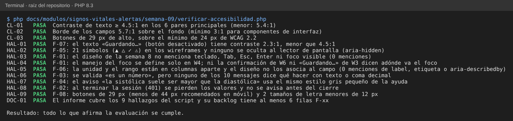

# Semana 9 — Evaluación de usabilidad y accesibilidad de «captura de signos vitales, evaluación de umbrales y generación de alerta»

**Estudiante:** Joshua Eduardo García Reyes (`jgarciar73-svg`) · **Módulo:** Signos vitales y alertas por valores anormales (módulo 13, reasignado dentro del grupo G1)

Se evalúa el diseño de la semana 8 (flujo por rol, 6 wireframes `W1` a `W6` y 10 mensajes de error) con las 10 heurísticas de Nielsen y los criterios de WCAG 2.2 nivel AA que se pueden juzgar sobre un wireframe: teclado, foco, contraste, etiquetas, mensajes y prevención de errores. Todavía no hay pantalla programada, así que se evalúa el diseño, no un producto; los hallazgos son lo que habría que corregir **antes** de programarla.

Cómo se priorizó: el impacto se mide por lo que puede pasar con el paciente. Un valor mal escrito o perdido que llega a una alerta (o la esconde) pesa más que un texto difícil de leer.

| Prioridad | Significado |
|---|---|
| Alta | Puede hacer que una toma se pierda, se registre mal o no se entienda una alerta |
| Media | Obliga a repetir trabajo o confunde, pero el dato queda bien |
| Baja | Molestia o incumplimiento menor que no cambia el dato |

## 1. Checklist completado

Se marca **Cumple**, **Parcial** o **No cumple** según lo que dice el documento y los wireframes de la semana 8.

### 1.1 Heurísticas de usabilidad (Nielsen)

| N.º | Heurística | Resultado | Evidencia |
|---|---|---|---|
| H1 | Visibilidad del estado | Cumple | Estados vacío/carga/éxito/error por pantalla (§3.2 de la semana 8) |
| H2 | Lenguaje cercano al usuario | Cumple | Mensajes en español claro, sin códigos; nombres de signo con unidad |
| H3 | Control y libertad | Parcial | Hay «Volver» y confirmación antes de salir, pero un 401 pierde los valores (F-02) |
| H4 | Consistencia | Parcial | El aviso de PAS/PAD se ve igual que la ayuda (F-04) |
| H5 | Prevención de errores | Parcial | Rango y unidad fija evitan errores físicos; falta decir qué hacer con texto o coma (F-03) |
| H6 | Reconocer en vez de recordar | Parcial | Unidad y rango visibles, pero no unidos al campo para quien no ve la pantalla (F-06) |
| H7 | Flexibilidad y eficiencia | No cumple | No se define uso con teclado (F-01) |
| H8 | Diseño minimalista | Cumple | Una acción principal por pantalla |
| H9 | Ayudar a recuperarse de errores | Parcial | Cada código dice qué hacer; el 401 no conserva lo escrito (F-02) |
| H10 | Ayuda y documentación | Cumple | Ayuda por campo y mensajes con acción |

### 1.2 Accesibilidad (WCAG 2.2 AA)

| Criterio | Tema | Resultado | Evidencia |
|---|---|---|---|
| 1.1.1 Contenido no textual | Símbolos | Parcial | 21 símbolos sin ocultar al lector de pantalla (F-05) |
| 1.3.1 Información y relaciones | Etiquetas | No cumple | Unidad y rango no asociados al campo (F-06) |
| 1.4.1 Uso del color | Niveles y errores | Cumple | Texto + símbolo + estilo; error con texto junto al campo |
| 1.4.3 Contraste del texto (4.5:1) | Contraste | Parcial | Los 6 pares principales cumplen (mínimo 5.4:1); «Guardando…» no (F-07) |
| 1.4.11 Contraste de componentes (3:1) | Campos | Cumple | Borde de campos 5.7:1 |
| 2.1.1 Teclado | Teclado | No cumple | El diseño no menciona teclado (F-01) |
| 2.4.3 Orden del foco | Foco | No cumple | Foco definido solo en W4 (F-01) |
| 2.4.7 Foco visible | Foco | No cumple | No se define estilo de foco (F-01) |
| 2.5.8 Tamaño del objetivo (24 px) | Botones | Cumple | Botones de 29 px de alto; para móvil se recomienda más (F-08) |
| 3.2.2 Al introducir datos | Confirmación | Cumple | «Revisar» antes de guardar; nada se envía solo |
| 3.3.1 Identificación de errores | Mensajes | Cumple | Mensaje junto al campo y resumen |
| 3.3.2 Etiquetas o instrucciones | Etiquetas | Parcial | Hay instrucción visible; falta asociarla (F-06) |
| 3.3.3 Sugerencia ante errores | Mensajes | Parcial | El 422 dice el rango; texto o coma no (F-03) |
| 3.3.4 Prevención de errores (datos) | Confirmación | Cumple | Revisión y confirmación porque la toma no se edita (RF-10) |
| 4.1.3 Mensajes de estado | Éxito | Cumple | W4 usa `aria-live` |
| 2.2.1 Tiempo ajustable | Sesión | No cumple | La sesión termina sin aviso previo (F-02) |

Resumen: de 26 puntos, 11 cumplen, 9 cumplen en parte y 6 no cumplen. Los 6 que no cumplen salen de tres hallazgos: F-01 (H7, 2.1.1, 2.4.3 y 2.4.7), F-06 (1.3.1) y F-02 (2.2.1).

## 2. Hallazgos con evidencia

Cada hallazgo se reproduce con `verificar-accesibilidad.php`; la columna «Prueba» es el ID que imprime.

| Hallazgo | Prueba | Qué se encontró | Dónde |
|---|---|---|---|
| F-01 | HAL-03, HAL-04 | El diseño no menciona teclado, Tab, Esc, Enter ni foco visible (0 menciones). El foco solo se define en W4; ni «Guardando…» (W3) ni la confirmación de W6 dicen adónde va | `semana-08-diseno-ux.md`, `wireframes.html` |
| F-02 | HAL-08 | Al terminar la sesión (401) los valores no se conservan y no se avisa antes del cierre. Una toma de 6 signos escrita a mano se pierde y hay que medir o escribir de nuevo | §5 de la semana 8 |
| F-03 | HAL-06 | Se valida «es un número», pero ninguno de los 10 mensajes dice qué hacer con texto o con coma decimal (`36,5`) | §3.1 y §4 |
| F-04 | HAL-07 | El aviso «la sistólica suele ser mayor que la diastólica» usa el mismo gris pequeño de la ayuda y se confunde con ella | W2b |
| F-05 | HAL-02 | 21 símbolos (▲ △ ✓ ⚠) sin `aria-hidden`: el lector de pantalla los lee como «triángulo negro» antes de «CRÍTICA» | W1, W4, W6 |
| F-06 | HAL-05 | La unidad y el rango están en columnas aparte; el diseño no dice que se asocien al campo (0 menciones de `label` ni `aria-describedby`) | §3.1 |
| F-07 | HAL-01 | El texto «Guardando…» del botón desactivado tiene contraste 2.3:1, menor que 4.5:1 | W3 |
| F-08 | HAL-09 | Botones de 29 px de alto (menos de 44 px recomendados en móvil) y 2 tamaños de letra menores de 12 px | todos |

Lo que sí se midió y cumple: `CL-01` (contraste ≥ 4.5:1 en 6 pares, el menor 5.4:1), `CL-02` (borde de campos 5.7:1) y `CL-03` (botones de 29 px sobre el mínimo de 24 px).

## 3. Backlog priorizado

Ordenado por prioridad y, dentro de ella, por esfuerzo. «Criterio verificable» es lo que debe poder comprobar quien revise la corrección.

| Hallazgo | Prioridad | Corrección propuesta | Criterio verificable | Semana |
|---|---|---|---|---|
| F-02 | Alta | Avisar 2 minutos antes de que termine la sesión con botón «Seguir conectado»; si ocurre el 401, guardar los valores solo en memoria de la página y devolverlos tras iniciar sesión (sin `localStorage`) | Con la sesión vencida, el segundo intento tras iniciar sesión envía los 6 valores sin reescribirlos; en el almacenamiento del navegador no queda ningún valor | 11 |
| F-06 | Alta | Cada campo con `<label for>` que diga «Presión sistólica (mmHg)» y `aria-describedby` hacia «Rango posible: 40 a 300» | Con el lector de pantalla el campo se lee «Presión sistólica, mmHg, rango 40 a 300»; un validador de HTML no reporta campos sin etiqueta | 11 |
| F-01 | Alta | Definir orden de Tab = orden visual; Enter en «Revisar»; Esc cierra la confirmación; foco visible de 2 px; tras «Revisar» con errores el foco va al primer campo con error; tras guardar, al mensaje de éxito | Recorrer W2 a W6 solo con teclado sin usar el ratón; el foco siempre se ve y nunca queda atrapado | 11 |
| F-03 | Media | Agregar a `medicion_invalida` el caso «no es un número»: «Escriba solo números; use punto para decimales (36.5)» y aceptar coma convirtiéndola a punto | Escribir `36,5` guarda 36.5; escribir `abc` muestra el mensaje junto al campo | 11 |
| F-05 | Media | Marcar los símbolos con `aria-hidden="true"`; el texto («CRÍTICA», «ANORMAL») ya cumple lo que el símbolo dice | El lector solo dice «CRÍTICA»; el contador de símbolos sin `aria-hidden` es 0 | 11 |
| F-04 | Media | Mostrar el aviso con borde y símbolo propio (⚠ con texto «Revise:»), distinto a la ayuda | A simple vista el aviso se distingue de la ayuda; el color de texto del aviso no es el de `.hint` | 11 |
| F-07 | Baja | Cambiar `.off` a un gris con contraste ≥ 4.5:1 (por ejemplo `#6b6b6b` sobre blanco: 5.3:1) | `HAL-01` pasa a FALLA (el hallazgo ya no existe) y el contraste calculado es ≥ 4.5:1 | 11 |
| F-08 | Baja | En móvil, botones de 44 px de alto y letra de 14 px o más | Ninguno de los botones mide menos de 44 px en 320 px de ancho; `HAL-09` pasa a FALLA | 10 |

Cuando se corrija un hallazgo, la prueba `HAL-xx` pasa a FALLA a propósito: ya no se cumple lo que el informe afirma, y hay que actualizar el informe junto con la corrección.

## 4. Evidencia

`php docs/modulos/signos-vitales-alertas/semana-09/verificar-accesibilidad.php` (solo PHP; lee los wireframes y el documento de la semana 8 y calcula los contrastes según la fórmula de WCAG). Imprime `CL-01..03` (lo que cumple), `HAL-01..09` (los hallazgos) y `DOC-01` (que este informe los cubra). Sale con código 0 si todo se cumple y 1 si algo no.

Se alteró el diseño o el informe a propósito y las 5 alteraciones se detectaron:

| Alteración | Falla |
|---|---|
| El texto de ayuda pasa a gris claro `#aaaaaa` | `CL-01` |
| Se agrega «Tab» y «foco visible» al documento de la semana 8 | `HAL-03` |
| Se agrega `aria-hidden` a un símbolo del wireframe | `HAL-02` |
| El color de «Guardando…» pasa a `#555` | `HAL-01` |
| Se borra la fila F-06 de la tabla de hallazgos del informe | `DOC-01` |

## 5. Límites

- Se evaluó el diseño, no una pantalla real: no se probó con un lector de pantalla ni con personas usuarias. Los criterios que dependen del código (nombre accesible, orden real del foco) se evalúan por lo que el diseño dice o no dice.
- El contraste se calculó sobre los colores de los wireframes; el color final puede cambiar.
- Las mediciones de tamaño (29 px) salen del CSS de los wireframes de escritorio; la adaptación a móvil es de la semana 10.
- No se evaluó el idioma ni el tamaño de texto al ampliar al 200 %.
