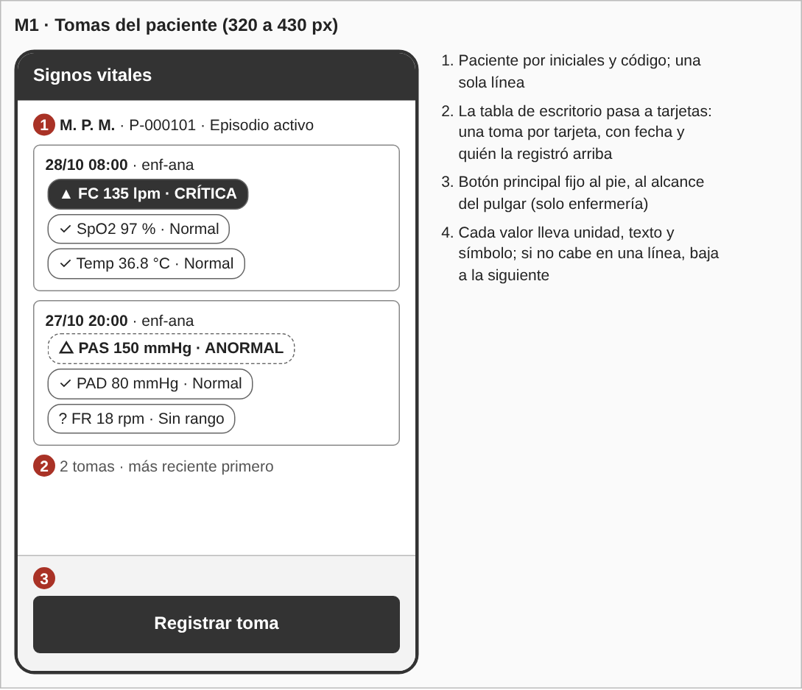
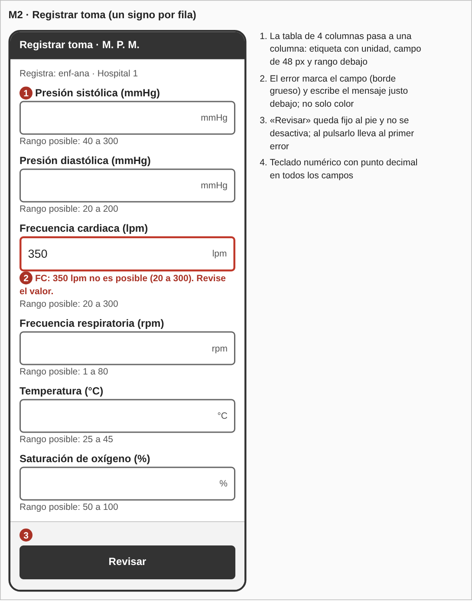
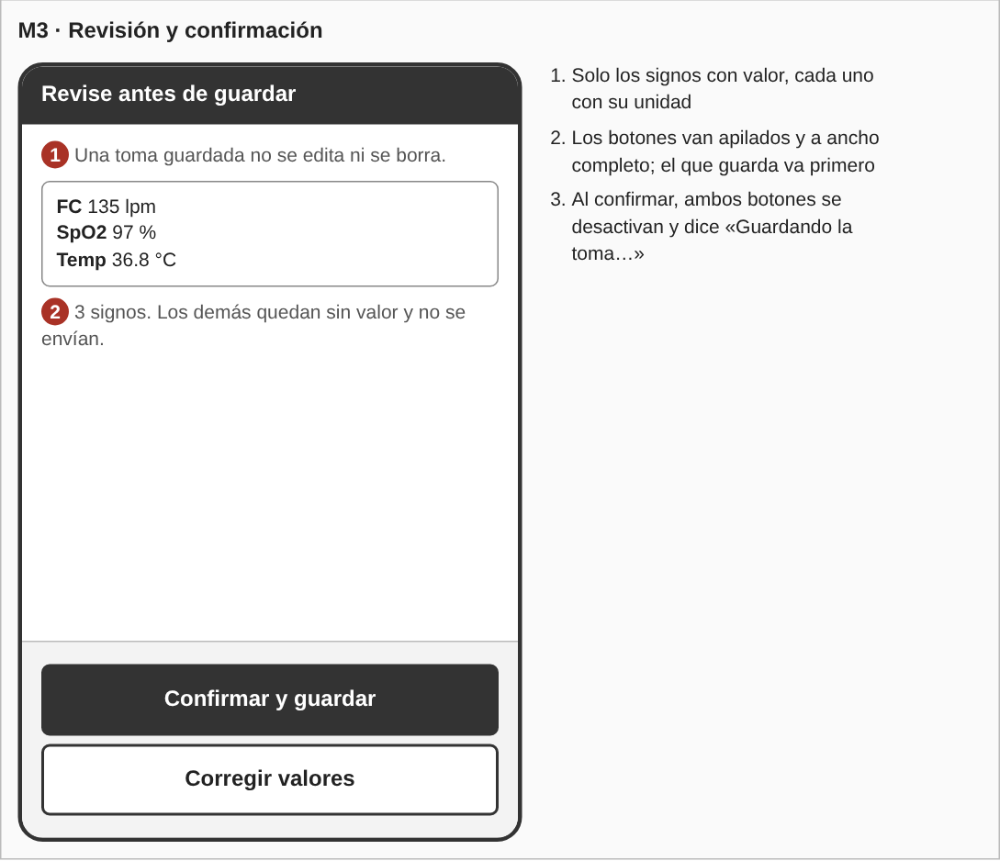
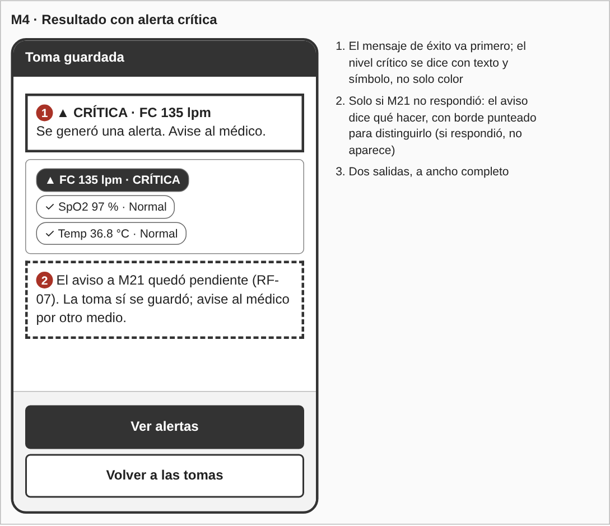
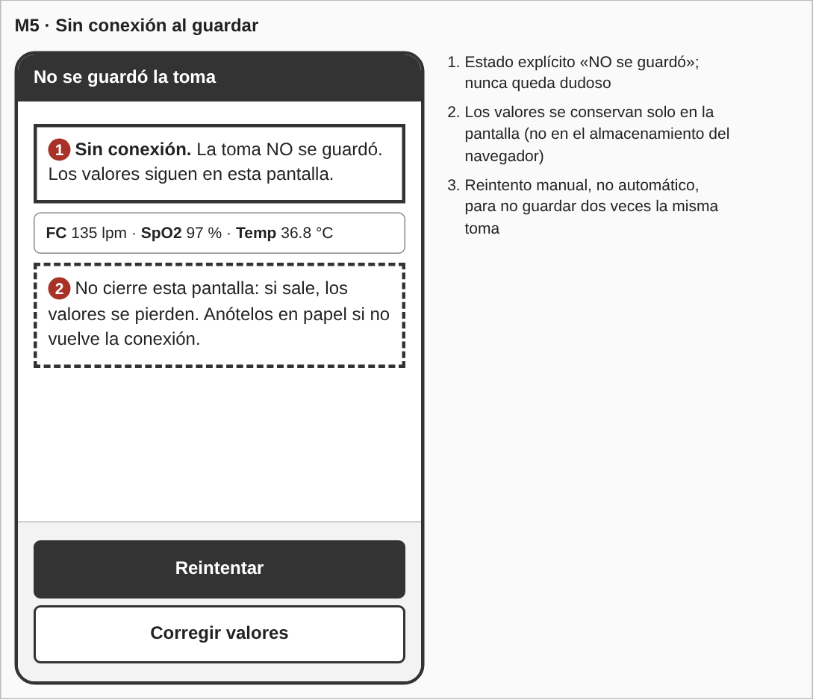
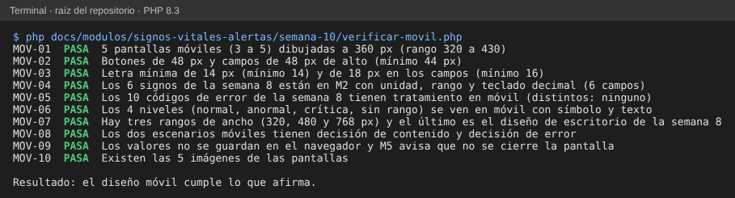

# Semana 10 — Diseño para móvil de «captura de signos vitales, evaluación de umbrales y generación de alerta»

**Estudiante:** Joshua Eduardo García Reyes (`jgarciar73-svg`) · **Módulo:** Signos vitales y alertas por valores anormales (módulo 13, reasignado dentro del grupo G1)

Se adapta a móvil (320 a 430 px de ancho) el flujo diseñado en la semana 8 para escritorio: roles, validaciones, niveles y mensajes de error no cambian; cambia cómo se distribuyen. Quien registra una toma suele estar de pie junto a la cama, con una mano ocupada, así que se prioriza lo que se hace con el pulgar.

## 1. Qué cambia respecto al escritorio

| Tema | Escritorio (semana 8) | Móvil |
|---|---|---|
| Lista de tomas | Filas con chips | Una tarjeta por toma, fecha y autor arriba |
| Formulario | Tabla de 4 columnas (signo, valor, unidad, rango) | Una columna: etiqueta con unidad, campo de 48 px y rango debajo |
| Acción principal | Botón junto al contenido | Botón a ancho completo, fijo al pie |
| Revisión | Resumen y botones en una fila | Botones apilados; el que guarda va primero |
| Teclado | Texto | Numérico con punto decimal |
| Errores | Mensaje junto al campo y resumen | Igual, y el campo con error se desplaza hasta quedar visible |

## 2. Pantallas propuestas (5)

Los wireframes están en `wireframes-movil/moviles.html` (a 360 px; `generar-png.js` genera las imágenes).

| Pantalla | Qué se ve primero | Acción principal | Equivale a (semana 8) |
|---|---|---|---|
| M1 Tomas | Paciente (iniciales y código) y la toma más reciente | Registrar toma (solo enfermería) | W1 |
| M2 Formulario | Primer signo y su unidad | Revisar | W2 |
| M3 Revisión | Aviso de que no se edita y los valores | Confirmar y guardar | W3 |
| M4 Resultado | Éxito y nivel de la toma, en texto y símbolo | Ver alertas | W4 |
| M5 Sin conexión | «NO se guardó» y los valores | Reintentar | W5 (`error_persistencia`) |

Las alertas (W6) se ven en móvil con la misma tarjeta de M1 y un botón de reconocer a ancho completo; no se dibuja aparte para no pasar de 5 pantallas.

## 3. Reglas de breakpoint

| Ancho | Diseño |
|---|---|
| 320 a 479 px | Base. Una columna, tarjetas y botón fijo al pie. El contenido útil mide 288 px (320 menos 16 px de margen a cada lado) |
| 480 a 767 px | La misma pantalla con la columna centrada, de 480 px como máximo; los chips de una toma caben en una línea |
| 768 px o más | Diseño de escritorio de la semana 8 (tabla y 4 columnas) |

Reglas generales:

- Se diseña desde 320 px hacia arriba; no hay desplazamiento horizontal. Si un texto no cabe, baja a otra línea.
- Todo objeto que se toca mide al menos 44 px de alto (botones de 48 px, campos de 48 px).
- Ningún texto menor de 14 px; en los campos de entrada, 18 px.
- Los campos numéricos usan teclado numérico con punto decimal (`inputmode="decimal"`).
- Una sola acción principal por pantalla, fija al pie; la secundaria va debajo.
- La orientación horizontal no tiene diseño propio (ver límites).

## 4. Escenario 1: toma con valor crítico, en el pasillo

La enfermera registra FC 135, SpO2 97 y Temp 36.8 de un paciente de su hospital. Recorre M1 → M2 → M3 → M4.

- **Decisión de contenido:** M2 muestra solo el signo, su unidad y su rango; los signos sin valor no se envían ni se piden. En M4 el nivel crítico va en la primera línea, con texto y símbolo («▲ CRÍTICA · FC 135 lpm»), antes que el resto de valores, porque es lo que obliga a actuar.
- **Decisión de error:** si escribe FC 350, el campo se marca con borde grueso y el mensaje de `medicion_invalida` aparece debajo: «FC: 350 lpm no es posible (20 a 300). Revise el valor.» El teclado no se cierra y los demás valores se conservan. Si la alerta crítica no llegó a M21 (RF-07), M4 lo dice con un aviso distinto y pide avisar al médico por otro medio.

## 5. Escenario 2: conexión limitada al guardar

La enfermera confirma en M3 y la red se cae. Recorre M2 → M3 → M5.

- **Decisión de contenido:** M5 dice en la primera línea que la toma **no** se guardó y deja los valores a la vista, para poder anotarlos en papel si no vuelve la conexión. Los valores viven solo en la pantalla: no se guardan en el almacenamiento del navegador (semana 8, §5).
- **Decisión de error:** el reintento es manual. Un reintento automático podría guardar dos veces la misma toma, y una toma guardada no se borra (RF-10).
- **Si no hubo respuesta del servidor** (se envió pero no se supo si llegó), M5 cambia el texto a «No sabemos si se guardó» y el botón principal pasa a «Ver tomas del paciente», que consulta la lista (`ConsultarTomas`) antes de permitir otro envío. Una clave de idempotencia en la petición resolvería esto en el servidor; hoy no existe y queda como propuesta para el servidor, no se cambia código en esta semana.

## 6. Mensajes de error en móvil

Los textos son los de la semana 8 (§4); aquí solo cambia dónde se ven.

| Código | HTTP | Cómo se ve en móvil | Pantalla |
|---|---|---|---|
| `json_invalido` | 400 | Aviso a ancho completo con «Reintentar» | M5 |
| `sin_sesion` | 401 | Pantalla de inicio de sesión; al volver, se conservan los valores si no se cerró la página | M2 |
| `acceso_denegado` | 403 | Aviso con «Volver», sin mostrar datos del paciente | M1 |
| `ruta_no_encontrada` | 404 | Aviso genérico con «Volver» | M1 |
| `metodo_no_permitido` | 405 | Aviso genérico con «Volver» | M1 |
| `episodio_no_disponible` | 409 | Aviso «No se guardó nada» con «Volver a pacientes» | M5 |
| `medicion_invalida` | 422 | Campo con borde grueso y mensaje debajo; el foco va al primer campo con error | M2 |
| `toma_vacia` | 422 | Mensaje arriba del formulario: «Escriba al menos un signo vital» | M2 |
| `signo_repetido` | 422 | Mensaje arriba del formulario con «Volver al formulario» | M2 |
| `error_persistencia` | 500 | Aviso «No se pudo guardar. Los valores siguen en pantalla.» con «Reintentar» | M5 |

## 7. Trazabilidad

| Requisito | Dónde se atiende |
|---|---|
| RF-01 (cada medición con su unidad) | M2: unidad en la etiqueta y en el campo |
| RF-04 (el error indica el signo) | M2, escenario 1 |
| RF-05, RF-06 (niveles y alertas) | M1, M4 |
| RF-07 (envío pendiente a M21) | M4 |
| RF-10 (no se edita) | M3, escenario 2 |
| RNF-07 (error en el campo; alerta por texto) | M2, M4 |

## 8. Evidencia

`php docs/modulos/signos-vitales-alertas/semana-10/verificar-movil.php` (solo PHP; lee los wireframes móviles y los documentos de la semana 8 y de esta). Comprueba el número de pantallas y su ancho, el tamaño de botones, campos y letra, que los 6 signos tengan unidad y rango como en la semana 8, que los 10 códigos de error tengan su tratamiento móvil, que los 4 niveles se vean con texto y símbolo, los breakpoints, los dos escenarios y que las imágenes existan.

Se dañó el diseño a propósito y las 5 alteraciones se detectaron:

| Daño | Falla |
|---|---|
| Un botón pasa a `min-height:36px` | `MOV-02` |
| Se quita el rango de la temperatura de M2 | `MOV-04` |
| Se borra la fila de `error_persistencia` | `MOV-05` |
| Se quita el nivel «Sin rango» de los wireframes | `MOV-06` |
| El texto de ayuda pasa a 12 px | `MOV-03` |

## 9. Límites

- Son wireframes de baja fidelidad a 360 px; no se probaron en un dispositivo ni con personas usuarias.
- No hay diseño propio para orientación horizontal ni para tabletas más allá de la regla de 480 a 767 px.
- La clave de idempotencia y la consulta previa al reintento son propuestas; el Micro-HIS actual no las tiene.
- El aviso de PAS menor que PAD y el reconocimiento de alertas (CU-06) siguen siendo propuestas de la semana 8.
