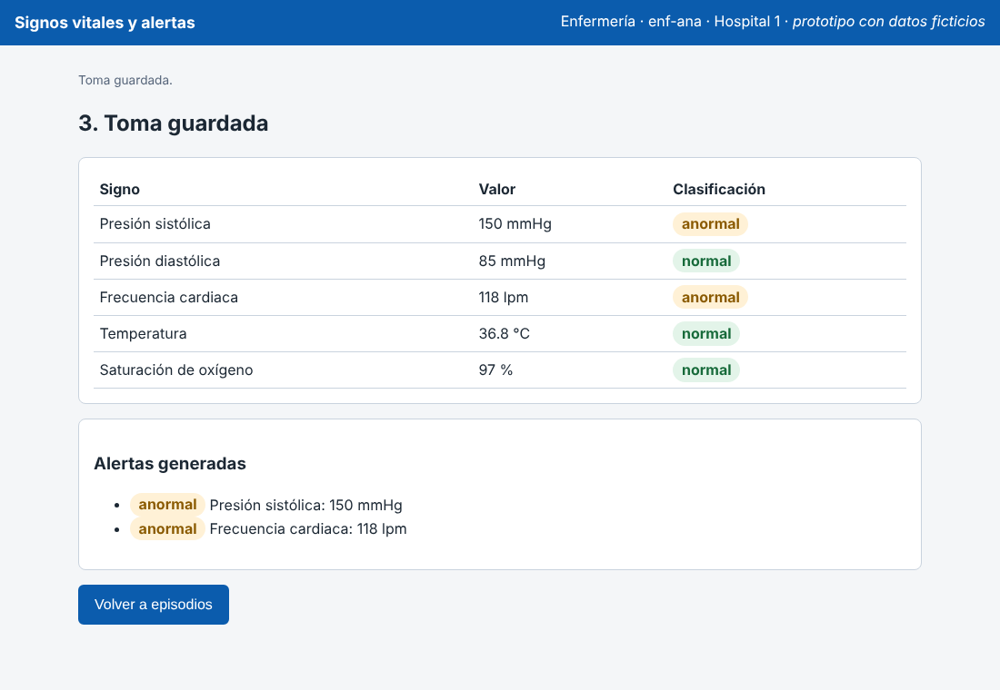
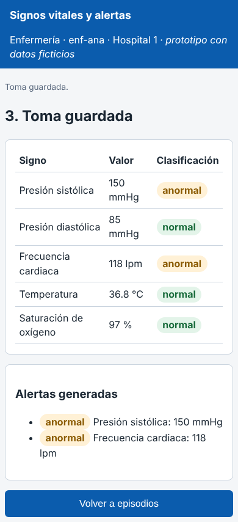
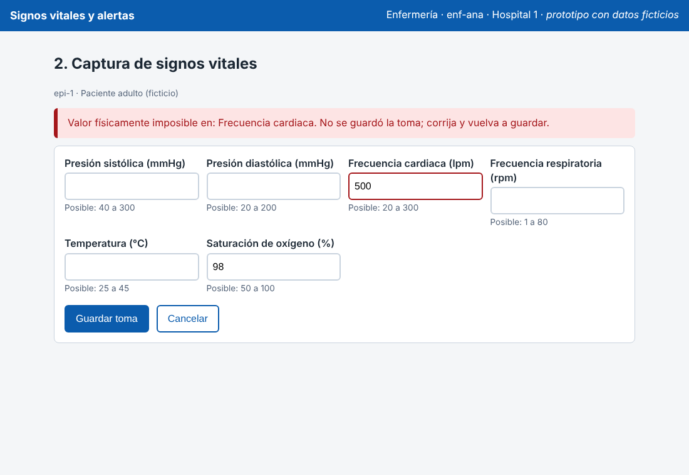
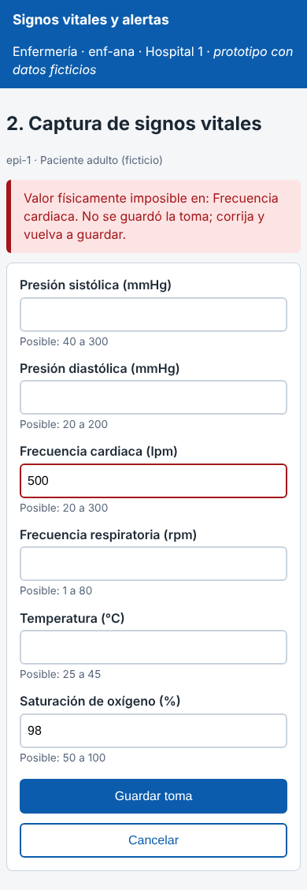

# Semana 11 – Prototipo navegable: captura de signos vitales, evaluación de umbrales y generación de alerta

Módulo: Signos vitales y alertas clínicas · Grupo G1 · Autor: Joshua Eduardo García Reyes.

El prototipo es **un solo archivo** (`prototipo/index.html`, sin servidor ni dependencias). Se abre con doble clic en un navegador y funciona igual en escritorio y en móvil (probado a 1100 px y a 390 px). Todos los datos son ficticios. La lógica de umbrales es la misma del Micro-HIS (`ValidadorLimitesFisicos`, `ReglaPorIntervalo`, `ReglaLimiteInferior`); `verificar-prototipo.php` lo comprueba comparando valor por valor.

## Mapa de navegación

```
 `pantalla:inicio` ── "Tomar signos" ──▶ `pantalla:captura` ── "Guardar toma" ──▶ `pantalla:resultado`
        ▲                                   │  ▲                                       │
        │                       valor imposible│ corrige                               │
        │                                   ▼  │                                       │
        │                       error crítico (bloque rojo, foco, nada se guarda)       │
        └────────────── "Cancelar" ◀────────┘          "Volver a episodios" ◀──────────┘
```

| Pantalla | Qué hace | Requisito que cubre |
|---|---|---|
| `pantalla:inicio` | Lista los episodios activos y las tomas de la sesión. | RF-03 (episodio activo), RF-08 (consulta) |
| `pantalla:captura` | Seis campos con unidad y rango posible; mensaje de error con `role="alert"`. | RF-01 (1 a 6 mediciones con unidad), RF-04 (rechazo con el signo), RNF-07 (error marca el campo) |
| `pantalla:resultado` | Clasificación por signo y alertas anormales/críticas. | RF-05 (clasificación), RF-06 (una alerta por medición anormal o crítica), CA-06, RNF-07 (la alerta se distingue por texto) |

## Camino feliz (capturas `escritorio-camino-feliz.png` y `movil-camino-feliz.png`)

1. Enfermería elige el episodio `epi-1` (adulto) en `inicio`.
2. En `captura` escribe FC 118, PAS 150, PAD 85, temperatura 36,8 y SpO2 97.
3. «Guardar toma» muestra `resultado`: PAS y FC **anormales** (dos alertas), PAD, temperatura y SpO2 normales.




## Error crítico (capturas `escritorio-error-critico.png` y `movil-error-critico.png`)

Se escribe FC 500 (físicamente imposible). El prototipo **no guarda nada** (RF-04, igual que `ValidadorLimitesFisicos` en el Micro-HIS), muestra un bloque rojo que nombra el signo, marca el campo con `aria-invalid` y mueve el foco al mensaje. La enfermera corrige y guarda; no hay que volver a escribir los demás valores.




## Lo que el prototipo deja ver con honestidad

- El episodio `epi-2` (niño de 5 años) no tiene rangos cargados: el prototipo muestra «sin rango», guarda la toma y pide revisión manual. El Micro-HIS hoy hace lo mismo y **no genera alerta** aunque el valor sea peligroso (riesgo para RNF-04; se revisa en la semana 13).
- No hay edición ni borrado de tomas (RF-10): la toma es de solo lectura una vez guardada.
- El prototipo no habla con la API ni con la base; no sustituye las pruebas del Micro-HIS.

## Cómo verificarlo

```
php docs/modulos/signos-vitales-alertas/semana-11/verificar-prototipo.php
```

Resultado esperado: nueve líneas `PASA` y «Resultado: el prototipo coincide con el Micro-HIS y con el documento». Si no hay `node` en el equipo, la línea P-03 aparece como OMITIDO.
