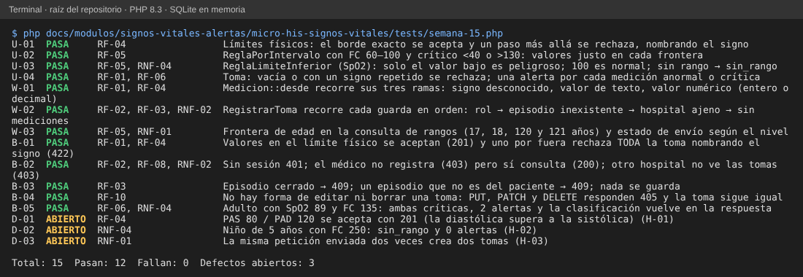

# Semana 15 – Pruebas unitarias, de caja blanca y de caja negra trazadas a RF/RNF

Módulo: Signos vitales y alertas clínicas · Grupo G1 · Autor: Joshua Eduardo García Reyes.
Archivo de pruebas: `micro-his-signos-vitales/tests/semana-15.php` (sin dependencias, SQLite en memoria; no modifica `tests/ejecutar.php`).

## 1. Cómo se ejecuta

```
php docs/modulos/signos-vitales-alertas/micro-his-signos-vitales/tests/semana-15.php
```

Resultado esperado: `Total: 15  Pasan: 12  Fallan: 0  Defectos abiertos: 3` y código de salida 0. Una prueba de defecto (`D-xx`) imprime **ABIERTO** mientras el defecto se reproduce; si alguien lo corrige, pasa a FALLA con el mensaje «conviértalo en prueba normal», para que el defecto no quede escondido ni la prueba obsoleta.



## 2. Matriz de trazabilidad

| Requisito | Prueba(s) | Tipo | Qué comprueba |
|---|---|---|---|
| RF-01 una toma de 1 a 6 mediciones | U-04, W-01, B-01 | unitaria, blanca, negra | Toma vacía o con signo repetido se rechaza; los tres caminos de `Medicion::desde`; el borde físico se acepta. |
| RF-02 solo enfermería del mismo hospital | W-02, B-02 | blanca, negra | Rol, hospital ajeno y sin sesión (403/401) sin dejar datos. |
| RF-03 episodio activo | W-02, B-03 | blanca, negra | Episodio inexistente, cerrado o de otro paciente → 409. |
| RF-04 rechazo por valor imposible | U-01, B-01 | unitaria, negra | Cada límite exacto se acepta y un paso más allá rechaza toda la toma nombrando el signo. |
| RF-05 clasificación por edad | U-02, U-03, W-03 | unitaria, blanca | Fronteras de cada regla y de la edad (17, 18, 120, 121 años). |
| RF-06 una alerta por medición anormal o crítica | U-04, B-05 | unitaria, negra | SpO2 89 y FC 135 → 2 alertas críticas. |
| RF-07 envío de críticas a M21 | W-03 | blanca | Solo las críticas quedan «pendiente_envio». El envío real **no existe** (H-05). |
| RF-08 consulta de tomas | B-02 | negra | El médico consulta (200); otro hospital no (403). |
| RF-09 reconocer alerta | — | — | **Sin prueba: la función no existe** (H-04). |
| RF-10 sin edición ni borrado | B-04 | negra | PUT, PATCH y DELETE → 405 y el valor guardado no cambia. |
| RNF-01 integridad | W-03, D-03 | blanca, defecto | Rollback ya cubierto por PER-01 de `tests/ejecutar.php`; el reintento duplica tomas (D-03). |
| RNF-02 aislamiento por hospital | W-02, B-02 | blanca, negra | Hospital ajeno sin acceso. |
| RNF-04 ningún crítico sin clasificar | U-03, B-05, D-02 | unitaria, negra, defecto | En adultos se cumple; en niños **no** (D-02). |
| RNF-05 y RNF-06 regla intercambiable y verificable | — | — | Ya cubiertos por `semana-02/ejemplo-lsp/verificar.php` y la semana 12. |
| RNF-03 rendimiento (< 2 s) | — | — | **No medido**: requiere prueba de carga que este módulo aún no tiene. |
| RNF-07 el error nombra el campo | B-01 | negra | `campos` trae `fc` en la respuesta 422. |

## 3. Cobertura pedida por la entrega

| Pedido | Cantidad | Pruebas |
|---|---|---|
| Unitarias (≥ 3) | 4 | U-01, U-02, U-03, U-04 |
| Caja blanca (≥ 2) | 3 | W-01 (ramas de `Medicion::desde`), W-02 (guardas de `RegistrarToma`), W-03 (frontera de edad y estado de envío) |
| Caja negra (≥ 4) | 5 | B-01 a B-05, solo por HTTP |
| Defectos reportados | 3 | D-01, D-02, D-03 |

Las pruebas se comprobaron también **rompiendo el código a propósito** (8 cambios en límites, comparaciones, guardas de rol y hospital, vacío de toma, 405 y estado de envío): cada cambio hizo fallar al menos una prueba.

## 4. Defectos encontrados (se corrigen en el código aparte; el acta de la semana 13 los registra con responsable)

| ID | Prueba | Descripción | Requisito | Severidad | Estado |
|---|---|---|---|---|---|
| H-01 | D-01 | PAS 80 con PAD 120 se acepta con 201. | RF-04 | Alta | Abierto |
| H-02 | D-02 | Un niño de 5 años con FC 250 queda «sin_rango» y sin alerta. | RNF-04 | Alta | Abierto |
| H-03 | D-03 | La misma petición dos veces crea dos tomas. | RNF-01 | Media | Abierto |

## 5. Lo que estas pruebas no cubren

RF-07 (envío real), RF-09 (reconocimiento) y RNF-03 (rendimiento) no tienen prueba porque la función o la medición no existen. Los hallazgos H-06 (aviso de PHP con entrada en arreglo) y H-07 (barra final en la ruta) son de severidad Baja y quedan solo en el acta de la semana 13.
