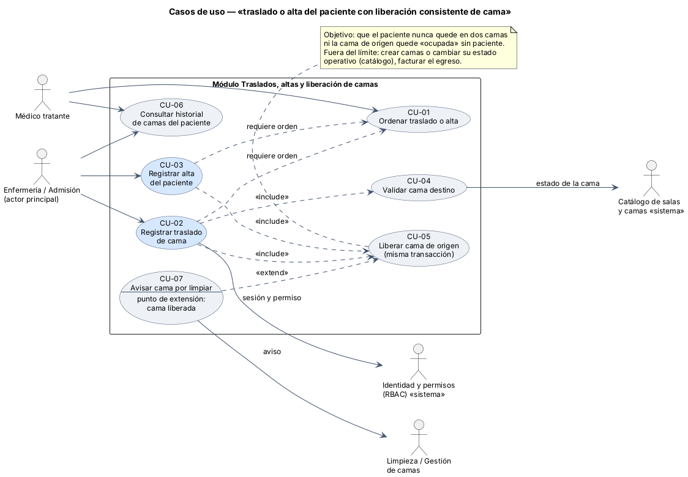
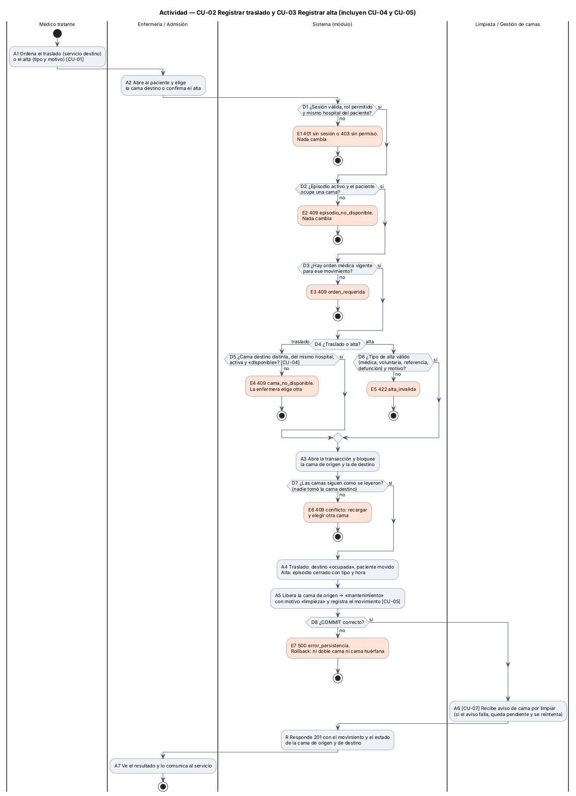
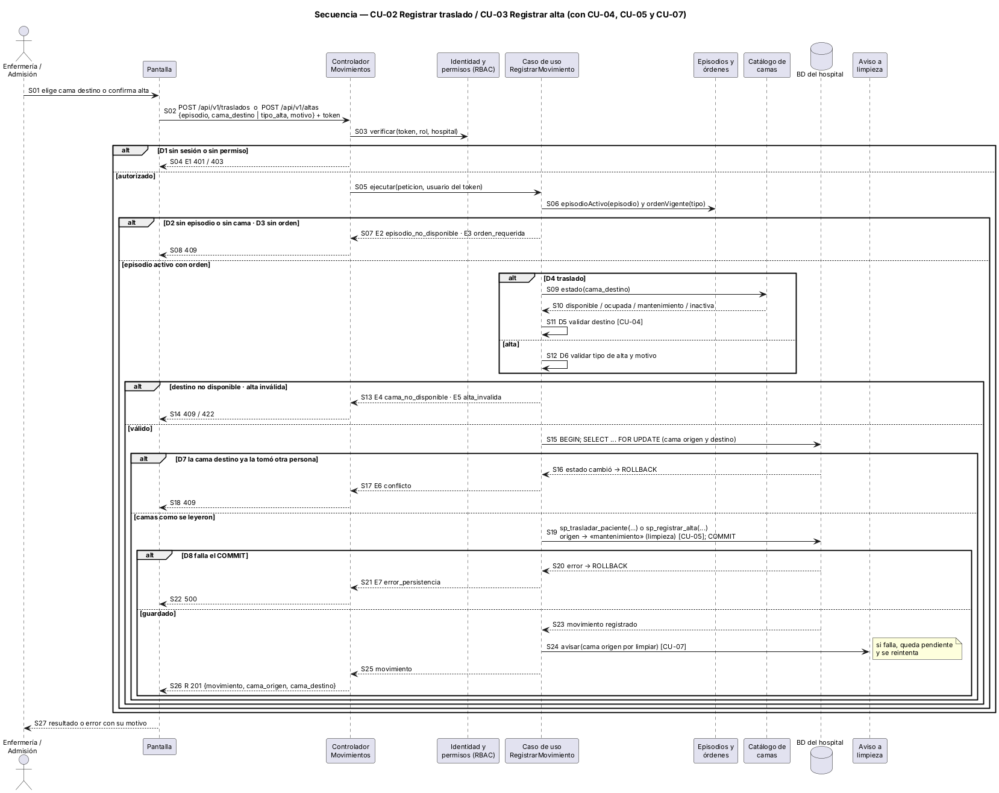

# Semana 1 — UML del proceso de traslado o alta con liberación de cama

**Estudiante:** Joshua Eduardo García Reyes (`jgarciar73@miumg.edu.gt`, `jgarciar73-svg`) · **Módulo:** Traslados, altas y liberación de camas (módulo 8, reasignado dentro del grupo G1) · **Proceso:** «traslado o alta del paciente con liberación consistente de cama»

| Pedido | Dónde |
|---|---|
| Casos de uso: actores y objetivo | §2 y [diagrama](diagramas/semana-01-casos-de-uso.png) |
| Actividad con decisiones, excepciones y resultado | §3 y [diagrama](diagramas/semana-01-actividad.png) |
| Secuencia con participantes, mensajes, validaciones y respuesta | §4 y [diagrama](diagramas/semana-01-secuencia.png) |
| Trazabilidad entre los tres diagramas | §5 |
| Narrativa de alcance | §1 |

## 1. Narrativa de alcance

**Objetivo.** Que enfermería o admisión registre el traslado de un paciente a otra cama, o su alta, de forma que la cama de origen quede liberada en el mismo instante. Así el paciente nunca aparece en dos camas y ninguna cama queda «ocupada» sin paciente. Hoy, si la liberación se hace aparte y se olvida, el tablero de ocupación miente y se niegan camas que sí existen.

**Actores**

| Actor | Tipo | Qué busca |
|---|---|---|
| Enfermería / Admisión | Principal (humano) | Mover al paciente o darle el alta sin pasos manuales extra |
| Médico tratante | Secundario (humano) | Ordenar el traslado o el alta y consultar el historial de camas |
| Identidad y permisos (RBAC) | Secundario (sistema) | Confirmar sesión, rol y hospital |
| Catálogo de salas y camas | Secundario (sistema) | Dar el estado operativo de la cama destino (disponible, ocupada, mantenimiento, inactiva) |
| Limpieza / Gestión de camas | Secundario (humano) | Saber qué cama quedó por limpiar |

**Dentro del alcance:** registrar la orden de traslado o alta, validar la cama destino, ejecutar el traslado (ocupar destino y liberar origen), registrar el alta (cerrar el episodio y liberar la cama), avisar la cama por limpiar y consultar el historial de camas del paciente.

**Fuera del alcance:** crear camas o cambiar su estado operativo a mano (módulo Catálogo de salas y camas); la admisión inicial; la epicrisis o el resumen clínico de egreso; la facturación; el transporte físico del paciente.

**Supuestos.** La base del grupo ya tiene `sp_trasladar_paciente` y `sp_registrar_alta`; este módulo los usa dentro de una transacción. Los estados de cama son los del catálogo. El estado «ocupada» solo lo cambian admisión y este módulo, nunca un usuario a mano.

**Reglas de negocio**

| ID | Regla |
|---|---|
| RN-01 | Solo enfermería o admisión del mismo hospital del paciente registra traslados y altas; el autor sale del token |
| RN-02 | El paciente debe tener un episodio activo y ocupar una cama |
| RN-03 | Todo traslado o alta necesita una orden médica vigente de ese tipo |
| RN-04 | La cama destino es distinta de la de origen, del mismo hospital, activa y «disponible» |
| RN-05 | Un paciente ocupa como máximo una cama y una cama tiene como máximo un paciente |
| RN-06 | Ocupar el destino, liberar el origen, cerrar el episodio (alta) y registrar el movimiento ocurren en una sola transacción con las dos camas bloqueadas |
| RN-07 | La cama liberada pasa a «mantenimiento» con motivo «limpieza»; vuelve a «disponible» desde el catálogo |
| RN-08 | El alta exige tipo (médica, voluntaria, referencia o defunción) y motivo |
| RN-09 | Los movimientos no se editan ni se borran; un error se corrige con otro movimiento |

## 2. Casos de uso



| CU | Nombre | Actor | Relación |
|---|---|---|---|
| CU-01 | Ordenar traslado o alta | Médico tratante | Precondición de CU-02 y CU-03 |
| CU-02 | Registrar traslado de cama | Enfermería / Admisión | Base; «include» CU-04 y CU-05 |
| CU-03 | Registrar alta del paciente | Enfermería / Admisión | Base; «include» CU-05 |
| CU-04 | Validar cama destino | — | Consulta el estado en el catálogo |
| CU-05 | Liberar cama de origen | — | Siempre en la misma transacción que CU-02 o CU-03 |
| CU-06 | Consultar historial de camas | Enfermería, Médico | Lectura |
| CU-07 | Avisar cama por limpiar | Limpieza | «extend» de CU-05 cuando la cama queda liberada |

**CU-02 en breve.** Precondición: sesión iniciada, episodio activo con cama y orden de traslado vigente. Flujo principal: la enfermera elige la cama destino; el sistema valida permiso, episodio, orden y cama (CU-04), bloquea ambas camas, mueve al paciente, libera el origen (CU-05), avisa a limpieza (CU-07) y responde. Alternativos: E1 a E7 de §3. Poscondición: el paciente queda en la cama destino y la de origen en «mantenimiento» por limpieza, o no cambia nada.

## 3. Actividad



| Decisión | Si falla | Resultado |
|---|---|---|
| D1 sesión, rol y hospital | E1 | 401 o 403, nada cambia |
| D2 episodio activo con cama | E2 | 409 `episodio_no_disponible` |
| D3 orden médica vigente | E3 | 409 `orden_requerida` |
| D4 traslado o alta | — | Elige la rama |
| D5 cama destino válida (traslado) | E4 | 409 `cama_no_disponible`; la enfermera elige otra |
| D6 tipo y motivo de alta (alta) | E5 | 422 `alta_invalida` |
| D7 nadie tomó la cama mientras tanto | E6 | 409 conflicto: recargar y elegir otra |
| D8 COMMIT correcto | E7 | 500 con rollback: ni doble cama ni cama huérfana |

**Resultado (R):** 201 con el movimiento y el estado final de la cama de origen y la de destino (A7). Si el aviso a limpieza falla, queda pendiente y se reintenta; el movimiento ya está guardado (A6).

## 4. Secuencia



Participantes: enfermería o admisión, pantalla, controlador, RBAC, caso de uso `RegistrarMovimiento`, episodios y órdenes, catálogo de camas, base del hospital y aviso a limpieza. Las validaciones están en S03 (permiso), S06 (episodio y orden), S09–S12 (cama destino o datos del alta) y S15–S16 (bloqueo y conflicto). La respuesta es S26 (201) o la de cada error (S04, S08, S14, S18, S22).

## 5. Trazabilidad entre los tres diagramas

| Caso de uso | Actividad | Secuencia | Regla |
|---|---|---|---|
| CU-01 Ordenar | A1 · D3 → E3 | S06–S08 | RN-03 |
| CU-02 Registrar traslado | A2, D1, D2, D4, A3, D7, A4, D8, R, A7 · E1, E2, E6, E7 | S01–S05, S09, S15–S26 | RN-01, RN-02, RN-05, RN-06 |
| CU-03 Registrar alta | A2, D4, D6, A4 · E5 | S12–S14, S19 | RN-06, RN-08 |
| CU-04 Validar cama destino | D5 · E4 | S09–S11, S13–S14 | RN-04 |
| CU-05 Liberar cama de origen | A5, D8 · E7 | S19–S22 | RN-05, RN-06, RN-07 |
| CU-07 Avisar cama por limpiar | A6 | S24 | RN-07 |
| CU-06 Consultar historial | No forma parte de este flujo; se modela con la consulta | — | RN-01, RN-09 |

Cada nodo de la actividad y cada mensaje de la secuencia lleva el mismo ID (D5, E4, CU-04…), así que un camino se puede seguir de un diagrama a otro.

## 6. Fuentes de los diagramas

Las fuentes editables están en [diagramas/](diagramas/) (`.puml`). Para regenerar las imágenes:

```bash
java -jar plantuml.jar -charset UTF-8 -tpng docs/modulos/traslados-altas-camas/semana-01/diagramas/*.puml
```

**Defensa en 1 minuto:** «Con orden médica, la enfermera traslada o da de alta. El sistema revisa permiso, episodio, orden y cama destino, bloquea las dos camas y en una sola transacción mueve al paciente y libera la cama de origen para limpieza. Si alguien tomó la cama antes, responde 409; si la base falla, no cambia nada. Así nunca hay un paciente en dos camas ni una cama ocupada sin paciente.»
