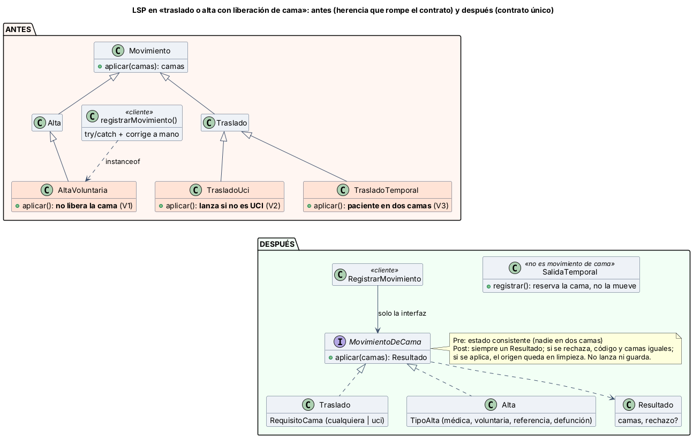

# Semana 2 — RF/RNF, criterios de aceptación y LSP en traslados y altas

**Estudiante:** Joshua Eduardo García Reyes (`jgarciar73@miumg.edu.gt`, `jgarciar73-svg`) · **Módulo:** Traslados, altas y liberación de camas (módulo 8, reasignado dentro del grupo G1) · **Flujo:** «traslado o alta del paciente con liberación consistente de cama» (CU-01 a CU-07 de la [semana 1](../semana-01/semana-01-uml-traslados-altas.md))

**Contenido:** RF/RNF (§1), criterios de aceptación (§2), LSP antes/después con responsabilidades y dependencias (§3, [diagrama](diagramas/semana-02-lsp-antes-despues.png), [`ejemplo-lsp/`](ejemplo-lsp/)) y evidencia verificable (§4, [captura](evidencia/verificar-lsp.png)).

## 1. Requerimientos

| ID | Requerimiento funcional | CU |
|---|---|---|
| RF-01 | Registrar la orden médica de traslado (servicio o tipo de cama) o de alta (tipo y motivo) | CU-01 |
| RF-02 | Registrar el traslado del paciente a una cama destino | CU-02 |
| RF-03 | Registrar el alta: médica, voluntaria, referencia o defunción, siempre con motivo | CU-03 |
| RF-04 | Validar que la cama destino sea distinta, del mismo hospital, «disponible» y del tipo pedido (por ejemplo UCI) | CU-04 |
| RF-05 | Liberar la cama de origen a «mantenimiento» por limpieza en el mismo movimiento | CU-05 |
| RF-06 | Consultar el historial de camas del paciente | CU-06 |
| RF-07 | Avisar a limpieza la cama liberada; si el aviso falla, reintentar sin deshacer el movimiento | CU-07 |
| RF-08 | Registrar una salida temporal (quirófano, estudio) sin mover al paciente de cama | — |
| RF-09 | Rechazar con un código estable: `sin_cama`, `cama_no_disponible`, `cama_no_cumple_requisito`, `alta_invalida`, `orden_requerida` | CU-02, CU-03 |
| RF-10 | Los movimientos no se editan ni se borran; un error se corrige con otro movimiento | CU-06 |

| ID | Requerimiento no funcional |
|---|---|
| RNF-01 | Integridad: ocupar destino, liberar origen y cerrar episodio (alta) en una transacción con las camas bloqueadas |
| RNF-02 | Consistencia: «ocupada» ⇔ tiene paciente; ningún paciente en dos camas (se comprueba después de cada movimiento) |
| RNF-03 | Seguridad: solo enfermería o admisión del mismo hospital; el autor sale del token |
| RNF-04 | Rendimiento: registrar un movimiento en menos de 2 s (p95) |
| RNF-05 | Mantenibilidad (LSP): un tipo de movimiento nuevo se conecta sin cambiar el caso de uso |
| RNF-06 | Verificabilidad y usabilidad: todo movimiento pasa la misma prueba de contrato y cada rechazo dice su motivo sin dejar nada a medias |

## 2. Criterios de aceptación

| ID | Dado | Cuando | Entonces | Evidencia |
|---|---|---|---|---|
| CA-01 | Usuario de otro hospital | registra un traslado | 403 y nada cambia | Micro-HIS (S3) |
| CA-02 | Sin orden médica vigente | se registra traslado o alta | 409 `orden_requerida` | Micro-HIS (S3) |
| CA-03 | p1 en A1 y A3 ocupada | se traslada p1 a A3 | `cama_no_disponible` y las camas no cambian | `verificar.php` |
| CA-04 | p1 en A1 y A2 libre | se traslada p1 a A2 | p1 en A2 y A1 en «mantenimiento» en el mismo resultado | `verificar.php` |
| CA-05 | p1 en A1 | alta voluntaria con motivo | A1 queda en «mantenimiento» (también la voluntaria libera) | `verificar.php` |
| CA-06 | Orden de UCI y destino general | se traslada | `cama_no_cumple_requisito`, sin excepción | `verificar.php` |
| CA-07 | p1 en A1 | alta sin motivo | `alta_invalida` | `verificar.php` |
| CA-08 | p9 sin cama | traslado o alta | `sin_cama` | `verificar.php` |
| CA-09 | Dos personas eligen A2 a la vez | ambas confirman | una gana; la otra recibe 409 conflicto | Micro-HIS (S3) |
| CA-10 | p1 va a quirófano | se registra la salida temporal | A1 sigue reservada para p1 y ninguna otra cama cambia | `verificar.php` (CLI-01) |

## 3. LSP: antes y después



**LSP** pide que cualquier subtipo pueda usarse donde se espera el tipo base sin que el cliente note la diferencia: no puede exigir más (precondición), entregar menos (postcondición) ni romper lo que siempre debe cumplirse (invariante).

**Antes** ([`antes.php`](ejemplo-lsp/antes.php)): `Movimiento` promete devolver el estado nuevo (o el mismo si no se puede), no lanzar, dejar a cada paciente en una sola cama y la cama de origen en limpieza. Tres subclases rompen esa promesa:

| Violación | Subclase | Qué rompe | Consecuencia |
|---|---|---|---|
| V1 | `AltaVoluntaria` | Postcondición: no libera la cama «hasta que firme» | Cama ocupada por un paciente que ya se fue; el cliente necesita `instanceof` |
| V2 | `TrasladoUci` | Precondición: lanza si la cama no es de UCI | El cliente necesita `try/catch` |
| V3 | `TrasladoTemporal` | Invariante: ocupa el destino sin soltar el origen | **Un paciente en dos camas**; puede pisar a otro paciente |

**Después** ([`despues.php`](ejemplo-lsp/despues.php)):

| Clase | Responsabilidad | Depende de |
|---|---|---|
| `MovimientoDeCama` (interfaz) | Fijar el contrato: pre, post, sin excepciones ni efectos | `Resultado` |
| `Traslado` | Mover a una cama válida; el tipo de cama es un dato (`RequisitoCama`), no una subclase | `Camas` |
| `Alta` | Liberar la cama para los 4 tipos de alta (`TipoAlta`) | `Camas` |
| `SalidaTemporal` | Reservar la cama mientras el paciente va a quirófano; **no** es un movimiento de cama | `Camas` |
| `RegistrarMovimiento` | Caso de uso: aplica cualquier movimiento sin conocer su clase | Solo la interfaz |
| `Camas`, `consistente()` | Buscar y liberar camas; comprobar el invariante de ocupación | Nada |

**Por qué así:** la UCI deja de ser una subclase y pasa a ser un dato del traslado; un destino que no cumple se rechaza con código (quita V2). El alta voluntaria libera la cama como cualquier otra; el formulario firmado es un requisito documental aparte (quita V1). Ir a quirófano no cambia de cama, así que sale de la jerarquía como `SalidaTemporal` (quita V3). Cada movimiento devuelve un `Resultado` sin guardar nada, y el caso de uso lo aplica en una transacción (RNF-01).

## 4. Evidencia

```bash
cd docs/modulos/traslados-altas-camas/semana-02/ejemplo-lsp
php verificar.php     # sale con 0 si todo da lo esperado y con 1 si algo falla
```

La **prueba de contrato** aplica los mismos casos a cada implementación, con casos que deben aplicarse y casos que deben rechazarse: C1 no lanza, C2 el estado sigue consistente, C3 si se aplica el paciente deja su cama y esta queda en limpieza, C4 si se rechaza nada cambia ([captura](evidencia/verificar-lsp.png)).

| Implementación | C1 | C2 | C3 | C4 | Veredicto |
|---|---:|---:|---:|---:|---|
| Antes: `Traslado`, `Alta` | 0 | 0 | 0 | 0 | Cumplen |
| Antes: `AltaVoluntaria` | 0 | 0 | 1 | 0 | Rompe LSP (V1) |
| Antes: `TrasladoUci` | 1 | 0 | 0 | 0 | Rompe LSP (V2) |
| Antes: `TrasladoTemporal` | 0 | 2 | 1 | 1 | Rompe LSP (V3) |
| Después: `Traslado` (6 casos), `Alta` (5 casos) | 0 | 0 | 0 | 0 | Cumplen |
| Después: `AltaConEpicrisis` (clase anónima, RNF-05) | 0 | 0 | 0 | 0 | Cumple sin tocar el caso de uso |

También pasan CLI-01 (antes el paciente queda en dos camas; después `SalidaTemporal` no toca camas) y CA-03 a CA-08. Si en `Alta` se quita la liberación de la cama, la prueba falla en C3: el contrato sí detecta el error.

**Defensa en 1 minuto:** «Antes, tres subclases no podían usarse en lugar de la base: el alta voluntaria no liberaba la cama, el traslado a UCI lanzaba y el temporal dejaba al paciente en dos camas. Ahora hay una interfaz con contrato: la UCI es un dato, toda alta libera y la salida a quirófano no es un movimiento de cama. La misma prueba lo demuestra: antes 3 rompen, después 0.»
