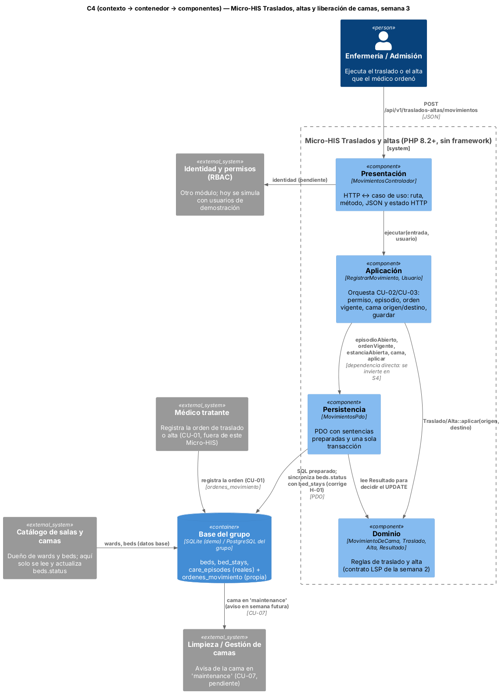

# Semana 3 — Micro-HIS Traslados, altas y liberación de camas en capas y vista arquitectónica

**Estudiante:** Joshua Eduardo García Reyes (`jgarciar73-svg`) · **Módulo:** Traslados, altas y liberación de camas (módulo 8, reasignado dentro del grupo G1) · **Flujo:** «traslado o alta del paciente con liberación consistente de cama»

El Micro-HIS está en [`../micro-his-traslados/`](../micro-his-traslados/): PHP 8.2+ sin framework ni Composer, PDO con sentencias preparadas y pruebas propias. Ejecuta CU-02 (Registrar traslado) y CU-03 (Registrar alta) de la [semana 1](../semana-01/semana-01-uml-traslados-altas.md) con el contrato LSP de la [semana 2](../semana-02/semana-02-lsp-requerimientos-diseno.md) (`MovimientoDeCama`, `Traslado`, `Alta`). Lo único que cambia es que cada movimiento recibe las dos camas que necesita (`CamaOrigen`, `CamaDestino`) y no todo el mapa de camas.

## 1. Vista arquitectónica (C4) y dependencias



| Capa | Archivos | Responsabilidad | Puede depender de |
|---|---|---|---|
| Presentación | `src/Presentacion/MovimientosControlador.php` | Ruta, método, JSON, usuario de demostración y estado HTTP (201, 400, 401, 403, 404, 405, 409, 422, 500) | Aplicación, `ErrorDominio` |
| Aplicación | `src/Aplicacion/RegistrarMovimiento.php` | Orquesta CU-02/CU-03: rol, episodio abierto, orden vigente, camas de origen y destino, guardar | Dominio, Persistencia (*) |
| Dominio | `src/Dominio/Movimientos.php` | `Traslado` y `Alta` deciden y devuelven un `Resultado`, sin tocar la base ni lanzar | Nada |
| Persistencia | `src/Persistencia/MovimientosPdo.php`, `sql/esquema.sql` | SQL preparado; estancias, `beds.status` y orden en una sola transacción | Dominio, `ErrorPersistencia` |

(*) Hoy `RegistrarMovimiento` recibe `MovimientosPdo` directamente. Es la única flecha que apunta hacia afuera; en la semana 4 se invierte con una interfaz Repository y un adaptador en memoria, igual que en Signos vitales. `bootstrap.php` carga las capas de adentro hacia afuera y la prueba ARQ-01 falla si el Dominio menciona otra capa o PDO, o si aparece SQL fuera de Persistencia.

**Decisiones:**
- `beds`, `bed_stays` y `care_episodes` usan **los nombres y columnas reales** del esquema del grupo (módulo Verificación BD, semana 1). `ordenes_movimiento` es propia: guarda la orden del médico (RF-01); la cama destino la elige enfermería al ejecutar.
- **`beds.status` se sincroniza con `bed_stays` en la misma transacción.** El hallazgo H-01 de Verificación BD mostró que ningún trigger lo hace, así que lo resuelve este módulo: cerrar la estancia de origen, poner esa cama en `maintenance`, abrir la estancia de destino y ponerla en `occupied` van en un solo `beginTransaction()`/`commit()`.
- **No hay columna de hospital:** cada hospital tiene su propia base (modelo CENTRAL/HOSPITAL), así que el aislamiento entre hospitales es de despliegue. CA-01 de la semana 2 queda fuera de este Micro-HIS; aquí se prueba el permiso por rol (RNF-03).
- **El alta cierra el episodio** y libera la cama como cualquier movimiento. La salida temporal a quirófano (RF-08) no es un movimiento de cama y no entra en este flujo.

## 2. Pruebas

```bash
cd docs/modulos/traslados-altas-camas/micro-his-traslados
php tests/ejecutar.php     # Total: 8  Pasan: 8  Fallan: 0  (base de prueba: SQLite en memoria)
```

| ID | Pide la tarea | Qué comprueba |
|---|---|---|
| APP-01 | Camino feliz | Traslado de epi-1 a A2: A1 en `maintenance`, A2 en `occupied`, estancia nueva abierta y orden `aplicada` |
| APP-02 | Camino feliz | Alta de epi-2: libera A3 y cierra el episodio |
| DOM-01 | Regla de dominio | A3 ocupada → `cama_no_disponible`; UCI pedida con cama general → `cama_no_cumple_requisito`; nada cambia |
| DOM-02 | Regla de dominio | Alta sin motivo → `alta_invalida`; paciente sin cama → `sin_cama`; sin filas nuevas |
| APP-03 | Permisos y guardas | Episodio cerrado y sin orden vigente → 409; rol no autorizado → `acceso_denegado` |
| PER-01 | Error de persistencia | Un trigger hace fallar el último `UPDATE` de la transacción: `ErrorPersistencia` y todo vuelve atrás (estancia abierta, camas iguales, sin estancia nueva) |
| HTTP-01 | Presentación | 201, 401, 400, 404, 405 y 409 con su código |
| ARQ-01 | Dependencias | Dominio sin otras capas ni PDO; sin SQL en Aplicación ni Presentación |

**Mutaciones:** si se quita el `rollBack()`, PER-01 falla (queda la cama A1 en `maintenance` y una estancia de más); si la cama de origen no pasa a `maintenance`, fallan APP-01 y APP-02. Las pruebas sí detectan esos errores.

**Defensa en 1 minuto:** «Cuatro capas con dependencias hacia adentro: el Dominio usa el contrato LSP de la semana 2 y no sabe de HTTP ni de SQL. Lo nuevo es que Persistencia hace en una sola transacción lo que Verificación BD encontró que nadie hacía: sincronizar `beds.status` con `bed_stays`. Las pruebas cubren camino feliz de traslado y de alta, reglas de dominio, error de persistencia con rollback, HTTP y dependencias. La deuda de depender directo del adaptador PDO se paga en la semana 4.»
