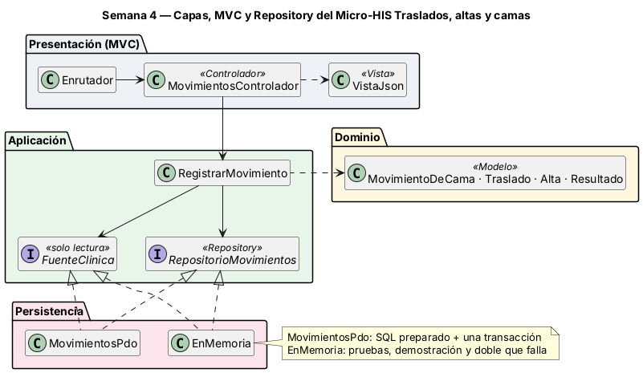
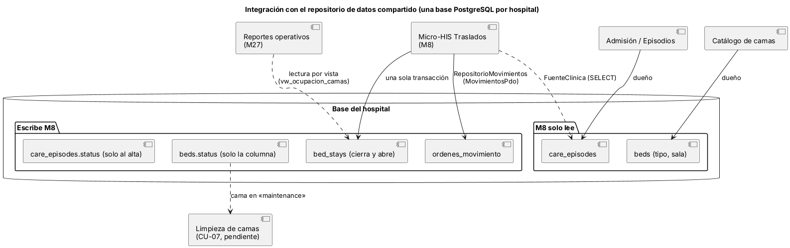

# Semana 4 — MVC, Repository y repositorio de datos compartido

**Estudiante:** Joshua Eduardo García Reyes (`jgarciar73-svg`) · **Módulo:** Traslados, altas y liberación de camas (módulo 8, reasignado dentro del grupo G1) · Continúa el [Micro-HIS de la semana 3](../semana-03/semana-03-arquitectura-micro-his.md) y su flujo «traslado o alta del paciente con liberación consistente de cama»

## 1. Capas, responsabilidades y objetos reutilizables



| Capa | Objeto | Responsabilidad | Reutilizable en |
|---|---|---|---|
| Presentación | `public/index.php`, `Enrutador`, `Peticion` | Front controller (elige base o memoria) y ruta + método → acción; 404 y 405 | Rutas nuevas del módulo |
| Presentación | `MovimientosControlador` | Lee la petición, identifica al usuario, llama al caso de uso y elige la vista. **Sin SQL ni reglas de negocio** | — |
| Presentación | `VistaJson` | Estado HTTP + JSON; único mapa código → estado | Toda respuesta del módulo |
| Aplicación | `RegistrarMovimiento` | Orquesta CU-02/CU-03; depende solo de interfaces. El Dominio no cambia | Otros casos de uso del módulo |
| Aplicación | `RepositorioMovimientos` (interfaz) | Lo que el módulo escribe: `ordenVigente` y `aplicar` (todo o nada) | Altas, traslados y futuras cancelaciones |
| Aplicación | `FuenteClinica` (interfaz) | Lectura de datos ajenos: episodio abierto, estancia abierta y cama | Registrar, futuras consultas y limpieza |
| Persistencia | `MovimientosPdo` | Implementa ambas interfaces con SQL preparado y una transacción | Producción (SQLite o PostgreSQL) |
| Persistencia | `EnMemoria` | Implementa ambas sin base; `fallarAlAplicar` simula una falla | Pruebas y demostración |

**Dónde va el límite:** las interfaces están en Aplicación, porque son lo que el caso de uso necesita; Persistencia las implementa y la flecha de la semana 3 (`RegistrarMovimiento → MovimientosPdo`) queda invertida. Son dos interfaces porque los datos tienen dueños distintos: órdenes y movimientos son de este módulo; episodios y camas vienen de otros.

## 2. Repositorio de datos compartido



Cada hospital tiene su base PostgreSQL (modelo CENTRAL/HOSPITAL), compartida por todos los módulos. Así se integraría este módulo:

| Regla de integración | Cómo se cumple |
|---|---|
| Cada tabla tiene un dueño que escribe | Este módulo escribe `ordenes_movimiento` y, por el movimiento, `bed_stays`, la columna `beds.status` y `care_episodes.status` (solo al alta); el resto lo lee por `FuenteClinica` |
| La sincronización de `beds.status` con `bed_stays` (hallazgo H-01) | Una sola transacción en `aplicar`; ningún otro módulo debería escribir `beds.status` |
| Otros módulos leen por vista | Reportes operativos leería `vw_ocupacion_camas`; limpieza consumiría las camas en `maintenance` |
| Permisos | Un rol de base por módulo: `UPDATE` solo en esas columnas, `SELECT` en el resto |
| Riesgo: dos traslados al mismo destino a la vez | Hoy se lee la cama y luego se escribe, sin bloqueo. Con PostgreSQL compartido debe usar `SELECT … FOR UPDATE` o un `UPDATE … WHERE status = 'available'` con verificación de filas, además de la exclusión GiST de `bed_stays`. Queda pendiente |

## 3. Pruebas

```bash
cd docs/modulos/traslados-altas-camas/micro-his-traslados
php tests/ejecutar.php     # Total: 10  Pasan: 10  Fallan: 0
```

Siguen las 6 de la semana 3 (APP-01..03, DOM-01..02, PER-01) y se agregan REP-01 (PDO y memoria dan los mismos resultados y estado final), MVC-01 (Enrutador → controlador → vista con PDO: 201, 401, 400, 403, 404, 405, 409 y 422), PER-02 (doble en memoria que falla → 500 sin cambios) y ARQ-01 ampliada. HTTP-01 pasó a MVC-01. Mutaciones comprobadas: importar `MovimientosPdo` en Aplicación o poner un `SELECT` o `Traslado` en el controlador hace fallar ARQ-01; no dejar la cama de origen en `maintenance` en memoria hace fallar REP-01; quitar el `rollBack()` hace fallar PER-01.
