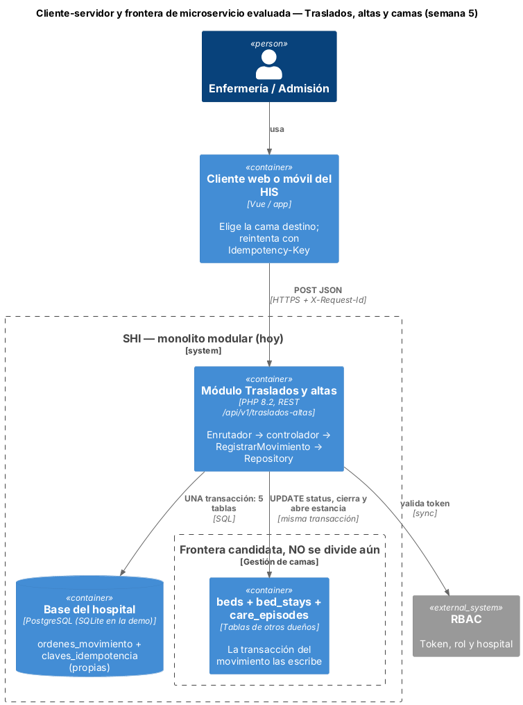
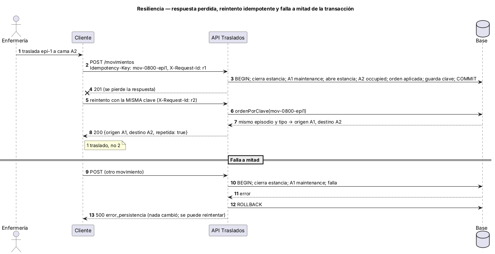

# Semana 5 — Cliente-servidor, contrato API y frontera de microservicio

**Estudiante:** Joshua Eduardo García Reyes (`jgarciar73-svg`) · **Módulo:** Traslados, altas y liberación de camas (módulo 8, reasignado dentro del grupo G1) · **Flujo:** «traslado o alta del paciente con liberación consistente de cama» · Evoluciona el [Micro-HIS de las semanas 3 y 4](../semana-04/semana-04-mvc-repository.md)

**Entregables:** contrato [`api/openapi.yaml`](../micro-his-traslados/api/openapi.yaml) (OpenAPI 3.0.3, validado con `openapi-spec-validator`), diagramas, evaluación de la frontera, migración razonada y plan de issue, rama, worktree y PR (§9). Prototipo: `Idempotency-Key` y `X-Request-Id` funcionando y probados.

## 1. Diseño cliente-servidor



| Operación | Respuestas | Notas |
|---|---|---|
| `POST /api/v1/traslados-altas/movimientos` | 201 aplicado · 200 reintento con la misma clave · 400 · 401 · 403 · 409 · 422 · 500 | Cuerpo: `episodio_id`, `tipo` (traslado o alta), `destino_id` (solo traslado) |

Solo hay una operación porque el flujo es un comando: la orden ya existe (la crea el médico, CU-01) y enfermería la ejecuta. Todo error devuelve `{codigo, mensaje, campos}` con uno de 14 códigos estables (enum del contrato); el cliente decide por `codigo`, no por el texto. La respuesta trae la cama liberada (`origen_id`, queda en `maintenance` para limpieza) y la ocupada (`destino_id`, `null` en el alta).

## 2. ¿Separarlo como microservicio? Evaluación medible

| Criterio | Medición o hecho | ¿Justifica dividir? |
|---|---|---|
| Rendimiento | p95 de 200 traslados dentro del proceso: **0.09 ms** (RNF-03, meta < 2 s). Una llamada de red solo agregaría latencia | No |
| Datos y transacción | MED-01: la transacción escribe **5 tablas y 3 son de otros dueños** (`beds`, `bed_stays`, `care_episodes`). Separar el módulo rompe el «todo o nada» y obliga a una saga con compensaciones | **No (es el criterio decisivo)** |
| Escala independiente | Supuesto, sin medir: unas decenas de movimientos al día por hospital. No hay picos que exijan escalar solo este módulo | No |
| Despliegue y equipo | Un equipo pequeño publica todo el SHI junto | No |
| Falla aislada | Si falla la base, falla todo el flujo igual; un servicio aparte no lo evitaría | No |

**Decisión:** seguir como módulo del monolito modular, con la frontera ya marcada (contrato propio, tabla propia, Repository). **La frontera candidata no es este módulo sino «Gestión de camas»** (`beds`, `bed_stays` y la limpieza, CU-07): si algún día ese dueño tiene su base y su API, Traslados dejaría de escribir esas tablas y llamaría a `liberar` y `ocupar`. **Se dividiría** si ocurre alguna de estas condiciones: más de 50 movimientos por segundo sostenidos, otro equipo a cargo de las camas, o camas compartidas entre varios hospitales con disponibilidad distinta.

## 3. Propiedad de datos

| Dato | Dueño | Acceso de este módulo |
|---|---|---|
| `ordenes_movimiento` | Este módulo (la crea el médico, CU-01) | Pasa la orden a `aplicada` |
| `claves_idempotencia` | Este módulo (nueva en la semana 5) | Escribe y lee |
| `beds`, `wards` | Catálogo de camas (Verificación BD) | Solo cambia `beds.status`, en la misma transacción (hallazgo H-01) |
| `bed_stays` | Gestión de camas | Cierra la estancia y abre la nueva |
| `care_episodes` | Admisión y episodios | Solo cierra el episodio en el alta |

## 4. Comunicación

- **Síncrona (REST/JSON)** entre cliente y API: enfermería necesita saber al instante si la cama quedó libre u ocupada.
- **Base compartida, no llamadas entre servicios:** las tres tablas ajenas se escriben en la misma transacción. Es la comunicación más simple y la única que garantiza la consistencia de hoy.
- **Asíncrona (propuesta, sin implementar):** al quedar la cama en `maintenance`, el aviso a Limpieza (CU-07) saldría por una bandeja de salida con id único, sin que el movimiento espere a Limpieza.

## 5. Seguridad

| Riesgo | Control |
|---|---|
| Suplantación | Hoy `X-Usuario-Demo` (solo demostración). En el SHI: token del módulo RBAC; el usuario siempre sale del token |
| Movimiento hecho por quien no debe | Solo `enfermeria` y `admision`; el médico recibe 403 (HTTP-01) |
| Mover a un paciente sin orden | Se exige orden vigente del mismo tipo (`orden_requerida`, 409) |
| Datos del paciente expuestos | HTTPS; el log no guarda episodio, cama ni usuario (OBS-01) |
| Abuso o datos basura | JSON inválido → 400; clave de idempotencia de 8 a 64 caracteres; sentencias preparadas |
| Aislamiento entre hospitales | Una base por hospital (modelo CENTRAL/HOSPITAL): es de despliegue, no del código |

## 6. Resiliencia



| Falla | Respuesta del diseño | Estado |
|---|---|---|
| Se pierde la respuesta y el cliente reintenta | `Idempotency-Key`: el segundo POST devuelve 200 con el mismo resultado, sin mover otra cama | **Implementado** (RES-01) |
| Misma clave en otro movimiento | 409 `clave_reutilizada` | Implementado |
| Falla de la base a mitad | Rollback; 500 `error_persistencia`, sin camas ni estancias a medias | Implementado (PER-01, PER-02) |
| Dos reintentos simultáneos | El primero aplica y el segundo ve la orden ya `aplicada` (409); al reintentar recibe 200 | Implementado |
| Si se separaran las camas | Saga: liberar origen → ocupar destino → cerrar orden; si falla un paso, compensar con la acción inversa y reintentar con espera creciente | Solo diseño |

## 7. Observabilidad

- `X-Request-Id`: se acepta o se genera, se devuelve en la respuesta y une el log del cliente con el del servidor. **Implementado.**
- Una línea JSON por petición (`id`, método, ruta, estado, código, ms) en el log de PHP, sin datos del paciente (OBS-01). **Implementado.**
- Métricas propuestas: movimientos por hora, porcentaje rechazado por `cama_no_disponible`, tiempo que una cama pasa en `maintenance` y p95 del registro.

## 8. Consistencia

- **Fuerte dentro del módulo:** estancia, cama de origen, cama de destino, orden, clave y episodio se confirman juntos o ninguno.
- **Eventual hacia afuera (propuesta):** el aviso a Limpieza llega «al menos una vez»; cada aviso lleva un id único y quien lo recibe ignora los repetidos.
- **Lectura propia inmediata:** después del 201 la cama de origen ya está en `maintenance` y la de destino en `occupied`.

## 9. Migración razonada y plan de trabajo

| Paso | Qué se hace | Se considera listo cuando |
|---|---|---|
| 1 | Contrato y códigos estables (esta semana) | CON-01 pasa |
| 2 | Idempotencia y correlación (esta semana) | RES-01 y OBS-01 pasan |
| 3 | Que el módulo de camas exponga `liberar` y `ocupar` y sea el único que escribe `beds` y `bed_stays` | Otro módulo no puede escribir esas tablas (permisos de base) |
| 4 | Bandeja de salida con aviso a Limpieza | Una cama en `maintenance` genera un aviso aunque Limpieza esté caída |
| 5 | Separar «Gestión de camas» solo si se cumple un criterio de §2 | Medición que lo justifique |

**Plan de issue, rama, worktree y PR (esta entrega):**

```bash
# Issue: "Semana 5 Traslados: contrato API, idempotencia, correlación y evaluación de microservicio"
git fetch origin
git worktree add ../shi-traslados-s5 -b semana-5-traslados-altas-camas-joshua-garcia origin/semana-4-traslados-altas-camas-joshua-garcia
cd ../shi-traslados-s5     # trabajo aislado sin tocar la carpeta principal
php docs/modulos/traslados-altas-camas/micro-his-traslados/tests/ejecutar.php
git commit -am "Semana 5: contrato API, idempotencia y correlación en Traslados y altas"
git push -u origin semana-5-traslados-altas-camas-joshua-garcia
# PR hacia develop (menos de 400 líneas, «Semana 5» en el título, lo revisa otro integrante); luego: git worktree remove ../shi-traslados-s5
```

## 10. Evidencia

```bash
cd docs/modulos/traslados-altas-camas/micro-his-traslados
php tests/ejecutar.php     # Total: 15  Pasan: 15  Fallan: 0
```

Se suman RES-01 (reintento idempotente en PDO y en memoria), CON-01 (el contrato documenta los 14 códigos y los 8 estados), OBS-01 (el log no lleva datos del paciente), MED-01 (la transacción escribe 5 tablas, 3 ajenas) y RNF-03 (p95 de 200 traslados < 2 s). **Mutaciones:** sin la comprobación de la clave falla RES-01; sin guardar la clave falla RES-01 y MED-01.

**Defensa en 1 minuto:** «Definí el contrato REST con códigos estables. Medí dos cosas: el traslado tarda 0.09 ms dentro del proceso y su transacción escribe cinco tablas, tres de otros dueños. Separarlo convertiría un todo o nada en una saga, sin ganancia medible, así que sigue en el monolito modular. La frontera candidata es Gestión de camas, con condiciones claras para dividirla. Implementé idempotencia para que un reintento no mueva otra cama y un id de correlación para seguir cada petición.»
