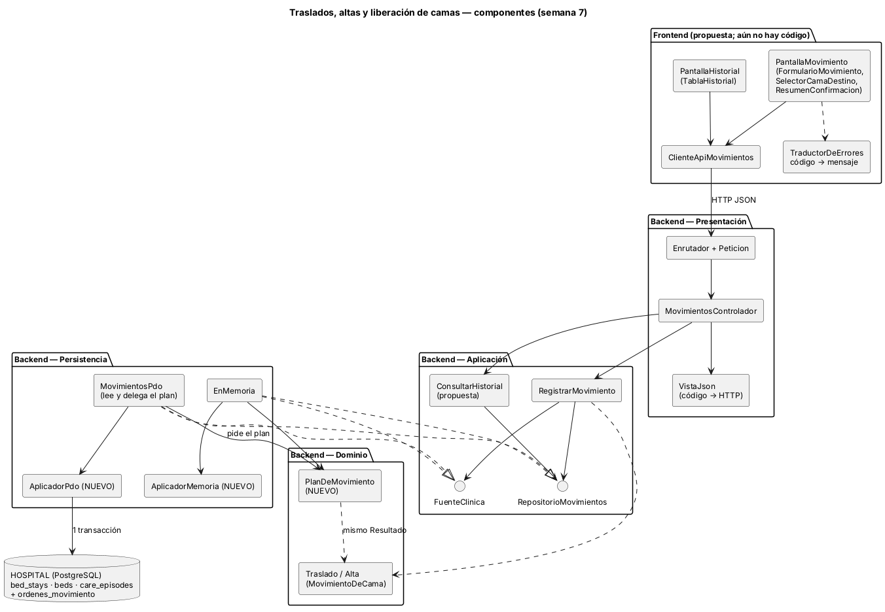
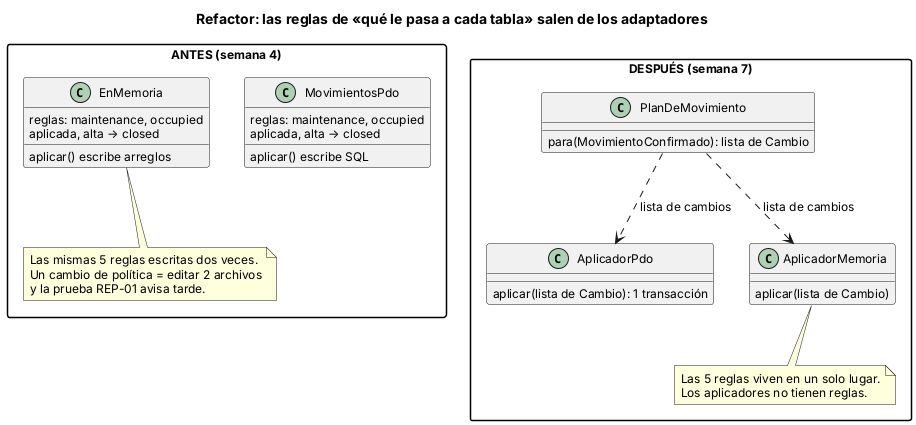
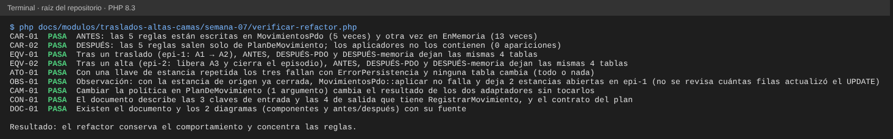

# Semana 7 — Componentes y refactor de «traslado o alta del paciente con liberación consistente de cama»

**Estudiante:** Joshua Eduardo García Reyes (`jgarciar73-svg`) · **Módulo:** Traslados, altas y liberación de camas (módulo 8, reasignado dentro del grupo G1)

Se parte del Micro-HIS de las semanas 3 y 4 (cuatro capas, puertos `RepositorioMovimientos` y `FuenteClinica`). Esta semana se dibujan los componentes de backend y de frontend, se fijan sus contratos y se refactoriza el punto más acoplado. El refactor es conceptual: vive en `ejemplo-refactor/` y no cambia el código del Micro-HIS.

## 1. Componentes

| Componente | Capa | Responsabilidad | Existe |
|---|---|---|---|
| `PantallaMovimiento` (formulario, selector de cama destino, resumen) | Frontend | Pedir tipo de movimiento y cama destino y confirmar antes de enviar | Propuesta |
| `PantallaHistorial` (tabla) | Frontend | Mostrar las estancias del episodio | Propuesta |
| `ClienteApiMovimientos` | Frontend | Única puerta HTTP hacia la API; no conoce pantallas | Propuesta |
| `TraductorDeErrores` | Frontend | Convertir cada código del servidor en un mensaje y una acción | Propuesta |
| `Enrutador`, `Peticion`, `MovimientosControlador`, `VistaJson` | Presentación | HTTP ↔ caso de uso; `VistaJson` es el único mapa código → estado | Código (S4) |
| `RegistrarMovimiento` | Aplicación | Permiso, episodio, orden vigente, camas, dominio, aplicar | Código (S4) |
| `ConsultarHistorial` | Aplicación | Estancias del episodio para la pantalla de historial | Propuesta |
| `Traslado`, `Alta` (`MovimientoDeCama`) | Dominio | Decidir si el movimiento se puede aplicar (contrato LSP de la semana 2) | Código (S4) |
| `PlanDeMovimiento` | Dominio | Decidir **qué cambia** en cada tabla cuando se aplica | Nuevo (esta semana) |
| `MovimientosPdo`, `EnMemoria` | Persistencia | Leer y aplicar el movimiento | Código (S4) |
| `AplicadorPdo`, `AplicadorMemoria` | Persistencia | Ejecutar el plan en una transacción | Nuevo (esta semana) |

El frontend es una propuesta porque el Micro-HIS aún no tiene pantallas; los mensajes y flujos concretos son de las semanas 8 a 10.

## 2. Contratos de entrada y salida

**API** (`POST /api/v1/traslados-altas/movimientos`, ya implementada en la semana 4):

| Sentido | Campo | Detalle |
|---|---|---|
| Entrada | `episodio_id` | Episodio abierto del paciente |
| Entrada | `tipo` | `traslado` o `alta` |
| Entrada | `destino_id` | Cama destino; solo en traslado |
| Salida | `aplicado` | `true` si se guardó el movimiento |
| Salida | `rechazo` | Código (`sin_cama`, `cama_no_disponible`, `cama_no_cumple_requisito`, `alta_invalida`) o `null` |
| Salida | `origen_id` | Cama que se libera |
| Salida | `destino_id` | Cama que se ocupa; `null` en el alta |

**Plan de movimiento** (nuevo): `PlanDeMovimiento::para(MovimientoConfirmado)` devuelve una lista de cambios, en orden y sin efectos. `MovimientoConfirmado` junta los mismos datos que hoy recibe `RepositorioMovimientos::aplicar()` (episodio, orden, tipo, `Resultado`, estancia de origen, estancia nueva y hora):

| Cambio | Datos | Cuándo |
|---|---|---|
| `CerrarEstancia` | estancia, hora, motivo (el tipo: `traslado` o `alta`) | Siempre |
| `PonerEstadoCama` | cama, estado | Origen (`maintenance`) y, en traslado, destino (`occupied`) |
| `AbrirEstancia` | estancia nueva, episodio, cama, hora | Solo traslado |
| `PonerEstadoOrden` | orden, estado (`aplicada`) | Siempre |
| `CerrarEpisodio` | episodio, estado (`closed`), hora | Solo si el tipo es `alta` |

Los aplicadores reciben esa lista y la ejecutan **todo o nada**: si algo falla lanzan `ErrorPersistencia` y no queda ningún cambio.

## 3. El punto de mayor acoplamiento

`MovimientosPdo::aplicar` y `EnMemoria::aplicar` hacen lo mismo con dos tecnologías, y cada uno trae escritas las 5 reglas de lo que ocurre al aplicar un movimiento: la cama liberada queda `maintenance`, la ocupada `occupied`, la orden pasa a `aplicada` y, si el tipo es `alta`, el episodio se cierra (`closed`). Hoy esas reglas están duplicadas: `verificar-refactor.php` cuenta las 5 en cada archivo (`CAR-01`).

Consecuencias:

- Cambiar una política (por ejemplo, que la cama liberada pase a otro estado) obliga a editar dos archivos, y la prueba `REP-01` lo detecta recién después.
- Una regla de negocio vive en una capa que debería solo guardar datos.
- El adaptador en memoria puede divergir del real sin que nadie lo note (ver §6).

## 4. Antes y después

| Aspecto | Antes (semana 4) | Después |
|---|---|---|
| Quién decide qué cambia | Cada adaptador, por su cuenta | `PlanDeMovimiento`, en el dominio |
| Reglas escritas | 5 en `MovimientosPdo` + 5 en `EnMemoria` | 5 en un solo archivo; 0 en los aplicadores |
| Cambiar una política | Editar 2 archivos | Cambiar un argumento del plan |
| Probar la regla | Con una base o con el doble | Sin base: es una lista de datos |
| Resultado en la base | Referencia | Idéntico (`EQV-01`, `EQV-02`) |
| Atomicidad | Una transacción | Igual (`ATO-01`) |

Código del después: `ejemplo-refactor/despues/Plan.php` (dominio) y `Aplicadores.php` (persistencia).

## 5. Justificación

- **Una sola responsabilidad:** el dominio decide qué cambia; la persistencia lo ejecuta.
- **Abierto a cambios, cerrado a modificaciones:** una política nueva no toca los adaptadores.
- **Dependencias hacia adentro:** los aplicadores dependen de datos del dominio, no al revés.
- **Qué no se hizo:** no se cambió la API, ni los puertos, ni el comportamiento observable; solo se movió dónde viven las reglas. Conectar el Micro-HIS al nuevo diseño queda para cuando el equipo lo apruebe.

## 6. Evidencia

`php docs/modulos/traslados-altas-camas/semana-07/verificar-refactor.php` (solo PHP; carga el Micro-HIS real y el ejemplo del después, y usa el esquema de SQLite del módulo). Ejecuta el mismo movimiento con el código de la semana 4 y con plan más aplicador, y compara las 4 tablas.

Se dañó el ejemplo a propósito y las 4 alteraciones se detectaron:

| Daño | Falla |
|---|---|
| El plan deja la cama liberada en `available` | `EQV-01` y `EQV-02` |
| El plan se olvida de cerrar el episodio en el alta | `EQV-02` |
| El aplicador PDO no deshace la transacción al fallar | `ATO-01` |
| Un aplicador escribe `'occupied'` directamente | `CAR-02` (y `EQV-01`, `EQV-02`, `CAM-01`) |

**Observación (`OBS-01`).** Al revisar `aplicar` apareció algo que este refactor no corrige a propósito: si la estancia de origen ya estaba cerrada (por ejemplo, otro movimiento la cerró un instante antes), el `UPDATE` la vuelve a cerrar sin revisar que estuviera abierta y el código sigue adelante: abre la estancia nueva y deja 2 estancias abiertas en el episodio. En PostgreSQL la regla de una sola estancia abierta por episodio probablemente lo frenaría con un error 500 (no se probó), pero el código no revisa cuántas filas actualizó. Propuesta para el equipo: cerrar con `AND ended_at IS NULL` y que el aplicador falle si el cierre no afectó exactamente 1 fila.

## 7. Límites

- El refactor no está conectado al Micro-HIS; es un ejemplo ejecutable que prueba que el resultado es el mismo.
- El frontend es una propuesta de componentes; no hay código ni pantallas todavía.
- Las pruebas usan SQLite con las mismas reglas de las tablas reales; no se corrieron contra PostgreSQL esta semana.
