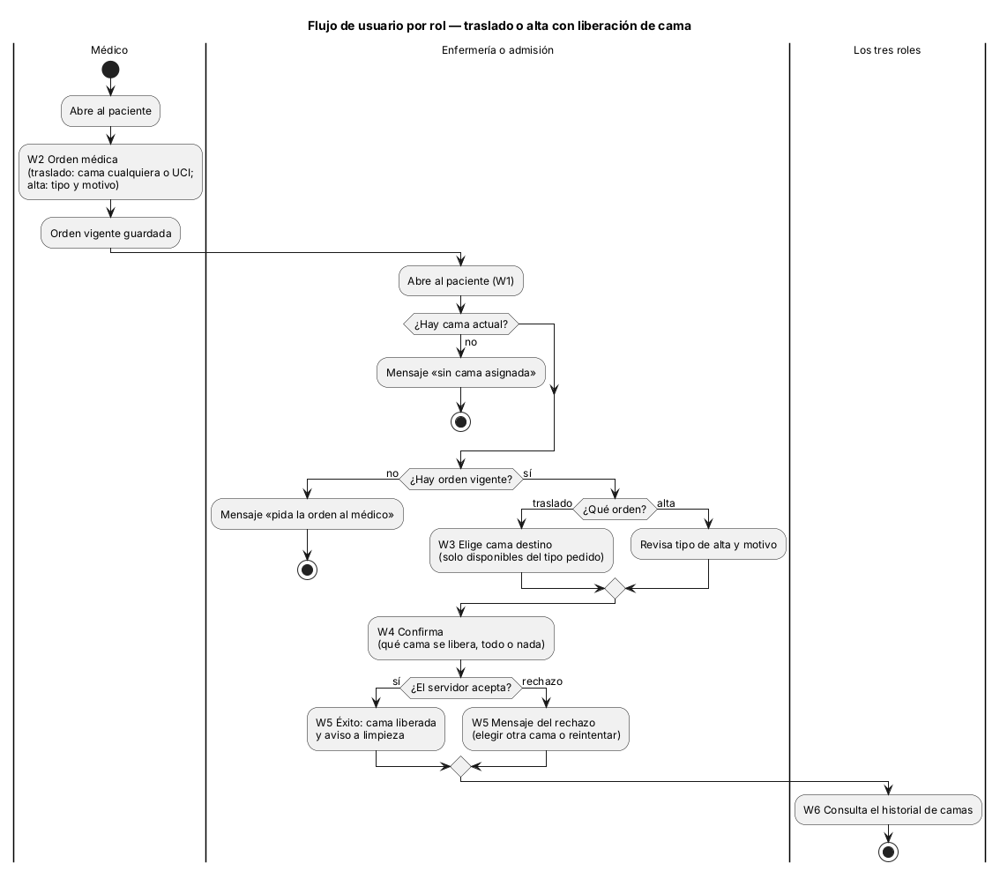
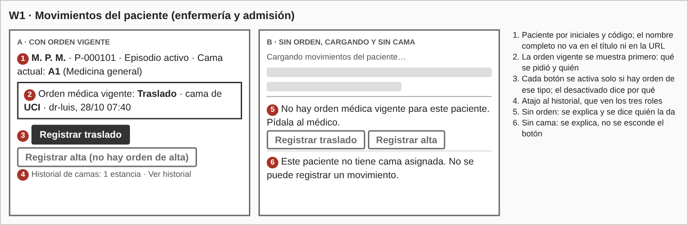
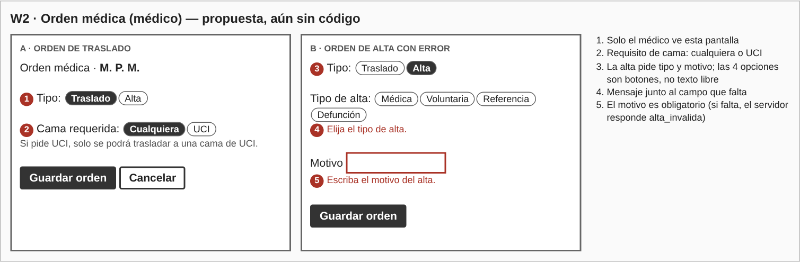
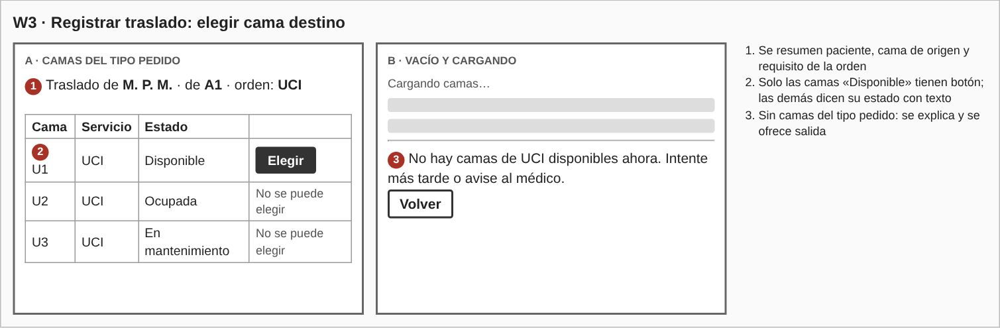
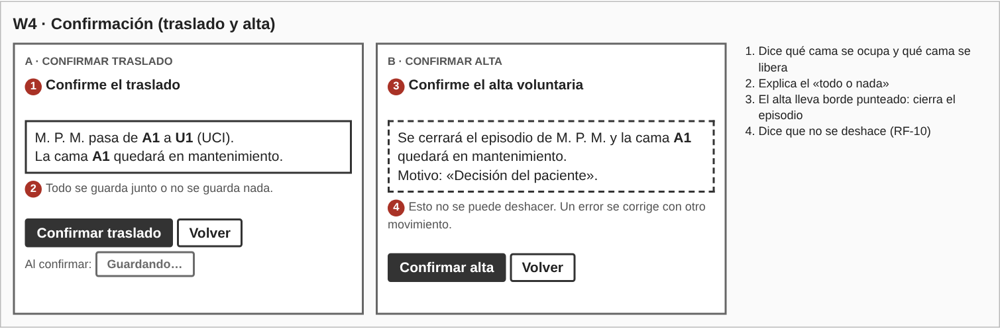
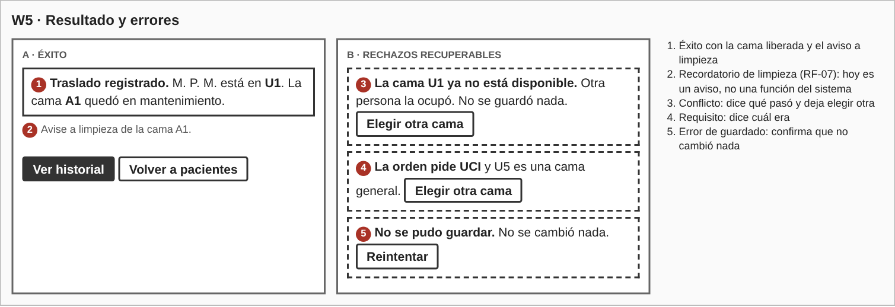
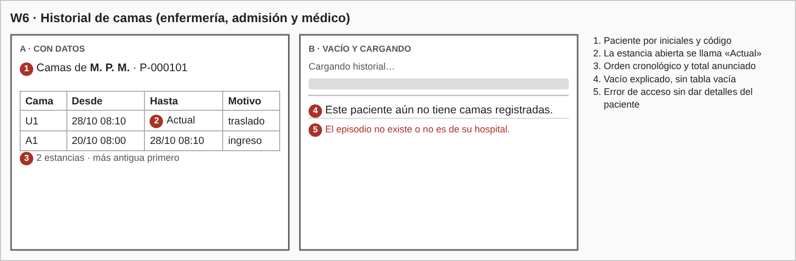
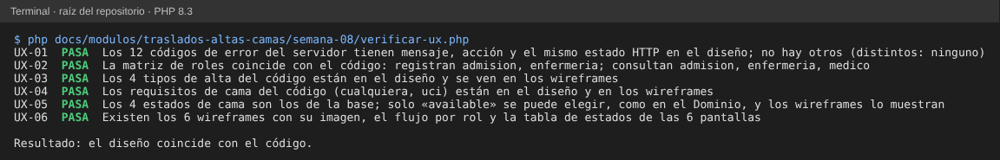

# Semana 8 — Diseño de experiencia de usuario de «traslado o alta del paciente con liberación consistente de cama»

**Estudiante:** Joshua Eduardo García Reyes (`jgarciar73-svg`) · **Módulo:** Traslados, altas y liberación de camas (módulo 8, reasignado dentro del grupo G1)

El flujo se diseña sobre lo que ya hace el Micro-HIS (semanas 3 y 4: códigos de rechazo, reglas de camas, tipos de alta) y sobre los requisitos de la semana 2. Quien manda el contenido de cada mensaje es el servidor; la pantalla solo lo traduce a una frase que dice qué pasó y qué hacer.

## 1. Roles

| Acción | Enfermería | Admisión | Médico | Base |
|---|---|---|---|---|
| Dar la orden médica de traslado o alta (propuesta) | No | No | Sí | RF-01, CU-01 |
| Registrar traslado o alta | Sí | Sí | No | RF-02, RF-03, `RegistrarMovimiento` |
| Consultar el historial de camas | Sí | Sí | Sí | RF-06, `ConsultarHistorial` (propuesta: aún sin código) |

Los tres roles solo ven pacientes de su hospital. El autor del movimiento sale de la sesión, nunca de un campo del formulario. La orden médica (W2) es una propuesta: el Micro-HIS aún no tiene un caso de uso para crearla; solo lee la orden vigente de `ordenes_movimiento`.

## 2. Flujo de usuario por rol

- **Médico:** abre al paciente → escribe la orden (traslado con cama cualquiera o UCI; alta con tipo y motivo) → consulta el historial cuando lo necesita. No ve los botones de registrar.
- **Enfermería y admisión:** abre al paciente → ve la orden vigente → elige la cama destino (traslado) o revisa tipo y motivo (alta) → confirma → ve el resultado → puede ver el historial.

**Decisiones del flujo.** Hay un paso de **confirmación** porque un movimiento no se edita ni se borra (RF-10): un error se corrige con otro movimiento. La confirmación dice qué cama se ocupa y qué cama se libera, y que todo se guarda junto o no se guarda nada (RNF-01). El alta tiene borde distinto y un aviso extra porque cierra el episodio. Tras confirmar, los botones se desactivan para no enviar dos veces.

## 3. Wireframes

Los seis wireframes están en `wireframes/wireframes.html` (se abre en cualquier navegador); `wireframes/generar-png.js` genera las imágenes.

### 3.1 Opciones y validaciones

| Tipo de alta | Valor | Cuándo |
|---|---|---|
| Médica | `medica` | Mejoría clínica |
| Voluntaria | `voluntaria` | Decisión del paciente; también libera la cama |
| Referencia | `referencia` | Se envía a otro establecimiento |
| Defunción | `defuncion` | Fallecimiento |

| Cama pedida | Valor |
|---|---|
| Cualquiera | `cualquiera` |
| UCI | `uci` |

| Estado de la cama | Valor | ¿Se puede elegir? |
|---|---|---|
| Disponible | `available` | Sí |
| Ocupada | `occupied` | No |
| En mantenimiento | `maintenance` | No |
| Inactiva | `inactive` | No |

- La lista de camas muestra solo las del tipo que pidió la orden, y solo las «Disponible» tienen botón (RF-04). El servidor repite la validación y manda: por eso W5 también muestra «La orden pide UCI», para el caso en que la pantalla estuviera desactualizada.
- El alta exige tipo y motivo; las cuatro opciones son botones, no texto libre. Sin motivo el servidor responde `alta_invalida`.
- La pantalla no decide si se puede mover: solo muestra lo que el servidor devuelve.

### 3.2 Estados por pantalla

| Pantalla | Vacío | Carga | Éxito | Error |
|---|---|---|---|---|
| W1 Movimientos | «No hay orden médica vigente… Pídala al médico» y «sin cama asignada» | «Cargando movimientos del paciente…» | Orden vigente y botones activos | W5 |
| W2 Orden médica | Campos sin elegir | — | Orden guardada | Mensaje junto al campo que falta |
| W3 Cama destino | «No hay camas de UCI disponibles ahora» | «Cargando camas…» | Lista con camas disponibles | W5 |
| W4 Confirmación | — | «Guardando…» | Pasa a W5 | W5 (no cambió nada) |
| W5 Resultado | — | — | «Traslado registrado» con cama liberada | Un mensaje y una acción por código (§4) |
| W6 Historial | «Este paciente aún no tiene camas registradas» | «Cargando historial…» | Lista, más antigua primero | «El episodio no existe o no es de su hospital» |

## 4. Mensajes de error (código → qué ve el usuario → qué puede hacer)

| Código | HTTP | Mensaje | Acción |
|---|---|---|---|
| `json_invalido` | 400 | No se pudo enviar el movimiento. Intente de nuevo. | Reintentar |
| `sin_sesion` | 401 | Su sesión terminó. Inicie sesión para continuar. | Iniciar sesión |
| `acceso_denegado` | 403 | No tiene acceso a este paciente o a esta acción. | Volver |
| `ruta_no_encontrada` | 404 | Algo salió mal. Intente de nuevo; si sigue, avise a soporte. | Volver |
| `metodo_no_permitido` | 405 | Algo salió mal. Intente de nuevo; si sigue, avise a soporte. | Volver |
| `episodio_no_disponible` | 409 | Este paciente ya no tiene un episodio activo. No se guardó nada. | Volver a pacientes |
| `orden_requerida` | 409 | No hay orden médica vigente de ese tipo. Pídala al médico. | Volver |
| `sin_cama` | 409 | Este paciente no tiene cama asignada; no se puede mover. | Volver |
| `cama_no_disponible` | 409 | La cama ya no está disponible. Otra persona pudo ocuparla. No se guardó nada. | Elegir otra cama |
| `cama_no_cumple_requisito` | 409 | La orden pide una cama de UCI y esta no lo es. | Elegir otra cama |
| `alta_invalida` | 422 | Escriba el motivo del alta. | Corregir el campo |
| `error_persistencia` | 500 | No se pudo guardar. No se cambió nada. | Reintentar |

Dos aclaraciones:

- **Conflicto entre dos personas (CA-09).** Si dos personas eligen la misma cama a la vez, el servidor de la semana 4 devuelve hoy `error_persistencia` (500) para la segunda. El diseño pide que sea `cama_no_disponible` (409) para poder decir «elija otra cama». Es una propuesta para el servidor; no se cambia código esta semana.
- **Aviso a limpieza (RF-07).** El sistema aún no avisa a limpieza; W5 muestra un recordatorio para que la persona lo haga.

## 5. Ayuda contextual y protección de datos

- **Ayuda:** cada pantalla dice qué cama se libera y cuál se ocupa; los botones desactivados explican por qué; el resumen de W4 explica el «todo o nada»; los mensajes dicen qué hacer.
- **Datos del paciente:** se muestra por iniciales y código; el nombre completo, el motivo del alta y el tipo «defunción» no van en el título de la pestaña, en la URL ni en la bitácora (RNF-03).
- **Datos en el navegador:** nada del movimiento se guarda en `localStorage` ni en cookies. Antes de salir de W3 o W4 con una selección sin confirmar se pide confirmación.
- **Permisos:** los botones de registrar no existen para el médico; el servidor lo vuelve a comprobar.

## 6. Trazabilidad

| Requisito | Dónde se atiende |
|---|---|
| RF-01 (orden médica) | W2, W1 |
| RF-02, RF-03 (traslado y alta) | W3, W4, W5 |
| RF-04 (cama destino válida) | W3, §3.1 |
| RF-05 (liberar la cama de origen) | W4, W5 |
| RF-06 (historial) | W6 |
| RF-07 (aviso a limpieza) | W5 (recordatorio) |
| RF-09 (rechazos con código estable) | §4 |
| RF-10 (no se edita) | W4 |
| RNF-01 (todo o nada) | W4, W5 |
| RNF-06 (cada rechazo dice su motivo) | §4 |

## 7. Evidencia

`php docs/modulos/traslados-altas-camas/semana-08/verificar-ux.php` (solo PHP; lee el código del Micro-HIS y este documento). Comprueba que los códigos de error y sus estados HTTP, la matriz de roles, los tipos de alta, los requisitos de cama y los estados de cama de este diseño coinciden con el código, y que los wireframes existen.

Se dañó el diseño a propósito y las 5 alteraciones se detectaron:

| Daño | Falla |
|---|---|
| Se borra el mensaje de `cama_no_cumple_requisito` | `UX-01` |
| El médico puede registrar movimientos | `UX-02` |
| Se quita «Referencia» de los wireframes | `UX-03` |
| Se quita «UCI» de los wireframes | `UX-04` |
| Se borra una de las imágenes de los wireframes | `UX-06` |

## 8. Límites

- Son wireframes de baja fidelidad para escritorio; la evaluación de usabilidad y accesibilidad es de la semana 9 y la adaptación a móvil, de la semana 10.
- Los textos no se probaron con usuarios reales.
- La orden médica (W2), el aviso a limpieza y el conflicto 409 son propuestas; el Micro-HIS actual no los tiene.
