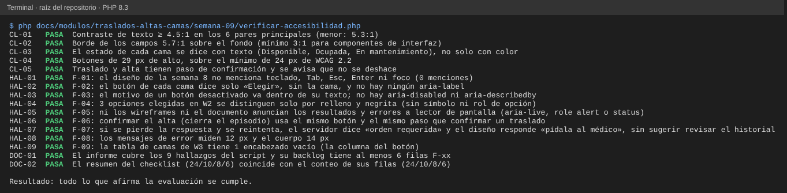

# Semana 9 — Evaluación de usabilidad y accesibilidad de «traslado o alta del paciente con liberación consistente de cama»

**Estudiante:** Joshua Eduardo García Reyes (`jgarciar73-svg`) · **Módulo:** Traslados, altas y liberación de camas (módulo 8, reasignado dentro del grupo G1)

Se evalúa el diseño de la semana 8 (flujo por rol, 6 wireframes `W1` a `W6` y 12 mensajes de error) con las 10 heurísticas de Nielsen y los criterios de WCAG 2.2 nivel AA que se pueden juzgar sobre un wireframe: teclado, foco, contraste, etiquetas, mensajes y prevención de errores. Todavía no hay pantalla programada, así que se evalúa el diseño, no un producto; los hallazgos son lo que hay que corregir **antes** de programarla.

Cómo se priorizó: el impacto se mide por lo que puede pasar con el paciente y con la cama. Elegir una cama equivocada, cerrar un episodio por error o no saber si el movimiento se guardó pesa más que un texto pequeño.

| Prioridad | Significado |
|---|---|
| Alta | Puede dejar al paciente en una cama equivocada, cerrar un episodio por error o hacer que el movimiento se pierda o se repita sin que se note |
| Media | Obliga a repetir trabajo o confunde, pero el dato queda bien |
| Baja | Molestia o incumplimiento menor que no cambia el dato |

## 1. Checklist completado

Se marca **Cumple**, **Parcial** o **No cumple** según lo que dicen el documento y los wireframes de la semana 8.

### 1.1 Heurísticas de usabilidad (Nielsen)

| N.º | Heurística | Resultado | Evidencia |
|---|---|---|---|
| H1 | Visibilidad del estado | Cumple | Estados vacío, carga, éxito y error por pantalla (§3.2 de la semana 8) |
| H2 | Lenguaje cercano al usuario | Cumple | Mensajes en español claro; «cama», «orden médica», no códigos |
| H3 | Control y libertad | Parcial | Hay «Volver» y confirmación, pero un alta no se deshace y el reintento es confuso (F-07) |
| H4 | Consistencia | Cumple | Mismo patrón de mensaje y acción en los 12 códigos; mismos botones en todas las pantallas |
| H5 | Prevención de errores | Parcial | Solo se eligen camas disponibles; el alta se confirma igual que un traslado (F-06) |
| H6 | Reconocer en vez de recordar | Parcial | El botón de cada cama no dice cuál es (F-02) |
| H7 | Flexibilidad y eficiencia | No cumple | No se define uso con teclado (F-01) |
| H8 | Diseño minimalista | Cumple | Una acción principal por pantalla |
| H9 | Ayudar a recuperarse de errores | Parcial | Cada código dice qué hacer; tras perder la respuesta, el mensaje engaña (F-07) |
| H10 | Ayuda y documentación | Cumple | La confirmación explica qué cama se libera y el «todo o nada» |

### 1.2 Accesibilidad (WCAG 2.2 AA)

| Criterio | Tema | Resultado | Evidencia |
|---|---|---|---|
| 1.3.1 | Información y relaciones | No cumple | Botones «Elegir» sin nombre propio, opciones sin rol y encabezado vacío (F-02, F-04, F-09) |
| 1.4.1 | Uso del color | Parcial | El estado de cama va en texto; la opción elegida solo por relleno (F-04) |
| 1.4.3 | Contraste del texto (4.5:1) | Cumple | Los 6 pares principales cumplen (menor: 5.3:1) |
| 1.4.11 | Contraste de componentes (3:1) | Cumple | Borde de campos 5.7:1 |
| 2.1.1 | Teclado | No cumple | El diseño no menciona teclado (F-01) |
| 2.4.3 | Orden del foco | No cumple | No se define adónde va el foco (F-01) |
| 2.4.7 | Foco visible | No cumple | No se define el estilo de foco (F-01) |
| 2.5.8 | Tamaño del objetivo (24 px) | Cumple | Botones de 29 px de alto |
| 3.2.2 | Al introducir datos | Cumple | Nada se envía sin confirmar |
| 3.3.1 | Identificación de errores | Cumple | Mensaje junto al campo y mensaje por código |
| 3.3.2 | Etiquetas o instrucciones | Parcial | Hay instrucciones visibles; el motivo de un botón desactivado va dentro del botón (F-03) |
| 3.3.3 | Sugerencia ante errores | Parcial | `orden_requerida` manda a pedir la orden aunque pudo haberse guardado ya (F-07) |
| 3.3.4 | Prevención de errores (datos irreversibles) | Parcial | Hay confirmación, pero igual para el alta y el traslado (F-06) |
| 4.1.3 | Mensajes de estado | No cumple | Los resultados y errores no se anuncian a un lector de pantalla (F-05) |

Resumen: de 24 puntos, 10 cumplen, 8 cumplen en parte y 6 no cumplen. Los 6 que no cumplen salen de cinco hallazgos: F-01 (H7, 2.1.1, 2.4.3 y 2.4.7), F-05 (4.1.3) y F-02, F-04 y F-09 (1.3.1).

## 2. Hallazgos con evidencia

Cada hallazgo se reproduce con `verificar-accesibilidad.php`; la columna «Prueba» es el ID que imprime.

| Hallazgo | Prueba | Qué se encontró | Dónde |
|---|---|---|---|
| F-01 | HAL-01 | El diseño no menciona teclado, Tab, Esc, Enter ni foco (0 menciones): no se define el orden de recorrido ni dónde queda el foco tras elegir una cama, confirmar o recibir un error | `semana-08-diseno-ux.md`, `wireframes.html` |
| F-02 | HAL-02 | El botón de cada cama en la lista de W3 dice solo «Elegir»; con un lector de pantalla se oye «Elegir, Elegir, Elegir» y no se sabe cuál es cuál. No hay ningún `aria-label` | W3 |
| F-03 | HAL-03 | El motivo del botón desactivado («no hay orden de alta») va dentro de su texto; un botón desactivado no recibe el foco, así que el motivo no se alcanza con teclado. No hay `aria-disabled` ni `aria-describedby` | W1 |
| F-04 | HAL-04 | Tipo de movimiento, cama pedida y tipo de alta son opciones que se distinguen por relleno oscuro y negrita; no tienen símbolo ni se declaran como grupo de opciones | W2 |
| F-05 | HAL-05 | Ni el éxito ni los errores (por ejemplo «La cama U1 ya no está disponible») se anuncian al lector de pantalla; no hay `aria-live` ni `role` de alerta o estado | W4, W5 |
| F-06 | HAL-06 | Confirmar un alta (cierra el episodio y no se deshace) usa el mismo botón principal y el mismo paso que confirmar un traslado; solo cambia el borde del recuadro | W4 |
| F-07 | HAL-07 | Si se envía el movimiento y se pierde la respuesta, la persona reintenta; si ya se había guardado, la orden ya no está vigente y el servidor responde `orden_requerida`, que el diseño traduce como «Pídala al médico». Nada sugiere revisar el historial antes | §4 de la semana 8 |
| F-08 | HAL-08 | Los mensajes de error miden 12 px y el cuerpo 14 px: lo más importante en el momento de un fallo es lo más pequeño | todos |
| F-09 | HAL-09 | La tabla de camas de W3 tiene un encabezado de columna vacío (la del botón): un lector no puede decir a qué corresponde | W3 |

Lo que sí se midió y cumple: `CL-01` (contraste ≥ 4.5:1 en 6 pares, el menor 5.3:1), `CL-02` (borde de campos 5.7:1), `CL-03` (el estado de cama va en texto), `CL-04` (botones de 29 px) y `CL-05` (hay confirmación y se avisa que no se deshace).

## 3. Backlog priorizado

Ordenado por prioridad y, dentro de ella, por esfuerzo. «Criterio verificable» es lo que debe poder comprobar quien revise la corrección.

| Hallazgo | Prioridad | Corrección propuesta | Criterio verificable | Semana |
|---|---|---|---|---|
| F-07 | Alta | Si el envío no recibe respuesta, no ofrecer «Reintentar» directo: mostrar «No sabemos si se guardó» y el botón «Ver historial»; si el reintento devuelve `orden_requerida`, consultar antes el historial y decir «Es posible que ya se haya guardado» | Simular respuesta perdida y reintento: el mensaje nunca dice «pídala al médico» si en el historial ya existe el movimiento | 11 |
| F-02 | Alta | El botón dice «Elegir cama U1» (o `aria-label` con el código de la cama y su servicio) | Con un lector de pantalla, cada botón de la lista se lee con su cama; no hay dos botones con el mismo nombre | 11 |
| F-06 | Alta | Confirmar el alta pide una acción extra (casilla «Entiendo que se cierra el episodio») y el botón dice «Confirmar alta y cerrar episodio»; el traslado queda como está | El botón del alta está desactivado hasta marcar la casilla; el del traslado no la pide | 11 |
| F-01 | Alta | Definir el orden de Tab igual al visual; Enter confirma, Esc cierra la confirmación; foco visible de 2 px; el foco pasa al primer campo con error, a la lista de camas al abrir W3 y al mensaje de resultado en W5 | Recorrer W1 a W6 solo con teclado sin ratón: el foco siempre se ve y nunca queda atrapado | 11 |
| F-05 | Media | Los resultados y errores se muestran en una región con `role="status"` (éxito) o `role="alert"` (error) | El lector anuncia el mensaje al aparecer, sin mover el foco; todo mensaje de resultado o error lleva esa marca | 11 |
| F-04 | Media | Las opciones son un grupo de opciones (`role="radiogroup"` con `aria-checked`) y la elegida lleva el símbolo ✓ además del relleno | El lector dice «Traslado, elegida»; el conteo de opciones elegidas sin símbolo es 0 | 11 |
| F-03 | Media | El botón queda enfocable con `aria-disabled="true"` y su motivo va en un texto asociado con `aria-describedby` | Con teclado se llega al botón y el lector dice por qué no se puede usar | 11 |
| F-08 | Baja | Mensajes de error de 14 px como mínimo (16 px en móvil) | El tamaño de `.t` es ≥ el del cuerpo; `HAL-08` pasa a FALLA | 10 |
| F-09 | Baja | La columna del botón tiene encabezado, aunque sea visualmente oculto («Acción») | La tabla no tiene encabezados vacíos; `HAL-09` pasa a FALLA | 11 |

Cuando se corrija un hallazgo, la prueba `HAL-xx` pasa a FALLA a propósito: ya no se cumple lo que el informe afirma, y hay que actualizar el informe junto con la corrección.

## 4. Evidencia

`php docs/modulos/traslados-altas-camas/semana-09/verificar-accesibilidad.php` (solo PHP; lee los wireframes y el documento de la semana 8 y calcula los contrastes según la fórmula de WCAG). Imprime `CL-01..05` (lo que cumple), `HAL-01..09` (los hallazgos), `DOC-01` (que este informe los cubra) y `DOC-02` (que el resumen del checklist coincida con sus filas). Sale con código 0 si todo se cumple y 1 si algo no.

Se alteró el diseño o el informe a propósito y las 5 alteraciones se detectaron:

| Alteración | Falla |
|---|---|
| El texto de ayuda pasa a gris claro `#aaaaaa` | `CL-01` |
| Se agrega «Tab» y «foco visible» al documento de la semana 8 | `HAL-01` |
| Se agrega `aria-live` a un wireframe | `HAL-05` |
| El mensaje de error pasa a 14 px | `HAL-08` |
| Se borra la fila F-09 de la tabla de hallazgos del informe | `DOC-01` |

## 5. Límites

- Se evaluó el diseño, no una pantalla real: no se probó con un lector de pantalla ni con personas usuarias. Los criterios que dependen del código (nombre accesible, orden real del foco) se evalúan por lo que el diseño dice o no dice.
- El contraste se calculó sobre los colores de los wireframes; el color final puede cambiar.
- F-07 describe una secuencia posible (respuesta perdida y reintento); no se probó contra un servidor real.
- Las mediciones de tamaño salen del CSS de los wireframes de escritorio; la adaptación a móvil es de la semana 10.
- No se evaluó el tamaño de texto al ampliar al 200 %.
