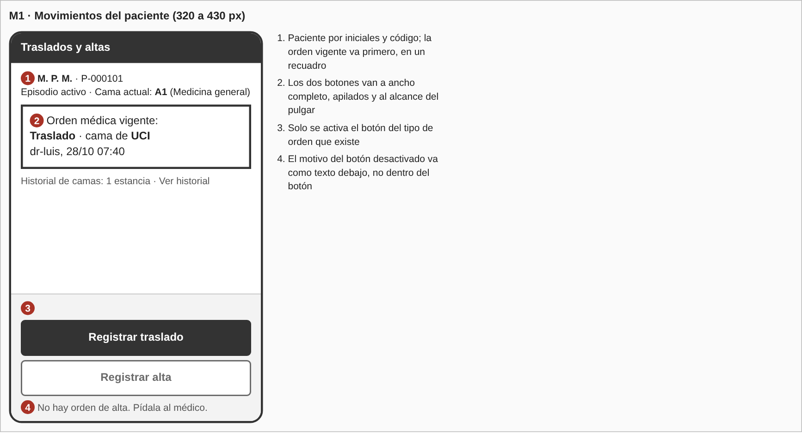
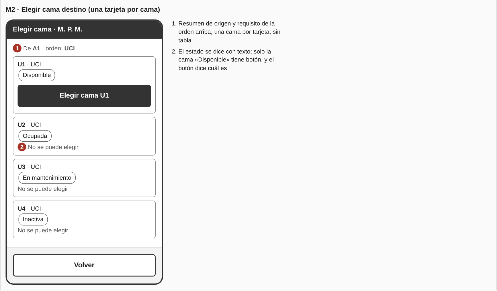
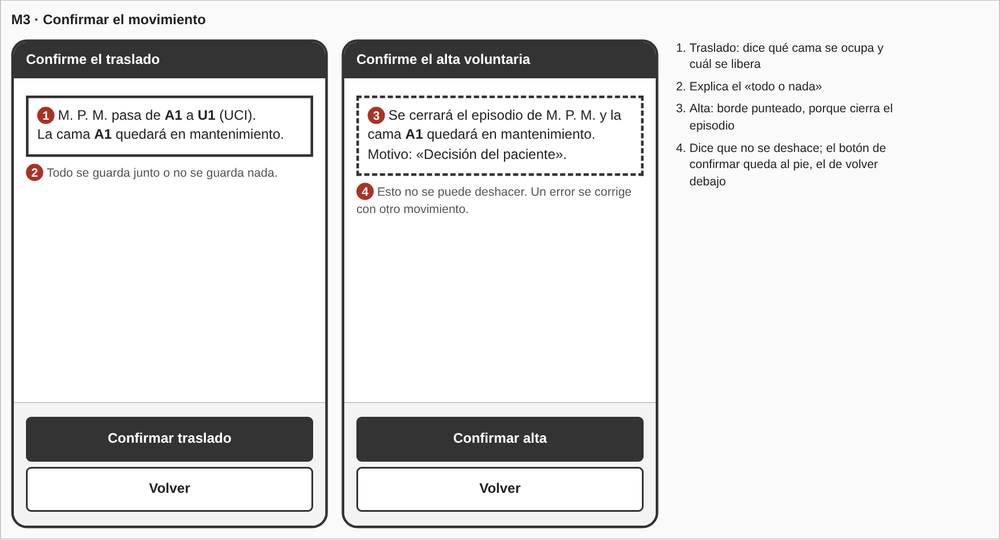
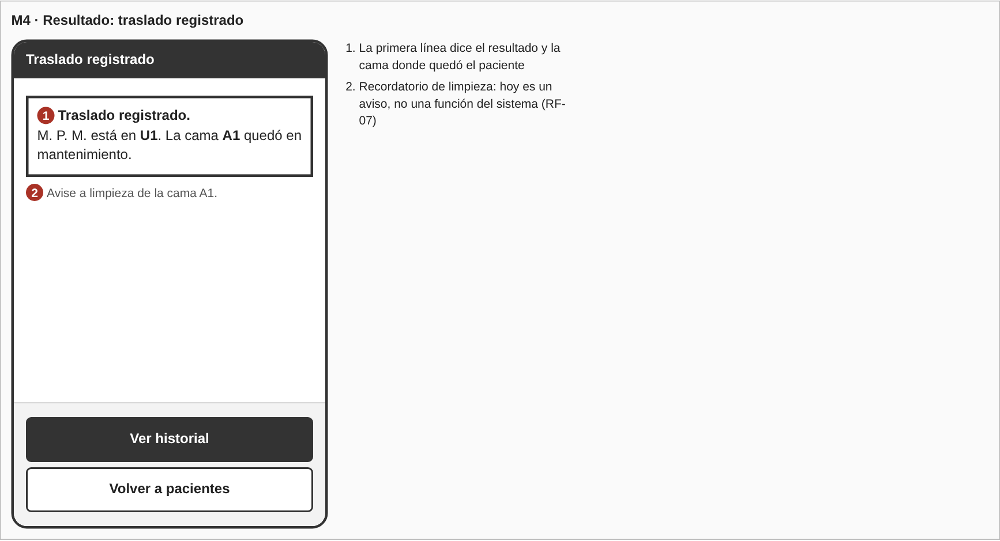
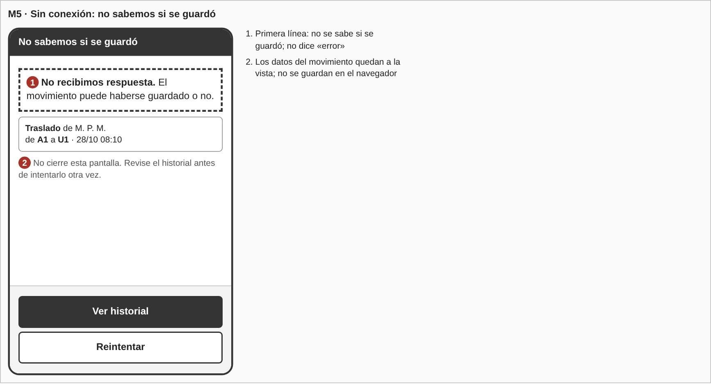
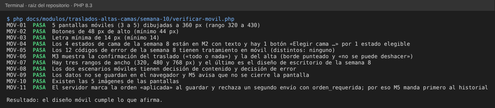

# Semana 10 — Diseño para móvil de «traslado o alta del paciente con liberación consistente de cama»

**Estudiante:** Joshua Eduardo García Reyes (`jgarciar73-svg`) · **Módulo:** Traslados, altas y liberación de camas (módulo 8, reasignado dentro del grupo G1)

Se adapta a móvil (320 a 430 px de ancho) el flujo diseñado en la semana 8 para escritorio: roles, reglas de camas, confirmaciones y mensajes de error no cambian; cambia cómo se distribuyen. Quien registra un movimiento suele estar de pie, junto a la cama o en el pasillo, con una mano ocupada, así que se prioriza lo que se hace con el pulgar y lo que no se puede deshacer se confirma con calma.

## 1. Qué cambia respecto al escritorio

| Tema | Escritorio (semana 8) | Móvil |
|---|---|---|
| Orden vigente y botones | Recuadro y dos botones en una fila | Recuadro arriba; los dos botones apilados, a ancho completo y fijos al pie |
| Lista de camas | Tabla de 4 columnas con botón «Elegir» | Una tarjeta por cama; el botón dice «Elegir cama U1» |
| Botón desactivado | Su motivo va dentro del botón | El motivo va como texto debajo del botón |
| Confirmación | Resumen y botones en una fila | El resumen arriba; confirmar al pie y «Volver» debajo |
| Historial | Tabla de 4 columnas | Una tarjeta por estancia (cama, desde, hasta, motivo) |
| Errores | Recuadro con acción | El mismo recuadro, a ancho completo, con la acción al pie |

## 2. Pantallas propuestas (5)

Los wireframes están en `wireframes-movil/moviles.html` (a 360 px; `generar-png.js` genera las imágenes).

| Pantalla | Qué se ve primero | Acción principal | Equivale a (semana 8) |
|---|---|---|---|
| M1 Movimientos | Paciente (iniciales y código) y la orden vigente | Registrar traslado o alta (solo el tipo que tiene orden) | W1 |
| M2 Elegir cama | Origen y requisito de la orden; las camas, una por tarjeta | Elegir cama (solo «Disponible») | W3 |
| M3 Confirmar | Qué cama se ocupa y cuál se libera (traslado) o el cierre del episodio (alta) | Confirmar | W4 |
| M4 Resultado | «Traslado registrado» y la cama donde quedó | Ver historial | W5 (éxito) |
| M5 Sin conexión | «No sabemos si se guardó» y los datos del movimiento | Ver historial | W5 (`error_persistencia`) |

La orden médica (W2) es de otro rol y se hace en escritorio. El historial (W6) se ve en móvil con una tarjeta por estancia y «Actual» en la abierta; no se dibuja aparte para no pasar de 5 pantallas.

## 3. Reglas de breakpoint

| Ancho | Diseño |
|---|---|
| 320 a 479 px | Base. Una columna, tarjetas y botones fijos al pie. El contenido útil mide 288 px (320 menos 16 px de margen a cada lado) |
| 480 a 767 px | La misma pantalla con la columna centrada, de 480 px como máximo; el resumen de M1 cabe en una línea |
| 768 px o más | Diseño de escritorio de la semana 8 (tabla de camas y botones en fila) |

Reglas generales:

- Se diseña desde 320 px hacia arriba; no hay desplazamiento horizontal. Si un texto no cabe, baja a otra línea.
- Todo objeto que se toca mide al menos 44 px de alto (botones de 48 px).
- Ningún texto menor de 14 px; los botones, 16 px.
- Una sola acción principal por pantalla, fija al pie; la secundaria va debajo.
- Nada que cierre un episodio ni ocupe una cama se envía con un solo toque: siempre pasa por M3.
- La orientación horizontal no tiene diseño propio (ver límites).

## 4. Escenario 1: traslado a UCI en el pasillo y la cama ya no está

La enfermera abre al paciente, ve la orden de traslado a UCI y elige la cama U1. Mientras confirma, otra persona ocupó U1. Recorre M1 → M2 → M3 → (rechazo) → M2.

- **Decisión de contenido:** M2 muestra por cama solo el código, el servicio y el estado en texto; no hay columnas que obliguen a desplazarse. El botón dice «Elegir cama U1» para que el nombre de la cama se lea justo donde se toca. El resumen de origen y requisito queda arriba para no tener que volver a M1.
- **Decisión de error:** el rechazo `cama_no_disponible` dice «La cama U1 ya no está disponible. Otra persona pudo ocuparla. No se guardó nada.» y vuelve a M2 con la lista recargada, donde U1 ya aparece como «Ocupada». La persona no pierde la orden ni tiene que pasar por M1. Si la orden pedía UCI y la cama no lo es (`cama_no_cumple_requisito`), el mensaje dice cuál era el requisito y vuelve a la misma lista. Hoy el servidor devuelve `error_persistencia` en un conflicto entre dos personas (semana 8, §4): el código `cama_no_disponible` es una propuesta para el servidor.

## 5. Escenario 2: conexión limitada al confirmar

La enfermera confirma el traslado en M3 y la red se cae. Recorre M3 → M5.

- **Decisión de contenido:** M5 dice en la primera línea «No sabemos si se guardó», no «error», y deja a la vista el movimiento (paciente, origen, destino y hora) para poder anotarlo en papel. Esos datos viven solo en la pantalla: no se guardan en el almacenamiento del navegador (semana 8, §5).
- **Decisión de error:** el reintento no es automático ni es el botón principal. El botón principal es «Ver historial»: si el movimiento ya se guardó, la orden quedó `aplicada` y el reintento chocaría con `orden_requerida`, un mensaje que diría «pídala al médico» sobre algo que sí se hizo. Primero se consulta el historial (`ConsultarHistorial`); si la estancia nueva ya está, se muestra el resultado de M4. Si no está, «Reintentar» envía otra vez. Una clave de idempotencia en la petición resolvería esto en el servidor; hoy no existe y queda como propuesta, no se cambia código.
- Distinto es `error_persistencia` (500): ahí el servidor sí respondió y dijo que no cambió nada. M5 cambia el texto a «No se pudo guardar. No se cambió nada.» y el botón principal pasa a «Reintentar».

## 6. Mensajes de error en móvil

Los textos son los de la semana 8 (§4); aquí solo cambia dónde se ven.

| Código | HTTP | Cómo se ve en móvil | Pantalla |
|---|---|---|---|
| `json_invalido` | 400 | Aviso a ancho completo con «Reintentar» | M5 |
| `sin_sesion` | 401 | Pantalla de inicio de sesión; al volver, M1 del mismo paciente | M1 |
| `acceso_denegado` | 403 | Aviso con «Volver», sin mostrar datos del paciente | M1 |
| `ruta_no_encontrada` | 404 | Aviso genérico con «Volver» | M1 |
| `metodo_no_permitido` | 405 | Aviso genérico con «Volver» | M1 |
| `episodio_no_disponible` | 409 | Aviso «No se guardó nada» con «Volver a pacientes» | M5 |
| `orden_requerida` | 409 | Aviso con «Volver»; si venía de un reintento, antes se ofrece «Ver historial» | M1 |
| `sin_cama` | 409 | Aviso en M1 con los botones desactivados y su motivo debajo | M1 |
| `cama_no_disponible` | 409 | Aviso arriba de la lista recargada, con «Elegir otra cama» | M2 |
| `cama_no_cumple_requisito` | 409 | Aviso con el requisito y «Elegir otra cama» | M2 |
| `alta_invalida` | 422 | Mensaje en M3 de alta: «Escriba el motivo del alta» con «Volver» | M3 |
| `error_persistencia` | 500 | Aviso «No se pudo guardar. No se cambió nada.» con «Reintentar» | M5 |

## 7. Trazabilidad

| Requisito | Dónde se atiende |
|---|---|
| RF-02, RF-03 (traslado y alta) | M1, M2, M3 |
| RF-04 (cama destino válida) | M2, escenario 1 |
| RF-05 (liberar la cama de origen) | M3, M4 |
| RF-06 (historial) | M4, M5, escenario 2 |
| RF-07 (aviso a limpieza) | M4 (recordatorio) |
| RF-10 (no se edita) | M3, escenario 2 |
| RNF-01 (todo o nada) | M3, M5 |
| RNF-06 (cada rechazo dice su motivo) | §6 |

## 8. Evidencia

`php docs/modulos/traslados-altas-camas/semana-10/verificar-movil.php` (solo PHP; lee los wireframes móviles, el código del Micro-HIS y los documentos de la semana 8 y de esta). Comprueba el número de pantallas y su ancho, el tamaño de botones y letra, que los estados de cama de la semana 8 estén en M2 y solo la «Disponible» tenga botón, que los 12 códigos de error tengan su tratamiento móvil, que el alta se distinga del traslado, los breakpoints, los dos escenarios, que los datos no se guarden en el navegador, que el reintento tras guardar choque de verdad con la orden ya aplicada y que las imágenes existan.

Se dañó el diseño a propósito y las 6 alteraciones se detectaron:

| Daño | Falla |
|---|---|
| Un botón pasa a `min-height:36px` | `MOV-02` |
| Se quita el estado «En mantenimiento» de M2 | `MOV-04` |
| Se borra la fila de `sin_cama` | `MOV-05` |
| Se quita «no se puede deshacer» de la confirmación del alta | `MOV-06` |
| El texto de ayuda pasa a 12 px | `MOV-03` |
| El servidor deja de marcar la orden como aplicada | `MOV-11` |

## 9. Límites

- Son wireframes de baja fidelidad a 360 px; no se probaron en un dispositivo ni con personas usuarias.
- No hay diseño propio para orientación horizontal ni para tabletas más allá de la regla de 480 a 767 px.
- La clave de idempotencia, la consulta previa al reintento y el código `cama_no_disponible` en un conflicto son propuestas; el Micro-HIS actual no los tiene.
- La orden médica (W2) y el aviso a limpieza siguen siendo propuestas de la semana 8.
- Los hallazgos de usabilidad y accesibilidad de la semana 9 no se aplican aquí; este diseño parte del de la semana 8.
