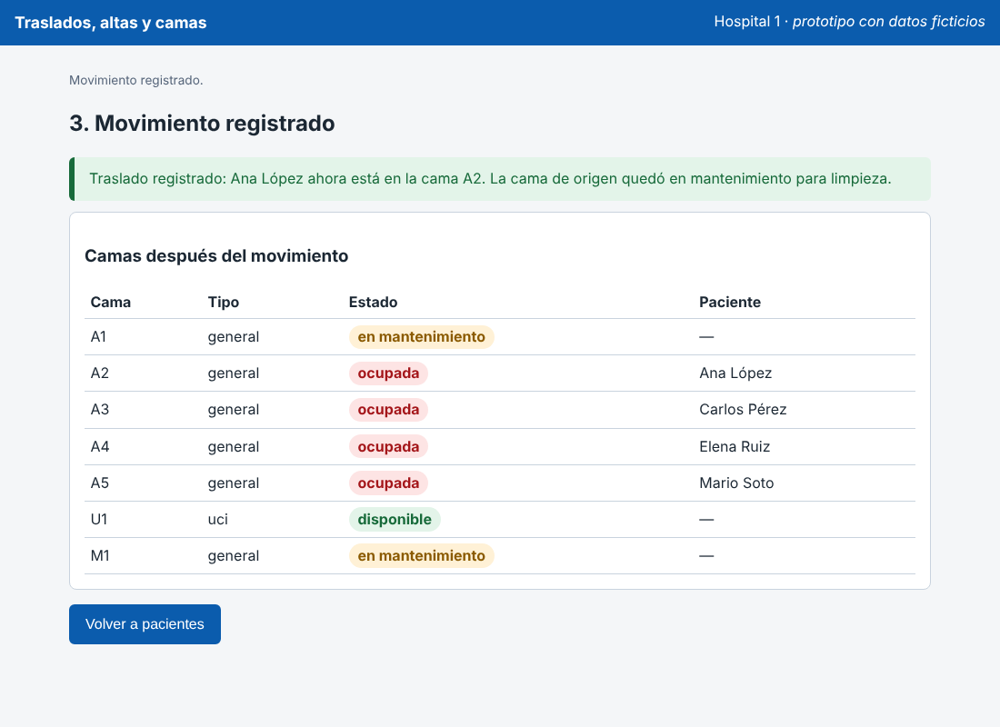
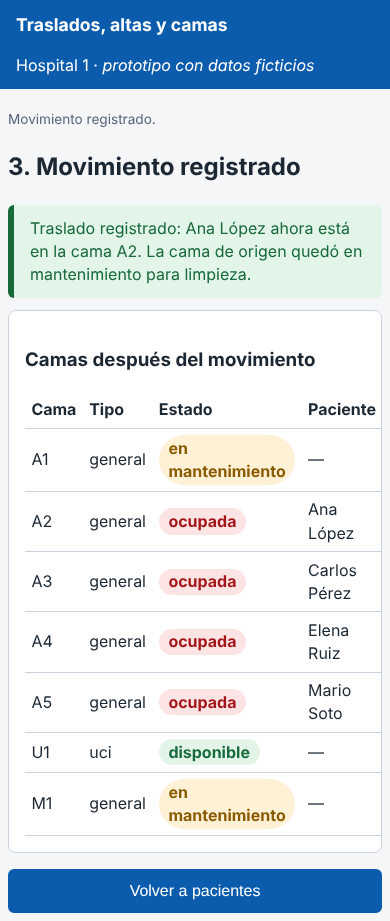
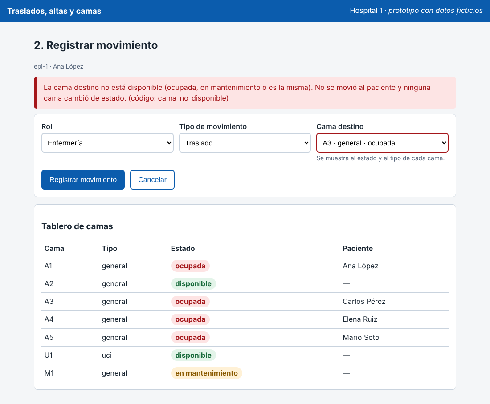
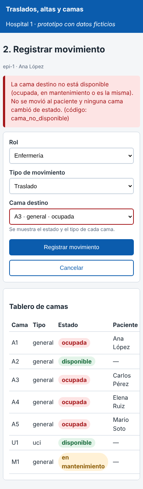

# Semana 11 – Prototipo navegable: traslado o alta del paciente con liberación consistente de cama

Módulo: Traslados, altas y camas · Grupo G1 · Autor: Joshua Eduardo García Reyes.

El prototipo es **un solo archivo** (`prototipo/index.html`, sin servidor ni dependencias). Se abre con doble clic en un navegador y funciona igual en escritorio y en móvil (probado a 1100 px y a 390 px). Los datos son ficticios y son los de `micro-his-traslados/sql/esquema.sql`. La regla de movimiento es la misma de `RegistrarMovimiento`, `Traslado` y `Alta`; `verificar-prototipo.php` la compara con el Micro-HIS en 192 movimientos (7 episodios × 3 tipos × 9 camas destino, más tres roles).

## Mapa de navegación

```
 `pantalla:pacientes` ── "Registrar movimiento" ──▶ `pantalla:movimiento` ── "Registrar movimiento" ──▶ `pantalla:resultado`
        ▲                                               │  ▲                                                │
        │                                  rechazo del dominio │ corrige                                      │
        │                                               ▼  │                                                │
        │                              error crítico (bloque rojo, foco, ninguna cama cambia)                │
        └──────────────── "Cancelar" ◀──────────────────┘          "Volver a pacientes" ◀──────────────────┘
```

| Pantalla | Qué hace | Requisito que cubre |
|---|---|---|
| `pantalla:pacientes` | Lista los pacientes hospitalizados con su cama actual y su orden médica vigente. | RF-01 (orden vigente), RF-06 (cama actual) |
| `pantalla:movimiento` | Rol, tipo (traslado o alta), cama destino con estado y tipo, y el tablero de camas. | RF-02, RF-03, RF-04, RF-09 |
| `pantalla:resultado` | Mensaje con el resultado y el tablero actualizado: origen en mantenimiento, destino ocupada. | RF-05, RNF-01, RNF-02 |

## Camino feliz (capturas `escritorio-camino-feliz.png` y `movil-camino-feliz.png`)

1. Se elige el episodio `epi-1` (Ana López, cama A1, orden de traslado).
2. Cama destino A2 (disponible) y «Registrar movimiento».
3. `resultado` dice que Ana está en A2 y que **A1 quedó en mantenimiento**; el tablero muestra A2 ocupada. Ninguna cama queda sin dueño ni con dos.




## Error crítico (capturas `escritorio-error-critico.png` y `movil-error-critico.png`)

Se elige como destino la cama A3, que está ocupada. El prototipo **no mueve a nadie ni cambia ninguna cama** (RF-04, RNF-01), muestra un bloque rojo con el motivo y el código estable `cama_no_disponible`, marca el campo con `aria-invalid` y mueve el foco al mensaje. El tablero sigue mostrando A1 ocupada por Ana. Se corrige la cama y el flujo continúa.




## Lo que el prototipo deja ver con honestidad

- El estado de cada cama se escribe con texto («ocupada», «disponible», «en mantenimiento»), no solo con color.
- Con el rol Médico el prototipo responde `acceso_denegado`, igual que el Micro-HIS; `epi-4` tiene un alta sin motivo (`alta_invalida`) y `epi-3` pide cama UCI (`cama_no_cumple_requisito`).
- El prototipo hereda un hallazgo del Micro-HIS (se revisa en la semana 13): confía en el estado de la cama; si una cama figura «disponible» pero ya tiene un paciente adentro, la aceptaría como destino.
- No existen en el prototipo el historial de camas (RF-06 completo), el aviso a limpieza (RF-07) ni la salida temporal (RF-08): tampoco existen todavía en el Micro-HIS.
- El prototipo no habla con la API ni con la base; no sustituye las pruebas del Micro-HIS.

## Cómo verificarlo

```
php docs/modulos/traslados-altas-camas/semana-11/verificar-prototipo.php
```

Resultado esperado: ocho líneas `PASA` y «Resultado: el prototipo coincide con el Micro-HIS y con el documento». Si no hay `node` en el equipo, P-02 y P-03 aparecen como OMITIDO.
