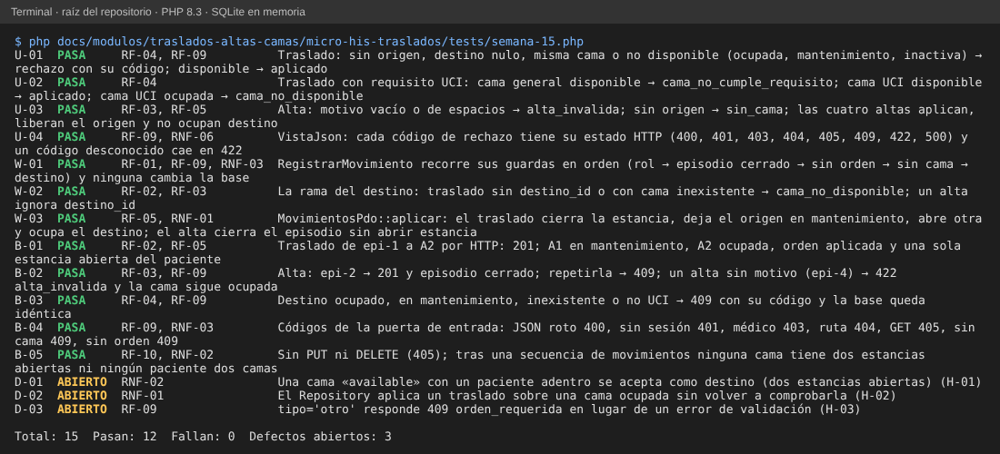

# Semana 15 – Pruebas unitarias, de caja blanca y de caja negra trazadas a RF/RNF

Módulo: Traslados, altas y camas · Grupo G1 · Autor: Joshua Eduardo García Reyes.
Archivo de pruebas: `micro-his-traslados/tests/semana-15.php` (sin dependencias, SQLite en memoria; no modifica `tests/ejecutar.php`).

## 1. Cómo se ejecuta

```
php docs/modulos/traslados-altas-camas/micro-his-traslados/tests/semana-15.php
```

Resultado esperado: `Total: 15  Pasan: 12  Fallan: 0  Defectos abiertos: 3` y código de salida 0. Una prueba de defecto (`D-xx`) imprime **ABIERTO** mientras el defecto se reproduce; si alguien lo corrige, pasa a FALLA con el mensaje «conviértalo en prueba normal», para que el defecto no quede escondido ni la prueba obsoleta.



## 2. Matriz de trazabilidad

| Requisito | Prueba(s) | Tipo | Qué comprueba |
|---|---|---|---|
| RF-01 orden médica | W-01 | blanca | Sin orden vigente → `orden_requerida` y la base no cambia. |
| RF-02 traslado a cama destino | W-02, B-01 | blanca, negra | Destino sin elegir o inexistente se rechaza; el traslado por HTTP ocupa el destino y deja una sola estancia abierta. |
| RF-03 alta con motivo | U-03, W-02, B-02 | unitaria, blanca, negra | Las cuatro altas aplican; motivo vacío → `alta_invalida`; el alta cierra el episodio. |
| RF-04 validar destino | U-01, U-02, B-03 | unitaria, negra | Distinta, disponible y del tipo pedido (UCI); cada rechazo deja la base idéntica. |
| RF-05 liberar origen en el mismo movimiento | U-03, W-03, B-01 | unitaria, blanca, negra | El origen queda en mantenimiento en la misma operación. |
| RF-06 historial de camas | — | — | **Sin prueba: la función no existe** (H-04). |
| RF-07 aviso a limpieza | — | — | **Sin prueba: la función no existe** (H-04). |
| RF-08 salida temporal | — | — | **Sin prueba: la función no existe** (H-04). |
| RF-09 códigos de rechazo estables | U-01, U-04, W-01, B-02, B-03, B-04, D-03 | unitaria, blanca, negra, defecto | Los cinco códigos y los estados HTTP; `tipo` inválido cae en un código engañoso (D-03). |
| RF-10 sin edición ni borrado | B-05 | negra | PUT y DELETE responden 405. |
| RNF-01 integridad | W-03, D-02 | blanca, defecto | Todo o nada ya cubierto por PER-01 de `tests/ejecutar.php`; el Repository no vuelve a comprobar el destino (D-02). |
| RNF-02 consistencia (cama ⇔ paciente) | B-05, D-01 | negra, defecto | Tras una secuencia de movimientos no hay camas con dos estancias ni camas ocupadas sin paciente; una cama «available» con paciente se acepta (D-01). |
| RNF-03 seguridad por rol | W-01, B-04 | blanca, negra | El médico recibe 403; admisión y enfermería registran. |
| RNF-04 rendimiento (< 2 s) | — | — | **No medido.** |
| RNF-05 y RNF-06 contrato y verificabilidad | U-04 | unitaria | Mapa código → estado; el contrato LSP ya lo prueban `semana-02/ejemplo-lsp/verificar.php` y la semana 12. |

## 3. Cobertura pedida por la entrega

| Pedido | Cantidad | Pruebas |
|---|---|---|
| Unitarias (≥ 3) | 4 | U-01, U-02, U-03, U-04 |
| Caja blanca (≥ 2) | 3 | W-01 (guardas de `RegistrarMovimiento`), W-02 (rama del destino), W-03 (ramas de `MovimientosPdo::aplicar`) |
| Caja negra (≥ 4) | 5 | B-01 a B-05, solo por HTTP |
| Defectos reportados | 3 | D-01, D-02, D-03 |

Las pruebas se comprobaron también **rompiendo el código a propósito** (13 cambios con efecto: estado y tipo del destino, cama repetida, motivo del alta, rol, orden vigente, estados que se escriben, cierre del episodio, 405 y JSON roto): cada cambio hizo fallar al menos una prueba. Dos cambios sobrevivieron y son equivalentes: quitar `alta_invalida => 422` del mapa (el valor por defecto ya es 422) y ignorar `destino_id` en un alta en el caso de uso (el dominio ya lo ignora).

## 4. Defectos encontrados (se corrigen en el código aparte; el acta de la semana 13 los registra con responsable)

| ID | Prueba | Descripción | Requisito | Severidad | Estado |
|---|---|---|---|---|---|
| H-01 | D-01 | Una cama «available» con un paciente adentro se acepta como destino: dos estancias abiertas. | RNF-02 | Alta | Abierto |
| H-02 | D-02 | `MovimientosPdo::aplicar` ocupa una cama ocupada sin volver a comprobarla. | RNF-01 | Alta | Abierto |
| H-03 | D-03 | `tipo = 'otro'` responde 409 `orden_requerida`. | RF-09 | Media | Abierto |

## 5. Lo que estas pruebas no cubren

RF-06, RF-07, RF-08 y RNF-04 no tienen prueba porque la función o la medición no existen. Los hallazgos H-04 (rutas faltantes), H-05 (orden con datos inválidos), H-06 (dos formatos de fecha) y H-07 (aviso de PHP con entrada en arreglo) quedan solo en el acta de la semana 13. La concurrencia real de dos movimientos simultáneos solo se puede probar contra PostgreSQL, no con SQLite.
