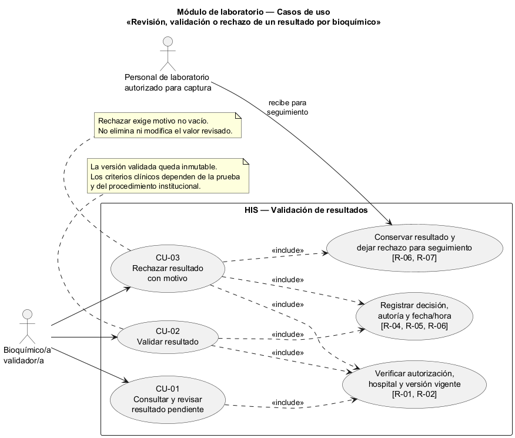
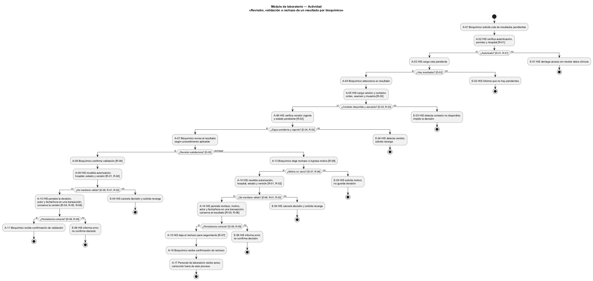
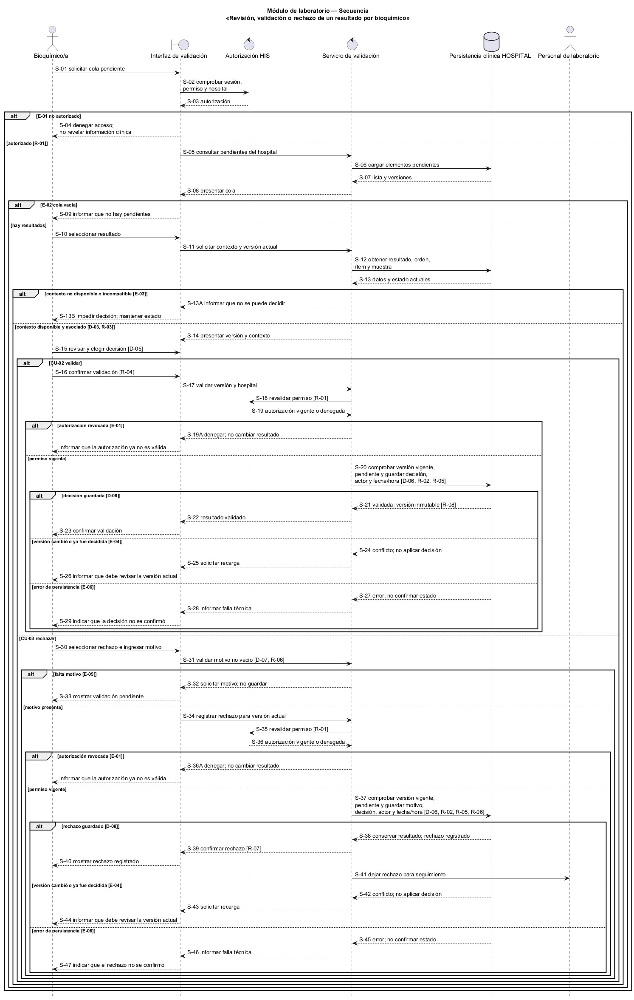

# Semana 1 — Modelado UML de la validación de resultados por bioquímico

| | |
|---|---|
| **Curso** | Análisis de Sistemas II — Proyecto Final 2026 |
| **Proyecto** | Sistema Hospitalario Integrado (HIS) |
| **Módulo** | Validación de resultados por bioquímico |
| **Tema de la semana** | Conceptos generales, orientación a objetos y UML |
| **Proceso modelado** | «Revisión, validación o rechazo de un resultado por bioquímico» |
| **Estudiante según la captura** | Mercedes Azucena Lopez Perez |
| **Fecha** | Octubre 2026 |

## 1. Introducción

La validación bioquímica es una decisión profesional posterior a la captura de un resultado. El bioquímico revisa un resultado pendiente junto con la orden, el examen, la muestra y los datos interpretativos disponibles para la prueba. Si la revisión es satisfactoria, valida la versión vigente; si no lo es, la rechaza con un motivo obligatorio para que el personal autorizado del laboratorio pueda darle seguimiento. Las dos decisiones quedan asociadas a la identidad del bioquímico y a la fecha/hora, sin borrar ni reemplazar el resultado revisado.

Este documento modela tres vistas relacionadas:

- **Casos de uso:** quién revisa y qué objetivos persigue.
- **Actividad:** autorizaciones, verificaciones, decisión, excepciones y estados resultantes.
- **Secuencia:** participantes, mensajes, validaciones y respuestas del sistema.

Los identificadores CU, A, D, E, S y R enlazan las vistas y se resumen en la matriz de trazabilidad. Se trata de un modelo de negocio académico; no afirma que las pantallas, estados físicos de base de datos, endpoints o reglas clínicas estén implementados.

## 2. Narrativa de alcance

**Objetivo.** Permitir que un bioquímico autorizado revise una versión de resultado de laboratorio que esté pendiente de validación y registre una decisión auditable: validarla o rechazarla con motivo. El sistema debe confirmar que el resultado aún corresponde a la versión vigente pendiente antes de guardar la decisión.

**Escenario de referencia.** El bioquímico abre la cola de resultados pendientes de su hospital y selecciona un resultado. El sistema confirma su autorización y presenta el contexto disponible para la prueba: orden e ítem, paciente y muestra relacionados, valor, unidad cuando aplique, información del catálogo y cualquier indicador asociado. El bioquímico contrasta esos datos con el procedimiento profesional aplicable. Si la información es suficiente y la revisión es satisfactoria, elige validar. Si identifica una causa para no validarlo, elige rechazar e indica un motivo. Antes de guardar, el sistema verifica de nuevo que la versión siga pendiente y vigente. Registra la decisión, la autoría y el momento, conserva el resultado revisado y confirma el desenlace. Un rechazo permanece trazable y se devuelve para seguimiento al personal autorizado de laboratorio; una falla técnica no se presenta como una decisión clínica.

**Dentro del alcance:**

- consultar resultados pendientes en el hospital autorizado;
- abrir y revisar la versión vigente junto con su contexto de orden, examen y muestra;
- comprobar autorización, pertenencia al hospital, integridad de asociación y vigencia del resultado;
- registrar la validación profesional de la versión pendiente;
- registrar el rechazo con un motivo no vacío;
- conservar la versión revisada y registrar actor, fecha/hora y decisión;
- informar el resultado de la operación y distinguir una decisión clínica de un error técnico.

**Fuera del alcance:**

- capturar o corregir el valor del resultado, emitir órdenes o recibir muestras;
- definir valores de referencia, intervalos, unidades, rangos críticos o algoritmos por examen;
- sustituir el juicio profesional por una regla automática basada únicamente en un valor fuera de rango;
- validar resultados de otro hospital, reabrir resultados ya validados o corregirlos retrospectivamente;
- implementar alertas críticas, comunicar resultados al paciente, diagnosticar o prescribir tratamiento;
- definir endpoints, interfaces clínicas, campos definitivos de auditoría o el estado físico de base de datos.

**Supuestos y límites:**

1. El resultado, su orden, ítem y muestra ya existen; el proceso recibe resultados capturados y pendientes.
2. La cuenta del bioquímico está autenticada y la autorización se comprueba para el hospital y la acción solicitada. Ver la cola no reemplaza la autorización para decidir.
3. Los valores y criterios aplicables dependen de la prueba y de los procedimientos institucionales. El modelo no inventa límites ni equipara automáticamente un valor fuera de referencia con un resultado inválido.
4. La decisión se aplica solamente a la versión vigente pendiente. Si cambió desde que fue abierta, no se valida ni se rechaza con datos obsoletos; se solicita volver a cargarla.
5. Validar vuelve inmutable esa versión. Una rectificación posterior requiere otro proceso controlado, versionado y con motivo, ajeno a esta entrega.
6. Rechazar exige un motivo y conserva el resultado como evidencia; no borra la versión ni significa por sí solo que la muestra fue rechazada o que deba repetirse.
7. Una falla de autorización, concurrencia o persistencia no cambia el estado y nunca se representa como validación o rechazo exitosos.
8. El diseño federado del repositorio contempla `lab_order`, `lab_order_item`, `specimen` y `lab_result_version` en la base HOSPITAL, y establece la inmutabilidad de resultados validados y el versionado con motivo de las correcciones. No define aquí los campos, estados persistidos ni el contrato de una decisión de rechazo; estos requieren coordinación entre módulos.

## 3. Actores

| Actor | Tipo | Objetivo |
|---|---|---|
| Bioquímico/a validador/a | Primario | Revisar resultados pendientes y registrar una validación o un rechazo fundamentado para la versión vigente. |
| Personal de laboratorio autorizado para captura | Secundario, fuera de la decisión | Recibir los resultados rechazados para darles seguimiento en su proceso. No puede validar en nombre del bioquímico. |

La interfaz, el servicio de validación, el control de autorización, el repositorio y el registro de auditoría son participantes internos del HIS, no actores externos.

## 4. Diagrama de casos de uso

Fuente editable: [semana-01-casos-de-uso.puml](diagramas/semana-01-casos-de-uso.puml).

## 5. Especificación de casos de uso

### CU-01 — Consultar y revisar resultado pendiente

| Campo | Descripción |
|---|---|
| Actor principal | Bioquímico/a validador/a. |
| Objetivo | Inspeccionar un resultado pendiente y el contexto disponible antes de decidir. |
| Precondición | Actor autenticado y autorizado en el hospital correspondiente. |
| Disparador | El actor abre la cola de validación o selecciona uno de sus elementos. |
| Flujo principal | 1. El actor solicita los resultados pendientes. 2. El sistema verifica autorización y ámbito hospitalario. 3. El sistema presenta la cola con identificadores y estados actuales. 4. El actor abre un elemento. 5. El sistema carga la versión vigente y el contexto asociado de orden, examen y muestra. 6. El actor revisa los datos con el procedimiento aplicable y decide continuar con CU-02 o CU-03. |
| Alternativas y excepciones | Sin autorización: acceso denegado (E-01). No hay pendientes: se informa cola vacía (E-02). Resultado o contexto inexistente/no accesible: no se permite decidir (E-03). Error al consultar: se informa la falla y no se presenta información como actualizada (E-06). |
| Postcondición | No hay cambio de estado por consultar o revisar. La versión mostrada está identificada para detectar cambios concurrentes. |

### CU-02 — Validar resultado

| Campo | Descripción |
|---|---|
| Actor principal | Bioquímico/a validador/a. |
| Objetivo | Registrar la aprobación profesional del resultado vigente, sin modificar el valor evaluado. |
| Precondición | CU-01 completado; la versión continúa vigente y pendiente; el bioquímico está autorizado. |
| Disparador | El bioquímico elige «validar» después de revisar el contexto requerido. |
| Flujo principal | 1. El actor confirma la decisión para la versión mostrada. 2. El sistema vuelve a comprobar autorización, hospital, estado y versión vigente (R-01, R-02). 3. El sistema registra la validación con actor y fecha/hora y conserva la versión del resultado (R-04, R-05). 4. El sistema confirma la decisión. |
| Alternativas y excepciones | Si dejó de estar pendiente o la versión cambió, se cancela la decisión y se solicita recargar (E-04). Si falta contexto necesario para revisar, no se permite confirmar (E-03). Si falla la persistencia, no se muestra éxito ni se cambia el estado (E-06). |
| Postcondición | La versión vigente queda validada e inmutable; existe evidencia de quién decidió y cuándo. |

### CU-03 — Rechazar resultado con motivo

| Campo | Descripción |
|---|---|
| Actor principal | Bioquímico/a validador/a. |
| Objetivo | Registrar que el resultado no puede validarse en la revisión actual y explicar la causa. |
| Precondición | CU-01 completado; la versión continúa vigente y pendiente; el bioquímico está autorizado. |
| Disparador | El bioquímico elige «rechazar» tras identificar una causa que debe quedar documentada. |
| Flujo principal | 1. El actor elige rechazar. 2. El sistema solicita el motivo. 3. El actor ingresa la causa. 4. El sistema comprueba que el motivo no esté vacío y vuelve a verificar autorización, hospital, estado y versión (R-01, R-02, R-06). 5. El sistema registra la decisión, el motivo, actor y fecha/hora, y conserva el resultado revisado (R-05, R-06). 6. El sistema confirma el rechazo y deja constancia del seguimiento para el personal autorizado de laboratorio (R-07). |
| Alternativas y excepciones | Motivo vacío: el sistema solicita completarlo y no registra decisión (E-05). Versión ya decidida o reemplazada: cancela y pide recargar (E-04). Error de persistencia: no informa rechazo exitoso (E-06). |
| Postcondición | El rechazo queda consultable con su motivo y autoría; el resultado original no se elimina ni se modifica. El seguimiento correctivo pertenece al proceso de captura. |

## 6. Diagrama de actividad

Fuente editable: [semana-01-actividad.puml](diagramas/semana-01-actividad.puml).

El flujo diferencia una decisión profesional de un error del sistema. Solo la revisión de una versión autorizada, vigente y pendiente llega a las ramas de validación o rechazo.

## 7. Diagrama de secuencia

Fuente editable: [semana-01-secuencia.puml](diagramas/semana-01-secuencia.puml).

El intercambio muestra la consulta del contexto, las verificaciones antes de registrar una decisión y las respuestas para aprobación, rechazo, concurrencia, autorización y persistencia.

## 8. Decisiones, reglas y excepciones

| ID | Decisión del flujo |
|---|---|
| D-01 | ¿El bioquímico está autenticado y autorizado para este hospital y esta acción? |
| D-02 | ¿La cola contiene resultados pendientes? |
| D-03 | ¿Existe contexto disponible y correctamente asociado a orden, examen y muestra? |
| D-04 | ¿La versión sigue siendo la vigente y está pendiente de validación? |
| D-05 | ¿La revisión profesional permite validar el resultado? |
| D-06 | Al guardar, ¿siguen vigentes la autorización, el hospital, la versión y el estado pendiente? |
| D-07 | Si se rechaza, ¿el motivo está presente y no vacío? |
| D-08 | ¿Se persistió la decisión sin error? |

| ID | Regla |
|---|---|
| R-01 | Solo un bioquímico autenticado y autorizado para el hospital y la acción puede consultar o decidir. |
| R-02 | Solo se decide sobre la versión vigente pendiente; el estado y la versión se vuelven a verificar al guardar. |
| R-03 | La revisión usa el contexto asociado a la orden, examen y muestra; no se inventan criterios ni se decide automáticamente por un valor fuera de referencia. |
| R-04 | Validar registra una decisión explícita sobre la versión revisada; no altera el valor analítico. |
| R-05 | Toda decisión conserva actor y fecha/hora asociados al resultado revisado. |
| R-06 | Rechazar exige motivo no vacío y conserva la versión revisada; no elimina ni altera el dato. |
| R-07 | Un rechazo habilita seguimiento por el personal autorizado de laboratorio; su corrección o repetición no se ejecuta en este proceso. |
| R-08 | Una versión validada es inmutable; cualquier rectificación posterior requiere un flujo separado y controlado. |
| R-09 | Un error técnico o un cambio concurrente no se convierte en una decisión exitosa ni modifica el resultado. |

| ID | Excepción |
|---|---|
| E-01 | Actor no autenticado o sin permiso: denegar la acción sin revelar información clínica. |
| E-02 | Cola sin resultados pendientes: mostrar estado vacío, sin registrar decisión. |
| E-03 | Resultado o contexto relacionado inexistente, no disponible o ajeno al hospital: impedir decisión y notificar el problema. |
| E-04 | Resultado ya decidido o versión reemplazada desde su consulta: cancelar, conservar el estado más reciente y solicitar recarga. |
| E-05 | El motivo de rechazo está vacío: no guardar la decisión y señalar qué debe completarse. |
| E-06 | Falla de lectura o escritura: informar el error; no mostrar confirmación de éxito ni fabricar un estado final. |

## 9. Trazabilidad entre vistas

| Regla | Caso(s) de uso | Actividad | Secuencia |
|---|---|---|---|
| R-01 — Autorización y ámbito hospitalario | CU-01, CU-02, CU-03 | A-02–A-04, A-09, A-14; D-01, D-06; E-01 | S-02–S-05, S-17–S-19A, S-35–S-36A |
| R-02 — Versión vigente y estado pendiente | CU-01, CU-02, CU-03 | A-06, A-09, A-14; D-04, D-06; E-04 | S-11–S-14, S-20, S-24, S-37, S-42 |
| R-03 — Contexto y revisión profesional | CU-01, CU-02, CU-03 | A-05; D-03; E-03 | S-12–S-14, S-13A–S-13B |
| R-04 — Validación explícita sin alterar el valor | CU-02 | A-08, A-10–A-11; D-05, D-06, D-08 | S-15–S-23 |
| R-05 — Decisión con actor y fecha/hora | CU-02, CU-03 | A-10, A-14; D-08 | S-20–S-23, S-37–S-41 |
| R-06 — Rechazo con motivo y conservación | CU-03 | A-13–A-14; D-07, D-08; E-05 | S-30–S-40 |
| R-07 — Seguimiento fuera de este proceso | CU-03 | A-15–A-17 | S-38–S-41 |
| R-08 — Inmutabilidad tras validación | CU-02 | A-10 | S-21 |
| R-09 — Errores y concurrencia no son decisiones | CU-01, CU-02, CU-03 | D-06, D-08; E-01–E-06 | S-03–S-05, S-13A–S-13B, S-19A, S-24–S-29, S-32–S-33, S-36A, S-42–S-47 |

## 10. Conclusión

El proceso mantiene separadas la captura analítica y la decisión profesional. Validar o rechazar son resultados explícitos, asociados al bioquímico que los registra y a la versión concreta revisada. La trazabilidad, el motivo de rechazo, la comprobación de concurrencia y la inmutabilidad posterior a la validación evitan cambios silenciosos. Los criterios clínicos concretos, la representación persistida del rechazo y la integración con la cola de trabajo requieren acuerdo entre los módulos responsables.

## 11. Referencias

- Captura de la tarea de Semana 1 compartida por la estudiante: «Validación de resultados por bioquímico».
- `openspec/changes/postgresql-federated-schema-rebuild/specs/hospital-clinical-schema/spec.md`: inmutabilidad de resultados validados y versionado con motivo para correcciones.
- `openspec/changes/postgresql-federated-schema-rebuild/design.md`: secuencia prevista de entidades clínicas de laboratorio en HOSPITAL.
