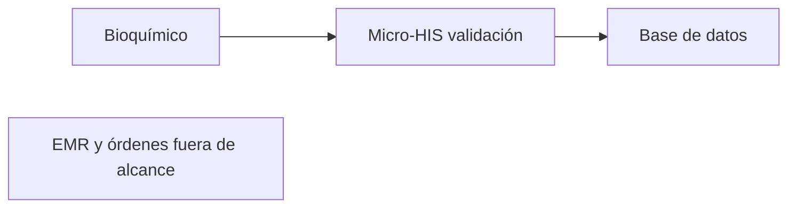
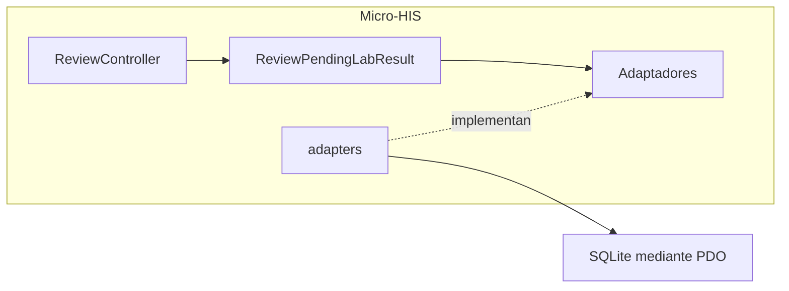
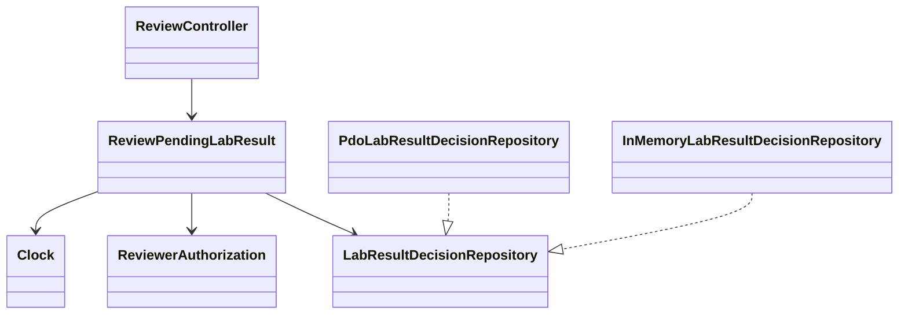
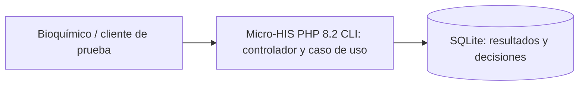
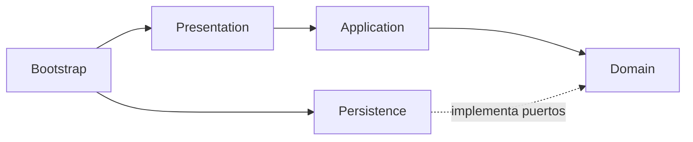

# Semana 3 — Arquitectura de validación de resultados por bioquímico

| | |
|---|---|
| **Curso** | Análisis de Sistemas II — Proyecto Final 2026 |
| **Proyecto** | Sistema Hospitalario Integrado (HIS) |
| **Módulo** | Validación de resultados por bioquímico |
| **Tema** | Diseño arquitectónico, vistas y patrones |
| **Flujo** | «Revisión, validación o rechazo de un resultado por bioquímico» |
| **Estudiante** | Lopez Perez, Mercedes Azucena |
| **Fecha** | Octubre 2026 |

## 1. Objetivo y alcance
Se inicia un Micro-HIS en PHP 8.2+ vanilla que ejecuta el flujo de revisión, validación y rechazo. Presentation, Application, Domain y Persistence están separados; el adaptador usa PDO preparado y las pruebas usan dobles y base de datos de prueba. Se adapta en cuatro carpetas independientes el diseño de [Semana 2](../semana-02/semana-02-dip-validacion-resultados.md). La Semana 4 (PR #184) agregará MVC y paridad InMemory/PDO sobre esta base.

## 2. Requerimientos
Se conservan RF-01 a RF-08 y RNF-01 a RNF-07 de Semana 2:

| Grupo | Resumen |
|---|---|
| RF-01..RF-08 | Consultar pendiente, revisar contexto, autorizar bioquímico, validar, rechazar con motivo, controlar versión, registrar auditoría y mostrar resultado. |
| RNF-01..RNF-07 | Seguridad, trazabilidad, consistencia transaccional, disponibilidad, mantenibilidad, interoperabilidad y pruebas. |

## 3. Vistas arquitectónicas
### C4 contexto


### C4 componentes


### UML


## 4. Patrones y decisiones
Se usa arquitectura por capas y ports & adapters. El repository desacopla persistencia; las excepciones/reglas se expresan como estados de dominio. PDO emplea prepared statements. La decisión y su auditoría se escriben atómicamente. `LabResult`, comandos y registros son valores inmutables (`readonly`).

## 5. Pruebas y ejecución

```text
php docs/modulos/validacion-resultados-bioquimico/semana-03/ejemplo/tests/run.php
```

La cobertura incluye camino feliz, motivo obligatorio, autorización, estado final, versión obsoleta, contexto hospitalario, fallas InMemory/PDO, rollback, ausencia de SQL en Presentation y reflexión arquitectónica. Resultado verificado: 39 comprobaciones reales, 0 fallidas con PHP 8.2.33 y pdo_sqlite. Evidencia: [salida-pruebas.txt](evidencia/salida-pruebas.txt).

## 6. Límites
SQLite es una demostración; no hay servidor HTTP ni autenticación real ni rangos clínicos. El límite del módulo es la validación: captura y corrección pertenecen al módulo de ingreso.

## 7. Referencias
- [Semana 1](../semana-01/semana-01-uml-validacion-resultados.md)
- [Semana 2](../semana-02/semana-02-dip-validacion-resultados.md)
- Semana 4: PR #184.
## 8. Organización y dependencias

- Presentation: ejemplo/src/Presentation/ReviewController.php, adapta entradas y resultados.
- Application: ejemplo/src/Application/ReviewPendingLabResult.php, coordina el flujo mediante interfaces.
- Domain: ejemplo/src/Domain/ReviewModel.php, contiene modelos, estados y puertos.
- Persistence: ejemplo/src/Persistence/, implementa el contrato con PDO e InMemory.
- Composición: ejemplo/bootstrap.php, carga las capas sin Composer ni framework.

Las consultas reciben identificador y hospital; ambas tablas incluyen el hospital en sus claves. Un fallo de lectura genera PersistenceFailure, que Application traduce a fallo de persistencia y Presentation a 503. La versión identifica la revisión del resultado; la decisión cambia el estado sin modificar el valor ni su versión.

### C4 contenedores


### Dependencias entre capas


El controlador se invoca desde PHP; los códigos HTTP son valores de respuesta y no implican un servidor web. La suite requiere PHP 8.2+ con PDO y pdo_sqlite, crea bases en memoria y no altera bases clínicas. Prueba rechazo exitoso, auditoría PDO, aislamiento de identificadores repetidos entre hospitales, errores de lectura y rollback.