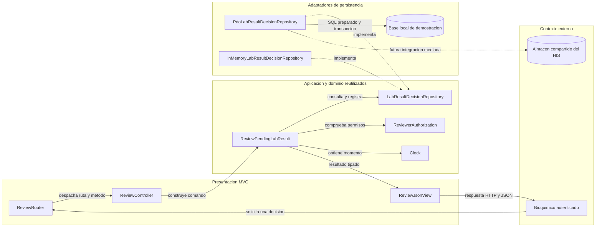
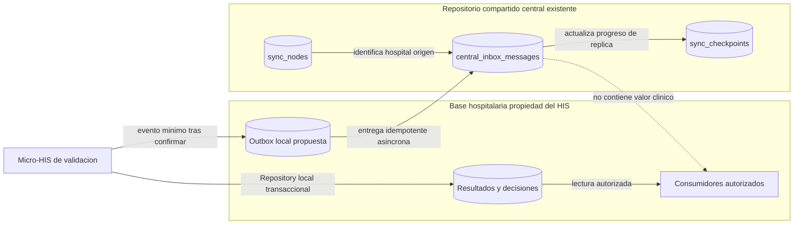

# Semana 4 — MVC, Repository y repositorio de datos compartido

| | |
|---|---|
| **Curso** | Análisis de Sistemas II — Proyecto Final 2026 |
| **Módulo** | Validación de resultados por bioquímico |
| **Flujo** | Revisión, validación o rechazo de un resultado por bioquímico |
| **Estudiante según la captura** | Lopez Perez, Mercedes Azucena |
| **Fecha** | 27 de octubre de 2026 |
| **Base de trabajo** | `origin/develop`, `bf38699dc974e999d91b293999f8255b9417a409` |

## 1. Objetivo, alcance y continuidad

Esta entrega organiza la entrada con MVC, conserva el contrato `LabResultDecisionRepository` que ya usa el caso de uso de la Semana 2 y añade dos adaptadores intercambiables: PDO y memoria. El controlador no contiene SQL ni decide reglas clínicas. Se documenta además cómo podría integrarse el módulo con los almacenes compartidos del HIS.

La rama de Semana 3 de este módulo no existe en el repositorio. Por eso esta entrega continúa directamente el mismo prototipo DIP de Semana 2 —sus modelos, caso de uso y adaptador en memoria— y no afirma que haya una implementación productiva de una Semana 3. Se extiende ese prototipo con presentación MVC y un adaptador PDO local.

**Incluye:** decisión sobre una versión pendiente, motivo obligatorio de rechazo, contexto hospitalario y autorización del bioquímico mediante el puerto existente, comprobación de versión, auditoría atómica, presentación MVC, adaptadores PDO/InMemory y análisis de integración compartida.

**No incluye:** captura/corrección de valores, rangos bioquímicos, reglas clínicas automáticas, endpoints de producción, identidad/RBAC real, conexión a PostgreSQL de producción, ni envío efectivo al repositorio central. No se inventan umbrales de laboratorio.

## 2. Arquitectura y responsabilidades

### 2.1 Vista de capas MVC y Repository

<!-- mermaid-checked: no \n, no em-dash/en-dash, no {} in labels, subgraphs are id["label"], arrows are -->|"label"|, all subgraphs closed by end, ids unique -->


### 2.2 Inventario

| Capa | Objeto | Responsabilidad | Reutilización |
|---|---|---|---|
| Presentación / routing | `ReviewRouter` | Resuelve ruta y método; responde 404/405. | Rutas del micro-HIS. |
| Presentación / controller | `ReviewController` | Convierte entrada HTTP a `ReviewCommand`, invoca aplicación y traduce fallo técnico a respuesta de servicio no disponible. | Adaptador de entrada MVC. |
| Presentación / view | `ReviewJsonView` | Mapea estados tipados a código HTTP y JSON. No decide reglas clínicas. | Respuestas de validación. |
| Aplicación | `ReviewPendingLabResult` | Coordina autorización, contexto, versión, decisión y persistencia atómica. Reutilizado de Semana 2. | Caso de uso sin dependencia de PDO. |
| Aplicación | `LabResultDecisionRepository` | Contrato de lectura y escritura atómica ya consumido por el caso de uso. | Sustituye implementaciones de persistencia. |
| Aplicación | `ReviewerAuthorization`, `Clock` | Contratos de autorización y tiempo ya utilizados por el caso de uso. | Adaptadores reales o dobles. |
| Persistencia | `InMemoryLabResultDecisionRepository` | Adaptador ya existente para demostración y pruebas. | Pruebas rápidas. |
| Persistencia | `PdoLabResultDecisionRepository` | Implementa lectura y decisión en transacción; usa SQL preparado y revalida versión/estado en la actualización. | PDO SQLite en esta evidencia; portable con ajustes del esquema para el motor destino. |
| Persistencia | `schema.sql` | Esquema local de demostración para resultado y decisión auditable. | Suite PDO SQLite. |

### 2.3 Límites y dependencias

- **El controlador no conoce Repository ni PDO.** Depende del caso de uso `ReviewPendingLabResult`.
- **El caso de uso no conoce adaptadores.** Consume el contrato `LabResultDecisionRepository`, la autorización y el reloj.
- **El Repository es un puerto de aplicación:** es la necesidad del caso de uso, no una API específica de la base de datos.
- **Estado y auditoría se escriben en una transacción.** La escritura revalida hospital, versión pendiente y estado antes de cambiarlo.
- **La vista solo traduce resultados de aplicación:** 200 éxito, 403 denegado, 404 no disponible, 409 conflicto/estado, 422 entrada/contexto inválido y 503 dependencia de persistencia no disponible.
- **Un fallo no se presenta como decisión exitosa.** El adaptador retorna `FAILED` para fallas de escritura y convierte fallas PDO de lectura a `ReviewRepositoryUnavailable`, sin exponer SQL ni datos internos.

## 3. Contratos de entrada y salida

### 3.1 Contrato Repository

El contrato `LabResultDecisionRepository` vive junto al caso de uso heredado de Semana 2, en [`ReviewWorkflow.php`](../semana-02/ejemplo-dip/despues/ReviewWorkflow.php). Semana 4 no lo duplica ni lo cambia.

| Operación | Entrada | Salida | Garantías |
|---|---|---|---|
| `findById(resultId)` | ID no vacío del resultado solicitado. | `LabResult` o `null`. | El caso de uso comprueba hospital y contexto; la implementación PDO usa parámetro preparado. Fallo técnico de lectura se propaga como `ReviewRepositoryUnavailable`. |
| `decideAtomically(record)` | Resultado, versión esperada, hospital, actor, decisión, motivo y momento. | `SAVED`, `CONFLICT`, `NOT_FOUND` o `FAILED`. | Estado y decisión/auditoría se confirman juntos; se vuelve a verificar versión y estado dentro de la escritura. |

### 3.2 Contrato de entrada MVC

**Ruta demostrativa:** `POST /results/{resultId}/decision`. Esta ruta se ejecuta en el router de demostración; no es un endpoint desplegado del HIS.

| Campo | Fuente | Regla de forma | Uso |
|---|---|---|---|
| `resultId` | Segmento de ruta. | Cadena no vacía. | Localiza el resultado. |
| `expectedVersion` | JSON. | Entero; el caso de uso requiere valor mayor que cero. | Evita decidir una versión obsoleta. |
| `decision` | JSON. | `VALIDATE` o `REJECT`. | Acción solicitada. |
| `reason` | JSON, opcional en forma. | Cadena; el caso de uso exige no vacía para `REJECT`. | Motivo auditable. |
| `actorId` | Contexto confiable del llamador autenticado en el prototipo. | No vacío. | Autorización y auditoría; no se toma del JSON. |
| `hospitalId` | Contexto confiable del tenant/hospital. | No vacío. | Aislamiento y auditoría; no se toma del JSON. |

### 3.3 Respuesta MVC

| Estado de aplicación | HTTP | Cuerpo |
|---|---:|---|
| `VALIDATED` / `REJECTED` | 200 | Estado y registro de decisión con resultado, versión, hospital, actor, decisión, motivo y fecha. |
| `DENIED` | 403 | Código de estado tipado; sin información del resultado. |
| `NOT_FOUND` | 404 | No disponible; no distingue resultado ajeno de inexistente. |
| `INVALID_INPUT` / `INVALID_CONTEXT` | 422 | Estado tipado; no persiste. |
| `INVALID_STATE` / `CONFLICT` | 409 | No decide una versión obsoleta o ya decidida. |
| `PERSISTENCE_FAILURE` | 503 | Falla técnica sin éxito simulado ni detalle SQL. |
| Ruta/método no permitidos | 404 / 405 | Respuesta de routing; no invoca el caso de uso. |

## 4. Adaptadores PDO e InMemory

La implementación en memoria proviene del prototipo de Semana 2. La implementación PDO de Semana 4 guarda el resultado y su registro de decisión usando parámetros preparados. La tabla `lab_result_decision` tiene clave primaria `(result_id, version)`, que impide más de una decisión para la misma versión. La transición de estado, la escritura de auditoría y la confirmación ocurren dentro de una transacción.

El esquema de [`ejemplo/database/schema.sql`](ejemplo/database/schema.sql) es solo para la demostración SQLite. El modelo de Week 2 continúa siendo la fuente de las invariantes del caso de uso; el esquema no define rangos clínicos ni altera el valor analítico.

### Consistencia entre adaptadores

La suite ejecuta el mismo caso de uso MVC con `InMemoryLabResultDecisionRepository` y `PdoLabResultDecisionRepository`. Verifica aceptación, rechazo con motivo, preservación del valor, autoría, denegación, versión concurrente, rollback de auditoría e indisponibilidad de lectura. La evidencia PDO es SQLite en memoria; no acredita PostgreSQL ni la base hospitalaria compartida.

## 5. Integración con el repositorio de datos compartido

### 5.1 Qué existe en el repositorio del HIS

La base de código define conexiones **central** y **hospital**. Las migraciones centrales examinadas crean el registro de redes/hospitales y la infraestructura de sincronización (`sync_nodes`, `sync_checkpoints`, `central_inbox_messages`). Las migraciones hospitalarias incluyen pacientes y episodios. En las migraciones de esta base inspeccionada **no se encontraron tablas de resultados de laboratorio**; el `lab_result` del ejemplo es un esquema del micro-HIS académico, no se presenta como una tabla productiva ya existente.

### 5.2 Propuesta de integración y propiedad del dato

Se propone que el contexto hospitalario sea dueño de los resultados y decisiones. El adaptador Repository de este módulo escribe en el almacén hospitalario autorizado. Si otro módulo necesita enterarse de una decisión, el módulo publicaría un evento mínimo por un mecanismo de salida confiable hacia `central_inbox_messages`; el almacenamiento central registra recepción/procesamiento del evento, no reemplaza el registro clínico de origen.

| Principio | Decisión |
|---|---|
| Una fuente de verdad | El resultado, su versión y su decisión se escriben únicamente en el dominio hospitalario dueño. |
| Separación entre bases | No se requiere una transacción atómica entre la base hospitalaria y central. El estado local se confirma primero; la publicación remota se reintenta de manera idempotente. |
| Privacidad | No enviar valor analítico, datos identificables del paciente, texto libre de motivo ni credenciales al repositorio central. Una futura proyección debe tener finalidad, minimización, autorización y retención aprobadas. |
| Identidad del origen | La asociación con `sync_nodes` y su hospital permite atribuir el nodo de origen. Debe validarse contra el hospital autenticado; no confiar en un `hospitalId` enviado por cliente. |
| Idempotencia | Usar identificador de evento estable y la unicidad `(source_node_id, event_id)` definida por `central_inbox_messages` para evitar procesar el mismo mensaje dos veces. |
| Acceso de lectura | Otros módulos leen una vista o proyección autorizada, no modifican tablas propiedad de validación. |
| Seguridad de base | Segmentar permisos por propietario y aplicar controles tenant/hospital en aplicación y motor. No se afirma que exista RLS activo en las migraciones inspeccionadas. |
| Integridad local | Resultado y auditoría de la decisión se guardan en la misma transacción del almacén hospitalario. La bandeja central no participa en esa transacción. |

El payload de evento recomendado, sujeto a contrato y evaluación de privacidad, solo comunica `eventId`, tipo de evento, nodo origen, versión de esquema y un identificador opaco de referencia. Los consumidores que necesiten detalles deben solicitar acceso al sistema dueño mediante un contrato autorizado, no inferirlos del evento central.

<!-- mermaid-checked: no \n, no em-dash/en-dash, no {} in labels, subgraphs are id["label"], arrows are -->|"label"|, all subgraphs closed by end, ids unique -->


**Límite explícito:** esta integración es un análisis y una propuesta. No se creó una tabla outbox ni se conectó el adaptador PDO a las conexiones Laravel del HIS.

## 6. Requisitos y criterios de aceptación

Los requisitos RF/RNF y reglas de negocio provienen de Semana 2. Semana 4 los materializa en capas, contratos y persistencia sin ampliar el flujo:

| ID | Requisito verificable | Evidencia |
|---|---|---|
| CA-01 | MVC separa router, controlador y view; el controlador no tiene SQL ni reglas clínicas. | `ejemplo/src/Presentation/Mvc.php`; comprobaciones estáticas del runner. |
| CA-02 | El caso de uso existente opera por el Repository de Aplicación, que pueden implementar memoria y PDO. | `ReviewWorkflow.php`, `InMemoryLabResultDecisionRepository.php` y `PdoLabResultDecisionRepository.php`. |
| CA-03 | Validar conserva el valor y registra actor/momento. | Suite PDO e InMemory. |
| CA-04 | Rechazar requiere motivo y mantiene el valor. | Suite de regresión Semana 2 y runner de Semana 4. |
| CA-05 | Denegación, no encontrado, conflicto y fallas tienen respuestas distinguibles sin revelar hospital ajeno. | Mapeo MVC y pruebas de estados. |
| CA-06 | Cambio del estado y registro de auditoría son atómicos. | Prueba PDO que falla al insertar auditoría y confirma rollback. |
| CA-07 | Se analiza integración compartida y propiedad del dato con base en migraciones existentes. | Sección 5 y diagrama de integración. |

## 7. Validación ejecutada

Comandos desde la raíz del repositorio:

```powershell
php docs/modulos/validacion-resultados-bioquimico/semana-04/ejemplo/tests/run.php
php docs/modulos/validacion-resultados-bioquimico/semana-02/ejemplo-dip/verificar.php
php -l docs/modulos/validacion-resultados-bioquimico/semana-04/ejemplo/src/Application/ReviewRepositoryUnavailable.php
php -l docs/modulos/validacion-resultados-bioquimico/semana-04/ejemplo/src/Persistence/PdoLabResultDecisionRepository.php
php -l docs/modulos/validacion-resultados-bioquimico/semana-04/ejemplo/src/Presentation/Mvc.php
php -l docs/modulos/validacion-resultados-bioquimico/semana-04/ejemplo/tests/run.php
git diff --check
```

Resultados exactos en [`evidencia/validacion-semana-04.txt`](evidencia/validacion-semana-04.txt). La suite Week 4 usa PDO SQLite si el driver está disponible; si no está, informa un skip explícito para las pruebas PDO. Las pruebas de Semana 2 se vuelven a ejecutar como regresión.

## 8. Referencias y límites de la revisión

- [Semana 1: UML del proceso](../semana-01/semana-01-uml-validacion-resultados.md).
- [Semana 2: requisitos, criterios y DIP](../semana-02/semana-02-dip-validacion-resultados.md).
- [Contrato Repository y caso de uso de Semana 2](../semana-02/ejemplo-dip/despues/ReviewWorkflow.php).
- Migraciones centrales: [`create_network_registry`](../../../../database/migrations/central/2026_08_11_000000_create_network_registry.php) y [`create_central_sync_tables`](../../../../database/migrations/central/2026_08_11_000400_create_central_sync_tables.php).
- Migraciones hospitalarias examinadas: [`create_patient_and_care_tables`](../../../../database/migrations/hospital/2026_08_11_000200_create_patient_and_care_tables.php) y [`create_medical_record_tables`](../../../../database/migrations/hospital/2026_08_11_000400_create_medical_record_tables.php).

La evidencia es una ejecución académica local con datos ficticios. No acredita autorización real, continuidad de servicio, integración entre bases, cumplimiento clínico ni despliegue. Los cambios de Semana 4 son exclusivos de documentación y ejemplo del módulo; no alteran las migraciones centrales ni la aplicación hospitalaria compartida.
