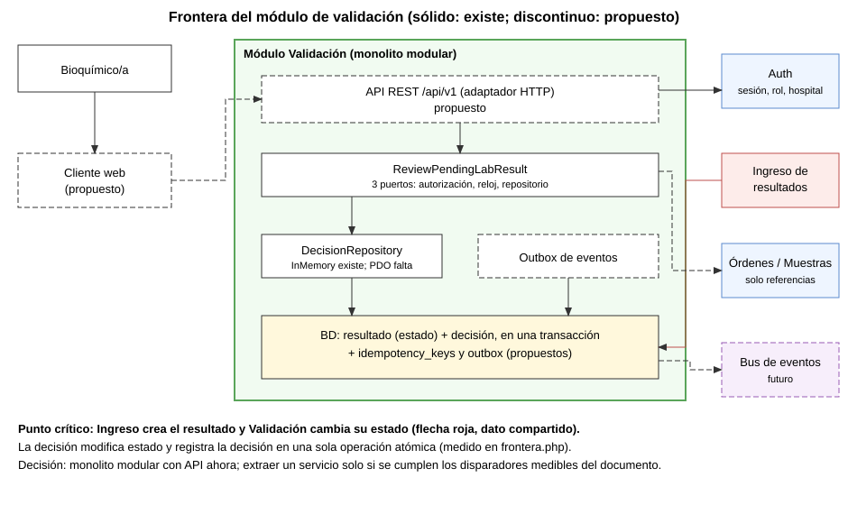
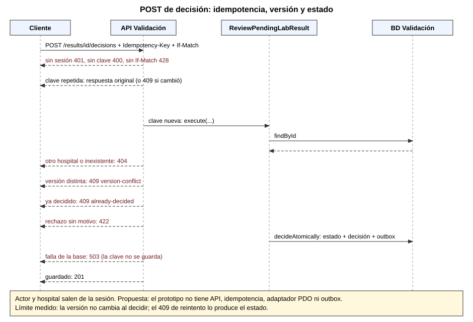

# Semana 5 - Cliente-servidor, API REST y frontera de microservicio: Validación de resultados por bioquímico

Estudiante: LOPEZ PEREZ, MERCEDES AZUCENA. Flujo: revisión, validación o rechazo de un resultado por bioquímico.

## 1. Estado real

| Elemento | Estado |
|---|---|
| Caso de uso `ReviewPendingLabResult`, 3 puertos, repositorio InMemory (Semana 2) | Existe |
| Adaptador PDO, API HTTP, `Idempotency-Key`, `If-Match`, sesión, outbox | **Propuesta**: no está implementado |
| `verificacion/frontera.php` | Mide el prototipo real: 8 de 8 comprobaciones |
| `verificacion/contrato.php` | Adaptador HTTP **simulado** sobre el caso de uso real: 20 de 20 comprobaciones |

## 2. Frontera medida (evidencia/frontera-semana-05.txt)

- 0 menciones de PDO o SQL en el núcleo; 3 puertos propios (autorización, reloj, repositorio); 0 imports de otros módulos.
- Solo existe **un** adaptador (InMemory). No hay adaptador PDO, así que **no se pueden medir tablas ni claves foráneas**: se declara como límite.
- El resultado referencia 4 identificadores ajenos (`hospitalId`, `orderItemId`, `examinationId`, `specimenId`), solo como referencias.
- **Hallazgo clave:** una decisión cambia el estado del resultado **y** registra la decisión en una sola operación atómica (`decideAtomically`). El resultado nace en Ingreso y Validación cambia su estado: es un dato compartido entre dos módulos.

## 3. Contrato API propuesto (`/api/v1`)

Reglas comunes: JSON, errores `application/problem+json` con un `type` estable; hospital y actor salen de la **sesión**, nunca del cuerpo; la escritura exige `Idempotency-Key` y `If-Match` con la versión.

| Método y ruta | Uso | Respuestas |
|---|---|---|
| `POST /results/{id}/decisions` | `{decision: VALIDATE\|REJECT, reason}`; `reason` obligatorio al rechazar | 201, 400, 401, 403, 404, 409, 422, 428, 503 |
| `GET /results/pending` | Cola de resultados pendientes del hospital | 200, 401, 403 |
| `GET /results/{id}` | Detalle y versión (`ETag`) | 200, 404 |
| `GET /results/{id}/decisions` | Historial de decisiones | 200, 404 |

| Código | `type` | Cuándo |
|---|---|---|
| 201 | n/a | Decisión guardada |
| 400 | missing-idempotency-key | Falta la clave |
| 401 | unauthenticated | Sin sesión |
| 403 | forbidden | Sin rol de revisor |
| 404 | not-found | Inexistente **o de otro hospital** |
| 409 | version-conflict / already-decided / idempotency-key-reuse | Tres causas distintas, separadas por `type` |
| 422 | invalid-input / incomplete-context / invalid-decision | Entrada o contexto inválido |
| 428 | precondition-required | Falta `If-Match` |
| 503 | unavailable | Falla de persistencia; no se guarda como idempotente |

Las rutas `GET` están propuestas pero **no se simularon**; la simulación cubre solo el `POST`.

### Diferencias con el prototipo

1. `actorId` y `hospitalId` llegan como parámetros; en la API salen de la sesión.
2. No hay idempotencia: con otra clave, un reintento ya decidido da 409 `already-decided` (paso 3 de `contrato.php`).
3. **La versión no cambia al decidir** (paso 9): hoy el control lo hace el estado. Se propone incrementarla para que el `ETag` sea fiable.
4. No hay adaptador PDO ni persistencia real.
5. No hay verificación de las referencias contra Órdenes y Muestras (hoy solo se comprueba que no estén vacías).

## 4. Comportamiento comprobado en la simulación

Validación 201 con actor de la sesión; idempotencia (misma clave repite, otro contenido 409); rechazo sin motivo 422 y con motivo 201; versión obsoleta 409; 401, 400, 428 y 422; 403 sin rol; 404 entre hospitales; 422 por contexto incompleto; 503 que no se guarda como respuesta idempotente y permite reintentar. Evidencia: `evidencia/contrato-semana-05.txt`.

## 5. ¿Microservicio? Decisión

**Monolito modular con API ahora; no se extrae un servicio.**

1. Un solo equipo y sin carga medida.
2. La decisión cambia el estado del resultado y registra la decisión de forma atómica; si el resultado viviera en Ingreso y la decisión en Validación, sería una transacción distribuida o una consistencia eventual que hoy no se necesita.
3. El prototipo no tiene persistencia real: no hay datos para justificar una división.

La frontera medida es condición **necesaria, no suficiente**. Disparadores para reconsiderar (umbrales propuestos por la autora, sin datos reales): ritmo de despliegue distinto, latencia p95 sostenida sobre el objetivo, propiedad por otro equipo y caídas en cascada.

## 6. Propiedad de datos

| Dato | Dueño propuesto |
|---|---|
| Decisiones, motivo, idempotencia, outbox | Validación |
| Resultado (valor, unidad, versiones) | Ingreso |
| **Estado del resultado** (PENDING, VALIDATED, REJECTED) | **Por decidir**: hoy lo cambia Validación; se propone que siga en la misma BD mientras sea monolito |
| Paciente, orden, examen, muestra, hospital | Otros módulos, por referencia |

## 7. Comunicación y consistencia

Síncrono: Auth (sesión) y, en la fase final, verificación de referencias. Asíncrono: eventos `ResultValidated` y `ResultRejected` por **outbox**, escritos en la misma transacción de la decisión, hacia Informe y Notificación. Consistencia fuerte dentro del módulo y eventual hacia los consumidores.

## 8. Seguridad, resiliencia y observabilidad

HTTPS; rol de revisor verificado en cada petición; 404 entre hospitales; el cuerpo no puede declarar al autor. Reintentos seguros por idempotencia; `503` con `Retry-After`. Id de correlación y métricas: latencia, tasa de 409 por causa, 5xx y antigüedad de la cola de pendientes.

## 9. Migración por fases

1. Adaptador PDO y esquema. 2. Incrementar la versión al decidir. 3. Sesión (actor y hospital). 4. Tabla de idempotencia. 5. Adaptador HTTP. 6. Verificación de referencias. 7. Outbox. 8. Evaluar extracción solo si se cumplen los disparadores.

## 10. Plan de issue, rama, worktree y PR

- Issue: pendiente de identificar (no se inventa número).
- Rama: `semana-5-validacion-resultados-api-microservicio-mercedes-lopez`.
- Worktree: `shi-semana-5-validacion-resultados-api-microservicio-mercedes-lopez`, desde `origin/develop`.
- PR hacia `develop` con la plantilla del repo, **aún no abierto** por instrucción de la autora.

## 11. Diagramas





## 12. Limitaciones

No hay API real ni servidor HTTP; la simulación prueba la lógica, no el transporte. Sin adaptador PDO no se midieron tablas. Los umbrales son hipotéticos. El ID del módulo y el número de issue no están confirmados.

## 13. Cómo reproducir

```
php verificacion/frontera.php
php verificacion/contrato.php
```
