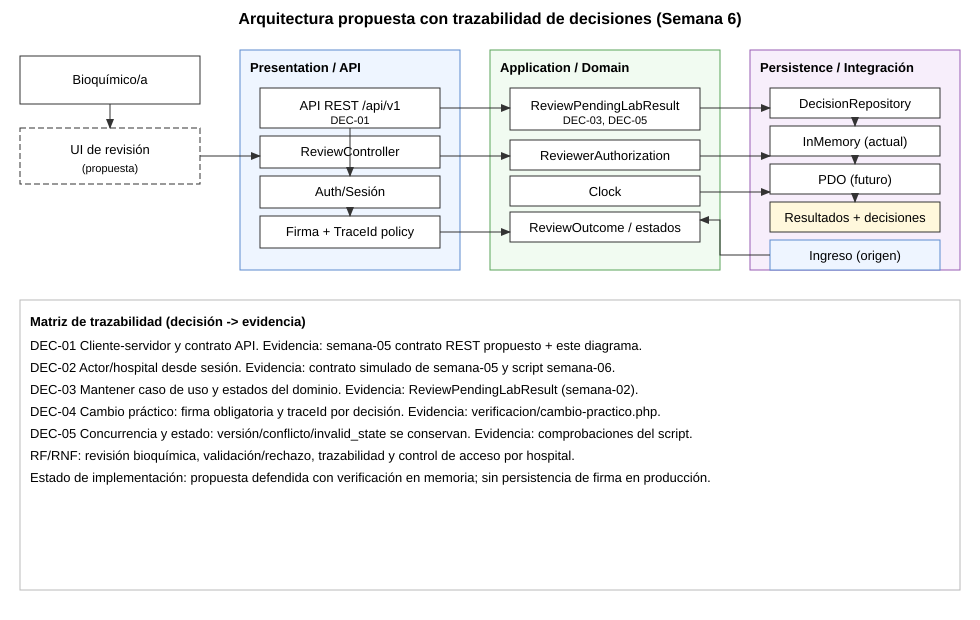

# Semana 6 - Primera evaluación parcial: arquitectura propuesta de validación bioquímica

Estudiante: LOPEZ PEREZ, MERCEDES AZUCENA  
Módulo: Validación de resultados por bioquímico  
Flujo: revisión, validación o rechazo de un resultado

## Presentación (8 diapositivas)

### Diapositiva 1 - Problema y alcance

- Se defiende la arquitectura del flujo bioquímico sin ampliar el módulo.
- Se conectan actores, UML, RF/RNF, SOLID, capas, Repository y contrato API.
- Se responde un cambio práctico sobre resultados, revisión bioquímica, validación, rechazo, firma y trazabilidad.

### Diapositiva 2 - Actores y contexto operativo

- **Bioquímico/a:** revisa contexto y decide VALIDATE o REJECT.
- **Auth/Sesión:** aporta actor y hospital para control de acceso.
- **Ingreso de resultados:** origen del resultado pendiente.
- **Módulos consumidores:** reciben eventos o estados de decisión.

### Diapositiva 3 - Capas y SOLID

- Presentation/API: controlador y mapeo de respuesta.
- Application: `ReviewPendingLabResult` como caso de uso principal.
- Domain: estados, decisiones y `ReviewDecisionRecord`.
- Persistence: `LabResultDecisionRepository` con adaptadores.
- SOLID: SRP (caso de uso enfocado), DIP (puertos), OCP (adaptadores).

### Diapositiva 4 - Repository y consistencia

- `decideAtomically` encapsula la escritura de estado + auditoría.
- El caso de uso valida versión, estado pendiente y contexto.
- Resultado: `CONFLICT` o `INVALID_STATE` explícitos ante condiciones de carrera.
- En memoria ya funciona; PDO queda como siguiente fase.

### Diapositiva 5 - Contrato API propuesto

- `POST /api/v1/results/{id}/decisions` con `decision`, `reason`, `If-Match`, `Idempotency-Key`.
- Errores esperados: 400, 401, 403, 404, 409, 422, 428, 503.
- Actor y hospital salen de sesión, no del payload.
- `type` de error separa causa de negocio y técnica.

### Diapositiva 6 - Cambio práctico defendido

- Límite detectado: el diseño actual permite decidir sin firma explícita.
- Cambio propuesto: firma obligatoria + `traceId` por decisión.
- Se conserva el motor de decisión existente (validar/rechazar, versión y estado).
- Evidencia ejecutable en `verificacion/cambio-practico.php`.

### Diapositiva 7 - Diagrama trazable y matriz decisión-evidencia

Fuente editable: [semana-06-arquitectura-trazable.puml](diagramas/semana-06-arquitectura-trazable.puml)

### Diapositiva 8 - Riesgos y plan de evolución

- Riesgo: incremento de fricción en operación por firma obligatoria.
- Mitigación: firma derivada de sesión y dispositivo, no texto manual.
- Riesgo: trazabilidad parcial si no se persiste firma.
- Mitigación: extender repositorio para guardar hash de firma y `traceId`.
- Evolución: integrar adaptador PDO y contrato API real por fases.

## Matriz decisión -> evidencia

| Decisión | Qué se decidió | Evidencia |
|---|---|---|
| DEC-01 | Mantener evolución cliente-servidor por contrato API | Semana 5 + diagrama Semana 6 |
| DEC-02 | Actor/hospital vienen de sesión | Semana 5 (`contrato.php`) + script Semana 6 |
| DEC-03 | Conservar `ReviewPendingLabResult` como núcleo | `semana-02/ejemplo-dip/despues/ReviewWorkflow.php` |
| DEC-04 | Exigir firma y generar `traceId` | `semana-06/verificacion/cambio-practico.php` + evidencia |
| DEC-05 | Mantener reglas de versión/estado para concurrencia | comprobaciones de `INVALID_STATE` y `NOT_FOUND` del script |

## Registro del cambio práctico defendido

Ver [registro-cambio-practico.md](registro-cambio-practico.md).

## Resultado de verificación

Evidencia ejecutada: [evidencia/cambio-practico-semana-06.txt](evidencia/cambio-practico-semana-06.txt)

- Se prueba el límite actual (validar sin firma).
- Se prueba el rechazo de decisión sin firma en la política propuesta.
- Se conserva la lógica de validación/rechazo con trazabilidad.
- Se conserva aislamiento por hospital y control por estado.

