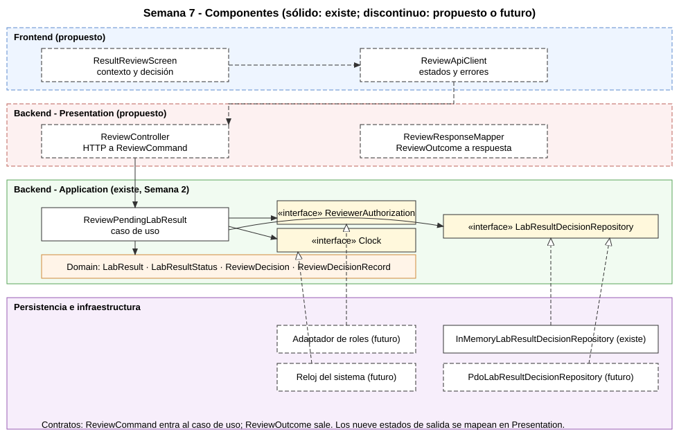

# Semana 7 — Diseño de componentes y refactorización: validación de resultados por bioquímico

| | |
|---|---|
| **Curso** | Análisis de Sistemas II — Proyecto Final 2026 |
| **Módulo** | Validación de resultados por bioquímico |
| **Proceso** | Revisión, validación o rechazo de un resultado por bioquímico |
| **Autora** | Lopez Perez, Mercedes Azucena |
| **Fecha** | 27 de octubre de 2026 |

## 1. Alcance

Se diseñan los componentes de backend y frontend propios de este módulo y se refactoriza conceptualmente el punto de mayor acoplamiento, sin ampliar el módulo: no se agregan captura de valores, entrega de resultados ni reglas bioquímicas.

El módulo ya tiene un diseño «antes» (`CoupledLabResultReview`) y un «después» (`ReviewPendingLabResult` con tres contratos), ambos de la Semana 2. Esta entrega **no escribe código nuevo de producción**: usa esas dos clases como el refactor concreto, lo justifica y completa el diseño con la capa de presentación y el frontend, que son propuestas.

## 2. Diagrama de componentes

Fuente editable: [semana-07-componentes.puml](diagramas/semana-07-componentes.puml). Trazo continuo: existe en el repositorio; discontinuo: propuesto o futuro.

| Capa | Componente | Responsabilidad única | Estado |
|---|---|---|---|
| Frontend | `ResultReviewScreen` | Mostrar contexto (orden, examen, muestra, valor, unidad) y capturar la decisión y el motivo | Propuesto |
| Frontend | `ReviewApiClient` | Enviar la decisión y traducir las respuestas a estados de pantalla | Propuesto |
| Backend, Presentation | `ReviewController` | Convertir la petición en `ReviewCommand` y llamar al caso de uso | Propuesto |
| Backend, Presentation | `ReviewResponseMapper` | Convertir `ReviewOutcome` en respuesta (código y mensaje) | Propuesto |
| Backend, Application | `ReviewPendingLabResult` | Orquestar la decisión con sus reglas | Existe |
| Backend, Application | `ReviewerAuthorization`, `Clock`, `LabResultDecisionRepository` | Contratos que el caso de uso necesita | Existen |
| Backend, Domain | `LabResult`, `LabResultStatus`, `ReviewDecision`, `ReviewDecisionRecord` | Tipos inmutables del dominio | Existen |
| Persistencia | `InMemoryLabResultDecisionRepository` | Implementar el repositorio para pruebas | Existe |
| Persistencia | `PdoLabResultDecisionRepository` | Persistir estado y auditoría en una transacción | Futuro |
| Infraestructura | Adaptador de roles, reloj del sistema | Implementar autorización y reloj reales | Futuro |

## 3. Contratos de entrada y salida

### Entrada del caso de uso: `ReviewCommand`

| Campo | Tipo | Regla |
|---|---|---|
| `resultId` | texto | No vacío |
| `expectedVersion` | entero | 1 o mayor |
| `actorId` | texto | No vacío; **debería venir de la sesión** (REV13-01) |
| `hospitalId` | texto | No vacío; **debería venir de la sesión** (REV13-01) |
| `decision` | `VALIDATE` o `REJECT` | Enumeración, no texto libre |
| `reason` | texto | Obligatorio al rechazar |

### Salida: `ReviewOutcome`

| Estado | Significado | Propuesta de respuesta HTTP |
|---|---|---|
| `VALIDATED`, `REJECTED` | Decisión registrada; incluye el registro con actor y momento | 200 |
| `INVALID_INPUT` | Entrada o motivo inválidos | 422 |
| `DENIED` | Sin permiso | 403 |
| `NOT_FOUND` | No disponible o de otro hospital | 404 |
| `INVALID_CONTEXT` | Falta orden, examen o muestra | 409 |
| `INVALID_STATE` | Ya estaba decidido | 409 |
| `CONFLICT` | La versión cambió | 409 |
| `PERSISTENCE_FAILURE` | Falla de lectura o escritura | 503 |

La columna HTTP es una **propuesta** que cierra parte de REV13-05; aún no hay un contrato API aprobado.

### Contratos de salida del caso de uso hacia sus dependencias

| Contrato | Método | Garantía exigida |
|---|---|---|
| `ReviewerAuthorization` | `canReview(actor, hospital): bool` | Verdadero solo para un bioquímico autorizado en ese hospital |
| `Clock` | `now()` | Momento de la decisión |
| `LabResultDecisionRepository` | `findById(id)` | Devuelve el resultado o `null` |
| `LabResultDecisionRepository` | `decideAtomically(record)` | Guarda estado y auditoría juntos o no guarda nada; revalida versión, estado y hospital; responde `SAVED`, `CONFLICT`, `NOT_FOUND` o `FAILED` |

## 4. Punto de mayor acoplamiento

`CoupledLabResultReview::decide` (76 líneas de código) mezcla en un solo método:

1. **Autorización** con un texto fijo (`'bioquimico'`) en lugar de un permiso.
2. **Validación de entrada** de la decisión como texto libre.
3. **Persistencia**: SQL, transacción y rollback repetidos en 3 puntos de salida.
4. **Reglas de dominio**: estado pendiente y versión.
5. **Auditoría** con el reloj del sistema (`date(...)`).
6. **Presentación**: devuelve el resultado como texto libre en 7 puntos de retorno.

Defectos observados en el código «antes»:

- Un resultado inexistente o de otro hospital se responde como `INVALID_STATE`, lo que impide distinguir «no disponible» de «ya decidido».
- No se valida el contexto de orden, examen y muestra.
- El rol se recibe como parámetro de texto, así que el cliente podría enviarlo.
- No se puede probar sin una base de datos.

## 5. Comparación antes y después

Medición ejecutable ([verificacion/acoplamiento.php](verificacion/acoplamiento.php), salida en [evidencia/acoplamiento-semana-07.txt](evidencia/acoplamiento-semana-07.txt)):

| Medida | Antes | Después |
|---|---:|---:|
| Usa PDO | 2 | 0 |
| Contiene SQL | 3 | 0 |
| Maneja transacción | 6 | 0 |
| Lee el reloj del sistema | 1 | 0 |
| Compara el rol con un texto fijo | 1 | 0 |
| Devuelve el resultado como texto libre | 7 | 0 |
| Líneas de código de la clase | 76 | 64 |

| Aspecto | Antes | Después |
|---|---|---|
| Dependencias | PDO concreto | 3 contratos |
| Pruebas | Requieren base de datos | Adaptador en memoria; 33 aserciones pasan |
| Resultados | Texto libre | Enumeración con 9 valores |
| Autorización | Texto fijo | Contrato inyectado |
| Cambio de base de datos | Toca la clase de reglas | Se escribe otro adaptador |
| Cantidad de código | Una clase de 76 líneas | Más piezas: la clase baja a 64 líneas, pero aparecen contratos y adaptadores |

La reducción de líneas es pequeña y **no es la justificación**. El código total aumenta porque se separan piezas; lo que mejora es la dirección de las dependencias.

## 6. Justificación

- **Una razón de cambio por componente:** cambiar de SQLite a PostgreSQL, o de la autorización por texto a RBAC, ya no obliga a editar las reglas de decisión.
- **Seguridad:** la autorización y el tenant pasan a ser contratos explícitos, el lugar donde se corrigen REV13-01 y REV13-04.
- **Errores distinguibles:** separar «no disponible» de «ya decidido» permite al frontend mostrar la acción correcta (recargar, reintentar o avisar).
- **Pruebas rápidas:** las 13 condiciones de la Semana 2 corren sin infraestructura.
- **Sin ampliar el módulo:** no se agregan funciones; solo se reparte la responsabilidad que ya existía.

Se descartó mantener el servicio acoplado con SQL «más ordenado»: no resuelve la imposibilidad de probar las reglas por separado ni de cambiar el almacenamiento.

## 7. Trazabilidad

| Requisito | Componente |
|---|---|
| RF-01, RF-02 | `ReviewerAuthorization`, `ReviewPendingLabResult`, ámbito por `hospitalId` |
| RF-03, RF-05 | `ReviewPendingLabResult`, `ReviewDecision`, motivo |
| RF-06, RNF-04 | `ReviewDecisionRecord` (actor y momento; **sin firma**) |
| RF-07, RNF-02 | `LabResultDecisionRepository::decideAtomically` |
| RF-08 | `ReviewOutcome` y `ReviewResponseMapper` |
| RNF-01, RNF-06 | Los tres contratos |

## 8. Limitaciones

- El frontend y la capa de presentación son propuestas; no hay código, ni diseño de pantallas, ni pruebas con usuarios.
- El adaptador PDO, el de roles y el reloj del sistema no existen.
- La correspondencia HTTP es una propuesta sin contrato aprobado.
- La firma y la separación de funciones siguen abiertas (REV13-02 y REV13-03).
- La medición del acoplamiento usa expresiones regulares sobre el código; es un indicador, no un análisis completo.
- Los diagramas SVG se dibujaron a mano; el `.puml` es la fuente editable.
