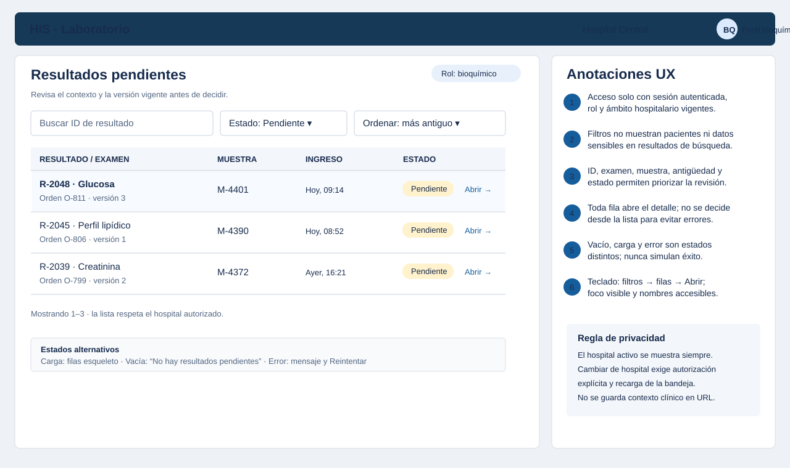
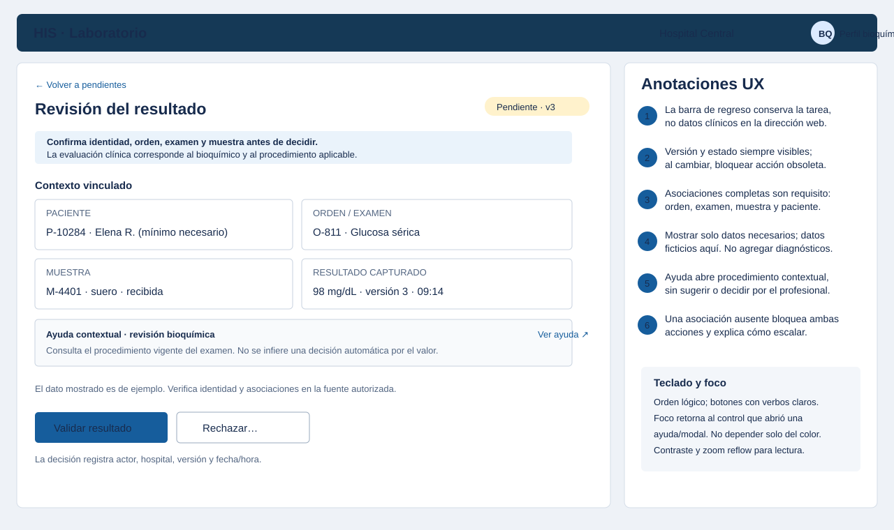
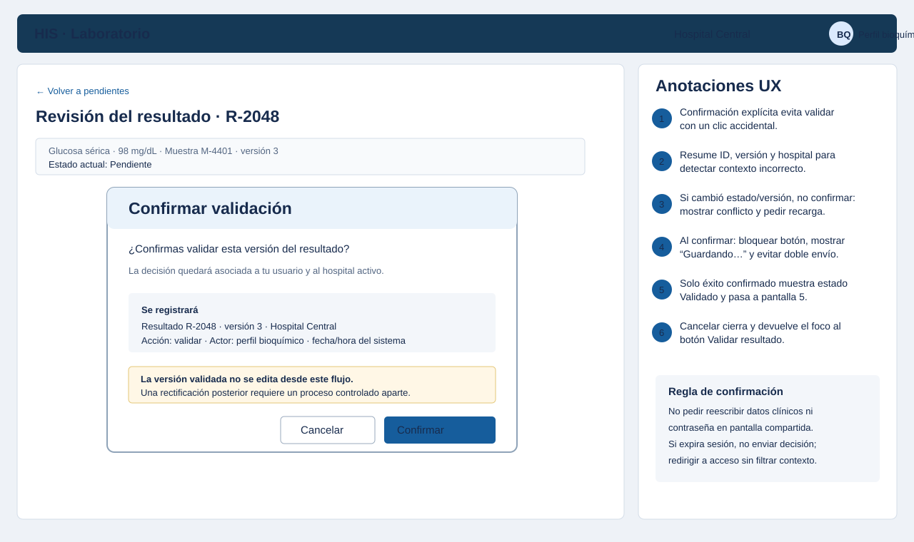
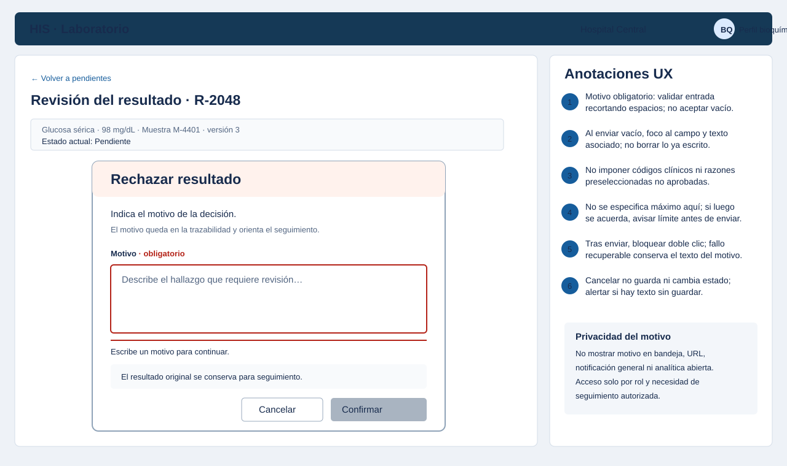
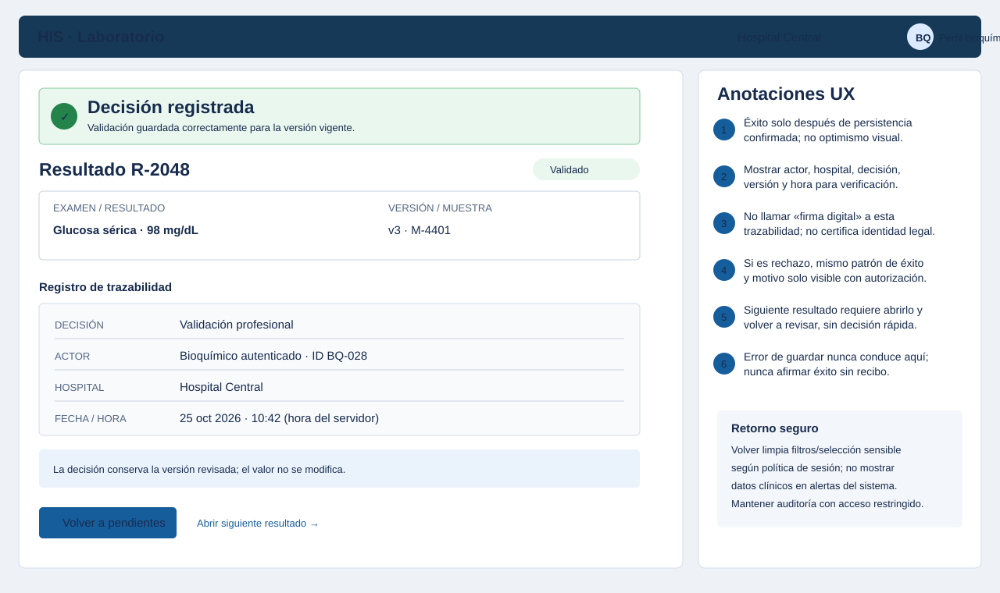
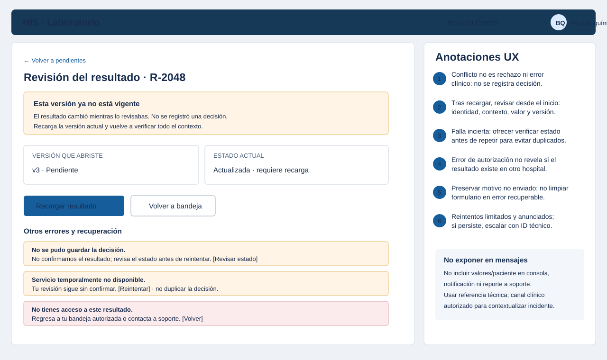

# Semana 8 — Diseño UX de validación de resultados por bioquímico

| | |
|---|---|
| **Curso** | Análisis de Sistemas II — Proyecto Final 2026 |
| **Proyecto** | Sistema Hospitalario Integrado (HIS) |
| **Módulo** | Validación de resultados por bioquímico |
| **Tema** | Diseño de experiencia de usuario |
| **Flujo** | «Revisión, validación o rechazo de un resultado por bioquímico» |
| **Estudiante según la captura** | Lopez Perez, Mercedes Azucena |
| **Fecha** | Octubre 2026 |

## 1. Objetivo y alcance

Este diseño describe la experiencia de un bioquímico autenticado y autorizado que abre una bandeja de resultados pendientes, verifica contexto y versión, y confirma una decisión profesional de validar o rechazar con motivo. Incluye inicio, decisión, confirmación, estados vacíos/de carga/éxito, errores recuperables, ayuda contextual, mensajes, validaciones y protección de datos.

Se entregan **seis wireframes anotados**. Son propuestas de interfaz, no pantallas desplegadas ni especificaciones de API. La bandeja asume que el rol y el hospital ya fueron autorizados; el servidor debe revalidarlos en cada operación. Los datos de paciente, resultado, orden y muestra que aparecen son ficticios y solo ilustran la jerarquía visual.

La decisión permanece bajo criterio del bioquímico y el procedimiento institucional del examen. No se proponen rangos de referencia ni alertas clínicas automáticas. La «firma» es la trazabilidad de usuario, hospital, versión, decisión y fecha/hora, no una firma criptográfica.

## 2. Actores, contexto y principios UX

| Actor | Interacción contemplada |
|---|---|
| Bioquímico autorizado | Revisa la bandeja y el detalle de la versión vigente; valida o rechaza con motivo. |
| Jefatura de laboratorio / soporte autorizado | Recibe escalaciones de resultados con contexto incompleto o fallas; no decide por el bioquímico. |
| Personal que captura resultados | Puede recibir el seguimiento de un rechazo por un flujo autorizado, pero no validar en nombre del bioquímico. |

**Principios de diseño**

1. **Identidad y hospital siempre a la vista.** Nunca se usa el cambio de hospital como un simple filtro: debe haber autorización y nueva carga.
2. **Revisar antes de decidir.** La bandeja no ofrece acciones de validación/rechazo en línea. Se muestra la versión y el contexto vinculados antes de abrir confirmación.
3. **Decisión reversible solo mediante proceso aparte.** La confirmación indica que la versión validada no se edita desde este flujo; una corrección posterior requiere un proceso controlado.
4. **Errores sin ambigüedad.** Pendiente, guardando, confirmado, conflicto, error e indisponibilidad tienen mensajes distintos. Un fallo nunca se presenta como éxito.
5. **Privacidad por defecto.** En listas, mensajes y notificaciones se limita la información clínica; el detalle y el motivo se exponen solo a roles autorizados y por necesidad de trabajo.
6. **Ayuda sin sustituir juicio clínico.** El enlace contextual lleva al procedimiento vigente, no recomienda una decisión a partir de un valor aislado.
7. **Accesibilidad.** Orden de tabulación predecible, foco visible, etiquetas persistentes, mensajes asociados al campo, contraste suficiente y estados no comunicados únicamente con color. El diseño final debe validarse con teclado y lector de pantalla.

## 3. Flujo principal

```text
Sesión autenticada + rol/hospital autorizado
        ↓
01 Bandeja → cargar / vacío / error con reintento
        ↓ abrir un resultado
02 Revisión de asociaciones, valor, unidad, versión y ayuda
        ├─ contexto incompleto → detener decisión y escalar
        ├─ Validar → 03 confirmar → guardar con control de versión
        └─ Rechazar → 04 escribir motivo → confirmar y guardar
                                      ↓
                          05 decisión persistida y trazable

Versión cambió o fallo → 06 mensaje específico → recargar / verificar estado / escalar
```

La autorización de servidor se verifica al recuperar el resultado y otra vez al confirmar la escritura. La pantalla no considera suficiente que el actor haya visto la bandeja.

## 4. Wireframes anotados

### WF-01 — Inicio: bandeja de pendientes

La tabla muestra el identificador, examen, muestra, ingreso y estado mínimo para elegir qué revisar. Los filtros no incluyen campos clínicos libres. Ninguna decisión se toma desde la fila; el bioquímico abre el detalle.



**Estados representados en el wireframe**

- **Carga:** esqueleto en filas y controles inactivos hasta recibir respuesta.
- **Vacío:** «No hay resultados pendientes» con ayuda para quitar filtros o volver a consultar; nunca significa que la consulta falló.
- **Error recuperable:** «No se pudo cargar la bandeja» con referencia técnica no sensible y acción **Reintentar**. No borrar filtros al reintentar.
- **Datos:** orden y examen asociados; el conteo/paginación debe respetar el ámbito autorizado.

### WF-02 — Revisión de resultado y contexto

Antes de decidir, presenta en grupos separados identidad del paciente con datos mínimos, orden/examen, muestra, resultado/unidad, hora de captura, versión y estado. Si el dato o asociación falta, el flujo se detiene sin decisiones y ofrece una ruta de escalación autorizada.



**Ayuda contextual:** «Consulta el procedimiento vigente del examen». Su destino debe estar aprobado, ser accesible para el rol y mantener el contexto clínico protegido; no debe interpretar el resultado ni proponer automáticamente validar/rechazar.

### WF-03 — Confirmación de validación

La acción se presenta en un diálogo que resume identificador, versión, hospital y el efecto de la decisión. **Cancelar** no guarda; **Confirmar** inicia el guardado y bloquea envíos repetidos.



El servidor comprueba autorización, pertenencia al hospital, estado pendiente y versión esperada en la operación de escritura. Solo una respuesta persistida satisfactoriamente conduce al estado de éxito. Si el resultado cambió, se informa conflicto y se vuelve a cargar antes de evaluar de nuevo.

### WF-04 — Rechazo con motivo obligatorio

El diálogo solo habilita confirmar cuando el motivo contiene texto no vacío después de quitar espacios. La validación ocurre en línea y al enviar; el mensaje se asocia al campo, conserva lo escrito y desplaza el foco al error. El motivo no se muestra en la bandeja.



El rechazo mantiene la versión y el valor revisados para trazabilidad y seguimiento. La pantalla no inventa categorías, códigos, longitud máxima o destinos de seguimiento; éstos requieren definición y aprobación del proceso institucional.

### WF-05 — Decisión confirmada y trazabilidad

El estado de éxito aparece solo después de recibir confirmación de persistencia. Resume decisión, actor autenticado, hospital, versión y hora; no llama «firma digital» al registro de auditoría.



En caso de rechazo, el mismo patrón confirma el resultado y restringe la visualización del motivo a usuarios autorizados. El acceso al historial no concede facultad de cambiar una decisión. La opción de abrir el siguiente elemento vuelve a iniciar la revisión sin confirmar en forma masiva.

### WF-06 — Conflicto y errores recuperables

El estado principal de ejemplo es una versión que cambió durante la revisión. La decisión no se escribió. El bioquímico vuelve a cargar, verifica el nuevo contexto completo y decide otra vez. La pantalla distingue conflicto de guardado fallido, indisponibilidad y falta de acceso.



| Situación | Mensaje y recuperación UX |
|---|---|
| Versión obsoleta | «Esta versión ya no está vigente. No se registró una decisión». **Recargar resultado** reinicia la revisión con la versión actual. |
| Falla al guardar con resultado no confirmado | «No confirmamos el resultado». Ofrecer **Revisar estado** antes de reenviar para no duplicar una decisión. Conservar formulario/motivo cuando corresponda. |
| Servicio indisponible | Explicar que no hay confirmación, habilitar reintento anunciado y escalación; no representar el envío como completado. |
| Sin autorización | Mensaje genérico que no confirma existencia de datos en otro hospital; regreso a la bandeja autorizada o soporte. |
| Contexto incompleto | Bloquear ambas decisiones, describir qué asociación no pudo verificarse y dirigir a seguimiento autorizado. |

## 5. Validaciones y reglas de interacción

| Elemento | Validación / regla | Respuesta visible |
|---|---|---|
| Acceso inicial | Sesión autenticada, rol bioquímico y ámbito hospitalario; el servidor repite autorización en lectura y escritura. | Sin acceso: no mostrar resultado ni confirmar su existencia fuera del ámbito. |
| Resultado que se abre | Estado pendiente; asociación completa a orden, examen y muestra; versión identificada. | Incompleto/no disponible: estado explicativo, sin botones de decisión. |
| Validar | Requiere confirmación explícita; conservar valor y unidad; verificar versión y estado de forma atómica. | Guardando con botón bloqueado; éxito solo al persistir; conflicto exige recarga. |
| Rechazar | Motivo obligatorio; trim de espacios; no vaciar el campo al haber error. | Error inline con foco y descripción accesible; no enviar ni cambiar estado mientras falte motivo. |
| Doble envío | Deshabilitar acción mientras se procesa; idempotencia/resolución de estado a cargo del servicio. | Evitar duplicado; si la respuesta es incierta, comprobar estado en vez de repetir a ciegas. |
| Cancelar diálogo | No persistir; devolver foco al control que abrió el diálogo. | Si hay motivo escrito, confirmar antes de descartarlo. |
| Sesión expirada | No enviar ni guardar decisión sin sesión válida. | Solicitar autenticación; no incluir información clínica en parámetros de retorno expuestos. |
| Ayuda contextual | Abrir documento vigente y autorizado, sin instrucción de decisión automatizada. | Si ayuda no disponible, informar el fallo sin bloquear la lectura del resultado ni sugerir criterios alternativos. |
| Datos sensibles | Minimizar datos en tabla, alertas, telemetría, URL, capturas y reportes de error. | Mostrar detalle solo con autorización; motivos e historial con control de acceso. |

Los textos son prototipo y deben validarse con bioquímicos, jefatura y responsables de privacidad/accesibilidad. Los datos de wireframe son ficticios: no se deben reutilizar como fixtures clínicos reales.

## 6. Matriz de trazabilidad

| Requisito de la consigna | Pantalla / regla |
|---|---|
| Roles autorizados e inicio | WF-01; acceso inicial; WF-02 |
| Revisión bioquímica y asociaciones | WF-02; tabla de validación del resultado |
| Decisión de validar o rechazar | WF-02 → WF-03/WF-04 |
| Confirmación y trazabilidad | WF-03, WF-05 |
| Estados vacío, carga y éxito | WF-01, WF-05 |
| Errores recuperables y versión obsoleta | WF-06 |
| Ayuda contextual | WF-02 |
| Protección de datos vinculados | WF-01, WF-02, WF-04, WF-05, WF-06 |
| Motivo obligatorio del rechazo | WF-04 |
| Firma y trazabilidad (sin afirmar firma criptográfica) | WF-03, WF-05 |

## 7. Límites y siguiente paso

Este entregable propone una UX; no implementa pantallas ni prueba usabilidad con usuarios. La Semana 1 fija el proceso y sus límites; Semana 2 define autorización, versión, rechazo, auditoría y errores; Semana 15 aporta casos del prototipo. Antes de producción, el equipo debe acordar identidad mínima visible, acceso al historial, procedimiento de ayuda, prioridad de la bandeja, soporte, tratamiento de respuesta incierta y política de sesión.

## Referencias del módulo

- [Semana 1 — Modelo del proceso](../semana-01/semana-01-uml-validacion-resultados.md)
- [Semana 2 — Requerimientos y DIP](../semana-02/semana-02-dip-validacion-resultados.md)
- [Semana 15 — Pruebas del prototipo](../semana-15/semana-15-pruebas-validacion-bioquimica.md)
