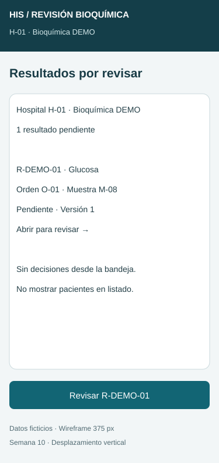
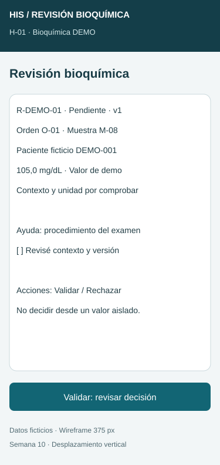
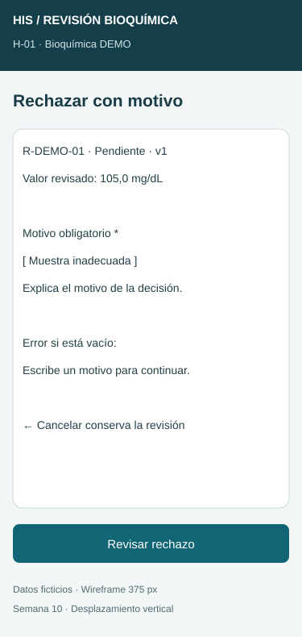
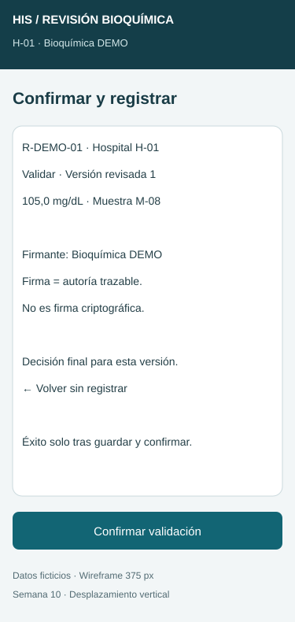
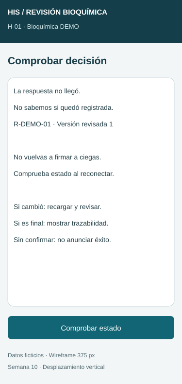

# Semana 10 — Movilidad: validación por bioquímico

**Estudiante:** Lopez Perez, Mercedes Azucena.

Propuesta responsive de cinco pantallas a **320, 375 y 430 px**, derivada del [UX de semana 8](../semana-08/semana-08-ux-validacion-bioquimica.md), base a27c516. Integrar esa base antes de esta entrega. Quince SVG estáticos; no se afirma aplicación conectada, autenticación ni firma digital. Los datos son ficticios.

## Cinco pantallas y jerarquía

| Pantalla | Contenido y decisiones | Imagen 375 px |
|---|---|---|
| M1 Bandeja | Hospital/rol, examen, orden/muestra, estado y versión; sin acción masiva ni decisión desde listado | [Ver](wireframes/01-bandeja-375.svg) |
| M2 Revisión | Contexto mínimo autorizado, valor/unidad, versión, ayuda y acciones Validar/Rechazar | [Ver](wireframes/02-revision-375.svg) |
| M3 Rechazo | Contexto y motivo obligatorio con error junto al campo; cancelar no decide | [Ver](wireframes/03-rechazo-375.svg) |
| M4 Confirmación | Decisión, versión revisada, valor/unidad, firmante y efecto final; volver sin registrar | [Ver](wireframes/04-confirmacion-375.svg) |
| M5 Recuperación | Respuesta desconocida, comprobación de estado y recarga; sin firma repetida ni éxito falso | [Ver](wireframes/05-recuperacion-375.svg) |

M2 incluye dos acciones independientes: “Validar: revisar decisión” es la primaria dibujada y “Rechazar” abre M3; al implementar ambas tendrán controles ≥44 px y acceso por teclado. La casilla de revisión es ayuda de proceso, no prueba de criterio clínico ni sustituto de controles servidor.

M4 tiene dos variantes de contenido, no dos pantallas nuevas: Validar como ejemplo dibujado; Rechazar conserva el motivo de M3, lo muestra en el resumen y usa “Confirmar rechazo”. El motivo nunca desaparece al volver. Tras respuesta exitosa, M4 se transforma en recibo de solo lectura: decisión, resultado/versión, hospital, actor, hora con zona y referencia de auditoría recibidos del servidor. No hay botón para firmar otra vez una versión final.

## Navegación y roles

Bioquímico autorizado: M1 → M2 → M4 (validar) o M2 → M3 → M4 (rechazar). Volver conserva contexto/borrador durante sesión válida. M4 → recibo solo con persistencia confirmada; error/timeout → M5. Consulta autorizada de auditoría solo permite leer la decisión según permiso; personal de captura no valida ni rechaza en este flujo. Roles son reglas de diseño, no controles implementados por estos SVG.

Hospital no es un filtro libre: identidad/tenant/rol se comprueban en servidor al leer y al confirmar. Cambiar contexto exige autorización y nueva carga; borrar borrador si cambia el ámbito. No exponer datos personales en bandeja ni motivos en notificaciones generales.

## Breakpoints y formularios

| Ancho | Regla propuesta |
|---|---|
| 320–359 px | Una columna, márgenes 16 px y contenido 288 px a 320; acciones apiladas sin ocultar unidad/estado/versión. |
| 360–430 px | Misma jerarquía; crece ancho del contenido, no se agregan columnas. |
| 431–767 px | Mantener columna y formulario centrado hasta 560 px. |
| Desde 768 px | Bandeja puede usar tabla con encabezados; detalle con contexto lateral si cabe. Formulario hasta 560 px. |

Implementación futura: viewport del dispositivo, ancho fluido, min-width:0, ajuste de identificadores largos y scroll vertical; no ocultar desbordamientos para tapar contenido. Texto base de interfaz 16 px; los bocetos usan 14 px en contenido para anotar estructura y deben revisarse en implementación. Botón principal al final del contenido, no fijo sobre teclado. Motivo es texto multilínea con etiqueta persistente; no permitir solo espacios. Valor y unidad son solo lectura, sin teclado numérico ni edición clínica desde este módulo.

Foco visible y orden contexto → revisión → acciones → confirmación. Al fallar motivo, asociar error y enfocar campo; carga/éxito anuncian estado sin depender del color. Volver y cancelar tienen nombres explícitos. Zoom/teclado abierto no deben ocultar botones; validar con teclado y lector de pantalla sobre controles reales.

## Estados y recuperación

| Condición | Contenido/acción propuesta |
|---|---|
| Cargando | Esqueleto y aviso; decisiones inactivas hasta tener versión/contexto. |
| Vacío | “No hay resultados pendientes” solo tras consulta satisfactoria. |
| Fallo de bandeja | Mensaje y reintento; no presentarlo como vacío. |
| Contexto incompleto | Detener decisión y ofrecer escalación autorizada sin recomendar decisión clínica. |
| Guardando | “Registrando decisión…”; bloquear doble envío y no mostrar recibo anticipado. |
| Motivo vacío | Error local y servidor; conservar texto y no escribir. |
| 409 / versión o estado cambió | No guardar; recargar contexto y revisar antes de nueva confirmación. |
| Sesión/permiso inválido | Renovar acceso o denegar; no permitir comprobar datos protegidos sin sesión. |
| Falla confirmada de escritura | No mostrar éxito; conservar borrador en memoria y ofrecer recuperación según contrato. |
| Respuesta desconocida | M5: consultar estado por referencia antes de repetir; no afirmar rollback. |
| Éxito persistido | Recibo de solo lectura; firma significa autoría trazable, no certificado criptográfico. |

El contrato integrado debe definir referencia de operación/idempotencia y consulta de resultado. No se presume que exista un endpoint en estos bocetos. No hay cola offline ni persistencia de datos clínicos en el dispositivo.

## Escenario móvil 1 — Validación y respuesta perdida (320 px)

1. Bioquímico autorizado abre M1 y revisa M2: orden, muestra, paciente mínimo, valor/unidad y versión 1. Se omiten datos personales del listado y se deja historial completo bajo demanda.
2. M4 confirma validar v1 con actor/hospital y efecto final. Se pierde la respuesta tras enviar.
3. M5 dice “No sabemos si quedó registrada”; no se muestra firma exitosa ni se reenvía automáticamente al reconectar.
4. Al comprobar: si fue persistida, mostrar recibo original con referencia/autor/hora; si sigue desconocida, permanecer en recuperación; si se confirma que no se aplicó, revalidar contexto y permitir reintento con la misma clave/contenido según contrato. Nunca generar dos decisiones por doble toque.

**Decisión de contenido:** contexto y unidad antes de acciones; firma detallada solo al confirmar/recibir. **Error:** timeout no equivale a fallo de escritura. **Aceptación:** una decisión persistida y un recibo, sin éxito sin confirmación.

## Escenario móvil 2 — Rechazo concurrente (430 px)

1. Desde M2 abrir M3; el usuario intenta motivo en blanco, ve error, corrige y continúa a M4 con versión y motivo visibles.
2. Otra persona decide o cambia la versión antes del guardado. El servidor devuelve conflicto; M5 no anuncia rechazo registrado.
3. Recargar: si versión final, mostrar decisión trazable solo lectura; si hay nueva versión pendiente, volver a M2 y exigir revisión de ese contexto antes de otra decisión. Conservar motivo solo para comparación, no aplicarlo a ciegas.
4. Si la sesión venció, renovar autorización antes de consultar resultado o recuperar borrador. No mostrar motivos fuera del ámbito autorizado.

**Decisión de contenido:** motivo cerca de contexto, historial bajo demanda; acción de validar no aparece en formulario de rechazo. **Error:** no resolver conflicto sobrescribiendo ni cambiando expectedVersion automáticamente. **Aceptación:** cero decisión sobre versión obsoleta y ninguna firma falsa; final no editable.

## Evidencia y límites

Quince variantes SVG de cinco pantallas. [Verificación estructural](evidencia/verificacion.txt): XML válido y texto dentro del lienzo medido con Arial. No son pruebas de navegador, interacción, conectividad ni firma real. Las reglas de responsive, foco/teclado y recuperación son criterios de implementación futura, sin certificación WCAG ni juicio clínico automatizado.