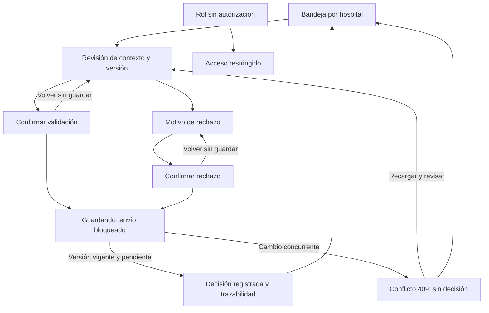

# Semana 11 — Prototipo navegable desktop y móvil

**Estudiante:** Lopez Perez, Mercedes Azucena

**Módulo:** Validación de resultados por bioquímico

Abrir [prototipo/index.html](prototipo/index.html) en Edge o Chrome. No necesita servidor, compilación ni conexión. Los datos y la sesión son ficticios y permanecen solo en memoria. Reiniciar restablece el escenario; recargar el archivo borra las decisiones de demostración.

## Recorridos

1. Camino feliz: Revisar resultado → Validar resultado → Confirmar y registrar → Decisión registrada → Volver a bandeja. El recibo muestra resultado, valor/unidad, versión, decisión, hospital, autor, rol, hora de Guatemala y referencia de auditoría. Una decisión final no permite editar ni volver a decidir.
2. Rechazo: Revisar → Rechazar con motivo → escribir motivo → Revisar rechazo → Confirmar y registrar. Un motivo vacío bloquea el avance y enfoca el campo. Cancelar conserva lo escrito sin guardar.
3. Error crítico: Revisar → activar “Simular cambio de versión al confirmar” → Validar → Confirmar. Aparece conflicto 409, sin decisión ni firma de éxito. Recargar y revisar abre v2 pendiente y exige una nueva confirmación. La versión inicial nunca se sobrescribe.
4. Roles: seleccionar Personal de captura bloquea la revisión y las decisiones. Volver al rol Bioquímico permite continuar. Es una simulación UX; un servidor real debe autorizar cada lectura y escritura.

## Mapa de navegación

## Consistencia y accesibilidad

La bandeja no toma decisiones; el detalle mantiene orden, muestra, paciente ficticio, valor/unidad, hospital, estado y versión. La confirmación identifica al firmante y explica el efecto final. “Firma” significa autoría trazable; no es una firma criptográfica ni usa certificados. Las entradas se escapan antes de mostrarlas para que el motivo sea texto.

Escritorio desde 768 px: navegación lateral y contexto en dos columnas. Móvil hasta 767 px: una columna, acciones apiladas y contenido fluido; se verifican 320, 375 y 430 px. Controles de al menos 46 px, etiquetas persistentes, foco visible, enlace de salto, foco al cambiar de vista, regiones de estado/error y mensajes que no dependen solo de color. El contraste usa texto oscuro sobre fondos claros y blanco sobre verde oscuro. No se afirma validación con lector de pantalla ni auditoría WCAG completa.

## Evidencia visual

| Recorrido | Escritorio 1366 × 900 | Móvil 375 × 812 |
|---|---|---|
| Validación confirmada | [Captura](evidencia/desktop-camino-feliz.png) | [Captura](evidencia/movil-camino-feliz.png) |
| Error crítico de versión | [Captura](evidencia/desktop-error-critico.png) | [Captura](evidencia/movil-error-critico.png) |

[Resultado de verificación](evidencia/verificacion.txt). Las capturas provienen del prototipo ejecutado en Edge headless con Playwright, no de imágenes ilustrativas.

## Límites e integración

El guardado, la auditoría y el conflicto son simulaciones en memoria. No hay autenticación real, API, firma digital, persistencia ni datos clínicos reales. El rango mostrado es ficticio e informativo, no una recomendación de decisión. En integración, un servidor debe comprobar hospital, rol, estado y versión dentro de la transacción y devolver la auditoría persistida antes de anunciar éxito. Este archivo independiente cumple la entrega de prototipo y no reemplaza el backend PHP de otras semanas.