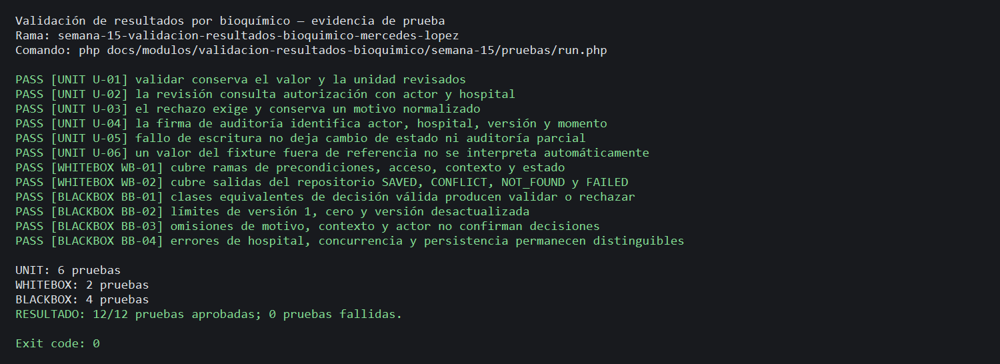
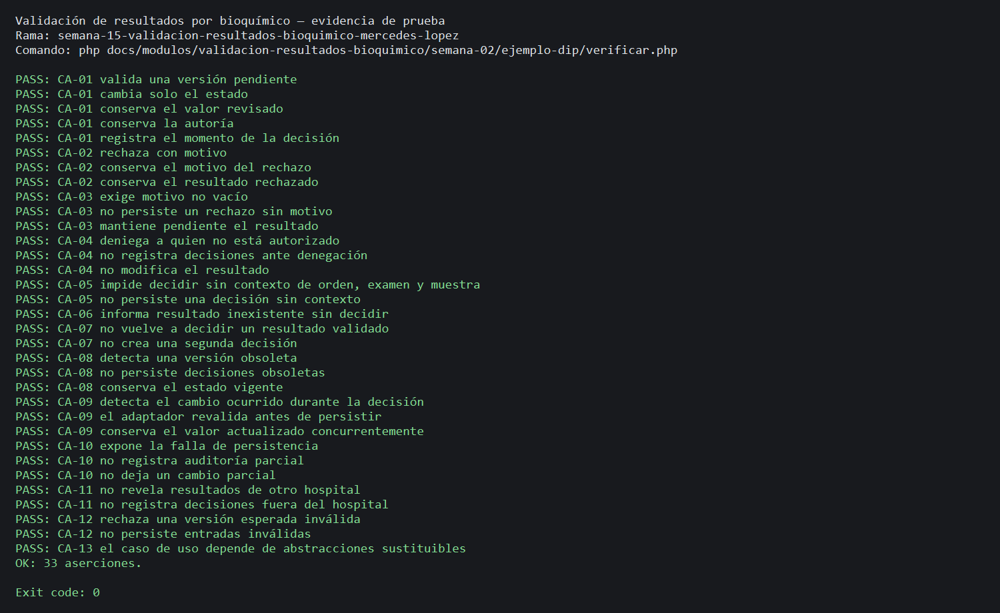

# Semana 15 — Pruebas de validación de resultados por bioquímico

| | |
|---|---|
| **Curso** | Análisis de Sistemas II — Proyecto Final 2026 |
| **Proyecto** | Sistema Hospitalario Integrado (HIS) |
| **Módulo** | Validación de resultados por bioquímico |
| **Tema** | Pruebas unitarias, caja blanca y caja negra |
| **Flujo bajo prueba** | «Revisión, validación o rechazo de un resultado por bioquímico» |
| **Estudiante según la captura** | Lopez Perez, Mercedes Azucena |
| **Fecha** | Octubre 2026 |

## 1. Objetivo y alcance

Diseñar y ejecutar pruebas trazables para el flujo del bioquímico del prototipo PHP de Semana 2: autorización de la revisión, evaluación de una versión pendiente, validación o rechazo con motivo y registro de actor, hospital, versión y momento. Se prueba el comportamiento del caso de uso `ReviewPendingLabResult` y su puerto de persistencia usando dobles deterministas.

El repositorio de aplicación no contiene un servicio de producción implementado para este flujo; por eso las pruebas se dirigen al caso de uso demostrativo de Semana 2, no a clases de otros módulos ni a una API clínica existente. No se asignan intervalos ni reglas clínicas inventadas. «Reglas de resultado» aquí significa preservar valor/unidad y respetar el estado/versionado del resultado revisado; la interpretación clínica sigue bajo criterio profesional.

La identidad del bioquímico, junto con decisión, hospital, versión y fecha/hora, es la **firma de auditoría del prototipo**. No representa una firma criptográfica ni certificación digital.

## 2. Requisitos bajo prueba

| ID | Requerimiento |
|---|---|
| RF-01 | Revisar y decidir requiere un actor autorizado dentro del hospital correspondiente. |
| RF-02 | El resultado debe existir y tener asociaciones a orden, examen y muestra antes de decidir. |
| RF-03 | Solo puede decidirse sobre la versión esperada que permanezca pendiente. |
| RF-04 | Validar no altera valor ni unidad y conserva una transición trazable. |
| RF-05 | Rechazar exige motivo no vacío y conserva el resultado original. |
| RF-06 | La decisión registra bioquímico, hospital, versión, decisión y fecha/hora; el rechazo incluye motivo. |
| RF-07 | Estado y auditoría se guardan atómicamente; errores técnicos no crean decisiones parciales. |
| RNF-01 | Los resultados de denegación, entrada inválida, conflicto, no encontrado y persistencia fallida son distinguibles. |
| RNF-02 | Las pruebas son repetibles con reloj, autorización y repositorio controlados, sin base de datos. |
| RNF-03 | La prueba no define umbrales ni sustituye el criterio bioquímico. |
| RNF-04 | La suite cubre condiciones del flujo y clases de entrada válidas, límites, omisiones y errores. |
| RNF-05 | No se prueban módulos ajenos al flujo bioquímico. |

## 3. Estrategia y clases de prueba

| Tipo | Cantidad mínima | Diseñadas | Enfoque |
|---|---:|---:|---|
| Unitarias | 3 | 6 | Conservación del valor y unidad; autorización; validación y rechazo; identidad y trazabilidad; atomicidad; ausencia de rangos clínicos automáticos. |
| Caja blanca | 2 | 2 | Ramas de precondiciones, autorización, consulta, asociación, versión, estado y motivo; mapeo de cada salida de persistencia. |
| Caja negra | 4 | 4 | Clases equivalentes de decisiones; límites de versión; campos/contexto omitidos; hospital ajeno, concurrencia y errores técnicos. |

Los dobles están en [`pruebas/TestDoubles.php`](pruebas/TestDoubles.php), y los casos en [`pruebas/run.php`](pruebas/run.php). Cada identificador U, WB o BB aparece en la salida para relacionar ejecución y matriz.

## 4. Matriz RF/RNF → pruebas

| Requisito | Pruebas trazadas | Evidencia observable |
|---|---|---|
| RF-01 autorización por actor y hospital | U-02, WB-01, BB-04 | Autoriza antes de consultar; deniega al actor no autorizado; no revela resultados de otro hospital. |
| RF-02 existencia y contexto completo | WB-01, BB-03 | Resultado ausente y asociaciones omitidas impiden decidir. |
| RF-03 versión vigente y estado pendiente | WB-01, WB-02, BB-02, BB-04 | Versión antigua/conflicto y estado ya decidido no generan otra decisión; la carrera se detecta al guardar. |
| RF-04 validar sin alterar el dato | U-01, U-06, BB-01 | Se conserva el valor y unidad revisados; no se simulan rangos clínicos. |
| RF-05 rechazo con motivo | U-03, WB-01, BB-01, BB-03 | El motivo se exige, normaliza y conserva; sin motivo no se intenta escribir. |
| RF-06 firma y trazabilidad | U-03, U-04, BB-01 | Actor, hospital, versión, decisión, hora y motivo se asocian a la decisión. |
| RF-07 atomicidad de estado y auditoría | U-05, WB-02, BB-04 | Un fallo de escritura no crea transición ni registro parcial. |
| RNF-01 errores distinguibles | WB-01, WB-02, BB-02, BB-04 | Se observan `DENIED`, `INVALID_INPUT`, `NOT_FOUND`, `INVALID_CONTEXT`, `INVALID_STATE`, `CONFLICT` y `PERSISTENCE_FAILURE`. |
| RNF-02 repetibilidad | Todas | Reloj fijo, autorización y repositorio en memoria controlados; ejecución sin infraestructura externa. |
| RNF-03 no inventar reglas bioquímicas | U-06, BB-01 | Una cifra de fixture no activa una decisión clínica automatizada ni se transforma. |
| RNF-04 condiciones y particiones | WB-01, WB-02, BB-01–BB-04 | Casos de condición, límites, clases, omisiones y errores. |
| RNF-05 aislar el módulo | Todas | La suite requiere solamente el workflow DIP de validación; no arranca Laravel ni consulta módulos ajenos. |

## 5. Caja blanca — ramas y condiciones

### WB-01 — Guardas del caso de uso

| Condición / rama | Caso | Resultado esperado |
|---|---|---|
| ID de resultado vacío | WB-01 | `INVALID_INPUT`; autorización y repositorio no se consultan. |
| autorización falsa | WB-01 | `DENIED`; no se consulta el resultado. |
| resultado inexistente | WB-01 | `NOT_FOUND`. |
| hospital distinto | BB-04 | `NOT_FOUND`, sin revelar existencia. |
| falta asociación a orden, examen o muestra | WB-01, BB-03 | `INVALID_CONTEXT`. |
| versión distinta a la esperada | WB-01, BB-02 | `CONFLICT`. |
| estado distinto de `PENDING` | WB-01 | `INVALID_STATE`. |
| rechazo con motivo vacío | WB-01, BB-03 | `INVALID_INPUT`, sin escritura. |
| todas las guardas satisfechas | U-01, U-03, BB-01 | Decisión escrita a través del repositorio. |

### WB-02 — Salidas del puerto de persistencia

| `DecisionWriteStatus` | Decisión | Resultado del caso de uso |
|---|---|---|
| `SAVED` | `VALIDATE` | `VALIDATED` |
| `SAVED` | `REJECT` | `REJECTED` |
| `CONFLICT` | cualquiera | `CONFLICT` |
| `NOT_FOUND` | cualquiera | `NOT_FOUND` |
| `FAILED` | cualquiera | `PERSISTENCE_FAILURE` |

## 6. Caja negra — equivalencia, límites, omisiones y errores

| Caso | Partición / condición externa | Resultado esperado |
|---|---|---|
| BB-01 | Pendiente autorizado, decisión `VALIDATE` o `REJECT` con motivo | Respuesta correspondiente y una decisión registrada. |
| BB-02 | Límite de versión: mínima válida `1`, inválida `0`, menor que la vigente | `VALIDATED`, `INVALID_INPUT`, `CONFLICT`, respectivamente. |
| BB-03 | Omisión de motivo, orden, examen, muestra o actor | Entrada/contexto inválido; no se confirma decisión. |
| BB-04 | Hospital no coincidente, modificación concurrente o persistencia fallida | `NOT_FOUND`, `CONFLICT` o `PERSISTENCE_FAILURE`, sin decisión parcial. |

## 7. Comandos y resultados

Desde la raíz del repositorio:

```powershell
php docs/modulos/validacion-resultados-bioquimico/semana-15/pruebas/run.php
php docs/modulos/validacion-resultados-bioquimico/semana-02/ejemplo-dip/verificar.php
```

**Resultado observado:** 12 casos en Semana 15 (6 unitarios, 2 caja blanca y 4 caja negra), todos aprobados; la suite heredada mantiene sus criterios CA-01 a CA-13. PHP 8.2.33 pasa `php -l` en runners y dobles. Las salidas están en [salida-semana-15.txt](evidencia/salida-semana-15.txt) y [salida-regresion-semana-02.txt](evidencia/salida-regresion-semana-02.txt); las capturas visuales en [capturas/](evidencia/capturas/).

### Captura de la suite Semana 15



### Captura de regresión de Semana 2



## 8. Defectos y límites de la evidencia

| ID | Defecto observado | Severidad | Estado |
|---|---|---|---|
| — | No se detectaron defectos en los escenarios ejecutados. | — | Sin defectos abiertos. |

Estas pruebas validan el ejemplo académico de aplicación, no la conformidad clínica ni un servicio productivo. Los dobles permiten probar las reglas del caso de uso, pero no prueban una base real, integración EMR, firma criptográfica ni valores de referencia de un catálogo.
