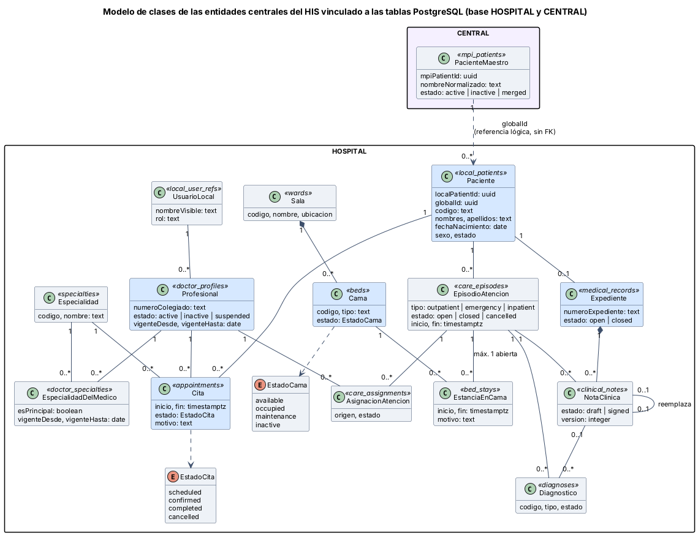

# Semana 1 — Modelo de clases UML del HIS vinculado a PostgreSQL

**Estudiante:** Joshua Eduardo García Reyes (`jgarciar73@miumg.edu.gt`, `jgarciar73-svg`) · **Módulo:** Verificación de base de datos PostgreSQL (asignado en el tablero del docente) · **Fuente revisada:** `database/migrations/hospital/` y `database/migrations/central/` de `develop`

**Entregables:** [diagrama de clases](diagramas/semana-01-clases-his.png) (§1), tabla de correspondencia clase → tabla (§2) y relaciones → llaves foráneas (§3). La tabla no está copiada a mano sin control: [`verificar-correspondencia.php`](verificar-correspondencia.php) la lee de este documento y comprueba cada tabla, columna y llave foránea contra las migraciones reales (§4).

## 1. Diagrama de clases



Las cinco entidades pedidas están en azul: **Paciente, Profesional, Cita, Cama y Expediente**. Las demás clases son las que la base necesita para unirlas: sin `EpisodioAtencion` no hay estancia en cama ni nota clínica, y sin `Especialidad` no hay cita. Cada clase muestra entre « » la tabla que la guarda. Las multiplicidades salen de las llaves foráneas y de los índices únicos de cada tabla, no de una suposición.

**Decisiones del modelo:**

- El **paciente** tiene dos niveles. `PacienteMaestro` (base CENTRAL, índice maestro de la red) y `Paciente` (base HOSPITAL). Se unen por `global_id` sin llave foránea física, porque están en bases distintas.
- El **profesional** no guarda su nombre: lo toma de `UsuarioLocal` (`display_name`). Por eso se modelan como dos clases.
- **Cita** y **Cama** tienen estados fijos (`CHECK ... IN`), que se modelan como enumeraciones.
- `Sala ◆— Cama` y `Expediente ◆— NotaClinica` son composiciones: la cama no existe sin su sala ni la nota sin su expediente, y la base lo impone con `ON DELETE RESTRICT` y con triggers que impiden borrar.

## 2. Tabla de correspondencia clase → tabla PostgreSQL

| Clase UML | Base | Tabla | Atributos verificados (columnas) |
|---|---|---|---|
| PacienteMaestro | CENTRAL | `mpi_patients` | `mpi_patient_id`, `normalized_name`, `birth_date`, `sex`, `status`, `merged_into_id` |
| Paciente | HOSPITAL | `local_patients` | `local_patient_id`, `global_id`, `code`, `given_name`, `family_name`, `birth_date`, `sex`, `status`, `mpi_link_status` |
| EpisodioAtencion | HOSPITAL | `care_episodes` | `care_episode_id`, `local_patient_id`, `type`, `status`, `started_at`, `ended_at`, `reason` |
| UsuarioLocal | HOSPITAL | `local_user_refs` | `local_user_ref_id`, `central_user_id`, `membership_id`, `display_name`, `role_code`, `status` |
| Profesional | HOSPITAL | `doctor_profiles` | `doctor_profile_id`, `local_user_ref_id`, `license_number`, `status`, `valid_from`, `valid_to` |
| Especialidad | HOSPITAL | `specialties` | `specialty_id`, `code`, `name`, `status` |
| EspecialidadDelMedico | HOSPITAL | `doctor_specialties` | `doctor_specialty_id`, `doctor_profile_id`, `specialty_id`, `is_primary`, `valid_from`, `valid_to`, `status` |
| AsignacionAtencion | HOSPITAL | `care_assignments` | `care_assignment_id`, `care_episode_id`, `doctor_profile_id`, `specialty_id`, `source`, `status`, `valid_from` |
| Cita | HOSPITAL | `appointments` | `appointment_id`, `local_patient_id`, `doctor_profile_id`, `specialty_id`, `starts_at`, `ends_at`, `status`, `reason` |
| Sala | HOSPITAL | `wards` | `ward_id`, `code`, `name`, `location`, `status` |
| Cama | HOSPITAL | `beds` | `bed_id`, `ward_id`, `code`, `type`, `status` |
| EstanciaEnCama | HOSPITAL | `bed_stays` | `bed_stay_id`, `care_episode_id`, `bed_id`, `started_at`, `ended_at`, `reason` |
| Expediente | HOSPITAL | `medical_records` | `medical_record_id`, `local_patient_id`, `record_number`, `opened_at`, `status`, `closed_at` |
| NotaClinica | HOSPITAL | `clinical_notes` | `clinical_note_id`, `medical_record_id`, `care_episode_id`, `author_user_ref_id`, `status`, `version_no`, `supersedes_id` |
| Diagnostico | HOSPITAL | `diagnoses` | `diagnosis_id`, `care_episode_id`, `clinical_note_id`, `code`, `type`, `status` |

**Tipos:** `uuid` → identificador (clave primaria `gen_random_uuid()`), `text` → texto, `date` y `timestamptz` → fecha y fecha con zona horaria, `boolean` → lógico. Los atributos de estado son enumeraciones porque la tabla los limita con `CHECK (... IN (...))`.

## 3. Relaciones → llaves foráneas

| Relación UML | Llave foránea | Multiplicidad y de dónde sale |
|---|---|---|
| Paciente 1 — 0..1 Expediente | `medical_records.local_patient_id` → `local_patients` | 0..1 por `medical_records_local_patient_id_unique` |
| Paciente 1 — 0..* EpisodioAtencion | `care_episodes.local_patient_id` → `local_patients` | Sin restricción de unicidad |
| Paciente 1 — 0..* Cita | `appointments.local_patient_id` → `local_patients` | El paciente no tiene dos citas activas cruzadas (exclusión GiST) |
| UsuarioLocal 1 — 0..* Profesional | `doctor_profiles.local_user_ref_id` → `local_user_refs` | Un solo perfil activo y abierto por usuario (índice único parcial) |
| Profesional 1 — 0..* EspecialidadDelMedico | `doctor_specialties.doctor_profile_id` → `doctor_profiles` | Vigencias de la misma especialidad no se cruzan; una principal a la vez |
| Especialidad 1 — 0..* EspecialidadDelMedico | `doctor_specialties.specialty_id` → `specialties` | — |
| Profesional 1 — 0..* Cita | `appointments.doctor_profile_id` → `doctor_profiles` | El médico no tiene dos citas activas cruzadas (exclusión GiST) |
| Especialidad 1 — 0..* Cita | `appointments.specialty_id` → `specialties` | Trigger: el médico debe tener la especialidad vigente |
| EpisodioAtencion 1 — 0..* AsignacionAtencion | `care_assignments.care_episode_id` → `care_episodes` | — |
| Profesional 1 — 0..* AsignacionAtencion | `care_assignments.doctor_profile_id` → `doctor_profiles` | Trigger de especialidad vigente |
| Sala 1 ◆— 0..* Cama | `beds.ward_id` → `wards` | Código de cama único dentro de la sala |
| Cama 1 — 0..* EstanciaEnCama | `bed_stays.bed_id` → `beds` | Una cama no tiene dos estancias cruzadas (exclusión GiST) |
| EpisodioAtencion 1 — 0..* EstanciaEnCama | `bed_stays.care_episode_id` → `care_episodes` | Máximo una estancia abierta por episodio (índice único parcial) |
| Expediente 1 ◆— 0..* NotaClinica | `clinical_notes.medical_record_id` → `medical_records` | Versión única por expediente |
| EpisodioAtencion 1 — 0..* NotaClinica | `clinical_notes.care_episode_id` → `care_episodes` | Trigger: episodio y expediente del mismo paciente |
| NotaClinica 0..1 — 0..1 NotaClinica | `clinical_notes.supersedes_id` → `clinical_notes` | Una nota se reemplaza una sola vez (índice único parcial) |
| EpisodioAtencion 1 — 0..* Diagnostico | `diagnoses.care_episode_id` → `care_episodes` | — |
| NotaClinica 0..1 — 0..* Diagnostico | `diagnoses.clinical_note_id` → `clinical_notes` | Opcional (columna sin NOT NULL) |
| PacienteMaestro 1 ..> 0..* Paciente | `local_patients.global_id` → `mpi_patients` (lógica) | Sin FK física: bases distintas; `global_id` es único en HOSPITAL |

## 4. Verificación contra las migraciones

```bash
php docs/modulos/verificacion-bd-postgresql/semana-01/verificar-correspondencia.php
# Tablas: 15/15 · Columnas: 95/95 · Llaves foráneas: 18/18 (+1 lógica)
# Resultado: correspondencia verificada
```

El script lee las tablas §2 y §3 de este documento y busca cada `CREATE TABLE`, columna y `REFERENCES` en `database/migrations/{central,hospital}/*.php`. Si alguien cambia una migración o este documento sin actualizar el otro, el script falla y dice qué no coincide. No necesita PostgreSQL encendido.

## 5. Hallazgos de la revisión

| ID | Hallazgo | Por qué importa |
|---|---|---|
| H-01 | `beds.status = 'occupied'` no se actualiza con un trigger cuando se abre o cierra una `bed_stays` | Una cama puede quedar «ocupada» sin estancia, o al revés; la consistencia depende de la aplicación (módulo Traslados) |
| H-02 | `doctor_profiles` no tiene nombre ni documento; el nombre vive en `local_user_refs.display_name` | Toda vista de médicos necesita unir dos tablas |
| H-03 | No existe tabla de horario de atención del médico | Citas solo valida cruces, no si el médico atiende a esa hora (lo señala también el módulo Citas) |
| H-04 | El documento del paciente no está en `local_patients`; está cifrado en `mpi_identifiers` (CENTRAL) | Buscar por documento exige pasar por el índice maestro |
| H-05 | `specialties` está en la base HOSPITAL y no en CENTRAL | Cada hospital puede tener códigos distintos para la misma especialidad |

**Defensa en 1 minuto:** «Tomé las cinco entidades centrales y las clases que las unen, cada una con la tabla real que la guarda. Las multiplicidades salen de las llaves foráneas, de los índices únicos y de las exclusiones de PostgreSQL. La tabla de correspondencia no es solo texto: un script la compara con las migraciones y hoy coincide en las 15 tablas. En la revisión encontré cinco hallazgos; el más importante es que el estado de la cama no se sincroniza solo con la estancia.»
