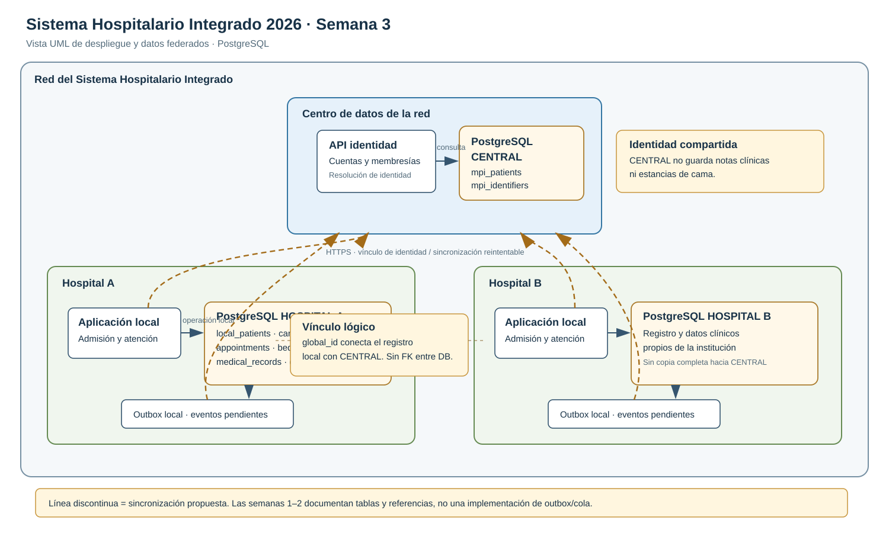

# Semana 3 — Arquitectura de datos federada

**Sistema Hospitalario Integrado 2026 | Semanas 1–15**
**Módulo:** Verificación de base de datos PostgreSQL
**Tema:** Base central y bases por hospital
**Vista:** Despliegue y datos (UML)

## Propósito

El sistema separa los datos que deben identificar a una persona en toda la red de los datos que cada hospital necesita para atenderla. La base CENTRAL conserva el índice maestro de pacientes y los identificadores asociados. Cada base HOSPITAL conserva el expediente operativo y clínico de su institución. Así, una persona puede vincularse entre hospitales sin trasladar automáticamente su historia clínica completa.

La vista de despliegue muestra una instancia central y una instancia local por hospital. Cada hospital conserva sus datos y atiende sus operaciones aunque la comunicación con CENTRAL se interrumpa. La vinculación global y el intercambio de referencias requieren conexión y sincronización posterior.

## Qué guarda cada base

**CENTRAL (PostgreSQL de la red)** conserva el índice maestro de pacientes (`mpi_patients`), los identificadores del paciente (`mpi_identifiers`) y la información central de cuentas y membresías que se referencia desde los hospitales. El índice permite resolver si dos registros locales corresponden a la misma persona. CENTRAL no es el repositorio de notas clínicas ni de estancias de cama.

**HOSPITAL (una base PostgreSQL por institución)** conserva los datos necesarios para operar y documentar la atención local. Entre las tablas descritas en las semanas anteriores están `local_patients`, `care_episodes`, `appointments`, `wards`, `beds`, `bed_stays`, `medical_records`, `clinical_notes`, `diagnoses`, `doctor_profiles`, `specialties` y `doctor_specialties`. También mantiene referencias locales de personal en `local_user_refs`, con `central_user_id`, `membership_id`, `display_name` y `role_code`.

| Dato | Ubicación principal | Motivo |
|---|---|---|
| Identidad maestra e identificadores usados para resolver duplicados | CENTRAL: `mpi_patients`, `mpi_identifiers` | La identidad debe poder reconocerse a través de la red. |
| Datos locales de identificación y registro operativo del paciente | HOSPITAL: `local_patients` | Cada hospital gestiona el registro que usa en su atención. |
| Citas, episodios, asignaciones y estancias | HOSPITAL | Son operaciones asociadas a una institución. |
| Expediente, notas clínicas y diagnósticos | HOSPITAL | El contenido clínico queda en el hospital que lo produjo. |
| Camas, salas y especialidades disponibles | HOSPITAL | La disponibilidad y el catálogo operativo pueden variar por institución. |
| Referencia local de usuario, rol y membresía | HOSPITAL: `local_user_refs`; identidad de cuenta en CENTRAL | El hospital necesita autorizar la operación con una referencia central mínima. |

La relación de `local_patients.global_id` con `mpi_patients` es lógica, no una llave foránea PostgreSQL: las tablas están en bases diferentes. Por eso la aplicación debe validar y reconciliar la referencia.

## Sincronización propuesta

Las migraciones y los documentos de las semanas 1 y 2 describen las entidades y referencias, pero no especifican un servicio de sincronización ni una cola de eventos. El flujo siguiente es una propuesta para completar la vista, no una función cuya implementación haya quedado demostrada.

1. El hospital registra al paciente y guarda la atención local en su propia transacción. Si hay conexión, solicita a CENTRAL buscar o crear la identidad maestra. CENTRAL devuelve el identificador global y el resultado de vinculación.
2. El hospital guarda ese identificador en `local_patients.global_id` y refleja el estado en `mpi_link_status`. Si CENTRAL no está disponible, el hospital conserva el registro local marcado como pendiente para resolverlo después.
3. Para evitar perder cambios durante una caída, el hospital registra en la misma transacción un evento mínimo en una bandeja de salida local (outbox). Un proceso lo envía cuando vuelve la conexión. CENTRAL procesa cada evento de forma idempotente y responde con el resultado de vinculación.
4. Las cuentas y membresías se propagan como referencias necesarias para la operación local, no como copias de información clínica.
5. Un proceso de conciliación revisa referencias pendientes, conflictos de identidad, eventos rechazados y retrasos. Una fusión del índice maestro debe dejar una referencia auditable hacia el identificador resultante y actualizar las referencias afectadas sin borrar el historial local.

El flujo no sincroniza notas, diagnósticos ni el expediente completo a CENTRAL. Si un profesional necesita consultar información de otro hospital, ese acceso requiere un mecanismo explícito, autorizado y auditable; el diagrama no presupone acceso federado a historias clínicas.

## Decisiones y límites

- **Responsabilidad local:** cada hospital es dueño de sus registros clínicos y de su operación.
- **Identidad compartida:** CENTRAL resuelve identidades de red; el vínculo se conserva mediante `global_id`, sin FK entre bases.
- **Tolerancia a desconexión:** la atención local continúa; las altas o cambios que dependan de resolución global quedan pendientes.
- **Integridad:** una sincronización eventual no reemplaza las restricciones que PostgreSQL aplica dentro de cada base.
- **Estado de camas:** la semana 1 identificó que `beds.status` no se actualiza automáticamente al cambiar `bed_stays`; la consistencia local todavía requiere una corrección en la aplicación o un mecanismo de base de datos.

## Evidencia

La vista UML de despliegue y datos está en [semana-03-vista-despliegue-datos.svg](diagramas/semana-03-vista-despliegue-datos.svg). El archivo fuente editable de PlantUML está en [semana-03-vista-despliegue-datos.puml](diagramas/semana-03-vista-despliegue-datos.puml).

## Fuentes del análisis

- `docs/modulos/verificacion-bd-postgresql/semana-01/semana-01-clases-his-postgresql.md`, en particular la tabla de correspondencia y los hallazgos H-01 a H-05.
- `docs/modulos/verificacion-bd-postgresql/semana-02/semana-02-requisitos-de-datos.md`, en particular RD-25 y RD-26.
- El resumen `CONTINUAR-EN-OTRO-CHAT.md` incluido en el ZIP, que describe la separación `database/migrations/central` y `database/migrations/hospital`.

**Alcance de verificación:** el bundle entregado contiene las ramas de las semanas 1 y 2 y sus documentos, pero la rama base `dev24` no incluye las migraciones `database/migrations`. Por ello, esta entrega refleja las tablas y hallazgos documentados en los trabajos previos; la propuesta de sincronización se marca expresamente como diseño pendiente de implementación.
