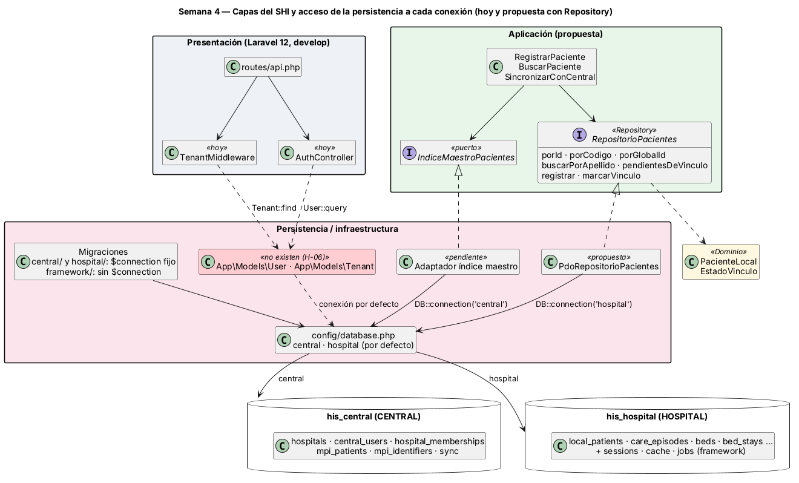

# Semana 4 — Capas, acceso a cada conexión y propuesta de Repository

**Estudiante:** Joshua Eduardo García Reyes (`jgarciar73-svg`) · **Módulo:** Verificación de base de datos PostgreSQL (asignado en el tablero del docente) · **Fuente revisada:** `develop` del 27-oct (`config/database.php`, `database/migrations/{central,hospital,framework}`, `app/`) · Continúa la [arquitectura federada de la semana 3](../semana-03/semana-03-arquitectura-datos-federada.md).

**Entregables:** revisión de cómo la persistencia llega a cada conexión (§1, §2), [diagrama de capas](diagramas/semana-04-capas-conexiones.png) (§3) y la interfaz `RepositorioPacientes` con sus consultas principales (§4). Todo lo que afirma este documento lo comprueba [`verificar-repositorio.php`](verificar-repositorio.php) (§5).

## 1. Cómo accede hoy la persistencia a cada conexión

| Pieza | Conexión | Cómo la elige | Comprobación |
|---|---|---|---|
| `config/database.php` | `central` y `hospital`, ambas PostgreSQL | Host, base, usuario y contraseña salen de `CENTRAL_DB_*` y `HOSPITAL_DB_*`; no hay credenciales en el código | CON-01 |
| Conexión por defecto | `hospital` | `'default' => env('DB_CONNECTION', 'hospital')` | CON-02 |
| Migraciones `central/` (5) y `hospital/` (6) | La de su carpeta | Cada una fija `protected $connection` y ejecuta su SQL con `DB::connection($this->connection)` | CON-03 |
| Migraciones `framework/` (sessions, cache, jobs) | `hospital`, por defecto | No fijan `$connection`; usan `Schema::create` | CON-04 |
| `TenantMiddleware`, `AuthController` | La de por defecto | Usan `App\Models\Tenant` y `App\Models\User` (Eloquent) | H-06 |
| Entidades clínicas (pacientes, camas, notas…) | — | Todavía no hay modelos ni repositorios; cada Micro-HIS usa su propio PDO | — |

## 2. Hallazgos

| ID | Hallazgo | Por qué importa | Propuesta |
|---|---|---|---|
| H-06 | `app/` usa `App\Models\User` y `App\Models\Tenant`, pero `app/Models` no existe y ninguna migración crea `users`, `tenants` ni las tablas de roles | Registro, login y la cabecera `X-Tenant-ID` fallan al ejecutarse. Además, en el modelo federado el usuario vive en CENTRAL (`central_users`, `hospital_memberships`) y el hospital en `hospitals` | Modelos con `$connection` explícito sobre esas tablas, o un repositorio de identidad en la conexión `central` |
| H-07 | Las tablas de framework caen en la conexión por defecto | Sirve si cada hospital despliega su propia aplicación; si una sola aplicación atiende varios hospitales, sesiones y colas se mezclan en una base HOSPITAL | Decidirlo y fijar la conexión por escrito |
| H-08 | `stancl/tenancy` está en `composer.json`, pero no hay `config/tenancy.php` y `TenantMiddleware` no cambia de conexión | Todas las consultas van a la misma base `hospital`, sea cual sea el tenant | O se configura la librería, o se quita y queda una base por despliegue |
| H-09 | `local_patients.global_id` es `NOT NULL` y único, pero la semana 3 permite un paciente «pendiente» de CENTRAL | El hospital debe generar un `global_id` provisional y poder cambiarlo al vincular (`marcarVinculo`) | Documentarlo en el contrato del repositorio (§4) |

## 3. Diagrama de capas



Arriba está lo que existe hoy (rutas, middleware y controlador) y, en rojo, los modelos que el código usa y no existen. Lo propuesto es que los casos de uso dependan de interfaces de la capa de Aplicación y que cada adaptador nombre su conexión: el repositorio de pacientes usa `DB::connection('hospital')` y el índice maestro, `DB::connection('central')`. Nunca dependen de la conexión por defecto.

## 4. Propuesta: `RepositorioPacientes`

**Por qué Paciente local:** es la entidad que une las dos conexiones (`local_patients.global_id` apunta lógicamente a `mpi_patients` en CENTRAL, sin llave foránea). Por eso hay **dos interfaces**: `RepositorioPacientes` (HOSPITAL) e `IndiceMaestroPacientes` (CENTRAL), sin transacción común. Código: [`propuesta/RepositorioPacientes.php`](propuesta/RepositorioPacientes.php) (interfaz, `PacienteLocal`, `EstadoVinculo`) y [`propuesta/PdoRepositorioPacientes.php`](propuesta/PdoRepositorioPacientes.php) (adaptador de referencia con sentencias preparadas).

| Operación | Consulta principal (`local_patients`) | Índice que usa | Para qué |
|---|---|---|---|
| `porId` | `WHERE local_patient_id = ?` | `local_patients_pkey` | Abrir la ficha |
| `porCodigo` | `WHERE code = ?` | `local_patients_code_unique` | Admisión por código del hospital |
| `porGlobalId` | `WHERE global_id = ?` | `local_patients_global_id_unique` | Respuesta de CENTRAL |
| `buscarPorApellido` | `WHERE lower(family_name) LIKE ? ESCAPE '\' ORDER BY … LIMIT ?` | Ninguno hoy → `local_patients_family_name_lower_pattern_index` | Búsqueda en admisión |
| `pendientesDeVinculo` | `WHERE mpi_link_status = 'pending' ORDER BY created_at … LIMIT ?` | Ninguno hoy → `local_patients_mpi_pending_index` (parcial) | Sincronización con CENTRAL (semana 3) |
| `registrar` | `INSERT … VALUES (?, …)` | Únicos de código y `global_id` | Alta del paciente; repetido → `ErrorRepositorio` (23505) |
| `marcarVinculo` | `UPDATE … SET global_id = ?, mpi_link_status = ? WHERE local_patient_id = ?` | `local_patients_pkey` | CENTRAL respondió; si no existe → `ErrorRepositorio` |

Los dos índices nuevos están en [`propuesta/indices-propuestos.sql`](propuesta/indices-propuestos.sql) para una migración de la conexión `hospital`. La búsqueda escapa `%` y `_`, así que lo que escribe el usuario no funciona como comodín.

## 5. Verificación

```bash
php docs/modulos/verificacion-bd-postgresql/semana-04/verificar-repositorio.php   # siempre: CON-01..04, H-06, REP-01..02
# Con PostgreSQL 15+ y una base vacía de prueba (crea un esquema temporal, carga las migraciones HOSPITAL y al final lo borra):
SHI_PG_DSN='pgsql:host=127.0.0.1;dbname=prueba' SHI_PG_USER=postgres SHI_PG_PASS=... php docs/modulos/verificacion-bd-postgresql/semana-04/verificar-repositorio.php
```

Con PostgreSQL 16 ([captura](evidencia/verificar-repositorio.png)), sobre 5 000 pacientes de prueba: FUN-01..04 prueban el repositorio real (alta, lecturas, código repetido, `%` literal, cola de pendientes, vínculo de un id inexistente). PLN-01..03 leen el plan: id, código y `global_id` ya usan su índice único; apellido y pendientes hacen `Seq Scan` hasta aplicar `indices-propuestos.sql`, y después usan su índice. Mutaciones probadas: sin escapar `%`, sin `lower()`, sin el índice parcial, `marcarVinculo` sin revisar si existía y la conexión por defecto cambiada a `central`; cada una hace fallar su verificación.

**Defensa en 1 minuto:** «Revisé cómo llega el código a cada base. Las migraciones están bien: cada una fija `central` u `hospital`, y las credenciales salen del entorno. El problema está en el código que se ejecuta: usa modelos que no existen, sobre tablas que no existen, y siempre por la conexión por defecto. Propongo que los casos de uso dependan de una interfaz y que cada adaptador nombre su conexión. Para pacientes son siete operaciones; el script prueba cada consulta en PostgreSQL y mostró que dos necesitan índices nuevos.»
