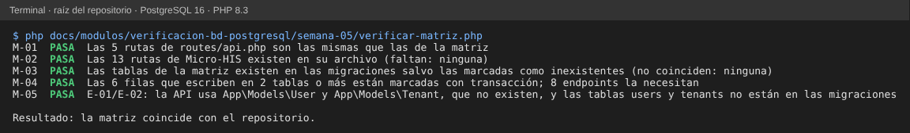
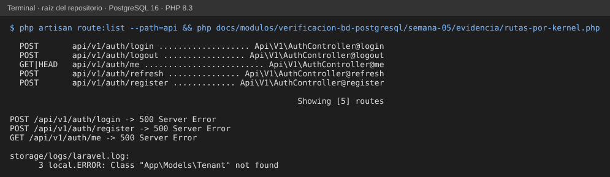

# Semana 5 — Matriz endpoint → tablas → operación, con transacciones

**Estudiante:** Joshua Eduardo García Reyes (`jgarciar73-svg`) · **Módulo:** Verificación de base de datos PostgreSQL (asignado en el tablero del docente)

**Tarea:** mapear qué endpoints de la API leen o escriben cada tabla y detectar operaciones que requieren transacción.

Se revisaron dos fuentes que hoy están en `develop`:

1. **API del grupo (Laravel)**: `routes/api.php` y `AuthController` (5 rutas bajo `/api/v1`).
2. **API de los Micro-HIS de los módulos** que trabajan sobre tablas reales de HOSPITAL (Notas SOAP, Signos vitales, Traslados, Médicos y Reportes).

La tabla se lee así: **L** = lee (SELECT), **I** = inserta, **U** = actualiza. La columna «Tx» dice si la operación necesita **una transacción**: escribe en más de una tabla o tiene que leer y escribir como una sola unidad.

## 1. Matriz

| Endpoint | Fuente | Base | Lee | Escribe | Tx | Motivo |
|---|---|---|---|---|---|---|
| `POST /api/v1/auth/register` | `routes/api.php` | HOSPITAL (conexión por defecto) | `tenants`, `roles` | `users` (I), `model_has_roles` (I) | Sí | Crea el usuario y le asigna el rol: si falla el rol queda un usuario sin permisos. Hoy son 2 sentencias sin `DB::transaction` |
| `POST /api/v1/auth/login` | `routes/api.php` | HOSPITAL | `tenants`, `users`, `roles` | — | No | Solo lectura |
| `GET /api/v1/auth/me` | `routes/api.php` | HOSPITAL | `tenants`, `users`, `roles` | — | No | Solo lectura |
| `POST /api/v1/auth/logout` | `routes/api.php` | HOSPITAL | `tenants` | `cache` (I, lista negra del token) | No | Una sola escritura |
| `POST /api/v1/auth/refresh` | `routes/api.php` | HOSPITAL | `tenants` | `cache` (I, lista negra del token anterior) | No | Una sola escritura |
| `POST /api/v1/notas-soap` | `notas-soap-diagnosticos/.../Http/Rutas.php` | HOSPITAL | `medical_records`, `care_episodes`, `care_assignments`, `local_user_refs` | `clinical_notes` (I), `diagnoses` (I) | Sí | Nota y diagnósticos son una sola unidad (RF-05 del módulo) |
| `GET /api/v1/notas-soap/{notaId}` | `.../Http/Rutas.php` | HOSPITAL | `clinical_notes`, `diagnoses` | — | No | Solo lectura |
| `POST /api/v1/notas-soap/{notaId}/firma` | `.../Http/Rutas.php` | HOSPITAL | `clinical_notes` | `clinical_notes` (U) | Sí | Leer el estado y firmar tiene que ser atómico (`SELECT … FOR UPDATE` o `UPDATE … WHERE status = 'draft'`) para que dos firmas no se crucen |
| `POST /api/v1/notas-soap/{notaId}/correcciones` | `.../Http/Rutas.php` | HOSPITAL | `clinical_notes` | `clinical_notes` (I, con supersedes_id), `diagnoses` (I) | Sí | La versión nueva y sus diagnósticos van juntos; `UNIQUE (medical_record_id, version_no)` decide la carrera |
| `GET /api/v1/expedientes/{expedienteId}/notas-soap` | `.../Http/Rutas.php` | HOSPITAL | `medical_records`, `clinical_notes`, `diagnoses` | — | No | Solo lectura |
| `POST /api/v1/signos-vitales/tomas` | `signos-vitales-alertas/.../Enrutador.php` | HOSPITAL | `medical_records`, `care_episodes`, `care_assignments` | `vital_signs` (I), `alertas_criticas` (I, no existe) | Sí | La toma y su alerta crítica van juntas; la alerta no se puede perder |
| `GET /api/v1/signos-vitales/tomas` | `.../Enrutador.php` | HOSPITAL | `vital_signs` | — | No | Solo lectura |
| `POST /api/v1/traslados-altas/movimientos` | `traslados-altas-camas/.../Enrutador.php` | HOSPITAL | `care_episodes`, `bed_stays`, `beds`, `ordenes_movimiento` (no existe) | `bed_stays` (U + I), `beds` (U ×2), `care_episodes` (U, solo alta), `ordenes_movimiento` (U, no existe) | Sí | Cerrar estancia, liberar cama, abrir estancia y ocupar destino: todo o nada (no hay trigger que sincronice `beds.status`, H-01) |
| `POST /api/v1/medicos` | `medicos-especialidades/.../Enrutador.php` | HOSPITAL | `local_user_refs`, `specialties` | `doctor_profiles` (I), `doctor_specialties` (I) | Sí | Perfil y especialidad principal van juntos |
| `POST /api/v1/medicos/{id}/especialidades` | `.../Enrutador.php` | HOSPITAL | `doctor_profiles`, `specialties` | `doctor_specialties` (I) | No | Una sola fila; la exclusión GiST evita vigencias cruzadas |
| `GET /api/v1/disponibilidad` | `.../Enrutador.php` | HOSPITAL | `doctor_specialties`, `specialties`, `appointments` | — | No | Solo lectura (el horario del médico no tiene tabla, H-03) |
| `GET /api/v1/reportes/{codigo}/exportar` | `reportes-operativos-exportables/.../Enrutador.php` | HOSPITAL | `bed_stays`, `care_episodes`, `beds` | `exportaciones_reporte` (I, no existe) | Sí | Leer con una sola foto de los datos (`REPEATABLE READ`) y registrar la exportación antes de entregarla |
| `POST /api/v1/exportaciones/{id}/reproducir` | `.../Enrutador.php` | HOSPITAL | `exportaciones_reporte` (no existe), `bed_stays`, `care_episodes` | — | No | Solo lectura |

Resumen: **18 endpoints**; **8 necesitan transacción** (1 de la API del grupo y 7 de los Micro-HIS).

## 2. Hallazgos

| ID | Hallazgo | Evidencia | Propuesta |
|---|---|---|---|
| E-01 | **Las 5 rutas de la API del grupo fallan con 500.** `TenantMiddleware` usa `App\Models\Tenant` y `AuthController` usa `App\Models\User`, pero en `app/` no hay carpeta `Models` (H-06 de la semana 4; aquí se confirma ejecutando las rutas). | Ejecución por el kernel de Laravel: las 5 rutas responden 500 con `Class "App\Models\Tenant" not found` (§3). | Crear los modelos sobre las tablas que sí existen (punto E-02). |
| E-02 | **Las tablas que usa la API no existen.** `users`, `tenants`, `roles` y `model_has_roles` no están en ninguna migración. La identidad real está en CENTRAL: `central_users` y `hospital_memberships`, y en cada HOSPITAL: `local_user_refs`. | `verificar-matriz.php` (M-03) busca cada tabla en las migraciones. | `users` → `central_users`; `tenants` → `hospitals` (CENTRAL); rol → `hospital_memberships.role` y `local_user_refs`. La API debe usar la conexión `central` para la cuenta. |
| E-03 | `register` no usa transacción: crea el usuario y después asigna el rol. | Código de `AuthController::register`. | `DB::connection('central')->transaction(...)`. |
| E-04 | 3 tablas que los Micro-HIS escriben no existen en el grupo: `alertas_criticas`, `ordenes_movimiento` y `exportaciones_reporte`. | M-03. | Agregarlas como migraciones de HOSPITAL de cada módulo dueño. |
| E-05 | Ningún endpoint escribe en CENTRAL todavía. La sincronización de la semana 3 (bandeja de salida + `central_inbox_messages`) no tiene endpoint. | Matriz. | Definir el endpoint de envío cuando exista el proceso de sincronización. |

## 3. Evidencia

```
php docs/modulos/verificacion-bd-postgresql/semana-05/verificar-matriz.php
```

El script solo necesita PHP. Lee la matriz de este documento y la compara con el repositorio:

| ID | Comprueba |
|---|---|
| M-01 | Las rutas de `routes/api.php` y las de la matriz son las mismas |
| M-02 | Cada ruta de un Micro-HIS existe en el archivo que la matriz indica |
| M-03 | Cada tabla existe en una migración, salvo las marcadas «no existe», que de verdad no existen |
| M-04 | Toda fila que escribe en 2 tablas o más está marcada «Sí» en Tx |
| M-05 | E-01: no existen `app/Models/User.php` ni `app/Models/Tenant.php` |



Ejecución de las rutas del grupo con el kernel de Laravel y PostgreSQL 16 (bases de prueba del grupo), con `evidencia/rutas-por-kernel.php`:


