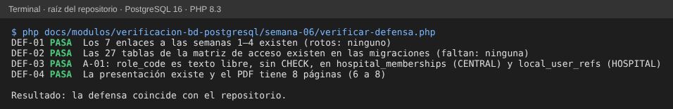

# Semana 6 — Primera evaluación parcial: defensa de las semanas 1 a 5

**Estudiante:** Joshua Eduardo García Reyes (`jgarciar73-svg`) · **Módulo:** Verificación de base de datos PostgreSQL (asignado en el tablero del docente)

**Tarea:** checkpoint del primer parcial: defender el trabajo de las semanas 1–5. **Entregable:** presentación con modelo UML, requisitos de datos, arquitectura federada y matriz de acceso.

- Presentación (8 diapositivas): [`presentacion/semana-06-defensa-verificacion-bd.pptx`](presentacion/semana-06-defensa-verificacion-bd.pptx) y [PDF](presentacion/semana-06-defensa-verificacion-bd.pdf).
- La matriz de acceso es nueva (§2); lo demás resume y conecta las semanas anteriores.

## 1. Guion de la defensa (8 diapositivas, unos 8 minutos)

| # | Diapositiva | Qué se dice | Evidencia |
|---|---|---|---|
| 1 | Qué verifica este módulo | Que el esquema PostgreSQL federado (CENTRAL + una base HOSPITAL por institución) cumple lo que el sistema necesita, con scripts que se pueden volver a correr | README del módulo |
| 2 | Modelo UML (S1) | 15 clases vinculadas a tablas reales; relaciones → llaves foráneas; 5 hallazgos (H-01 cama sin sincronizar, H-03 sin horario del médico…) | [semana-01](../semana-01/semana-01-clases-his-postgresql.md) |
| 3 | Requisitos de datos (S2) | 26 requisitos con mecanismo y criterio ejecutable: 23 cumplidos en PostgreSQL 16 y 3 brechas (RD-03, RD-25, RD-26) | [semana-02](../semana-02/semana-02-requisitos-de-datos.md) |
| 4 | Arquitectura federada (S3) | CENTRAL guarda identidad de red; HOSPITAL guarda la atención. `global_id` es una referencia lógica, sin FK entre bases; bandeja de salida para sincronizar | [semana-03](../semana-03/semana-03-arquitectura-datos-federada.md) |
| 5 | Capas y repositorio (S4) | Cada migración fija su conexión; el código de `app/` usa modelos y tablas que no existen (H-06); `RepositorioPacientes` con 7 consultas y 2 índices propuestos | [semana-04](../semana-04/semana-04-capas-repositorio.md) |
| 6 | API y transacciones (S5) | 18 endpoints, 8 necesitan transacción; las 5 rutas del grupo responden 500 (E-01) | semana-05 (PR de la semana 5) |
| 7 | Matriz de acceso (nueva) | Qué rol lee o escribe cada grupo de tablas, en qué base, y qué falta para que la base lo haga cumplir | §2 |
| 8 | Decisiones y próximos pasos | Las 6 decisiones de la §3 y lo que sigue en las semanas 7 a 11 (auditoría de migraciones, errores, datos de prueba, índices) | §3 |

## 2. Matriz de acceso

**L** = lee · **E** = escribe (inserta o actualiza) · **—** = sin acceso. «Sistema» es el proceso de sincronización (semana 3), no una persona.

| Base | Tablas | Recepción / admisión | Enfermería | Médico | Jefatura / administración | Auditoría | Sistema |
|---|---|---|---|---|---|---|---|
| CENTRAL | `central_users`, `hospital_memberships` | — | — | — | E | L | L |
| CENTRAL | `mpi_patients`, `mpi_identifiers`, `patient_hospital_links` | L | — | — | — | L | E |
| CENTRAL | `patient_consents`, `cross_hospital_access_grants` | E (consentimiento) | — | L (solicita) | E | L | — |
| CENTRAL | `cross_hospital_access_audits`, `break_glass_reviews` | — | — | — | — | E (revisa) | E (registra) |
| CENTRAL | `sync_nodes`, `sync_checkpoints`, `central_inbox_messages` | — | — | — | — | L | E |
| HOSPITAL | `local_patients`, `care_episodes` | E | L | L | L | L | E (vínculo) |
| HOSPITAL | `care_assignments`, `appointments` | E | L | L | L | L | — |
| HOSPITAL | `beds`, `bed_stays` | E (ingreso) | E (traslado y alta) | L | L | L | — |
| HOSPITAL | `medical_records`, `clinical_notes`, `diagnoses` | — | L | E | — | L | — |
| HOSPITAL | `vital_signs`, `allergies` | — | E | E (valida) | — | L | — |
| HOSPITAL | `local_user_refs`, `doctor_profiles`, `specialties`, `doctor_specialties` | L | L | L | E | L | E (refs) |

Qué falta para que la base haga cumplir esta matriz:

| ID | Hallazgo | Propuesta |
|---|---|---|
| A-01 | `role_code` es texto libre en `hospital_memberships` (CENTRAL) y en `local_user_refs` (HOSPITAL): no hay CHECK ni catálogo de roles | Catálogo `roles` o `CHECK (role_code IN (...))` con los 6 roles de esta matriz |
| A-02 | No hay roles de PostgreSQL por perfil: la aplicación entra con un solo usuario de base | Un rol de base de solo lectura para auditoría y reportes, y otro para la aplicación (`GRANT` por tabla) |
| A-03 | El acceso a datos de otro hospital sí está en la base: `cross_hospital_access_grants` exige consentimiento o «break glass» de máximo 1 hora | Mantenerlo; la API todavía no lo usa (semana 5, E-05) |

## 3. Decisiones → evidencia

| Decisión | Por qué | Evidencia |
|---|---|---|
| Verificar con scripts, no solo con documentos | El documento puede envejecer; el script falla si el esquema cambia | [`verificar-correspondencia.php`](../semana-01/verificar-correspondencia.php), [`verificar-requisitos.php`](../semana-02/verificar-requisitos.php) |
| Probar en PostgreSQL real, no solo leer el SQL | RD-03 parecía cubierto y falló al ejecutarse (un CHECK que da NULL deja pasar la fila) | [semana-02 §4](../semana-02/semana-02-requisitos-de-datos.md#4-brechas-y-propuesta) |
| Identidad en CENTRAL, atención en HOSPITAL | Una persona se reconoce en la red sin copiar su historia clínica | [semana-03](../semana-03/semana-03-arquitectura-datos-federada.md) |
| Sin FK entre bases; `global_id` lógico | Son bases distintas; la aplicación concilia | [semana-03](../semana-03/semana-03-arquitectura-datos-federada.md) |
| Dos interfaces de repositorio sin transacción común | HOSPITAL y CENTRAL no comparten transacción | [`RepositorioPacientes.php`](../semana-04/propuesta/RepositorioPacientes.php) |
| Señalar qué endpoints necesitan transacción | 8 de 18 escriben más de una tabla o leen y escriben juntas | semana-05 (PR de la semana 5) |

## 4. Preguntas probables

- **¿Por qué no hay llave foránea de `local_patients` a `mpi_patients`?** Están en bases distintas; PostgreSQL no hace FK entre bases. La integridad se recupera con la conciliación de la semana 3.
- **¿La base impide que un médico lea otro hospital?** Sí para datos de otro hospital: cada hospital tiene su propia base y el cruce pasa por `cross_hospital_access_grants`. Dentro del mismo hospital, hoy no: eso falta (A-01, A-02).
- **¿Qué es lo más urgente?** Que la API del grupo funcione (H-06/E-01): usa tablas que no existen.

## 5. Verificación

`php docs/modulos/verificacion-bd-postgresql/semana-06/verificar-defensa.php` (solo PHP) comprueba: DEF-01 los enlaces a las semanas 1–4 existen; DEF-02 cada tabla de la matriz de acceso existe en las migraciones; DEF-03 A-01 (`role_code` sin CHECK en las dos bases); DEF-04 la presentación y el PDF existen y el PDF tiene 6 a 8 páginas.

