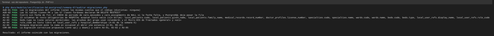
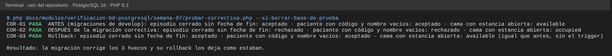

# Semana 7 — Auditoría de migraciones y migración correctiva

**Estudiante:** Joshua Eduardo García Reyes (`jgarciar73-svg`) · **Módulo:** Verificación de base de datos PostgreSQL (asignado en el tablero del docente)

**Tarea:** auditar las migraciones (claves primarias, foráneas, NOT NULL, UNIQUE, CHECK y acciones ON DELETE) y proponer correcciones. **Entregable:** informe por migración con hallazgos y [migración correctiva propuesta](propuesta/2026_10_30_000500_correct_hospital_integrity_gaps.php).

Se auditaron las 11 migraciones de `database/migrations/central` y `database/migrations/hospital` de dos formas: leyendo el SQL (`auditar-migraciones.php`, solo PHP) y ejecutándolas en PostgreSQL 16 y consultando el catálogo (`pg_constraint`, `pg_index`, `information_schema`).

## 1. Informe por migración

Las cuentas son apariciones en el SQL de cada archivo (por ejemplo, un CHECK puede estar dentro de un trigger).

| Migración | Tablas | Con PK | FK | ON DELETE RESTRICT | NOT NULL | UNIQUE | CHECK | Hallazgos |
|---|---|---|---|---|---|---|---|---|
| `2026_08_11_000000_create_network_registry` | 2 | 2 | 1 | 1 | 15 | 2 | 4 | — |
| `2026_08_11_000100_create_identity_and_memberships` | 2 | 2 | 2 | 2 | 15 | 3 | 5 | AU-04 |
| `2026_08_11_000200_create_mpi_tables` | 4 | 4 | 7 | 7 | 34 | 2 | 15 | — |
| `2026_08_11_000300_create_consent_and_access_control` | 4 | 4 | 15 | 15 | 43 | 1 | 20 | — |
| `2026_08_11_000400_create_central_sync_tables` | 3 | 3 | 3 | 3 | 25 | 3 | 15 | — |
| `2026_08_11_000000_enable_hospital_extensions` | 0 | 0 | 0 | 0 | 0 | 0 | 0 | — |
| `2026_08_11_000100_create_local_identity_and_professional_tables` | 4 | 4 | 3 | 3 | 26 | 5 | 6 | AU-02, AU-04 |
| `2026_08_11_000200_create_patient_and_care_tables` | 3 | 3 | 5 | 5 | 29 | 3 | 14 | AU-01, AU-02 |
| `2026_08_11_000300_create_scheduling_and_bed_tables` | 4 | 4 | 7 | 7 | 30 | 3 | 7 | AU-02, AU-03, AU-05 |
| `2026_08_11_000400_create_medical_record_tables` | 3 | 3 | 8 | 8 | 33 | 4 | 13 | AU-02 |
| `2026_08_11_000401_create_allergy_and_vital_sign_tables` | 2 | 2 | 6 | 6 | 25 | 2 | 22 | — |

**Lo que está bien** (confirmado en el catálogo de PostgreSQL): las 31 tablas tienen clave primaria; las 57 llaves foráneas son `ON DELETE RESTRICT` y **todas tienen índice** en sus columnas; las tablas clínicas tienen triggers de retención que impiden borrar; los estados (`status`) tienen CHECK con su lista de valores; las vigencias usan exclusión GiST. No se propone cambiar ningún `ON DELETE`: en datos clínicos borrar en cascada sería perder historia.

## 2. Hallazgos

| ID | Severidad | Hallazgo | Evidencia | Corrección |
|---|---|---|---|---|
| AU-01 | Alta | `care_episodes_status_period_check` y `care_assignments_period_check` comparan `ended_at > started_at` (y `valid_to > valid_from`) sin exigir que la fecha exista. Si falta, la comparación da NULL y PostgreSQL acepta la fila: un episodio «cerrado» sin fecha de fin | RD-03 (semana 2); `COR-01` | Agregar `ended_at IS NOT NULL` / `valid_to IS NOT NULL` al caso de cierre |
| AU-02 | Media | 13 columnas de texto obligatorias de HOSPITAL aceptan texto vacío o espacios: código y nombres del paciente, número de expediente, colegiado, código y nombre de especialidad y de sala, código y tipo de cama, nombre y rol del usuario. Las tablas clínicas sí usan `btrim(...) <> ''` | `AU-02`; `COR-01` | `CHECK (btrim(columna) <> '')` en las 13 |
| AU-03 | Media | `beds.type` no tiene valores permitidos: las pruebas del grupo usan `standard` y el Micro-HIS de Traslados `general` y `uci` | `AU-03` | Que el equipo acuerde el catálogo; mientras tanto, la corrección solo impide el texto vacío |
| AU-04 | Media | `role_code` es texto libre en `hospital_memberships` (CENTRAL) y en `local_user_refs` (HOSPITAL) | A-01 de la semana 6 | Catálogo de roles; la corrección de HOSPITAL impide el texto vacío |
| AU-05 | Alta | Ninguna migración pone la cama en `occupied` al abrir una estancia: una cama puede quedar «disponible» con un paciente adentro | H-01, RD-25; `COR-01` | Trigger `bed_stays_occupy_bed` (al cerrar la estancia, el estado lo decide el módulo de Traslados) |
| AU-06 | Baja | 3 pruebas de rollback del grupo usan `--step` fijo (5, 3, …): cualquier migración nueva de HOSPITAL las rompe aunque no cambie nada de lo que prueban | Al agregar la correctiva, 50 de 53 pruebas pasan y fallan solo esas 3 | Que esas pruebas hagan rollback hasta su migración por nombre, no por número de pasos |

## 3. Migración correctiva propuesta

[`propuesta/2026_10_30_000500_correct_hospital_integrity_gaps.php`](propuesta/2026_10_30_000500_correct_hospital_integrity_gaps.php) (conexión `hospital`). No se copió a `database/migrations/hospital`: la decisión es del equipo, y AU-06 obliga a ajustar 3 pruebas al mismo tiempo.

| Parte | Qué hace | Hallazgo |
|---|---|---|
| CHECK de periodo | Reemplaza los 2 CHECK; mantiene la salida para estados desconocidos para que el error siga siendo el de la lista de estados | AU-01 |
| 13 CHECK `*_not_blank_check` | `btrim(columna) <> ''` | AU-02 (y parte de AU-03, AU-04) |
| Trigger `bed_stays_occupy_bed` | Después de insertar o reabrir una estancia, pone la cama en `occupied` | AU-05 |
| `down()` | Quita todo lo anterior y deja los CHECK originales | — |

Si en una base ya hay filas que violan los nuevos CHECK, la migración falla y no cambia nada (PostgreSQL valida al agregar el CHECK). Antes de aplicarla en una base con datos: `SELECT … FROM care_episodes WHERE status IN ('closed','cancelled') AND ended_at IS NULL` y lo mismo con los textos vacíos.

## 4. Evidencia

```bash
php docs/modulos/verificacion-bd-postgresql/semana-07/auditar-migraciones.php     # solo PHP
php docs/modulos/verificacion-bd-postgresql/semana-07/probar-correctiva.php --si-borrar-base-de-prueba   # PostgreSQL de prueba (*_test) y composer install
```

`auditar-migraciones.php` recalcula la tabla de la §1 desde el código (AUD-01, AUD-02) y comprueba AU-01 a AU-05 en el SQL.



`probar-correctiva.php` ejecuta las migraciones reales en PostgreSQL 16 y prueba los 3 huecos antes, después de la correctiva y otra vez después de su rollback:



Con la correctiva agregada a las migraciones de HOSPITAL, la suite de base de datos del grupo (`phpunit --testsuite Database`) pasa 50 de 53 pruebas; fallan solo las 3 de AU-06.
