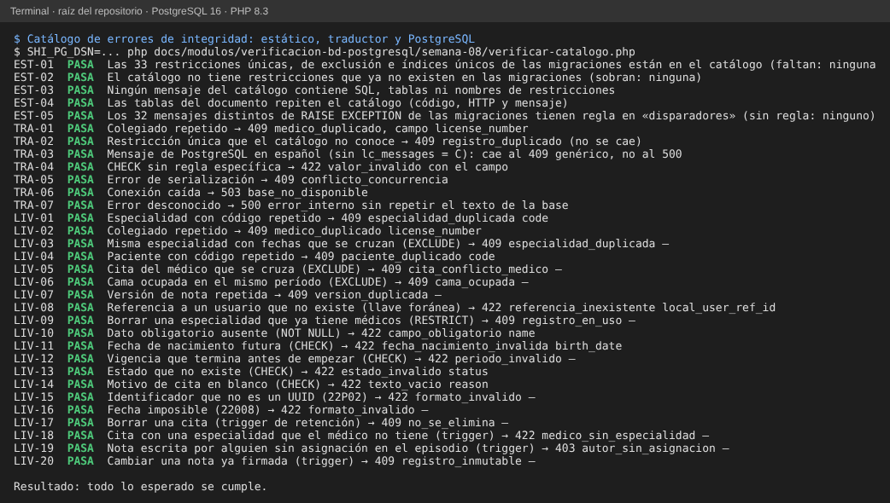

# Semana 8 — Errores de integridad: catálogo «violación de restricción → mensaje → HTTP»

**Estudiante:** Joshua Eduardo García Reyes (`jgarciar73-svg`) · **Módulo:** Verificación de base de datos PostgreSQL

La base ya impide los datos inválidos (duplicados, referencias inexistentes, datos obligatorios, fechas imposibles). Lo que falta es decidir **qué ve el usuario** cuando eso ocurre. Este documento define el catálogo, el traductor que lo aplica ([`traductor/`](traductor/)) y un script que lo comprueba contra las migraciones reales y contra PostgreSQL ([`verificar-catalogo.php`](verificar-catalogo.php)). Regla de oro: **el usuario nunca ve SQL, tablas ni nombres de restricciones**; ve un código estable (para el cliente), un mensaje en español y, si aplica, el campo que debe corregir.

## 1. Reglas generales (por SQLSTATE)

| SQLSTATE | Qué pasó | HTTP | Código | Campo |
|---|---|---|---|---|
| `23505` único, `23P01` exclusión | Duplicado o cruce de períodos | 409 | uno por restricción (§2); si no está en el catálogo, `registro_duplicado` | Si la restricción es de una sola columna |
| `23503` al insertar o actualizar | Referencia a un registro que no existe | 422 | `referencia_inexistente` | La columna (`tabla_columna_fkey`) |
| `23503` al borrar o cambiar | Otros registros dependen de este (las 57 llaves son `ON DELETE RESTRICT`) | 409 | `registro_en_uso` | — |
| `23502` NOT NULL | Falta un dato obligatorio | 422 | `campo_obligatorio` | La columna |
| `23514` CHECK | Valor que incumple una regla | 422 | una por patrón (§3); si no hay, `valor_invalido` | La columna (`tabla_columna_check`) |
| `22xxx` | Dato con formato inválido (UUID, fecha, número) | 422 | `formato_invalido` | — |
| `P0001` trigger | Regla de negocio de un trigger | 403, 409 o 422 | una por regla (§4); si no hay, `regla_no_cumplida` | — |
| `40001`, `40P01` | Serialización o interbloqueo | 409 | `conflicto_concurrencia` (el cliente puede reintentar) | — |
| `08xxx`, `57P01`, `57014`, `53300` | Conexión caída, tiempo agotado, sin conexiones | 503 | `base_no_disponible` | — |
| Cualquier otro | Error no previsto | 500 | `error_interno` (sin repetir el texto de la base) | — |

Criterio de los códigos HTTP: **409** cuando el dato es válido pero choca con el estado actual (duplicado, cruce, versión, inmutable); **422** cuando el dato mismo es inválido; **403** cuando el trigger niega por falta de asignación. Los códigos `especialidad_duplicada` y `medico_duplicado` son **los mismos** del contrato del módulo Médicos, para que la API de Médicos y la base digan lo mismo.

## 2. Restricciones únicas, de exclusión e índices únicos (33, todas HTTP 409)

| Restricción | Código | HTTP | Mensaje para el usuario |
|---|---|---|---|
| `networks_name_unique` | `red_duplicada` | 409 | Ya existe una red con ese nombre |
| `hospitals_network_code_unique` | `hospital_duplicado` | 409 | Ya existe un hospital con ese código en la red |
| `central_users_subject_unique` | `usuario_duplicado` | 409 | Esa identidad ya está registrada |
| `central_users_email_lower_unique` | `correo_duplicado` | 409 | Ese correo ya está registrado |
| `hospital_memberships_active_open_unique` | `membresia_duplicada` | 409 | El usuario ya tiene ese rol activo en el hospital |
| `patient_hospital_links_hospital_patient_unique` | `vinculo_duplicado` | 409 | El paciente ya está vinculado a ese hospital |
| `mpi_identifiers_active_identity_unique` | `identificador_duplicado` | 409 | Ese identificador ya está activo para un paciente |
| `break_glass_reviews_supersedes_id_unique` | `revision_ya_reemplazada` | 409 | Esa revisión ya fue reemplazada por otra |
| `sync_nodes_hospital_id_unique` | `nodo_duplicado` | 409 | El hospital ya tiene un nodo de sincronización |
| `sync_checkpoints_node_channel_unique` | `punto_control_duplicado` | 409 | Ya existe un punto de control para ese canal |
| `central_inbox_messages_source_event_unique` | `evento_duplicado` | 409 | Ese evento ya se había recibido |
| `local_user_refs_central_user_unique` | `usuario_local_duplicado` | 409 | Ese usuario ya existe en el hospital |
| `local_user_refs_membership_unique` | `usuario_local_duplicado` | 409 | Esa membresía ya está asociada a un usuario del hospital |
| `specialties_code_unique` | `especialidad_duplicada` | 409 | Ya existe una especialidad con ese código |
| `doctor_profiles_license_number_unique` | `medico_duplicado` | 409 | Ya existe un médico con ese colegiado |
| `doctor_profiles_active_open_user_unique` | `medico_duplicado` | 409 | Ese usuario ya tiene un perfil de médico activo |
| `doctor_specialties_active_period_exclusion` | `especialidad_duplicada` | 409 | El médico ya tiene esa especialidad en esas fechas |
| `doctor_specialties_primary_period_exclusion` | `especialidad_duplicada` | 409 | El médico ya tiene otra especialidad principal en esas fechas |
| `local_patients_global_id_unique` | `paciente_duplicado` | 409 | Ese paciente ya está registrado en el hospital |
| `local_patients_code_unique` | `paciente_duplicado` | 409 | Ya existe un paciente con ese código |
| `care_assignments_active_equivalent_unique` | `asignacion_duplicada` | 409 | Esa asignación ya está activa para el episodio |
| `appointments_doctor_active_period_exclusion` | `cita_conflicto_medico` | 409 | El médico ya tiene una cita en ese horario |
| `appointments_patient_active_period_exclusion` | `cita_conflicto_paciente` | 409 | El paciente ya tiene una cita en ese horario |
| `wards_code_unique` | `servicio_duplicado` | 409 | Ya existe un servicio con ese código |
| `beds_ward_code_unique` | `cama_duplicada` | 409 | Ya existe una cama con ese código en el servicio |
| `bed_stays_bed_active_period_exclusion` | `cama_ocupada` | 409 | La cama ya está ocupada en ese período |
| `bed_stays_open_care_episode_unique` | `episodio_con_cama` | 409 | El episodio ya tiene una cama asignada |
| `medical_records_local_patient_id_unique` | `expediente_duplicado` | 409 | El paciente ya tiene expediente |
| `medical_records_record_number_unique` | `expediente_duplicado` | 409 | Ya existe un expediente con ese número |
| `clinical_notes_record_version_unique` | `version_duplicada` | 409 | Otra persona guardó antes una versión de la nota; recargue y vuelva a intentar |
| `clinical_notes_supersedes_unique` | `nota_ya_corregida` | 409 | Esa nota ya fue corregida por otra versión |
| `allergies_active_equivalent_unique` | `alergia_duplicada` | 409 | El paciente ya tiene registrada esa alergia |
| `vital_signs_supersedes_unique` | `registro_ya_corregido` | 409 | Ese registro de signos vitales ya fue corregido |

## 3. Reglas CHECK (HTTP 422)

Hay más de 120 CHECK en las migraciones; en vez de una fila por cada uno, se agrupan por el patrón del nombre. La primera regla que coincide gana; el resto cae en `valor_invalido` («Hay un valor que no es válido») con el campo para resaltarlo.

| Código | HTTP | Mensaje para el usuario |
|---|---|---|
| `fecha_nacimiento_invalida` | 422 | La fecha de nacimiento no puede ser futura |
| `periodo_invalido` | 422 | La fecha de fin debe ser posterior a la de inicio |
| `estado_invalido` | 422 | El estado indicado no está permitido |
| `texto_vacio` | 422 | Falta un texto: no puede quedar en blanco |
| `version_invalida` | 422 | El número de versión no es válido |
| `medida_fuera_de_rango` | 422 | La medida está fuera del rango permitido |

## 4. Triggers (RAISE EXCEPTION, SQLSTATE P0001)

Las migraciones tienen 32 mensajes distintos de `RAISE EXCEPTION`. Se agrupan en 11 reglas:

| Código | HTTP | Mensaje para el usuario |
|---|---|---|
| `autor_sin_asignacion` | 403 | No tiene una asignación activa en este episodio |
| `episodio_no_corresponde` | 422 | El episodio, la nota o el autor no corresponden a este paciente |
| `correccion_invalida` | 422 | Una corrección debe reemplazar a la versión vigente, no a sí misma |
| `version_incoherente` | 409 | La versión indicada no sigue a la versión que se corrige |
| `registro_inmutable` | 409 | El registro ya no admite cambios; registre una corrección o una nueva versión |
| `no_se_elimina` | 409 | Este registro no se puede eliminar; cancélelo o corríjalo |
| `medico_sin_especialidad` | 422 | El médico no tiene esa especialidad vigente en la fecha indicada |
| `estancia_fuera_de_episodio` | 422 | La estancia debe quedar dentro del período del episodio |
| `consentimiento_requerido` | 403 | Se necesita un consentimiento vigente que cubra este acceso |
| `revision_sin_acceso_de_emergencia` | 422 | La revisión necesita un acceso de emergencia asociado |
| `revision_vigente_existente` | 409 | Ese acceso de emergencia ya tiene una revisión vigente |

## 5. Uso y límites

```php
try { $repositorio->registrar($paciente); }
catch (\PDOException $e) { [$http, $cuerpo] = [($t = $traductor->traducir($e))['http'], $t]; }   // $t['codigo'], $t['mensaje'], $t['campo']
```

- El nombre de la restricción se lee del texto del error, que PostgreSQL escribe en el idioma del servidor. La conexión debe usar `lc_messages = 'C'` (por ejemplo `ALTER ROLE app SET lc_messages = 'C'`). Si no, el traductor **no se cae**: responde con el código genérico de la clase (`registro_duplicado`, `valor_invalido`…) y el mismo HTTP.
- PDO no entrega el nombre de la restricción en un campo aparte, solo el texto: por eso se lee con una expresión regular.

## 6. Evidencia

`php docs/modulos/verificacion-bd-postgresql/semana-08/verificar-catalogo.php` (con `SHI_PG_DSN` para la parte de PostgreSQL):

| Nivel | Pruebas | Qué comprueban |
|---|---|---|
| Estático | EST-01 a EST-05 | El catálogo cubre las 33 restricciones y los 32 mensajes de triggers de las migraciones, no tiene sobrantes, ningún mensaje contiene términos técnicos y las tablas de este documento son idénticas al catálogo |
| Traductor | TRA-01 a TRA-07 | Errores construidos a mano: restricción desconocida, mensaje en español, serialización, conexión caída, error no previsto |
| PostgreSQL 16 | LIV-01 a LIV-20 | Esquema temporal con las migraciones de HOSPITAL; cada fila provoca la violación real y comprueba HTTP, código y campo, y que el mensaje no lleve nombres técnicos |



Para saber si el script detecta de verdad, se provocaron seis fallos y cada uno hizo fallar la prueba esperada: quitar una restricción del catálogo (EST-01), poner «constraint» en un mensaje (EST-03), cambiar un mensaje del documento (EST-04), añadir un `RAISE EXCEPTION` sin regla (EST-05), cambiar 409 por 400 en las únicas (LIV-01 a LIV-07) y quitar la regla de `P0001` (LIV-17 a LIV-20).

## 7. Hallazgos

| ID | Hallazgo | Propuesta |
|---|---|---|
| H-10 | El texto de los `RAISE EXCEPTION` de HOSPITAL es un identificador técnico (`clinical_notes_signed_immutable`) y el de CENTRAL son frases en inglés. Ninguno es presentable ni distingue el error sin leer el texto. | Unificar: `RAISE EXCEPTION USING ERRCODE = 'P0001', MESSAGE = '<código>'`, con el código estable del catálogo como mensaje. |
| H-11 | El traductor depende del idioma del servidor (`lc_messages`) para leer la restricción. | Fijar `lc_messages = 'C'` por rol en el despliegue; el catálogo ya degrada a códigos genéricos si no se cumple. |
| H-12 | Las 57 llaves foráneas son `RESTRICT` y 8 tablas (alergias, citas, estancias de cama, asignaciones, notas, diagnósticos, expedientes y signos vitales) tienen triggers que prohíben borrar: en la práctica no hay borrado físico. | Dejarlo así y exponer «cancelar» o «corregir» en vez de «eliminar»; el mensaje de `no_se_elimina` ya lo dice. |

## 8. Límites

- CENTRAL solo se verifica de forma estática (EST-01 y EST-05); las pruebas en PostgreSQL usan el esquema de HOSPITAL.
- Los mensajes son propuestas de redacción; el equipo de UX debe revisarlos.
- Hace falta la extensión `pdo_pgsql` y `SHI_PG_DSN` para los LIV; sin ellos el script informa «Ejecución: OMITIDA».
