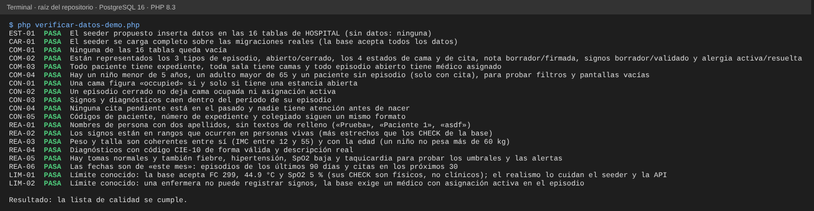

# Semana 9 — Calidad de los datos de prueba (seeders) de la base HOSPITAL

**Estudiante:** Joshua Eduardo García Reyes (`jgarciar73-svg`) · **Módulo:** Verificación de base de datos PostgreSQL

La tarea pide evaluar los datos de prueba (completitud, consistencia y realismo) para validar pantallas y reportes, y entregar la lista de calidad con los seeders corregidos o propuestos. Primero se revisó lo que hay en `develop`; como no hay nada que evaluar, se propone un seeder y la lista se aplica a él.

## 1. Qué hay hoy en develop

- `database/seeders/` tiene un solo archivo, `DatabaseSeeder.php`: 13 líneas, método `run()` vacío con el comentario «Federated seeders are added with their connection-pinned schemas». Su último cambio es el commit `45cf46a` (6-oct, «replace SQLite scaffold with federated PostgreSQL conn…»), que reemplazó el andamio SQLite.
- No hay fábricas ni seeders por conexión. Con `php artisan migrate --seed` las 16 tablas de HOSPITAL quedan vacías, y las pantallas de cada módulo muestran «sin datos» o fallan.
- Cada Micro-HIS del curso trae sus propios datos demo, pero en SQLite y con sus propias tablas; no sirven para probar el esquema real de PostgreSQL.

## 2. Lista de calidad

Resultado sobre el seeder de develop y sobre el seeder propuesto (§3). «ID» es el nombre de la verificación en `verificar-datos-demo.php`.

| ID | Criterio | Develop | Propuesta |
|---|---|---|---|
| COM-01 | Ninguna tabla queda vacía | FALLA (0 de 16 tablas con datos) | PASA |
| COM-02 | Están todos los estados: 3 tipos de episodio, abierto/cerrado, 4 estados de cama y de cita, nota borrador/firmada, signos borrador/validado, alergia activa/resuelta | FALLA | PASA |
| COM-03 | Todo paciente tiene expediente, toda sala tiene camas, todo episodio abierto tiene médico asignado | FALLA | PASA |
| COM-04 | Hay un niño, un adulto mayor y un paciente sin episodio (para filtros y pantallas vacías) | FALLA | PASA |
| CON-01 | Cama «occupied» si y solo si tiene una estancia abierta | no aplica | PASA |
| CON-02 | Episodio cerrado sin cama ocupada ni asignación activa | no aplica | PASA |
| CON-03 | Signos y diagnósticos dentro del período de su episodio | no aplica | PASA |
| CON-04 | Ninguna cita pendiente en el pasado; nadie atendido antes de nacer | no aplica | PASA |
| CON-05 | Códigos de paciente, expediente y colegiado con formato uniforme | no aplica | PASA |
| REA-01 | Nombres con dos apellidos, sin «Prueba», «Paciente 1», «asdf» | no aplica | PASA |
| REA-02 | Signos en rangos de personas vivas (más estrechos que los CHECK) | no aplica | PASA |
| REA-03 | Peso, talla y edad coherentes (IMC 12–55; niño de menos de 12 años no pesa más de 60 kg) | no aplica | PASA |
| REA-04 | Códigos CIE-10 de forma válida y descripción real | no aplica | PASA |
| REA-05 | Hay tomas normales y también fiebre, hipertensión, SpO2 baja y taquicardia, para probar umbrales y alertas | no aplica | PASA |
| REA-06 | Fechas de «este mes»: episodios de los últimos 90 días, citas en los próximos 30 | no aplica | PASA |

Además, `CAR-01` comprueba que la base acepta el seeder completo sobre las migraciones reales y `EST-01` que cubre las 16 tablas. `LIM-01` y `LIM-02` documentan dos límites de la base (§4).

## 3. Seeder propuesto

`propuesta/datos-demo-hospital.sql` (110 líneas) y `propuesta/HospitalDemoSeeder.php`, que lo ejecuta en la conexión `hospital` y no hace nada en producción.

| Tabla | Filas | Tabla | Filas |
|---|---:|---|---:|
| `local_user_refs` | 6 (3 médicos, 2 enfermeras, 1 admisión) | `care_episodes` | 7 (3 tipos, 4 abiertos y 3 cerrados) |
| `specialties` / `doctor_profiles` / `doctor_specialties` | 3 / 3 / 3 | `care_assignments` | 7 |
| `wards` / `beds` | 4 / 9 (4 ocupadas) | `bed_stays` | 4 (todas abiertas) |
| `local_patients` / `medical_records` | 8 / 8 (de 2 a 76 años) | `clinical_notes` / `diagnoses` | 3 / 6 |
| `appointments` | 5 (2 días, 7 días, 3 días, una completada y una cancelada) | `vital_signs` / `allergies` | 9 / 3 |

Decisiones de diseño:

- **Sin personas reales.** Nombres y apellidos comunes en Guatemala, combinados a mano; teléfonos y colegiados inventados.
- **Ids fijos** con `md5('clave')::uuid`: cada corrida produce los mismos ids y los scripts de otros módulos pueden referirse a ellos. Está pensado para una base recién migrada (`migrate:fresh --seed`) y va en una sola transacción.
- **Fechas relativas a `now()`**, para que el hospital de prueba siempre sea «de hoy».
- **Cuatro historias**: diabético hospitalizado con hipertensión y alergia grave a penicilinas, niño de 7 años con neumonía y SpO2 91 % (alerta), paciente de emergencia con fiebre, y postoperatorio sin complicaciones. Dan datos para Médicos, Traslados, Signos y Reportes sin salirse de HOSPITAL.
- Las asignaciones de los episodios cerrados se crean activas y se cierran al final del archivo, porque la base solo deja firmar a quien tiene la asignación activa (H-14).

## 4. Hallazgos

| ID | Severidad | Hallazgo | Consecuencia y propuesta |
|---|---|---|---|
| H-13 | Alta | `DatabaseSeeder` no inserta nada: una base recién migrada queda sin un solo dato. | Adoptar el seeder de §3 y llamarlo desde `DatabaseSeeder`. |
| H-14 | Alta | Los triggers de `vital_signs`, `clinical_notes` y `diagnoses` exigen que el autor tenga un perfil de médico (`doctor_profiles`) con asignación activa en el episodio. Una enfermera no puede registrar signos vitales (`vital_signs_author_assignment_trigger`, probado en `LIM-02`). | Decidir con el módulo Signos si las enfermeras deben poder registrar; si es así, la regla de la base debe cambiar (por ejemplo, validar el rol en `local_user_refs`). Hasta entonces los datos demo de signos van firmados por médicos. |
| H-15 | Media | Los CHECK de `vital_signs` son físicos, no clínicos: aceptan FC 299, 44.9 °C o SpO2 5 % (`LIM-01`). Además nada mantiene `beds.status = 'occupied'` sincronizado con `bed_stays`; solo el seeder y la API lo cuidan (CON-01). | Los umbrales clínicos y la sincronización de camas son responsabilidad del código de aplicación; el seeder queda estricto para no sembrar valores absurdos. |

## 5. Evidencia

Con PostgreSQL 16 (`SHI_PG_DSN`, `SHI_PG_USER` y `SHI_PG_PASS` en el entorno), desde la raíz del repositorio:

```
php docs/modulos/verificacion-bd-postgresql/semana-09/verificar-datos-demo.php
```



Sin esas variables el script imprime `EST-01` y «Ejecución: OMITIDA». Para comprobar que la lista detecta datos malos se dañó el seeder a propósito, una vez por cada fila; las 8 fallas se detectaron y el seeder original pasa:

| Daño | Verificación que falla |
|---|---|
| Se quita el INSERT de `allergies` | `EST-01`, `COM-01`, `COM-02` |
| Cama con estancia abierta marcada «available» | `CON-01` |
| Temperatura de 44.9 °C | `REA-02` |
| Paciente llamado «Paciente Prueba» | `REA-01` |
| Niño de 7 años con 185 kg | `REA-03` |
| Diagnóstico con código «neumonia» | `REA-04` |
| Cita «scheduled» hace 3 días | `CON-04` |
| Ninguna toma con fiebre, hipertensión ni SpO2 baja | `REA-05` |

## 6. Límites

- Solo cubre la base HOSPITAL (16 tablas). La base CENTRAL necesita su propio seeder y no se revisó en esta semana.
- `HospitalDemoSeeder.php` pasa la revisión de sintaxis, pero no se ejecutó dentro de Laravel; lo verificado contra PostgreSQL es el archivo SQL que carga.
- La forma del código CIE-10 se valida con una expresión regular, no contra el catálogo oficial.
- Los datos son ficticios y la lista de calidad no sustituye pruebas con datos reales anonimizados.
