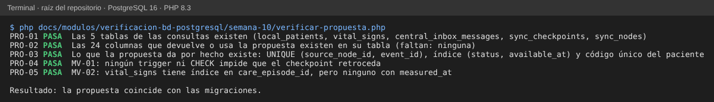
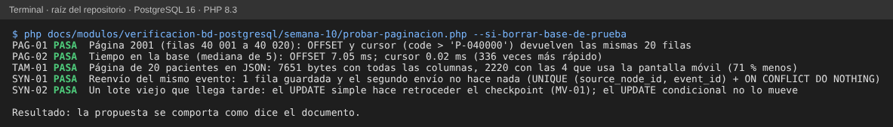

# Semana 10 — Consultas para clientes móviles: paginación, tamaño de respuesta y sincronización

**Estudiante:** Joshua Eduardo García Reyes (`jgarciar73-svg`) · **Módulo:** Verificación de base de datos PostgreSQL (asignado en el tablero del docente)

**Tarea:** analizar consultas para clientes móviles (paginación, tamaño de respuesta y conexión intermitente usando las tablas de sincronización central). **Entregable:** propuesta de paginación y sincronización con ejemplos de consulta.

Supuesto de la propuesta: el celular **nunca** habla con CENTRAL. Habla con la API de su hospital; el hospital sincroniza con CENTRAL por `sync_nodes`, `sync_checkpoints` y `central_inbox_messages` (arquitectura de la semana 3).

## 1. Paginación por cursor, no por OFFSET

`OFFSET n` obliga a PostgreSQL a leer y descartar las `n` filas anteriores: cuanto más lejos está la página, más lenta. Con un **cursor** (el último valor que vio el celular), la base salta directo con el índice. Además, si entra una fila nueva mientras se pasa de página, el cursor no repite ni salta filas.

| Pantalla móvil | Orden (desempate) | Columnas que devuelve | Índice | Página |
|---|---|---|---|---|
| Admisión: lista de pacientes | `code` | `local_patient_id`, `code`, `given_name`, `family_name`, `sex` | `local_patients_code_unique` (existe) | 20 |
| Enfermería: tomas del episodio | `measured_at` descendente (`vital_sign_id`) | `vital_sign_id`, `measured_at`, `heart_rate`, `oxygen_saturation`, `temperature`, `status` | falta (MV-02) | 10 |
| Traslados: camas de una sala | `code` | `bed_id`, `code`, `type`, `status` | `beds_ward_id_index` (existe) | todas (pocas por sala) |

```sql
-- Primera página (admisión)
SELECT local_patient_id, code, given_name, family_name, sex FROM local_patients ORDER BY code LIMIT 20;
-- Siguientes: el celular manda el último code que recibió (cursor)
SELECT local_patient_id, code, given_name, family_name, sex FROM local_patients WHERE code > :ultimo_code ORDER BY code LIMIT 20;
-- Tomas del episodio, de la más reciente a la más antigua
SELECT vital_sign_id, measured_at, heart_rate, oxygen_saturation, temperature, status FROM vital_signs
 WHERE care_episode_id = :episodio AND (measured_at, vital_sign_id) < (:ultima_hora, :ultimo_id)
 ORDER BY measured_at DESC, vital_sign_id DESC LIMIT 10;
```

La API devuelve el cursor como un texto opaco (`siguiente`) y `null` cuando no hay más; el celular no arma consultas ni números de página.

## 2. Tamaño de la respuesta

- Solo las columnas que la pantalla muestra (tabla de la §1). Nada de `SELECT *`: `contact`, `global_id`, `created_at` y `updated_at` no se usan en el celular.
- Página fija de 10 a 20 filas; el texto largo (notas clínicas) se pide aparte, al abrir el detalle.
- Medido en PostgreSQL 16 con 50 000 pacientes (§5): 20 pacientes pesan **7 651 bytes** con todas las columnas y **2 220 bytes** con las 4 que usa la pantalla (**71 % menos**).

## 3. Conexión intermitente

| Paso | Dónde | Consulta | Por qué funciona sin conexión estable |
|---|---|---|---|
| 1. El celular guarda la acción con un id propio (uuid) | Celular | — | Si se corta, la reenvía con el mismo id |
| 2. La API del hospital la recibe con `Idempotency-Key` | HOSPITAL | Como en la semana 5 de los Micro-HIS | Un reintento no duplica |
| 3. El hospital deja el evento en su bandeja de salida en la misma transacción | HOSPITAL | (propuesta de la semana 3) | No se pierde aunque CENTRAL no responda |
| 4. El hospital envía el lote a CENTRAL | CENTRAL | `INSERT INTO central_inbox_messages (source_node_id, event_id, event_type, payload_minimal) VALUES (…) ON CONFLICT (source_node_id, event_id) DO NOTHING` | `UNIQUE (source_node_id, event_id)`: un lote repetido no duplica |
| 5. CENTRAL procesa en orden | CENTRAL | `SELECT … FROM central_inbox_messages WHERE status = 'pending' AND available_at <= now() ORDER BY available_at LIMIT 100 FOR UPDATE SKIP LOCKED` | Índice `(status, available_at)`; dos procesos no toman el mismo mensaje |
| 6. Se mueve el checkpoint solo hacia adelante | CENTRAL | `UPDATE sync_checkpoints SET last_event_id = :id, last_occurred_at = :t, lag_seconds = … WHERE node_id = :nodo AND channel = :canal AND (last_occurred_at IS NULL OR last_occurred_at < :t)` | Un lote viejo que llega tarde no retrocede (MV-01) |
| 7. El nodo avisa que está vivo | CENTRAL | `UPDATE sync_nodes SET last_seen_at = now(), status = 'active' WHERE node_id = :nodo` | Se sabe qué hospital lleva cuánto sin sincronizar |

## 4. Hallazgos

| ID | Hallazgo | Propuesta |
|---|---|---|
| MV-01 | Nada impide que `sync_checkpoints.last_occurred_at` retroceda: un `UPDATE` simple con un lote viejo lo mueve hacia atrás (SYN-02) | Usar siempre el `UPDATE` condicional del paso 6, o un trigger que lo rechace |
| MV-02 | `vital_signs` solo tiene índice de una columna en `care_episode_id`: la lista de tomas ordenada por hora tiene que ordenar en memoria | Índice `(care_episode_id, measured_at DESC, vital_sign_id DESC)`; se mide en la semana 11 |
| MV-03 | Las tablas de HOSPITAL no tienen una columna común de «cambiado en» (`vital_signs` usa `recorded_at`, otras `updated_at`) para pedir «lo que cambió desde mi última conexión» | Acordar `updated_at` con trigger en las tablas que el celular guarda localmente |

## 5. Evidencia

```bash
php docs/modulos/verificacion-bd-postgresql/semana-10/verificar-propuesta.php        # solo PHP
php docs/modulos/verificacion-bd-postgresql/semana-10/probar-paginacion.php --si-borrar-base-de-prueba   # PostgreSQL de prueba (*_test) y composer install
```

`verificar-propuesta.php` comprueba que las tablas, columnas e índices que nombra este documento existen (o faltan, si así lo dice).



`probar-paginacion.php` carga 50 000 pacientes y mide: misma página con OFFSET y con cursor, el tiempo de cada una, el tamaño en JSON, el reenvío de un evento y el checkpoint que retrocede.


