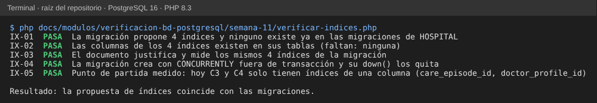
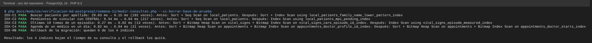

# Semana 11 — Consultas frecuentes con EXPLAIN ANALYZE e índices propuestos

**Estudiante:** Joshua Eduardo García Reyes (`jgarciar73-svg`) · **Módulo:** Verificación de base de datos PostgreSQL (asignado en el tablero del docente)

**Tarea:** medir consultas frecuentes con EXPLAIN ANALYZE y proponer índices justificados. **Entregable:** planes de ejecución antes/después e índices propuestos como migración: [`propuesta/2026_10_30_000600_add_frequent_query_indexes.php`](propuesta/2026_10_30_000600_add_frequent_query_indexes.php).

## 1. Cómo se midió

- PostgreSQL 16 con las migraciones reales de HOSPITAL y datos de prueba: **100 000 pacientes** (2 % pendientes de vincular con CENTRAL), **300 000 tomas de signos vitales** en 1 000 episodios y **60 000 citas** de 40 médicos.
- Cada consulta se corre 7 veces con `EXPLAIN (ANALYZE, BUFFERS)` y se toma la mediana del tiempo de ejecución en la base; después se aplica la migración, se corre `ANALYZE` y se repite. Al final se hace el rollback de la migración.
- Las 4 consultas salen de pantallas y procesos ya descritos: búsqueda en admisión y pendientes de vínculo (`RepositorioPacientes`, semana 4), tomas del episodio (enfermería, semana 10) y agenda del médico (Médicos y Citas).

## 2. Resultados

| ID | Consulta | Antes | Después | Índice propuesto | Mejora |
|---|---|---|---|---|---|
| C1 | `lower(family_name) LIKE 'orellana 77%'`, 20 filas | Seq Scan de 100 000 filas, 29.0 ms | Bitmap Index Scan, 0.15 ms | `local_patients_family_name_lower_pattern_index` | ~190× |
| C2 | Pendientes de vincular, los 100 más antiguos | Seq Scan + Sort, 9.3 ms | Index Scan del índice parcial, 0.04 ms | `local_patients_mpi_pending_index` | ~200× |
| C3 | Últimas 10 tomas de un episodio | Índice de `care_episode_id` + Sort de 300 filas, 0.27 ms | Index Scan en orden, sin Sort, 0.02 ms | `vital_signs_episode_measured_index` | ~13× |
| C4 | Citas de un médico en un día | Índice de `doctor_profile_id` (1 500 citas) + filtro por fecha, 0.82 ms | Índice por médico y hora, 0.04 ms | `appointments_doctor_starts_index` | ~20× |

Los tiempos cambian un poco en cada corrida; lo que se mantiene es el tipo de plan (de recorrer la tabla a leer el índice) y el orden de magnitud. Los planes completos antes y después están en la [captura de los planes](evidencia/planes-antes-despues.png).

## 3. Por qué cada índice

| Índice | Justificación | Costo |
|---|---|---|
| `local_patients (lower(family_name) text_pattern_ops, given_name)` | `LIKE 'pre%'` sobre `lower()` solo usa un índice sobre la **misma expresión** y con `text_pattern_ops`; un índice normal sobre `family_name` no sirve | Un índice más que mantener al registrar pacientes (pocos por minuto) |
| `local_patients (created_at, local_patient_id) WHERE mpi_link_status = 'pending'` | **Parcial**: solo guarda los pendientes (2 %), así que es pequeño y la cola de sincronización (semana 10) sale en orden sin ordenar | Casi nulo: los pacientes vinculados no entran |
| `vital_signs (care_episode_id, measured_at DESC, vital_sign_id DESC)` | Es el orden exacto de la pantalla y del cursor de la semana 10 (MV-02): la base lee las 10 primeras y se detiene | La tabla que más crece; vale la pena porque se consulta en cada ronda de enfermería |
| `appointments (doctor_profile_id, starts_at)` | La agenda filtra por médico **y** rango de horas; con solo `doctor_profile_id` se leen todas las citas del médico | Se mantiene al agendar |

Se revisaron y **no** necesitan índice nuevo: la bandeja de CENTRAL (`central_inbox_messages (status, available_at)` ya existe) y las llaves foráneas (las 57 ya tienen índice, semana 7).

## 4. Migración propuesta

- Conexión `hospital`; `CREATE INDEX CONCURRENTLY IF NOT EXISTS` para no bloquear las escrituras mientras se crea (por eso `$withinTransaction = false`).
- `down()` quita los 4 índices con `DROP INDEX CONCURRENTLY IF EXISTS`.
- No se copió a `database/migrations/hospital`: la decisión es del equipo, y al agregarla hay que ajustar las 3 pruebas de rollback con `--step` fijo (AU-06 de la semana 7).

## 5. Evidencia

```bash
php docs/modulos/verificacion-bd-postgresql/semana-11/verificar-indices.php     # solo PHP
php docs/modulos/verificacion-bd-postgresql/semana-11/medir-consultas.php --si-borrar-base-de-prueba [--mostrar-planes]   # PostgreSQL de prueba (*_test) y composer install
```




