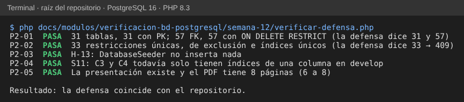

# Semana 12 — Segunda evaluación parcial: defensa de las semanas 7 a 11

**Estudiante:** Joshua Eduardo García Reyes (`jgarciar73-svg`) · **Módulo:** Verificación de base de datos PostgreSQL (asignado en el tablero del docente)

**Tarea:** checkpoint del segundo parcial: defender el trabajo de las semanas 7–11. **Entregable:** presentación con auditoría de migraciones, manejo de errores, calidad de datos e índices.

- Presentación (8 diapositivas): [`presentacion/semana-12-defensa-verificacion-bd.pptx`](presentacion/semana-12-defensa-verificacion-bd.pptx) y [PDF](presentacion/semana-12-defensa-verificacion-bd.pdf).
- Cada semana está en su propia carpeta (`semana-07` a `semana-11`) y llega a `develop` con su PR.

## 1. Guion de la defensa (8 diapositivas, unos 8 minutos)

| # | Diapositiva | Qué se dice | Evidencia |
|---|---|---|---|
| 1 | Qué cambió desde el parcial 1 | Del «qué hay» (semanas 1–5) al «qué tan bien está y cómo se arregla»: auditoría, errores, datos, móvil e índices, todo medido en PostgreSQL 16 | — |
| 2 | Auditoría de migraciones (S7) | 31 tablas con PK; 57 FK `ON DELETE RESTRICT`, todas con índice. 6 hallazgos: cierre sin fecha (AU-01), textos vacíos (AU-02), cama sin sincronizar (AU-05)… Migración correctiva probada antes, después y con rollback | `semana-07/auditar-migraciones.php`, `probar-correctiva.php` |
| 3 | Manejo de errores (S8) | Catálogo violación → mensaje → HTTP: 33 restricciones únicas y de exclusión → 409; CHECK → 422; triggers → mensaje propio. El texto técnico de PostgreSQL nunca llega al usuario | `semana-08/verificar-catalogo.php` |
| 4 | Calidad de los datos de prueba (S9) | El seeder del grupo no inserta nada (H-13). Lista de calidad de completitud, consistencia y realismo; seeder propuesto que la cumple. H-14: los triggers exigen médico para registrar signos | `semana-09/verificar-datos-demo.php` |
| 5 | Consultas móviles (S10) | Cursor en vez de OFFSET (cientos de veces más rápido en la página 2 001); 71 % menos bytes con solo las columnas de la pantalla; reenvío idempotente a CENTRAL; checkpoint que puede retroceder (MV-01) | `semana-10/probar-paginacion.php` |
| 6 | Índices (S11) | 4 consultas frecuentes con EXPLAIN ANALYZE: de Seq Scan o Sort a lectura del índice, entre 13 y 200 veces más rápidas; migración con `CONCURRENTLY` y rollback probado | `semana-11/medir-consultas.php` |
| 7 | Decisiones → evidencia | La tabla de la §2 | §2 |
| 8 | Qué falta y quién lo decide | Adoptar las 2 migraciones propuestas (correctiva e índices) ajustando las 3 pruebas de rollback (AU-06); catálogo de roles y de tipos de cama; que la API del grupo use las tablas reales (H-06) | §3 |

## 2. Decisiones → evidencia

| Decisión | Por qué | Evidencia |
|---|---|---|
| No cambiar ningún `ON DELETE` | Son datos clínicos: borrar en cascada pierde historia; además hay triggers de retención | S7, informe por migración |
| Corregir con CHECK y un trigger, no en la aplicación | Así se cumple aunque escriban varios módulos | S7, `COR-01..03` |
| Las migraciones propuestas quedan en `docs/` | Cambian el esquema de todos: las aprueba el equipo; AU-06 obliga a ajustar 3 pruebas a la vez | S7 §3, S11 §4 |
| Un mensaje por restricción, no por tabla | El usuario necesita saber qué corregir; el nombre de la restricción lo dice | S8 |
| Seeder determinista y con todos los estados | Las pantallas y reportes se prueban con casos reales, incluidos vacíos y errores | S9 |
| Paginar con cursor y devolver solo lo que se ve | Menos datos por red móvil y páginas estables aunque entren filas nuevas | S10 |
| Un índice por consulta medida, no «por si acaso» | Cada índice cuesta en las escrituras; los 4 están justificados con su plan | S11 |

## 3. Qué falta

| Pendiente | Responsable | Semana |
|---|---|---|
| Adoptar la migración correctiva y la de índices, ajustando las pruebas de rollback | Equipo de base de datos (autor de las migraciones) | 13–14 |
| Catálogo de roles (`role_code`) y de tipos de cama (`beds.type`) | Equipo + módulos RBAC y Camas | 13 |
| Modelos y tablas reales para la API del grupo (H-06, E-01) | Responsable de la API | 13 |
| Respaldo, restauración y rollback ejecutados | Este módulo | 14 |
| Pruebas automatizadas de restricciones en `tests/Database` | Este módulo | 15 |

## 4. Preguntas probables

- **¿Por qué no aplicaste tú las migraciones?** Porque cambian el esquema de todos los módulos y 3 pruebas del grupo dependen del número de migraciones (AU-06). Se entregan probadas, con `down()`, para que el equipo decida.
- **¿El índice no hace más lento el registro?** Un poco en cada `INSERT`. Por eso solo se proponen 4, cada uno con su consulta medida; el de pendientes es parcial y casi no pesa.
- **¿Qué ve el usuario si viola una restricción?** El mensaje y el código HTTP del catálogo de la semana 8, nunca el texto de PostgreSQL.

## 5. Verificación

`php docs/modulos/verificacion-bd-postgresql/semana-12/verificar-defensa.php` (solo PHP) vuelve a contar en las migraciones lo que dicen las diapositivas: P2-01 las 31 tablas con PK y las 57 FK `ON DELETE RESTRICT`; P2-02 las 33 restricciones únicas y de exclusión de la semana 8; P2-03 el seeder vacío (H-13); P2-04 los índices de una sola columna de C3 y C4 (S11); P2-05 la presentación y el PDF de 6 a 8 páginas.

