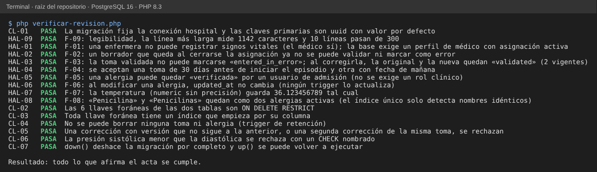

# Semana 13 — Acta de revisión técnica formal: migración de alergias y signos vitales

**Estudiante:** Joshua Eduardo García Reyes (`jgarciar73-svg`) · **Módulo:** Verificación de base de datos PostgreSQL

## 1. Datos de la revisión

| Campo | Valor |
|---|---|
| Artefacto revisado | `database/migrations/hospital/2026_08_11_000401_create_allergy_and_vital_sign_tables.php` (tablas `allergies` y `vital_signs`, sus índices y triggers) |
| Versión | `develop`; único commit del archivo: «feat(db): add HOSPITAL clinical schema H1-H4 with integrity tests», 6-oct-2026 |
| Tamaño | 51 líneas, 2 tablas, 6 llaves foráneas, 22 CHECK, 6 índices simples y 2 únicos parciales, 3 triggers (integridad de signos y retención de ambas tablas) |
| Fecha del acta | 28-oct-2026 |
| Por qué esta migración | Es la que más reglas clínicas concentra (autoría, versiones, inmutabilidad) y de la que dependen los módulos de Signos vitales y de Notas SOAP |

## 2. Roles

| Rol | Persona | Estado |
|---|---|---|
| Autor | `rortizs` (autor del commit de la migración) | Pendiente de recibir el acta |
| Moderador | `bquiroao` (líder del grupo), propuesto | Pendiente de aceptar |
| Revisor | `jgarciar73-svg` | Preparó el acta y corrió las verificaciones |

Esta acta recoge la revisión hecha por el revisor con las verificaciones del §5. La reunión con el autor y el moderador, y la firma de la decisión, quedan por registrar.

## 3. Criterios

- **Entrada:** la migración corre completa sobre las migraciones anteriores en PostgreSQL 16 sin errores, y existe un script que reproduce cada hallazgo.
- **Severidad:** *Crítico* = pierde datos clínicos o permite datos engañosos sin forma de detectarlos. *Mayor* = bloquea un flujo clínico o deja datos que inducen a error. *Menor* = calidad, mantenimiento o precisión.
- **Salida:** aprobada si no hay Críticos ni Mayores abiertos; «aprobada con cambios» si hay Mayores con responsable y propuesta; rechazada si hay Críticos.

## 4. Checklist (15 puntos)

| # | Punto | Resultado | Evidencia |
|---|---|---|---|
| 1 | El nombre sigue la serie del módulo (`2026_08_11_0004xx_create_…`) | Cumple | Inspección |
| 2 | Conexión `hospital` fijada; claves primarias uuid con valor por defecto | Cumple | CL-01 |
| 3 | Toda llave foránea declara `ON DELETE` y es `RESTRICT` (6 de 6) | Cumple | CL-02 |
| 4 | Toda llave foránea tiene un índice | Cumple | CL-03 |
| 5 | Tomas y alergias no se pueden borrar | Cumple | CL-04 |
| 6 | Las correcciones se encadenan por versión y solo hay una por toma | Cumple | CL-05 |
| 7 | CHECK de coherencia con nombre (presión sistólica ≥ diastólica, fechas, estado) | Cumple | CL-06 |
| 8 | `down()` deshace todo y `up()` se puede repetir | Cumple | CL-07 |
| 9 | Quién puede registrar está definido por el rol | **No cumple** | F-01 |
| 10 | Una toma tiene un ciclo de vida completo (borrador → validada → corregida o en error) | **No cumple** | F-02, F-03 |
| 11 | Las fechas de la toma son coherentes con el episodio | Parcial | F-04 |
| 12 | La alergia la verifica un rol clínico | **No cumple** | F-05 |
| 13 | `updated_at` refleja el último cambio | **No cumple** | F-06 |
| 14 | Tipos con precisión y sin duplicados casi idénticos | Parcial | F-07, F-08 |
| 15 | El archivo se puede revisar en un diff (líneas razonables) | **No cumple** | F-09 |

Resultado: 8 cumplen, 2 parciales, 5 no cumplen.

## 5. Hallazgos

| ID | Severidad | Hallazgo (reproducido con `HAL-xx`) | Corrección propuesta | Responsable (propuesto) |
|---|---|---|---|---|
| F-01 | Mayor | HAL-01: una enfermera no puede registrar signos vitales. El trigger exige un perfil en `doctor_profiles` con asignación activa, y `care_assignments` solo se asigna a médicos. | Decidir con Signos: o se permite el rol `nurse` (validando `local_user_refs.role_code` y agregando una asignación de enfermería), o el flujo del módulo acepta que solo registran médicos. | Autor + responsable de Signos |
| F-02 | Mayor | HAL-02: el trigger exige asignación activa también en los `UPDATE`. Un borrador que queda al cerrarse la asignación ya no se puede validar ni marcar como error. | Exigir la asignación activa solo en el `INSERT`; en `UPDATE` permitir las transiciones de estado de quien registró. | Autor |
| F-03 | Mayor | HAL-03: una toma validada no puede pasar a `entered_in_error`, y al corregirla la original y la nueva quedan ambas «validated» (2 vigentes). | Permitir en `UPDATE` de una toma validada solo el cambio a `entered_in_error` con motivo, o crear una vista que excluya las tomas reemplazadas. | Autor + responsable de Signos |
| F-04 | Menor | HAL-04: se aceptan una toma de 30 días antes del inicio del episodio y otra con fecha de mañana. | En el trigger, exigir `measured_at` entre el inicio del episodio y su fin (o ahora) y `recorded_at <= now()`. | Autor |
| F-05 | Mayor | HAL-05: una alergia puede quedar verificada por un usuario de admisión. | En un trigger de `allergies`, exigir que `verified_by_user_ref_id` tenga un rol clínico. | Autor |
| F-06 | Menor | HAL-06: al modificar una alergia, `updated_at` no cambia, porque ningún trigger lo actualiza. Si todas las escrituras pasan por Eloquent, el modelo lo mantiene; el defecto aparece con SQL directo u otras aplicaciones. | Un trigger genérico `set_updated_at()` en las tablas con esa columna. | Autor |
| F-07 | Menor | HAL-07: `temperature`, `oxygen_saturation`, `weight`, `height` y `glucose` son `numeric` sin precisión; se guarda 36.123456789. | Usar `numeric(4,1)` para temperatura y saturación, y precisiones equivalentes para el resto. | Autor |
| F-08 | Menor | HAL-08: «Penicilina» y «Penicilinas» quedan como dos alergias activas; el índice único solo detecta textos idénticos. | Hacer obligatorio `allergen_code` de un catálogo, o normalizar el nombre antes de guardar. | Responsable de Signos |
| F-09 | Menor | HAL-09: 10 líneas pasan de 300 caracteres (la mayor, 1142); un cambio de una columna se ve como una línea entera distinta en el diff. | Una sentencia o columna por línea, o mover el SQL a un archivo `.sql` que la migración lee. | Autor |

**Observación O-1** (sin severidad): los CHECK de `vital_signs` son límites físicos (FC hasta 300, 45 °C), no clínicos; la base acepta valores absurdos para una persona viva. Es razonable como último filtro, y el umbral clínico debe vivir en la aplicación.

Resumen: 0 Críticos, 4 Mayores (F-01, F-02, F-03, F-05) y 5 Menores.

## 6. Decisión propuesta

**Aprobada con cambios.** F-01, F-02, F-03 y F-05 deben corregirse en una migración nueva antes de que los módulos de Signos y Notas SOAP dependan de esas reglas; F-04 y F-06 a F-09 pueden entrar en el mismo cambio o en el siguiente ciclo. Fecha sugerida de seguimiento: la revisión de la semana 14.

## 7. Evidencia

Con PostgreSQL 16 (`SHI_PG_DSN`, `SHI_PG_USER` y `SHI_PG_PASS` en el entorno), desde la raíz del repositorio:

```
php docs/modulos/verificacion-bd-postgresql/semana-13/verificar-revision.php
```



`PASA` significa que lo que afirma el acta es cierto. Si el autor corrige la migración, el `HAL-xx` correspondiente pasa a `FALLA` y el acta debe actualizarse. Se comprobó con cambios hechos a propósito en una copia de la migración (el script acepta como argumento otra carpeta con `database/migrations`); los 5 se detectaron:

| Cambio en la copia | Falla |
|---|---|
| Se quita la exigencia de perfil de médico (F-01 «corregido») | `HAL-01`, `HAL-02` |
| `temperature numeric(4,1)` (F-07 «corregido») | `HAL-07` |
| Una llave foránea de alergias con `CASCADE` | `CL-02` |
| Se quita el trigger de retención de `vital_signs` | `CL-04`, `CL-05`, `CL-07` |
| Se permite modificar una toma validada | `HAL-03` |

## 8. Límites

- Es la revisión de una sola migración; las demás tablas de HOSPITAL y toda la base CENTRAL no se revisaron.
- Las propuestas son sugerencias del revisor; el autor y el responsable de Signos deciden cuál adoptar.
- Los responsables y el moderador son propuestos y no han confirmado.
- Se probó con PostgreSQL 16 y las migraciones ejecutadas con su SQL, no con `php artisan migrate`.
